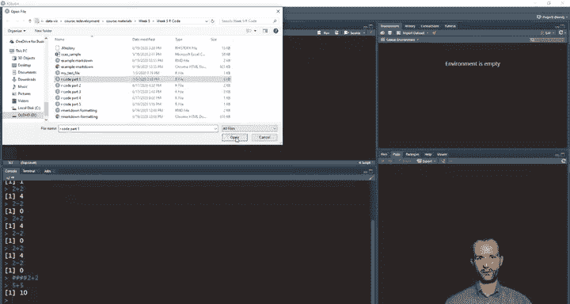
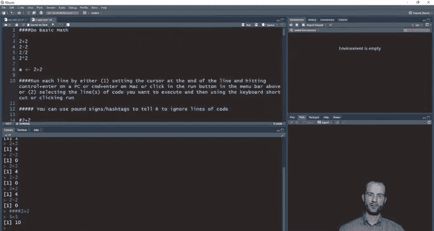
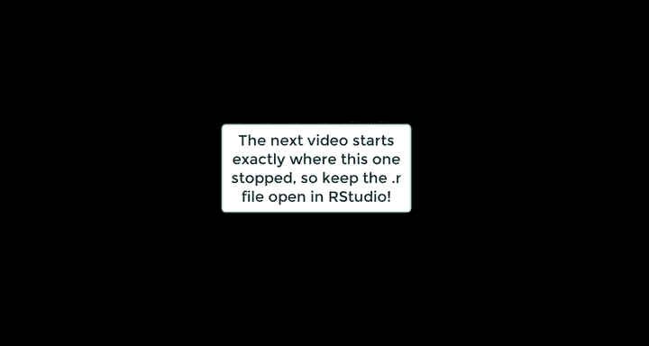

# 约翰霍普金斯大学《R语言数据可视化和仪表盘｜Data Visualization & Dashboarding with R》中英字幕 - P3：2_基础R第1部分.zh_en - GPT中英字幕课程资源 - BV1YWPjeKEWz

In this video， I'm going to do a very short primer on how to use R。

There are lots of tutorials and books that will help you orient yourself to R。

 and I'll point some of those out along the way。You should open up our studio and follow along with us as we go。

You kind of have to learn multiple things at once when you're first learning to use R。

 but I'll try to make this a nice and orderly introduction。

Almost everything I'm included in this video is a summary of what you can find on the base R cheat sheet。

 which is included in the other materials associated with this lesson。Before we get started。

 you should download the dot R file that is in the resources for this week and save that file somewhere on your computer we're going to refer to it later。

Once you've done that， you can go ahead and open up our studio。To start with。

You can tell R to do things by running commands in the console。

And you run a command in the console by typing it in and pressing enterter。At the most basic level。

 R is a calculator， and you can do the standard mathematical operations of adding， subtracting。

 multiplying， and dividing。Because you'll eventually be writing some fairly complex commands for R。

 it's usually easier to save lines of code。Than to run them individually in the console。

And you can do this in ourSt by creating our script file， which has the file extension。 R。

And then you can type multiple lines of code into R and save it for later。

When you're looking at a script file in ourSt， you can run each line by either setting the cursor at the end of the line and heading Control enter on a PC or command enter on a Mac。

Or you can also click the Run button in the menu bar。

Another way of running commands from the R script editor is to select one or more lines of code that you want to execute and then using the keyboard shortcut。

 the command or the control functions， and then click or clicking Run。

When you write code into an R script file， you can include pound signs at the start of a line of code and that comments out that line。

So when you try to run a commented line of code， R will skip the next line of uncomed uncommoncommented code and run that。

This is really important for making notes as you work， so when you come back to a file later。

 you know what you were doing and what you were working on。

To see example code for this lesson that you can follow along with。

Click the open file button in the menu bar or go to fileile open in the drop down menu。

And from there， you should open up the dot R file that's included in the materials。

You can follow along now with that file at picking up where we left off。

