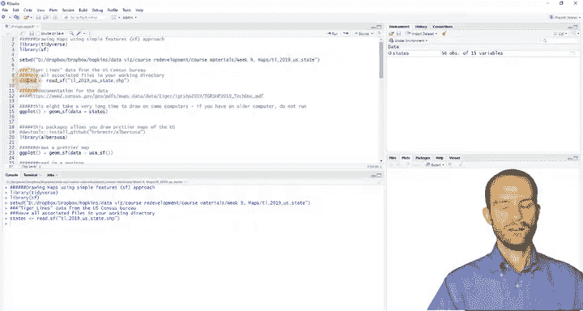

# 约翰霍普金斯大学《R语言数据可视化和仪表盘｜Data Visualization & Dashboarding with R》中英字幕 - P40：6_简单特征地图.zh_en - GPT中英字幕课程资源 - BV1YWPjeKEWz

The maps that we've drawn so far have drawn on data built into the maps package in R。

This may be all you need if you're just drawing simple maps and you have data that can be plotted using longitude and latitude。

However， R has the ability to use other kinds of geographic data。

One of the newer and increasingly popular systems for storing and distributing geospatial information is the Simple features format。

And you can read data encoded in simple features format into R。

 and this really opens up different kinds of maps you can draw and the different kind of data sources you can use。

Specifically， using the tools for simple features in R。

 you can download and use two very common formats for geographic data。Shape files and GeJSON files。

There are many， many sources for shapepeEfiles and GeJSON files。

 but the US Census Bureau Bureau is a great data source that's very well organized and we can get some good examples from that。

For instance， I found this data that I'm using here by using a Google search for US Census shapepefil。

When you're reading a shape file， they come with a set of associated files。

And you want to take the dot SHP file， the shapepe file。

 and all the associated files and put them in the same folder on your computer。

When you're working with them and you want to set that as the working directory in R。

Now download the SF library and load that library into your our session。

To read a dot SHP file or a shape file， we use the Read_ SF command。

And we can assign the results to an object in R。

Take a second， and inspect this。You see that essentially it's a 56 by 15 table。

With a number of different columns that are coded in a certain way。

The documentation for these columns， which is the codebook for the data。

 is available on the US census site。But looking at this。

 you can see just by inspecting it that there's this state abbreviations column。

 and so there's one row for each US state and a few territories。

We're ready to go ahead and make a map now， so call a Gigi plot。

Set the data to the states object that we graded。And now we add a special GM for mapping simple features data。

GM underscore SF。Your computer may take a minute to render this max because it's pretty big。

 but eventually it will do it。This map is not exactly user friendly because it plots a lot of outlying territories。

 and there's always this problem of mapping Alaska and Hawaii Hawaii with the continental states in the US。

Because this is such a common problem， a smart developer out there wrote a special package that includes a projection of the United States that includes Alaska and Hawaii in the Sple Fes framework。

We need to install a special package for this， the AlRS USA Library。

 and once we get that library loaded into R， we can use it to draw a map of the US。

Using that USA USA underscore SF file as the data。One more quick thing to cover here。

 it's worthwhile to show you now how to draw a map using GeJSON information as well。

A GeJO is just another common format for spatial data。

 and you've got an example GeJson file and the materials for this lesson。

This GeJO file is a map of counties around Seattle， Washington。To use this file。

 you point your read SF command to the GeJS file and you load it up into an R object。

And then we're able to map this in just the same way as we did with the shapepefi。

Now that we know how to draw maps using ShapeN GeJSON files and the SF package。

 we're ready to start adding information to these maps。

There are two ways that you can go about doing this。First。

 you can add data to the object you create from shapepeE or GeJO files。Or alternatively。

 these files also sometimes come with information embedded in them。

 and you can just draw on that when you draw on your maps。To start from the beginning。

 we'll use the method of adding our own data to the object that we create with the shapepe file。

This will become more clear in just a minute when we actually do it。To begin。

 you call up the map of the United States again using the US Census data shapepe file。And this time。

 let's filter the data so that we only have the states of Kansas， Nebraska， Iowa， and Missouri。

You can either set this filter using the postal code column here， which is STUSPS or the FIPS code。

 the FIPS code。You can go to find information about Fps online， it's easy to Google。

 but these are just special codes that the United States government uses to classify states numerically。

So let's do a filter command using the FPS codes and draw the map of these four states。

We'll start by transforming this blank map into a chlorophyath with colors in for the different states。

We'll make for demonstration purposes just a simple dummy data set consisting of the state codes and four letters of the alphabet。

We can then merge this data to our map data using the left join command。

We could do exactly the same thing here as the vector of quantitative information if we wanted to。

Once we have the data set merged， we can use GG plotot again and plot this data。

 setting the fill to our new variable that we've created。

 and you'll see that you create the chlorplth。This is very similar to what we've already done when we were using Gem polygon earlier。

By this point， you probably have a suspicion about how to draw points on a map using simple features data。

If we have a data frame that has latitude and longitude coordinates。

 we can draw points right on top of that with the GO points function。Again， just for an example here。

 remember that we have latitude and longitude for many of the world cities in the maps package and R。

So let's call that up and do a filter command that pulls out a few cities in the four states that we've mapped。

Now we can put those points directly onto the plot。

We can also add labels to these points in the same way more or less that we did when we were labeling simple scatter plots。

Using the Gon textext Repel command from the GG Repel package。

 we can add those labels drawing from the name column in our geographic data。

