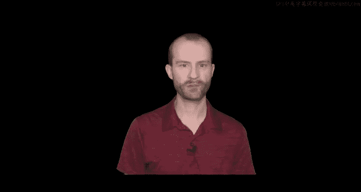
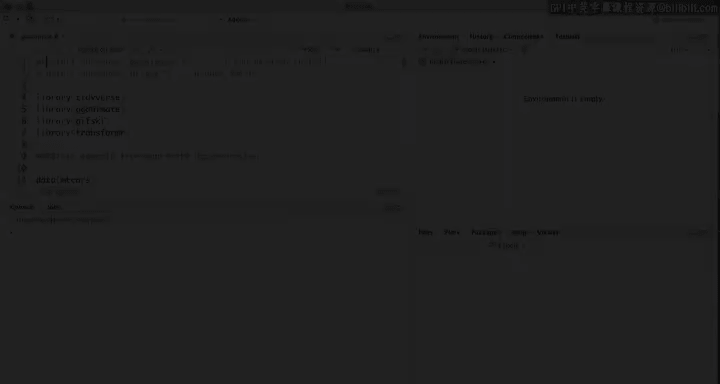
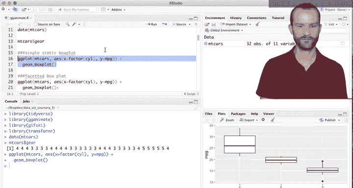

# 约翰霍普金斯大学《R语言数据可视化和仪表盘｜Data Visualization & Dashboarding with R》中英字幕 - P41：7_gganimate第1部分.zh_en - GPT中英字幕课程资源 - BV1YWPjeKEWz

Now that we've learned to make a wide variety of different visualizations。

Another trick on our bag will be making those visualizations animated。

If a picture says a thousand words， a moving picture I suppose， says more。

 so some crafted developers have developed a way to turn our GG plot visualizations into moving images。

And this is based on a package called GG animate。Basically。

 what Ggi anime does is it takes a GgiP figure and creates many different versions of it。

 changing a single parameter in the data so that the visual changes by one click of that parameter for each frame in the animation。

This is harder to understand in the abstract than in practice。

 so we'll try to move forward quickly here。Two good sources for learning how animations work using Ggi Animate are the official documentation for GgiAnimate atgggiAnimate。

com and also the RG galleries section on interactive visualizations。

The materials in this video are adapted from what you find on those websites。

As the GG animate documentation indicates， building an animation can get pretty complex。

 so what I'm going to do in this video is give you a verbal walkthrough of one of the examples from that documentation。

 and then in subsequent videos we'll go into a little bit more detail about each step。

So follow along now with the R code associated with this video。

 and you'll need to install several R packages。Let me start by making a simple animation based on that example from the GG animate documentation。

And what this animation does is it creates box plots for the fuel efficiency of cars with different numbers of cylinders in their engines。

 with different numbers of gears in their transmissions。

So first we'll do a static version of this plot， and this is easy review for us by now。

We call GiG plots， load the MT Cars data， and we set our X and Y aesthetics。In this data。

 SYL or cylinder is a numeric variable， and we want to treat that as categorical。

 so we will wrap that in the factor function。And then for the Y aesthetic。

 we'll use miles per gallon for fuel efficiency。And by adding a Gon box plot。

 we now see the distribution of the miles per gallon for different four， six and eight cylinder cars。

As we expect when we do this， the cars with more cylinders and therefore bigger enginechings are less fuel efficient。

Now there's this other variable in the MT Car's data for gears， which with values of three。

 four or five， and this indicates how many gears there are in the transmission。

So let's say that we wanted to know how miles per gallon changed as a function of the number of cylinders in the engine broken down across vehicles that have three。

 four， or five gears in the transmission。We can display this using the facet wrap function telling R to make separate figures on the basis of the gearing for the car Again。

 this is all review for you。This is perfectly fine and the static visual is very useful。

 but let's say that we wanted to manipulate this so that we have a single figure that changes。

What we do is we we swap out our facet rap function with a transitions states function。

 and that comes from the GG animate package。We'll go over more of the details later。

 but with transition states， what you're doing is you can indicate the variable in the data that you want to change across animations。

And so we'll specify that here and the object we'll save this figure to an object。

If we run the object， R is going to render the different frames of the animation。

 and when you run it， you'll see that animation will move between the different states that we specified here。

This gives you the same information as the faceted figure， but with just a little more visual flair。

Coming up， I'll talk in more detail about the different ways to control the animations that you make the Juji animate and some other details。

 so keep your R code open and when you're ready， go on to the next video。

