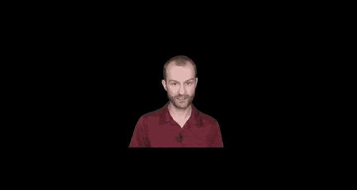
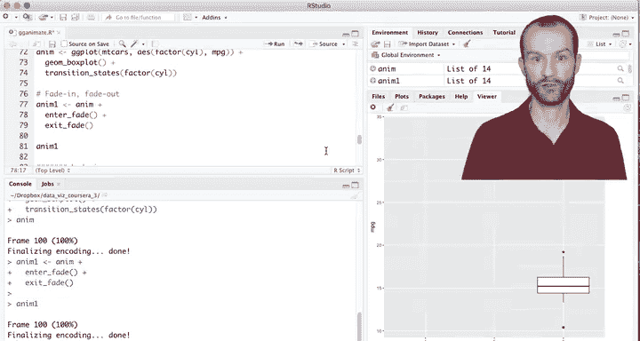
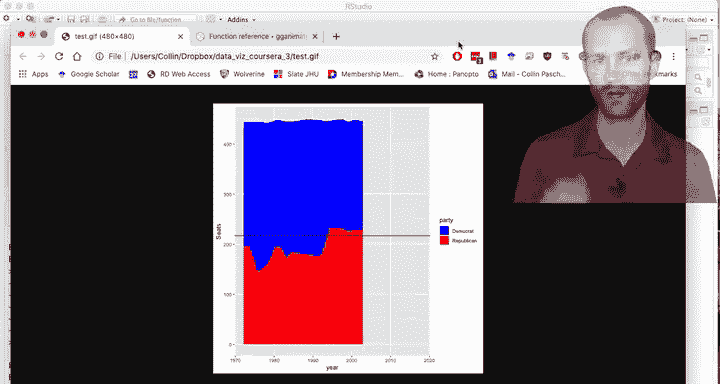

# 约翰霍普金斯大学《R语言数据可视化和仪表盘｜Data Visualization & Dashboarding with R》中英字幕 - P43：9_gganimate第3部分.zh_en - GPT中英字幕课程资源 - BV1YWPjeKEWz

So far we've used GG Animate to make animations of a few different types of figures。

 and we've used different transition functions in those animations。

There are a few additional visual flourishes and tweaks that you can do with the animations。

 which we'll go through partially in this video。One additional aspect of an animation that you can control is the entering and exiting。

And this will control how marks or GMs on the GG plot will appear and disappear during the transitions of the animation。

So to explain the example that's in the GG animate documentation。

 we can first revisit the box plot of the number of cylinders and car engines against the gas mileage。

 we did this a couple of videos ago。We can create the animation of this by transitioning across the cylinder variable。

 but you see that the animation is very choppy and it's kind of boring。

By adding different enter and exit functions， you can specify the visual look of these transitions。

And there are quite a few different intern exit functions。

 which you'll find in the G anime documentation。But with some experimentation and following along with the different vignettes or the examples。

 you'll see how these different options work and you can play around them to see what you think is visually most suitable and satisfying。

Along with baiting in and out， you can also do what is called shadowing。

 which allows you to retain previous or preview future frames of the animation。

And you can see shadowing demonstrated here with the figure that we generated earlier with the number of Democrats and Republicans in Congress。

What I've done here is use the shadow underscore W command and modified a few of the options to show you the shift in party control of Congress across time。

 but including some additional frames in the past so you can see it progressing。As you can tell。

 you can really get into the weeds on this， and you can let your imagination run wild with juji animate。

If you dig into the documentation， you'll see that there are tools for providing even more detailed control of animations。

Different options for modifying labels and some other possibilities。With the foundation here。

 you should be able to interpret that documentation and make those adjustments if they seem suitable for your own visualization。

The last thing I'll mention here about GJ animate is how to export your animations。

 The easiest way to do this is to save the animations as animated GIF files， GIF files。

And you can use the function anim underscore save， specify a dot GF file name and input a saved animation object。

 and the animation will save to your our sessions working directory。

And then you can then open it up in a web browser if you want to， or you can find some you for。

 depending on what kind of media you're preparing。

