# 约翰霍普金斯大学《R语言数据可视化和仪表盘｜Data Visualization & Dashboarding with R》中英字幕 - P44：10_ggplotly第1部分.zh_en - GPT中英字幕课程资源 - BV1YWPjeKEWz

Plootly is a package of powerful visualization tools to use with R。

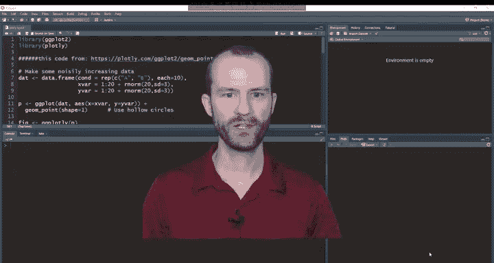

And in many respects， plotlet is an alternative to GgiPloot with a relatively easy to learn syntax for generating many of the same kinds of plots that we've created so far in this course。

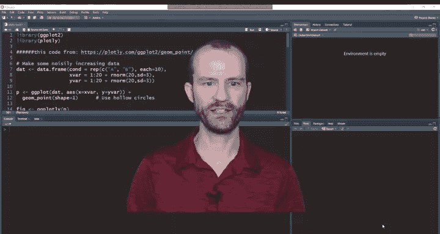

Plotly is also notable for how easy it is to make figures interactive using this tool。

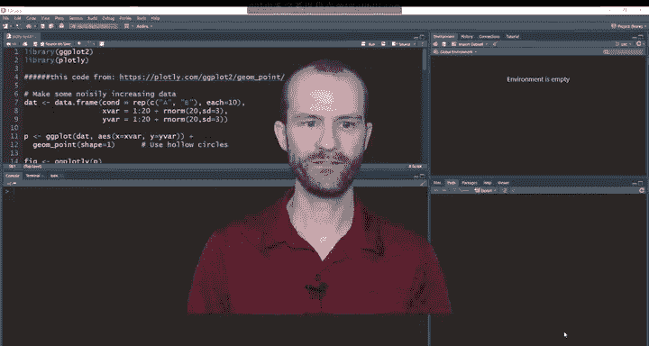

With Ply and especially in conjunction with shiny and Fl dashboards。

 you can replicate many of the interactive figures of visualization software like Tableau using R。

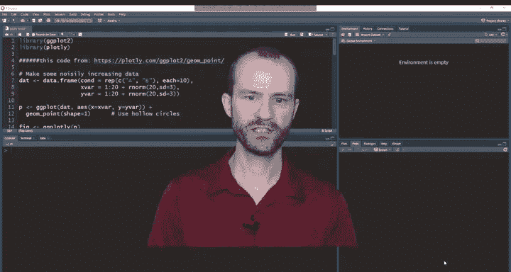

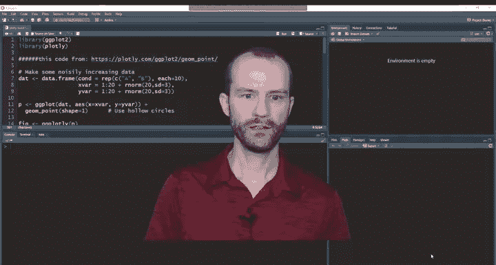

If you really want to maximize your visualization skills using R。

 you should take the time to learn plotly in its entirety。

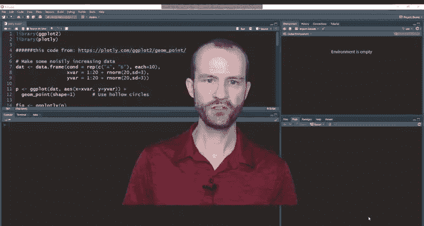

And with what we've learned so far， it shouldn't be especially difficult for you to transfer your knowledge about how to code an R to use this new package。

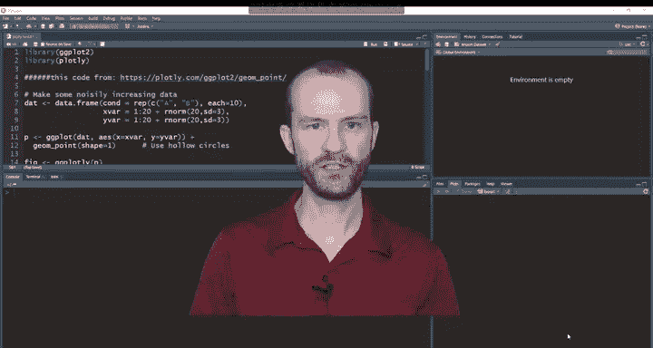

However， in this course， we just don't have time to cover everything。

 so we prioritize JugiPloot over Ply。

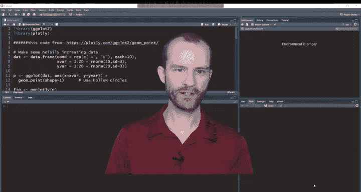

The best resources for our learning plotly are online。

Carron Seavert has a textbook that you can purchase that provides a really nice introduction。

 and there's a free version of this available online at plotly。r。com。

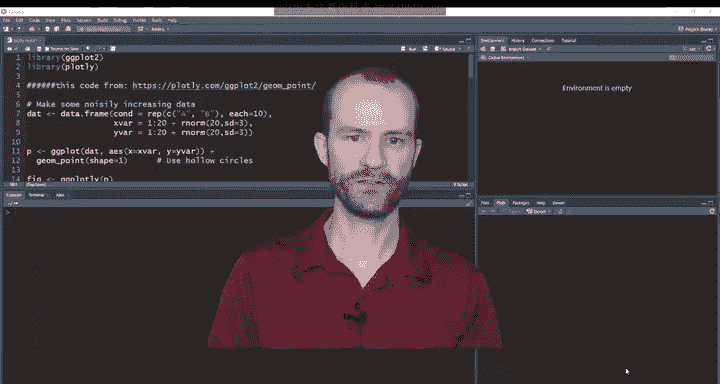

There's also a great set of reference materials available at plotly。com。

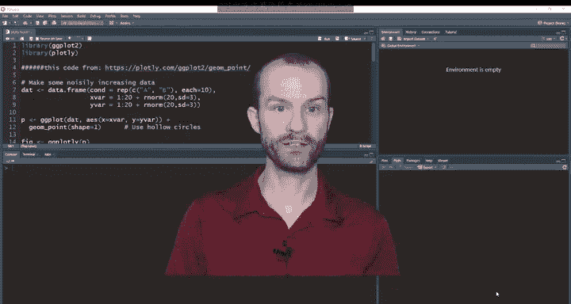

If you have time， it's a great idea to learn to use plotly。

 drawing on skills you developed in this class。

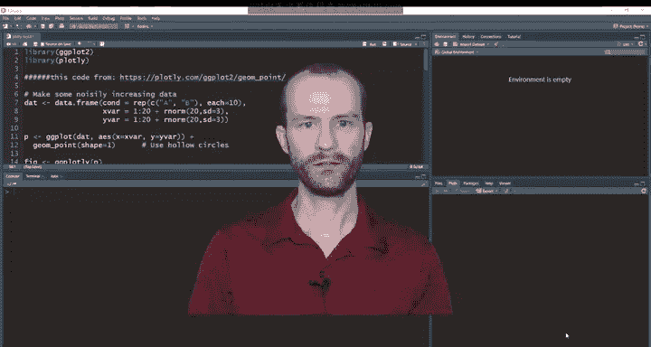

Fortunately， though， you don't have to learn all of plotly in order to make use of it and to improve the visualizations that we've created in GGplot。

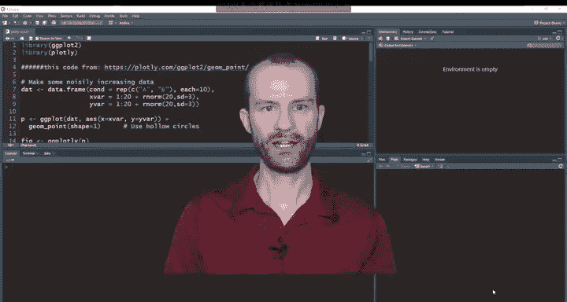

Plootly has a special function that interacts with Ggi plotot figures to make those figures interactive and appropriately it's called Ggi plototly。

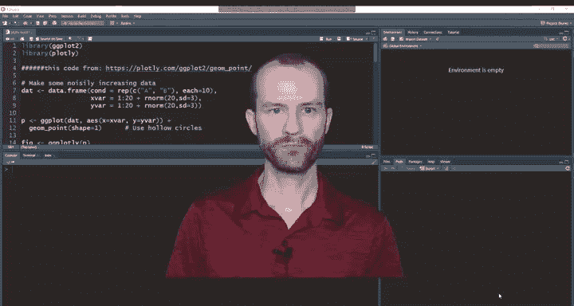

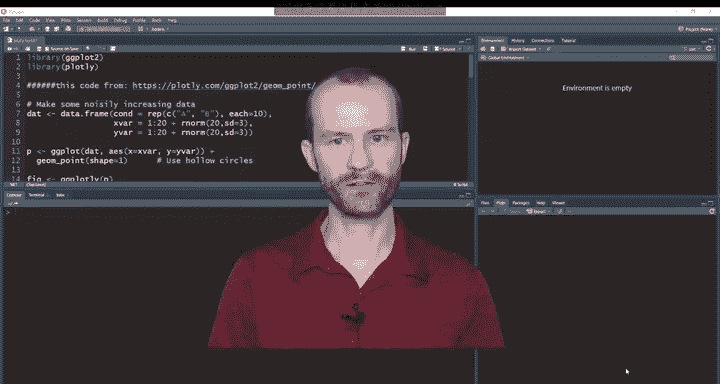

The basic usage of Ggiplotly is very easy， and all you have to do is create a Ggiplot figure and then take it and use it within the Ggi plotot function in order to use the special tools of Ggiplotly。

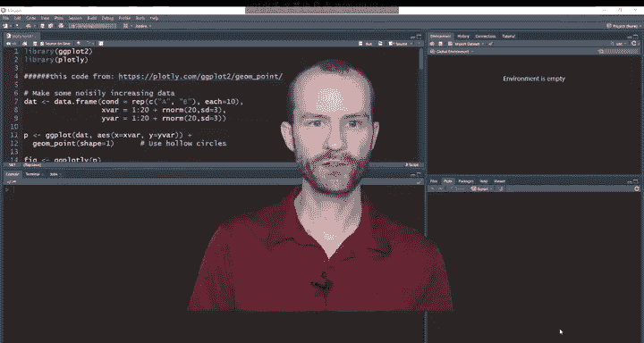

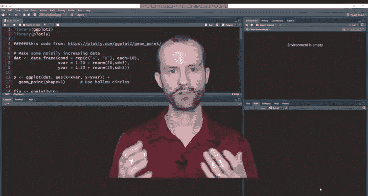

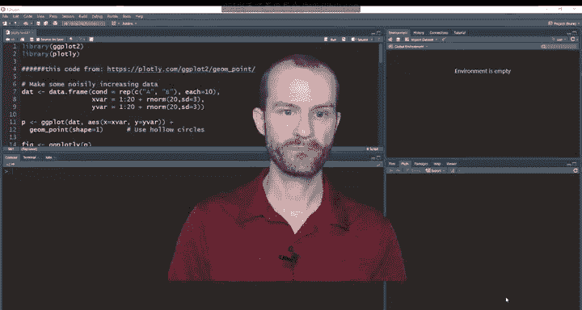

So let me show you how to do that。Follow along with the R code that's associated with this video。

 and I'm using an adapting code here from plotly。com。

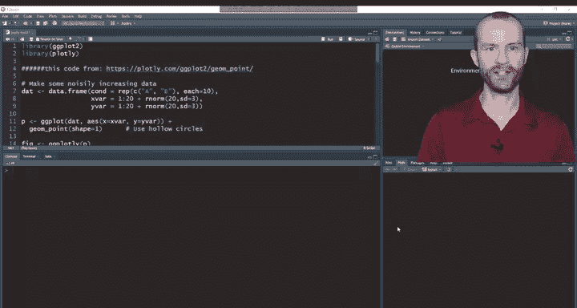

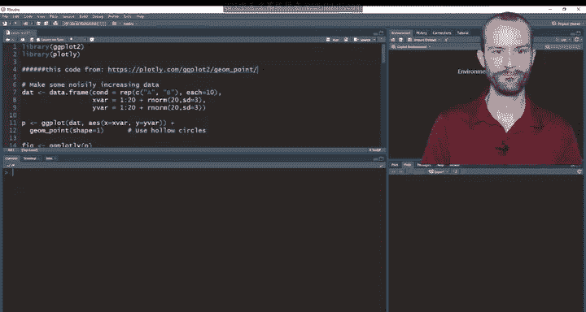

First， you install the libraries that we need and load those up。

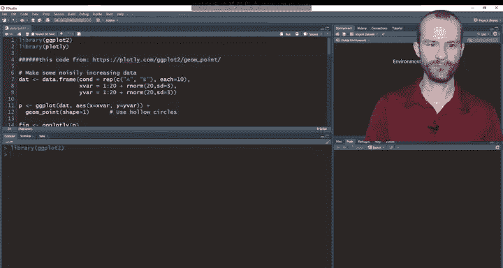

And then here I'm going to make some fake data， pulling data from a normal distribution。

 this is what we've seen in the past。

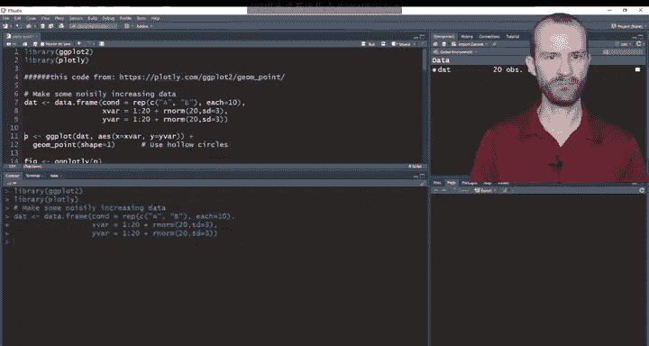

We'll make a really simple scatter plot using Ggi plot and save that to the object P in the R environment。

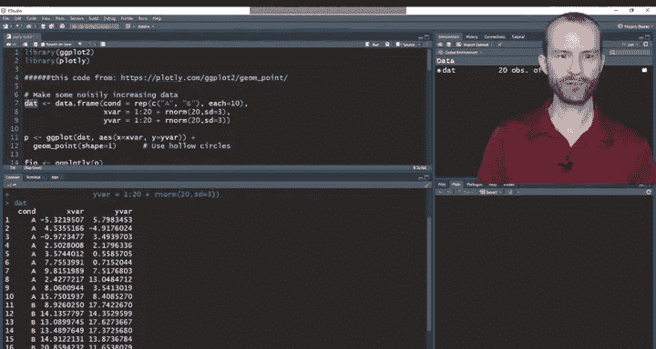

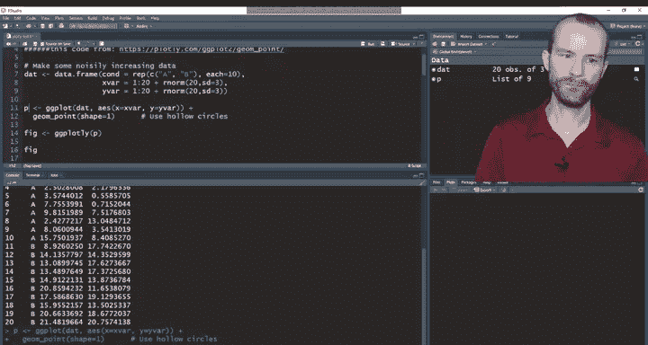

And from there， we just wrap that function Ggiplly around the GG plotot object that we've created。

 and we save that to the object fig。Now， if you run FIig in our studio。

 you'll get the GD plot figure， but with the extra bells and whistles of plotly。

Now we see that if we hover the cursor over a data point。

 we'll get a pop up box that displays data about that point。

And you'll see that the plot includes zooming and panning functions that you don't have with a traditional static G plot figure。

You can follow to this exact same approach from many different GG plot figures and it's worthwhile to spend some time playing with line charts。

 bar charts， heat maps， and the other kinds of figures that we've created in the course so far and to see what kind of interactivity comes up when you feed the GG plotly function。

 a GGpl figure。You can also go and make all the same kinds of aesthetic tweaks that we've done before。

 changing labels and colors and that sort of thing within the GG plotot figure before you feed it into Ggi plototly。

