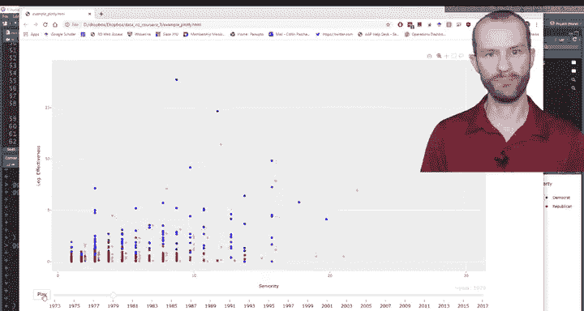
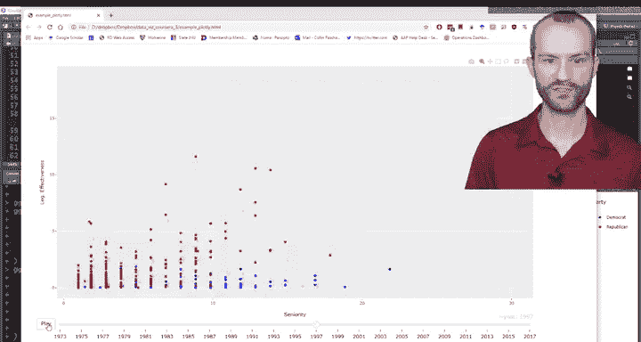
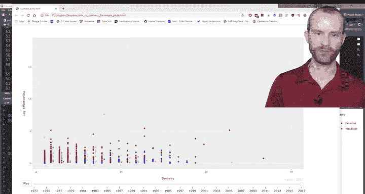

# 约翰霍普金斯大学《R语言数据可视化和仪表盘｜Data Visualization & Dashboarding with R》中英字幕 - P45：11_ggplotly第2部分.zh_en - GPT中英字幕课程资源 - BV1YWPjeKEWz

Another neat trick that you can do with plotly is to animate your figures。

 similarly to how we worked with GT Animate。Like Ggi animate。

 plotly works to animate your figures by creating frames of the animation based on cycling through some value in your data and then redrawing the figure for each different value。

And this is quite easy to do。So to give you an example here。

 I will start with drawing a static scatter plot using Gem points and the congressional effectiveness data that we've been working with in several previous examples。

This should all be very familiar to you by now， but you can review the code here if you need to。

What this G plot figure does is it plots legislative effectiveness on the Y axis and seniority on the X axis with the points colored by party。

Legislative effectiveness is just a score that is intended to measure how productive members of Congress are at making laws and higher means more productive。

 and again what we would expect is that members that become more senior that have been in the chamberm longer should be more productive and have a higher legislative effectiveness score。

So if we whip this up， we have a scatter plot for all members of Congress across all the years and cones in this data set。

And if I wanted to animate this figure to show change across years。

 I could wrap the entire Ggi plot command in the Ggi plotly function。

 and then I can add an option in the aesthetics here that sets frame to the year column in my data。

 So this is going to redraw the figure over and over again based on the different years in the data set。

When you do this， Qji plotly creates the figure and then you have this play button down here that will animate the figure and redraw it year by year。

You'll notice that this animation is pretty jumpy though， so if you wanted to smooth it out。

 you could introduce what is called object constancy to the figure。

And this will cause points to move from their point in the previous frame rather than being redrawn from scratch every single time。

What I'm doing here is adding in the name of each member of Congress as the ID here。

 because this is constant across multiple years in the data set as you track individual members across time。

When you add this and rerun the animation， you'll see that it's smooth out and you're actually able to track some of the outlier members across Congresses。

Across years。In terms of saving or sharing a plotly figure。

 you can export a plotly figure from the RSt viewer as an image and you'll get a static image file。

 alternative you can save it as a do HTML file， and then if you open that up in a web browser。

 it preserves the interactive elements of the figure。

 and then you could embed this and either a web page or other kinds of documents depending on what you're trying to produce。

If you want to publish a plotly figure to the web， you can actually do this in the viewer window as well。

 and if you click on the publish button， you can publish the visualization directly to RPUs。

You'll need to create an account， but once you do this。

 the HTML file will upload to your RPUs website and you can share the link however you like。

For more about publishing your visualizations to the web and sharing them。

 you'll have to take the next course in this specialization。

