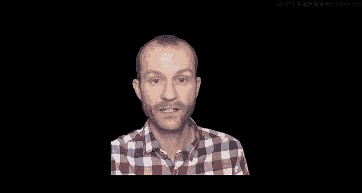
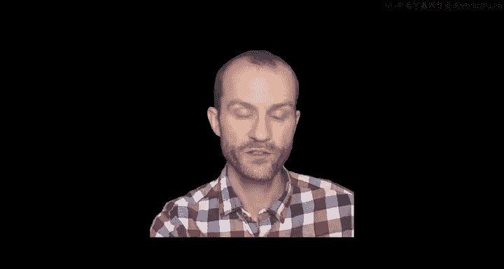
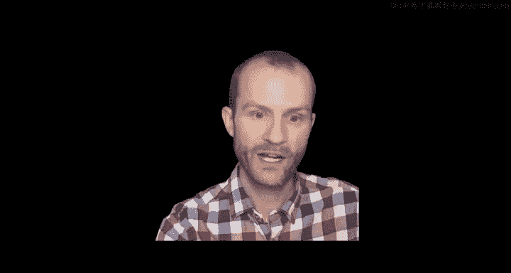

# 约翰霍普金斯大学《R语言数据可视化和仪表盘｜Data Visualization & Dashboarding with R》中英字幕 - P46：0_课程介绍.zh_en - GPT中英字幕课程资源 - BV1YWPjeKEWz

Welcome to our course on shiny and dashboarding with R。

This is going to be an exciting opportunity for you to practice the skills that you've built already and also to add to your abilities in sharing visualizations with others。

The first two weeks of this course are an introduction to Shihiny。

And shiny is a tool for making your R figures interactive。

And you'll see lots of examples of this soon in the next few videos。

The goal for the class is to get you set up and running the shiny。

I want you to be able to get your visualizations into shiny applications。

 and this is supposed to be a concise practical guide。

Designing Shi applications can get very complex， but for lots of everyday purposes。

 you don't need to have a complete command of every single tool that's available to you in shiny。

Besides， because the learning curve are shiny can be a little steep， especially for new R users。

 having a practical guide like what we try to present in this course will just give you the context you need to dig into more advanced features of the tool as you get more experienced with it and you have uses for it。

So what we're going to do is introduce you to the reference materials that will allow you to really master all the elements of shinyny and give you some practical examples。

But the emphasis here is really getting your feet under you so you can do some self study down the road。

After the first two weeks of Shi， the last week of the class is about dashboarding an R。

And we're going to use the Fl dashboard package， which is really just a special template for our markdown reports。

 just like we've done in the past。

We're going to show you also how to integrate Shiny into the dashboards。

And like Shiny Flex dashashboard is a very powerful package。

 and we're not going to go through every single functionality。

We'll get you up and running， we'll make sure you have a command of the basic layouts。

 and then from there， as needed you'll be able to go use more advanced tools。

Looking ahead in this class， you should be aware that the first peer review assignment is pretty straightforward just again to make sure you're up and running the shiny。

 but then the second and third assignments are a lot more complex because you have a lot of skills and I want to give you a chance to demonstrate them。

But if you break the assignments down and you look carefully at the examples that are provided in the videos and in the code attached to them。

 everything you need is going to be there and it's going to be your job just to put it together。

This is a really exciting course and you're going to learn a lot in just a few weeks。

 but by the end of it， you're going to be well positioned to complete an original project for your capstone in the next class。

 and you'll also be able to really impress your friends and colleagues with your ability to make dynamic visualizations。

