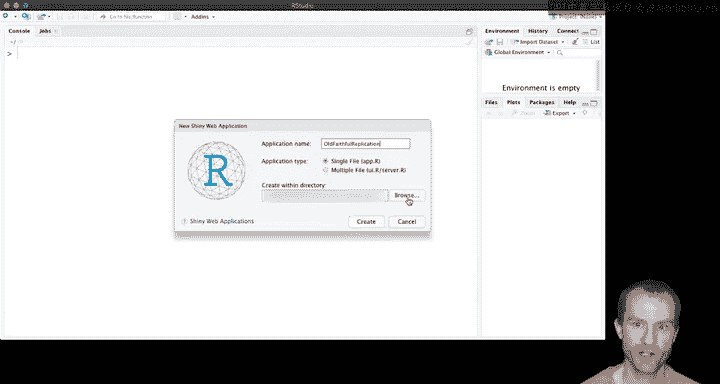
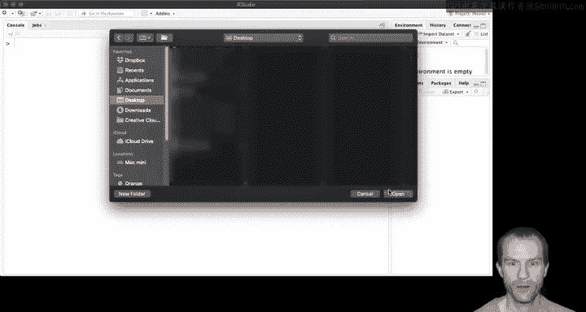
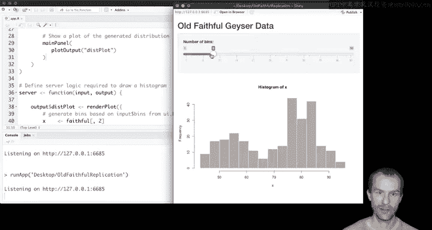

# 约翰霍普金斯大学《R语言数据可视化和仪表盘｜Data Visualization & Dashboarding with R》中英字幕 - P47：1_开始使用Shiny.zh_en - GPT中英字幕课程资源 - BV1YWPjeKEWz

Welcome back to Data visualsization。In this video， I'm going to talk you through creating a shiny app。

With Shiinny， you can create interactive visualizations and publish them online。

AndWe're first going to review an illustrative example of a shiny application。

 and by the end of this video you should be able to identify the advantages of a shiny app as a visualization tool and described structure of a shiny application。

This video and the next one are sort of like jumping into the deep end with shiny。

 so if you get confused， don't worry because in the following videos we'll go through some simpler examples。

We'll start by reviewing a classic example of the shiny app。

And it's on the screen here。As you can see， this is a histogram for the wait periods between eruptions of old Fa。

 the famous Geyser in Yellowstone National Park。This figure shows you the distribution of the wait times between eruptions for the geyser。

And what makes this special is the slider on the left hand side。

Where you can dynamically change the number of bins in the histogram。

This makes the histogram either chunkier or more fine grained。

 depending on how the user wants to look at the data。

We're going to replicate this figure and work through the code to see how this application works。

In our studio， click the new file button and selectSny Web app。

Our studio will ask you to provide a name for the project。

 and for now you can just call it old faithful replication with no spaces in the application name。

Select a directory on the computer where you're going to put your project files and you can pick anywhere on your PC or Mac that you want。

Then you have the option of selecting an application type that's either a single file or multiple files。

The reason you have this choice of using a single file or multiple files is that shiny apps have two parts。

One part is called the user interface or the UI， and this controls how users interact with your shiny application。

Setting up user input elements and figures like the slider and histogram in this example。

The userr interface controls what the user sees when they're using the application。

The other part of this shiny app is the server。Which controls how the data is manipulated to produce the visualizations。

In older versions of Shiinny， these two parts had to be separate files， but with software updates。

 the two files aret necessary， although some users who build really complex apps may prefer to split things up into two files。

The application that we're using here is simple， so to build everything with a single file is a little bit easier。

Select that option and go ahead and click Create。What you see here is our application file。

 which is automatically named app。org。Later， you could go back and rename this on your computer to be some kind of other file name if you wanted。

 but it has to end up with dot R。As you can see， the file is already populated here with our code for the old Fa example。

And once a shiny app is written， you can run it in our studio by clicking the Run app button。

When we do that， up pops the window and displays the old faithful histogram。

You can pause the video for a moment and play around with it， if you like。

Let's go ahead and take a closer look at the user interface portion of the code。

The user interface object is defined using this function fluid page。

And within the fluid page function， the user can specify the elements that are going to go in the display。

 what the user is going to see and what they're going to interact with。

Here we see that the application defines a title for the app。

And then it tells R that it wants a sidebar layout。

 which will create a panel for input on the left where the slider is going and a main panel where the figure will be。

The arguments for this slider input function are first the name of the value that we're going to select from the slider。

And then there's a label that will display in the user interface。

And then there's some information about the minimum and maximum values for the slider and the starting value for the slider。

The content of the main panel is going to be provided by the plot output function。

And the plot output function has， as its arguments an object calledD plotot。

 which is created down below in the server function。

So let's jump down and look at the second part of the code， which sets up the server。

The server is defined as a function with input and output。

And the key part of this function is the render plot command。

Which indicates that the application should draw whatever plot is within the render plot function。

In this case， that's going to be a histogram。Here using a column from the old faithful data and with a number of breaks。

 which is defined as the bins variable。Let's look at these two parts of the file and relate them to the interactive figure。

 so go ahead and click Run again。In the UI portion of the application。

 we see the slider input function。And again， this function is telling R to generate a slider with ranges from 1 to 50 with the slider starting at the value of 30。

Then whatever the user takes， wherever the user moves that slider。

 that value is going to be assigned to the input variable bins。

Now let's go down to the code for the server logic。

And do you see where the value for the slider is going here？

It's going to go here in this input cache bins。So what this line of code means that the value of bins for the histogram is in turn defined by the input value that the user selects from the slider。

Then the server function uses the histogram command to generate the figure based on the input values that it's receiving from the user。

So that input is assigned to the output value disk plot。And finally。

 the disc plot value is generated in the main panel of the user interface。

There's this back and forth of input coming from the user interface， going to the server。

 and then the server feeding the output back to the user interface。

And this is what makes the Shi app a dynamic interactive program。

When you first look at a shiny app and you start to work with this back and forth of user interface and server。

 it can be kind of confusing， so make sure you take a few minutes here and really understand every line and argument in this code。

It's only going to get more complicated down the lines。

 so you want to make sure you understand this structure now so you don't have more problems if you start to have more variations on this later。

