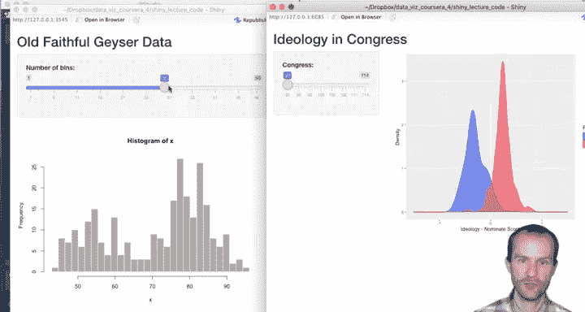
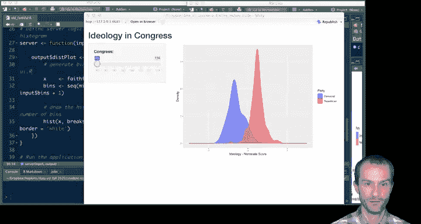
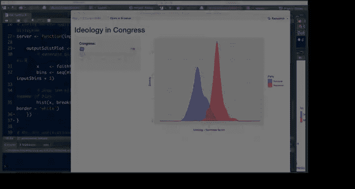

# 约翰霍普金斯大学《R语言数据可视化和仪表盘｜Data Visualization & Dashboarding with R》中英字幕 - P48：2_自定义Shiny应用程序示例.zh_en - GPT中英字幕课程资源 - BV1YWPjeKEWz

To build our own application， we're going to first modify the old PaL example。

When you first start out using Shiny， as with other kinds of tools in R。

 it's almost always easier to start by modifying templates and examples rather than trying to start from a blank page。

So here we're going to make a few changes to the old phaseful application that we've seen。First。

 instead of a histogram， we're going to draw a density plot。Second。

 we're going to use a different source of data， in this case。

 the data is going to come from the Center for Effective Lawmaking and it's going to be about the United States Congress。

This is data that we've seen before in previous videos in this sequence。And finally。

 because the data have different values here， we're going to modify the slider input to have a different kind of input for the user。

What we're going to do is draw a density plot that displays the distribution of the ideology of members of the US。

S。 Congress over time。

As you probably know， most politicians， including Congress members in the US。

 can be characterized as either being more liberal or more conservative。

And you might remember from previous times that we used as data that political scientists have devised a score for this called the DW Nomininate Sc。

And this purports to measure ideology based on members' voting records。

Lower scores are more liberal and higher scores are more conservative。

What we're going to do is create an application that allows us to move a slider that selects a session of Congress across time。

And we'll be able to see how the distribution of the ideologies of the members of the two parties in the United States have changed。

When you're looking at this， you can see that in many ways it's very similar to the old faithful example。

 and so our job is to modify the code from the template and make it fit the data and the question that we're trying to investigate with the visualization。

To follow along here， you want to open up the dotR file that's associated with this video。

 as well as the old faithfulful example that we've done in the last video。

As you'll see， these two files are pretty similar， but there are important changes。

 important differences there。And I'm going to leave both files up for comparison purposes。

Looking at the new file， the new application that we're going to write。

 the first thing we do is add the Tiverse library。And then the code here includes commands for setting the working directory and importing a dot CSV file。

When you're working with outside data and you're importing data for your shiny application。

 the best practice is to keep that data file in the same folder where theR file with your shiny code is located。

So make sure that when you run this on your own that you set the working director to the correct folder on your computer。

 and that folder needs to have the do R file for the shiny app and the data file that you're working with to import。

After we import the data， we'll do a little bit of data wrangling here to get the file ready for visualization。

And nonene of this should be new to you， but you might take a second to pause here and work through these lines to make sure you know what's going on with them and what modifications we're doing to the data。

So just for practice here and to get started， the first thing we're going to do is make a static version of the visualization with these two density plots on the same figure。

 just so we know exactly how to make the figure that we want。

This should be pretty much review for you by now， but we're going to identify the data。

 set the aesthetics。Modify the labels， modify the span of the X axis， and the color scheme。

And so when you run this， you know that the figure definitely works and it's going to display exactly what we want when we turn it into an interactive app inside the shiny application。

Now we can just leave these lines here because the figure is not going to display in the application because it's not part of the user interface and it's not in the server function。

Now， substantively， when you look at this， you can see that there's not very much overlap in the two distributions between Republicans and Democrats。

 there's a little， but not a lot of it。And it's important to remember though。

 that this is for all Congresses in the data set， so this aggregates everything from the 1970s up until recently。

 and what we want to do is see this for individual congresses。If you wanted to show that statically。

 one option would be to use facet wrap and create very small figures for each Congress and you'll be able to see here how the distributions changes and the amount of overlap changes over time。

This is a perfectly fine way to show change and especially if you're just doing like something on the printed page。

 it's probably the right thing to do， but we can actually do a little bit better with a shiny application。

So let's keep comparing the old FaL application to the new application code that we're working on now。

In both cases， we start by building the user interface， but for the new application。

 we're going to modify the title of the user interface to make it ideology in Congress。

And then we're going to change the input value in slider input， the label for the slider。

 and the value range for the slider。And then we're going to change the plot output to a new value Congress underscore this plot。

And all we're doing here is taking the same basic format from the old application and changing it to fit the new data and the new visualization that we want to create with our own data that we've imported。

For the server， we're going to do a few modifications as well。

We're going to change the output value here to match what we set in the user interface above。

And then in the render plot function， we're going to replace the code for generating a histogram with the code to create a GG plot figure with two drawn density plots。

 one for Republican members， and one for Democratic members。

This is obviously going to be very similar to the static version that we did for practice above。

But it's really important to see that the data argument here is different。

Rather than just pointing to the entire data set。What I've done here is that I've included a filter function that uses the my underscore Congress input value from the slider。

And so for example， if the slider input is 93， that filter is going to filter using the value 93。

It's going to come from that input and go down into that filter function。

So make sure you understand that think about how these two things are connected and how the input is going into that function to be used to filter out the data。

Now run the application as we have before。And you can use the slider to move from Congress to Congress across time。

Substantively what you see is interesting because the distribution of the ideologies of members of the two parties overlap less and less over time。

 and this is an outcome that a lot of people connect to the intense partisan polarization that we see in American politics today as the two parties have become farther apart with less overlap。

This is the power of a shiny interactive app， it gives you the ability to see visualizations change dynamically and allows the user to explore the stories that the data are telling that might not be as obvious with a single figure or might be difficult or cumbersome to display with a single figure。

