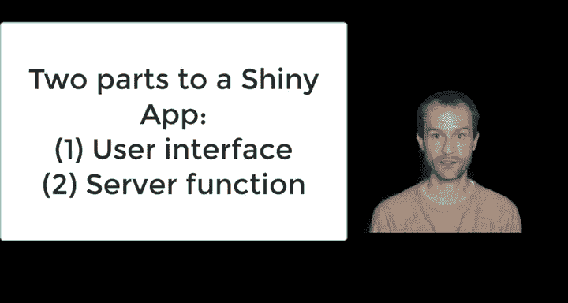
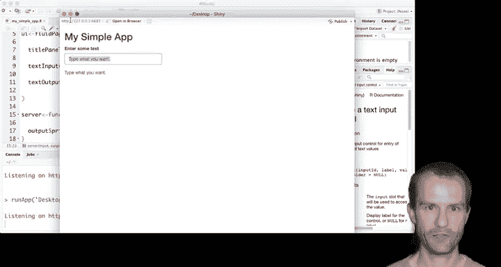

# 约翰霍普金斯大学《R语言数据可视化和仪表盘｜Data Visualization & Dashboarding with R》中英字幕 - P49：3_构建自己的Shiny应用程序.zh_en - GPT中英字幕课程资源 - BV1YWPjeKEWz

So far， I've shown you what a shiny app looks like and we've walked through the finished applications step by step。

Now that you have that context， I'm going to go over some basics and we're going to start building from the ground up。

Just to recap again， a shiny app has two parts， the user interface and the server function。

The user interface controls all of the visual elements of the app that the users will actually see。

And the server function controls how the information for figures and tables and other kinds of output is going to be processed。

So remember at the most basic level， you create a shiny app by defining these two things。

 a user interface object and a server function， and then you tie those together with the Shi app function at the end。

To really cement your understanding of this， we're going to create a really simple。

 shiny app from scratch， and I'm not included any code in this video intentionally because I want you to walk through this yourself step by step。

So to start， open up a new R script and load the Shi library。

You can pause the video at any time you need to kind of catch up with their directions here。

 but I'm going to go through step by step。So once you've got the Shi library loaded in your R script。

 you can create an object called UI and assign that to the fluid page function。Now on another line。

 create an object called server， and that's going to be a function that has input and output。

 so go ahead and type that in。On the final line， you will writeS app。

And then you'll have UI equals UI and server equals server。With that。

 you've got all the basic components of a shiny app written， you've got the user interface。

 you've got the server， and then you'retying it together。

Now save the file to a folder somewhere on your computer。And when you do that。

 you see that your RSt window changes a little bit and you have this run button that has changed to run application because RSt recognizes that this has become a shiny app because you've written the components of the Shi app into it。

You can go ahead and run the app here if you want to。

 but obviously it doesn't do anything because our user interface is blank and there's nothing within the server function。

So let's go ahead and make this application do something we're first going to give the application a title。

 and then we're going to add an input text box， and then we're going to tell the application to output whatever text the user inserts into it。

So we're going to start on the user interface side and we're going to create the user interface inside the fluid page function。

Each element of the user interface will be an argument that we will feed into this function。

 so we're going to have a series of functions here within the fluid page function。

 and those are going to be separated by commas because they're all individual arguments。

I'm going through a lot of details here， but it will become clearer once we get the thing built up。

We'll start within the user interface by including a title panel function。

 which is going to add a title to the application。So go ahead and punch it in just like I'm doing on the screen here now。

Go ahead and run this once you have the title panel function written in。

 and you'll see that the app is no longer blank， but it does have a title panel。

 so we've built the first component of the user interface by adding that function as an argument into the fluid page function。

Now we need to add some kind of element to the user interface that will allow the user to provide input。

In the previous applications we've seen， this has been a slider。

 and that's just a kind of input that you can put into the user interface。In this particular case。

 in this example， we're going to do something a little bit different。

 and we're going to do this with a text input function。

This is going to create a little text box that the users will be able to type into in order to input text into the application。

We can create this text box by using the text input function as another argument in the fluid page function within the user interface。

The first argument for the text input function is this thing called input ID。

 which is the value that will be stored in the shiny application and that will be used in the server function later on。

We're going to get to that in a minute， but for right now let's just continue with this function and we will add a label to the input text box。

 which will indicate the label for what this is going to be called when users see it on screen。Now。

 once you've got the input ID and the label included in this text input function。

Go ahead and just run the application again and you'll see that we have a main panel and a text input box。

But of course， we're not doing anything with that text input box， it's just there right now。

What we want to do is to tell the shiny application to print out whatever the user types into this input box。

So we had to do two things。First， we have to tell the server function that we want to do something with the input。

 and then we'll need to include that output that the server function is going to generate into the user interface。

All we want to do with the app is to have the server print out whatever the user puts into the text box。

So within the server function， we're going to create a piece of output called print_ textex。

And then we indicate in the server function that we want the application to render that text in the shiny application。

And we do that with the render text function。We're going to assign that render text to the output slot called print textex。

Now we can run the application one more time here， but it's not going to do anything differently because they haven't specified anywhere in the user interface where that output from the server is going to go。

So to do that， we have to add another argument to the fluid page function。

We're going to use textex output， which is going to tell the user interface to print the text output that we generated in the server function。

😡，We want the text output to be the output from the render text function we just made。

 so we point the output ID here to the output that we created in the function。

I know this is kind of complicated and it's lot of back and forth。

But go ahead and run this and you see what the program is doing now。

We've created three different elements of the user interface， the title， the text input box。

 and then where we are outputting that text in the user interface。

And what we've told the server to do behind the scenes is to take that input from the text box and print it into the user interface。

You're probably going to want to take a few more minutes here to kind of puzzle over this and probably well need to watch the video a couple more times to understand the interplay of these different parts。

But once you do， you'll get an intuition for how this works。

 and you're going to find out that more complicated applications are just an extension of this back and forth where you design elements of the user interface。

 the input from the user interface will go into the server。

 and then the server will produce output that you can specify to show up in the user interface itself。

So don't get frustrated， stick with it and you'll start to piece together how all these complementary pieces at the application work。

