# 约翰霍普金斯大学《R语言数据可视化和仪表盘｜Data Visualization & Dashboarding with R》中英字幕 - P4：3_基础R第2部分.zh_en - GPT中英字幕课程资源 - BV1YWPjeKEWz

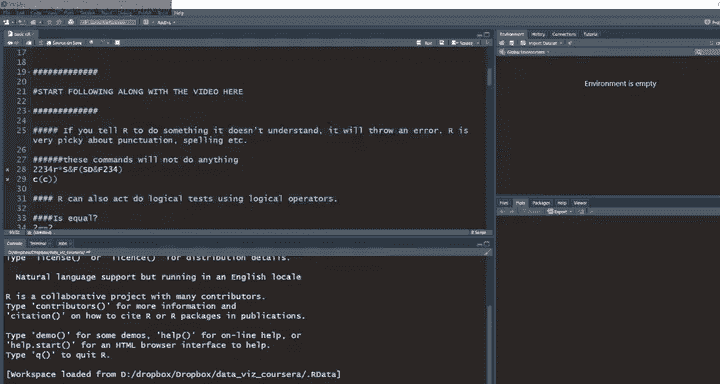

If you tell R to do something that it doesn't understand。

 it will throw an error at you in the console。And R is very picky about punctuation， spelling， etc。

 so if you have a syntax error， R will tell you that it doesn't understand what you want and it'll give you this error message。

These can be a little bit hard to interpret it first。

 but as you read more of them as you get more experienced coding。

 you'll get a sense for what these mean when they get thrown at you。

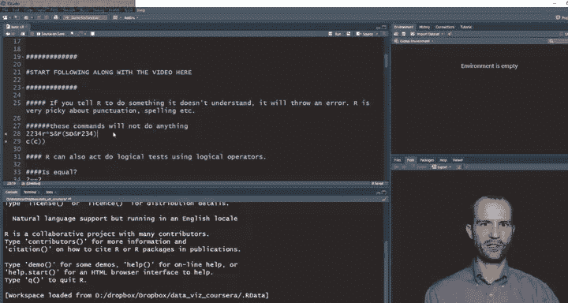

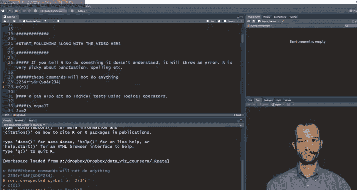

R can do simple logical tests like telling you whether two values are equal or responding true or false to inequalities。

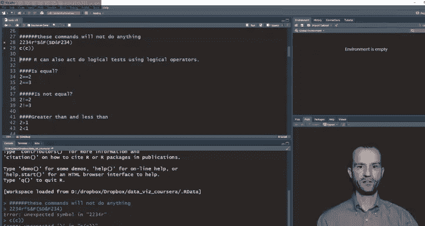

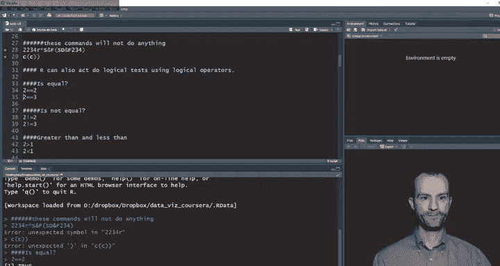

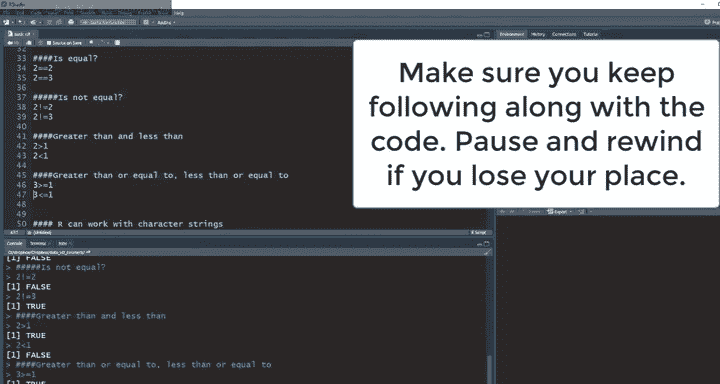

R can also work with character strings， so when you write a character string in R。

 you need to enclose that string and quotation marks。

You can use logical operators to see whether character strings exactly match each other。

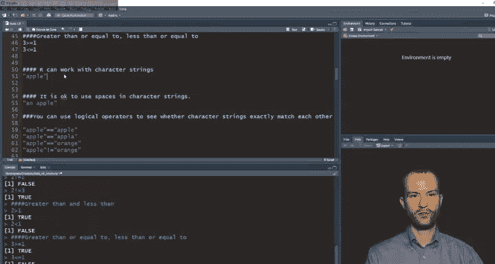

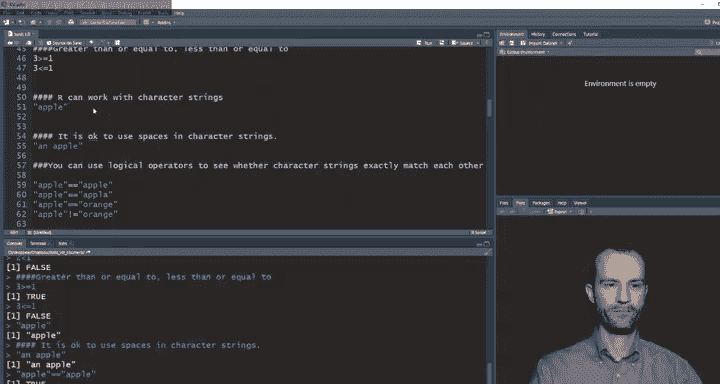

If you try to use inequalities with character strings。

 R will compare how long the character strings are。

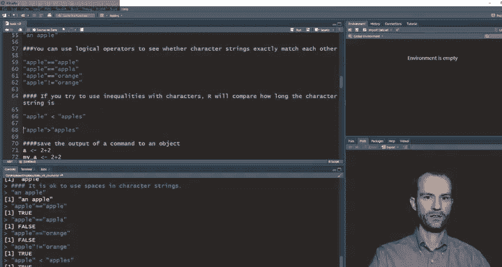

You can save the output from an executed R command to an object in what is called the R environment。

 which is just sort of a list of all the data that you're working with in R while you're sitting there working on your code。

You can create an object by starting a line of code with the name of the object。

And then you assign that object to value with the assignment operator。

 which is a less than sign followed immediately by a dash。When you save objects you can use letters。

 numbers， and some kinds of special characters like underscores or periods。

But an object cannot start with a number and there cannot be any spaces。

Once you assign a value to an object， that object will show up in the R environment and you'll be able to see it in the environment pane。

And you can see the value that is stored by an object。

 by running the line with that object in the console or from the R script。

You can also just select that single object in the script editor and run that if you like。

You select the object by double clicking on it。

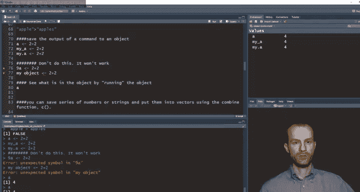

If you want to save a series of values， you can do that by combining them into vectors。

And you combine them using the。C function。Separated by commas for each individual item in the vector。

You can do this for a sequence of integers very quickly by separating the maximum and minimum values with a colon。

And you can also create vectors of true or false values if you want to。

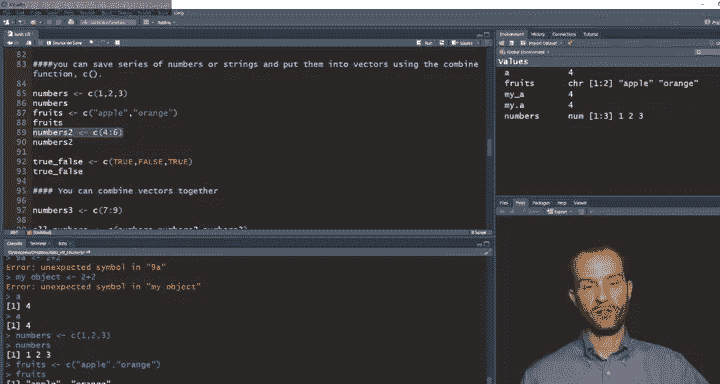

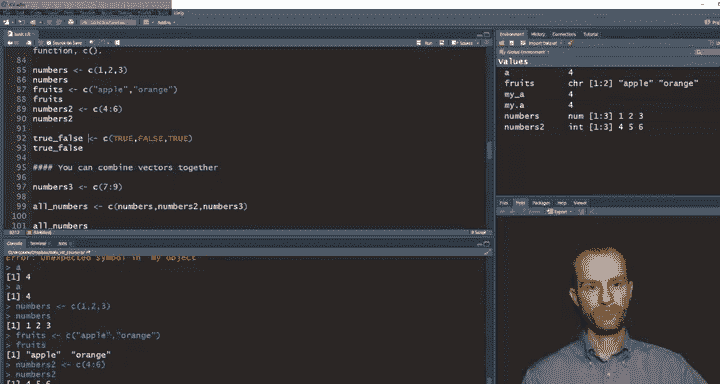

Once you have more than one vector， you can combine those vectors together again using the C function and separating the different vectors that you've created with commas。

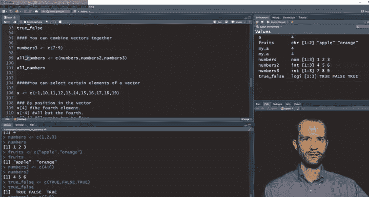

There's also a number of ways to select different elements of the vector。

 and this is done by typing the name of a vector object and then specifying which elements of the vector to select using special vector notation in brackets。

And you can see the examples here that use different notation and brackets to select specific elements of the vector。

You should look through these carefully on your own and also cross reference with the R cheat sheet that's associated with this video and you'll get a sense of how this works。

It's important to note that when you save different kinds of data into objects in R。

 that data is given a class that describes what kind of data is in the vector。

Some common classes are logical vectors that are truths and falses， numeric。

 character vectors and factors。Factors are a special kind of character vector that has some kind of ordinal value assigned to them。

 and these are called levels， and you need them for some kind of statistical models。

As factors come up， as we work with data， we'll talk more about them。

 it can actually be sort of tricky to deal with。You can see what kind of class an object is by using the class function。

And if you combine numbers and characters together into a vector。

 the numbers will convert to characters， so it's usually a good practice when you're doing data visualization to keep numbers and characters in different vectors and not mix them together we'll talk more about this when we talk about data management。

Sometimes you do need to change the class of a vector because there might be some kind of function R that only accepts character vectors or only accepts numeric vectors。

 and again， we'll talk about this more when it comes up。But for now。

 just know that you can coerce vectors to different classes using functions like as logical。

 as numeric， as character， and as factor。And you can switch information back and forth between those classes as you need to。

