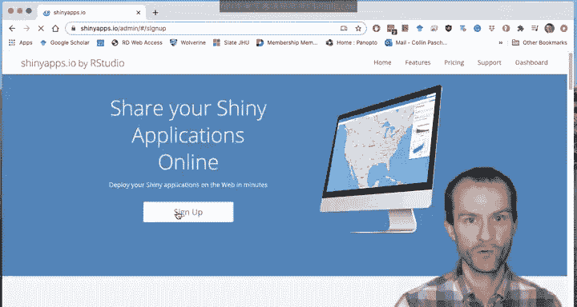
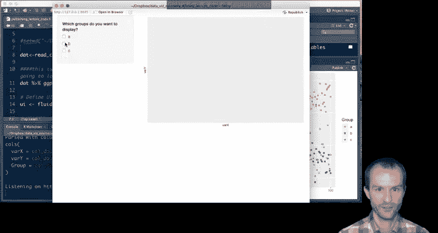
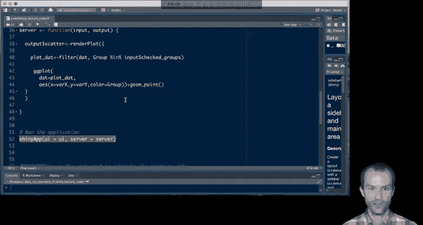
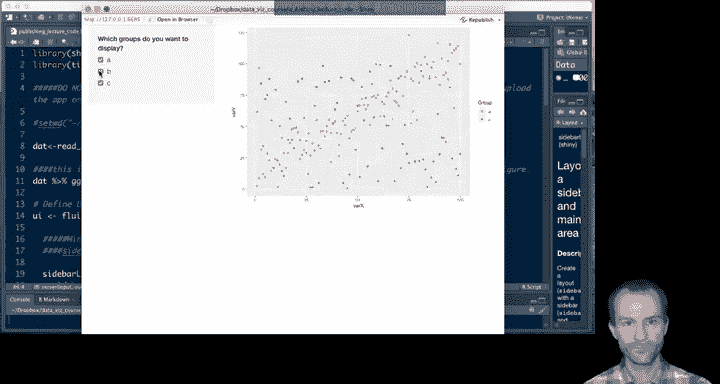
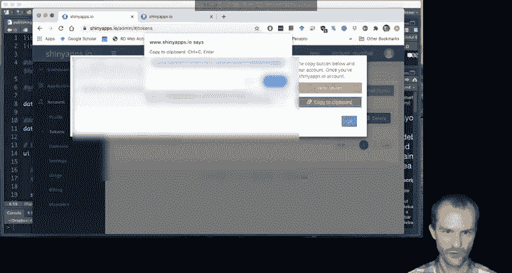
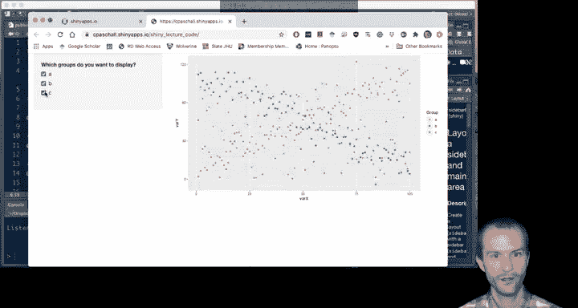

# 约翰霍普金斯大学《R语言数据可视化和仪表盘｜Data Visualization & Dashboarding with R》中英字幕 - P50：4_将应用程序上传到shinyapps.io.zh_en - GPT中英字幕课程资源 - BV1YWPjeKEWz

Once you have a shiny app written， there are several options for how to share it with the world。

And I'm going to show you two ways of doing this。One way is to publish your shiny app onto the website。

 shinyapps。o。And the other way we'll show you is to integrate the shiny code into an R Markdown file。

We'll start with publishing to Shiapps。io。This is a free service provided by our studio。

And in order to use it， you first need to set up a shiny apps account。So go to Shiny Appa IO。

Click sign up and go through the process for doing this。

And once your account is created， go back to our studio。For practice purposes。

We're going to build another very simple， shiny application。

And the script for this is included in the materials associated with this video。

We're going to make a scatter plot using the data that's attached as well in the dot CSC file。

Make sure that you download the data and put the dot CSV file in the same directory or folder where you're going to put the dot R file for the shiny application。

What this CSV file is is 300 observations of X and Y coordinates。And for 100 of the rows。

 they're specified as group A， and in that group there's a strong positive correlation between the x and y values。

For another 1 hundred0 rows， which are part of group B， there's a strong negative correlation。

And in the final 100 rows in group C， there's no correlation between it and them。

We're going to make a scatter plot with these data and we're going to vary the color of the dots by group。

So we're going to end up making a plot that looks like this。And with a shiny app。

 we're going to give the user the option to display the data from one or more of the groups so you can see the different relationships within each group。

The final shiny application will have a sidebar panel like we've seen before and a main panel。

 and on the left you'll be able to select those groups using checkboxes。

So let's turn now to the example code and start to walk through it。

This is going to be very similar again to the other examples that we've seen so far。

We're going to start by loading the libraries that we need for the application。

 and we'll also go ahead and import the data。

Again， it's really important here that the dot CSV file be in the same folder where the dot R file is for the shiny app。

And it's also really important that you do not set the working directory in the code here。

You can set the working director temporarily if you need to while you're working on the application。

 but make sure you comment that out before you try to actually deploy the app to shiny apps。

Io otherwise it's going to cause a problem and it will not upload correctly。

So after you go ahead and get the data imported here。

 you can go ahead and start building the user interface。

We use the fluid page function to set up the UI object。And then we want a sidebar layout。

And if you look at the help file for sidebar layout， you'll see that at a minimum for this。

 you need to feed this sidebar layout function， a sidebar panel function， and a main panel function。

This is no different than what we've seen in the past。

 I just wanted to show you the help file here so you started to connect these things。

So first we include a sidebar panel and within that we'll indicate that we want checkboxes with the checkbox group input function。

And this is different than other functions we've seen in the past。Rather than a slider。

 this is going to give us these checkboxes where the user will be able to select one or more of the groups。

So while the user interface tool is a little different。

 there are some similarities between the way you use this function and what we've done in the past。

Within the checkbox group input function， we specify the input ID。

 which we're going to make checked underscore groups。And a label for the checkboxes。

Then we specify the choices that the user will be able to select。

And they're going to be able to specify。Group A， group B or group C。

We also indicate here which choices we want to already have checked when the app opens up。

Then you close the checkbox group input function and separate that from the main panel function with a comma。

Because remember， these two functions are just arguments in the sidebar layout function。

It can be a real pain to get all these nested parentheses and commas and things to work together。

 so when you're trying to direct write your own apps， just keep with it。

 be careful and eventually you'll get everything to match up and it will run。

Once the input tools are set up in the sidebar， we will indicate that we want the main panel to be the plot output。

 which we're going to create below in the server。In the server function。

 we create the output slot where we're going to save the plot that we're going to generate。And here。

 the output slot is going to be called scatter。We use a render plot function to take the GG plot and to put it into that output slot。

Notice here that we have these curly brackets right after the first parent after the render plot function。

And what this allows me to do is to write some additional lines within the render plot function that will do some data management for me separately from the GG plot function。

I'm going to create a plot_ D object， which is assigned to a filter command that will filter the data using the checkbox group input。

We only want rows that correspond with the groups selected in the checkbox input function。

So the filter operation will display rows where the group value is included in the set of values that are checked in the checkbox。

And that's what this percentage sign in percentage sign operator is doing。

Take a minute and kind of puzzle through that to make sure you understand how that filter is working。

 because it's critical to understand this in order to see how the plot is going to be generated。

It's important to point out here that this is a little bit different than what we've done in the past。

 rather than put the filter function within the GG plot function。

 we've done this little bit of data management first before we've called GGplot。

And then we feed the object we've created with the filter data into the GG plot function。

I can do this on a separate line because we've wrapped everything within the render plot function within these curly brackets。

So take a minute and compare this code to what we've done in the past to see what the differences are about how we filter the data and pass it into the GD plot function。

In the DG plot function itself。Here I'm telling the server to use the plot_ thatt object。

 which I've created。And use that data to make a scatterpl with GM point， using x v x on the x axis。

 var y on the y axis， and varying the color of the dots by the group， A， B or C。

This is just like the static prototype we've done above。

Now that we have all this built and it should work the way we intend。

 we can run it out of our studio。Importantly， remember that we have to have this shiny app line at the end to tie the UI and the server together。

And once we do that， we can go ahead and run it。

And you'll see that now we can select the different checkboxes and different points will appear within the plot。

So we have the plot now and we want to publish it， put it out in the world。

Before we did all this coding， we already created the shiny apps。IO account。So here in the editor。

 you see this publish button。You want to click on that and our studio should ask you to connect a publishing account。

And you want to select shinyapp。IO。We're just following the directions here， so log into shinyapps。

o and go to your dashboard。Choose tokens from the account menu。Click show。

Click showhow Se and copy that code and put it back into the box in our studio。Again。

 just fall in the directions。

Now go ahead and click Connect， and from here you should select the files that you want to upload for this app。

So that's going to be the dot R file， which has the code in it and the dot CSV file that you download it that has the associated data。

Once you have those two things checked， go ahead and click publishub。

Our studio will publish the app to shinyapps。Io， and your browser will automatically open up to the deployed app。

It may take a minute for all this to work， but eventually it will go through。

You can then share the link here in the browser with whoever you want。

And they'll be able to go on their browser from anywhere in the world and look and interact with your shiny application。

If you want to go back to your dashboard on Shiapp。Io。

 you'll see that the app now shows up in the dashboard。

