# 约翰霍普金斯大学《R语言数据可视化和仪表盘｜Data Visualization & Dashboarding with R》中英字幕 - P51：5_将Shiny集成到R Markdown报告中.zh_en - GPT中英字幕课程资源 - BV1YWPjeKEWz

An alternative way to share a shiny app is to integrate it into an R Markdown file。

This is actually pretty easy to do。

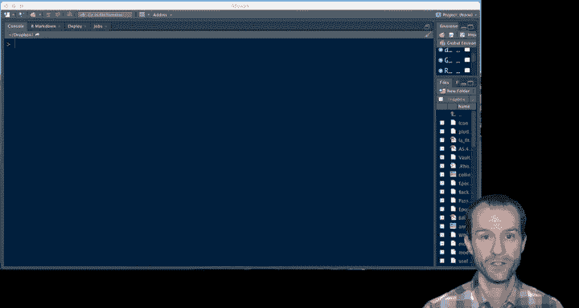

To start， create an R markdown file in ourSt。And select shinyhiny in this pop up window that comes up。

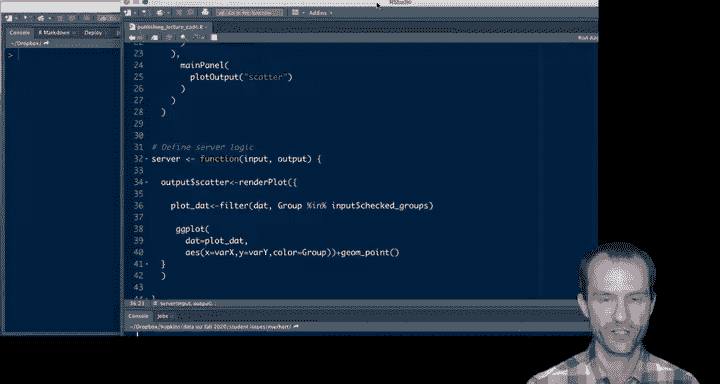

You can give this document a name of your choice。

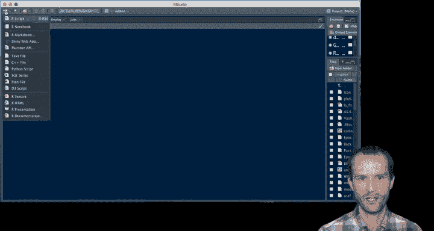

This documents like the templates for shiny apps when you make those in R Markdown。

 has placeholder content in it for creating an R markdown with shiny content。

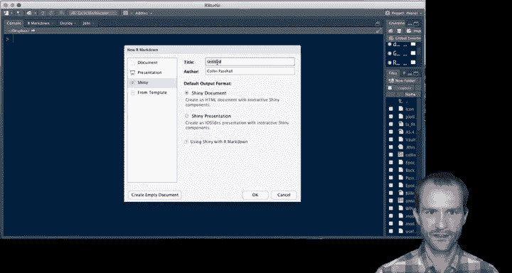

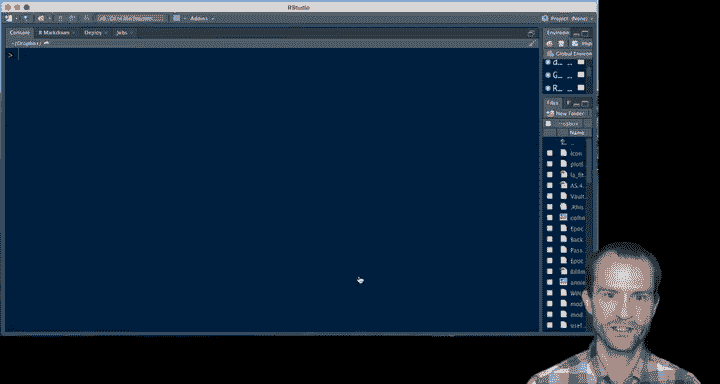

We're going to modify this， but for the moment， go ahead and just save it somewhere on your computer。

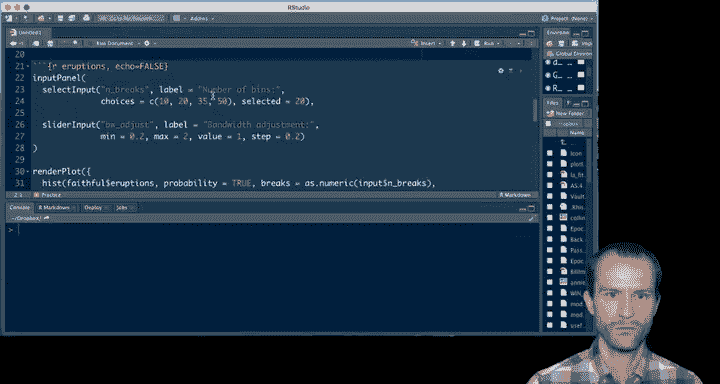

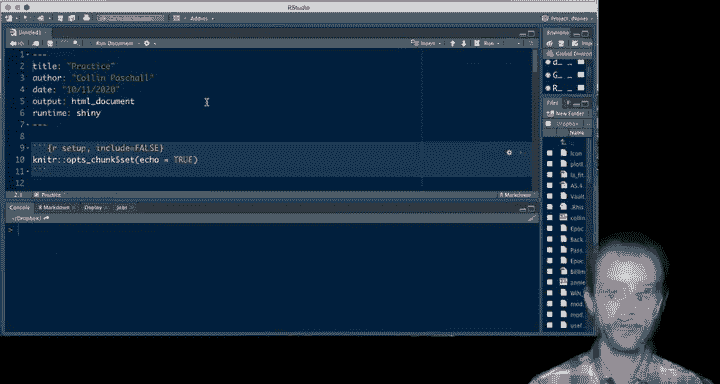

When you're saving this R Markdown file， make sure that you save it in the same folder on your computer where you have the dot CSV file that's associated with this video and that's the same dot CSV file that we used in the last video too。

 just make sure the RMD and CSV are in the same folder。

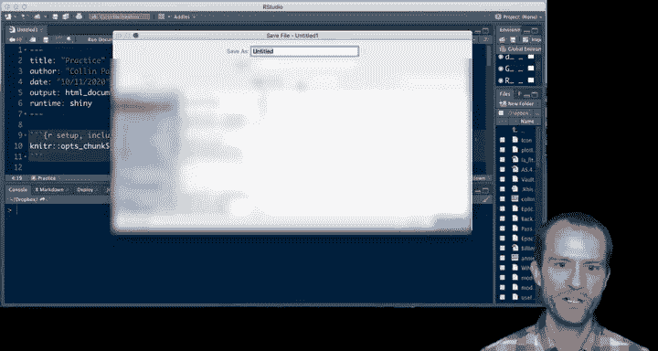

We can run this document and you'll see that it contains shiny inputs and output。

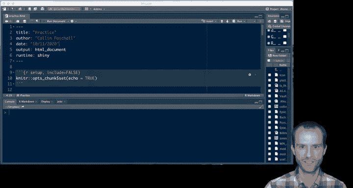

You can review this template on your own time， but what we want to do is customize it。

So I'm going to have here open the shiny application that we made in the last video。

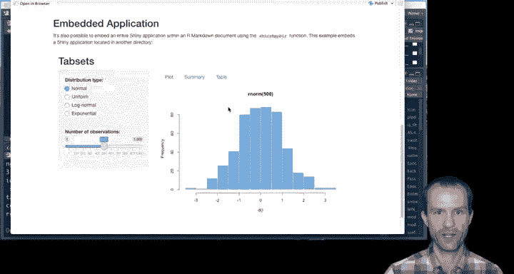

And I'm going to modify the code from the template。

 taking the content from the shiny app and moving it into the template。

We're going to start by adding the ti verse to the setup of chunk and we're going to import the data that we were using before。

This is about the three groups with the 100 rows per group and the different relationships within the groups。

Note here that I am not setting the working directory in our Markdown file。

You should have the markdown file and the CSV file that we're using here in the same directory。

 and so because that's the case when you're making this kind of our markdown file。

 you don't need to set the working directory in the markdown document itself。In fact。

 if you do do this， it will create problems if you try to publish it online using shiny apps。

 so if you do it， you can just comment that out before you actually try to upload it。

The key thing is to make sure that you have the dot CSC file and the dot RMD file in the same folder on your computer and then everything should work fine。

I'm going to go ahead and clear out this placeholder text and I'm going to replace it with some of my own。

And then I'm going to rename this first chunk。If you take a look inside of this chunk。

 you'll see that there's this input panel function。

 and what that does is it creates a box inside the R Markdown document where you can put input functions for shiny。

I'm going to clear out the select and slider inputs here。

 I'm going to copy over the checkbox group input function that we used in the last visualization。

 so I'm just taking out the input functions that are in the template and putting my own in there。

Then you see that there's this render plot function within the markdown file which is being used to draw a histogram in the template。

Again， I'm just going to replace this completely with the render plot function that we used in the last video。

Now notice that you're not assigning this render plot function to an object like you did in the shiny application。

 it's just the render plot function itself。We're not going to cover embedding an entire shiny application into an R markdown file here。

 so we're just going to delete all that， that's something that you can study on your own once you've really gotten a command of Shiny and R Markdown。

So with our modifications complete here， let's go ahead and click Run documentcu。

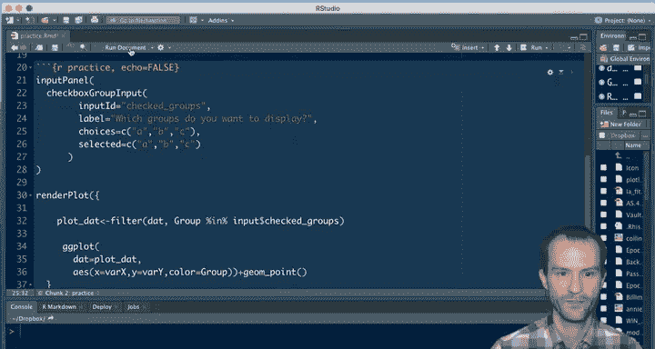

And you'll see that we've converted that template into our markdown with a shiny content that is the same as the shiny app that we created in the last video。

So to share this， we can go ahead and click on the publishub button again。

And you can publish just this document。And now because we've already linked our studio with our shiny AppIO account。

 we can click publishub again。And the Markdown file will upload to our Shi apps account ready to share with the world。

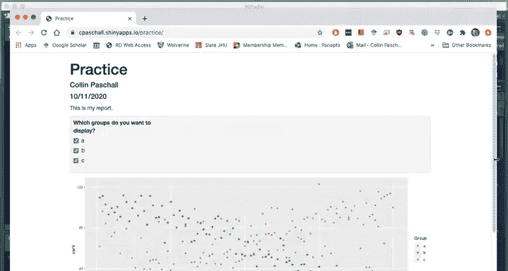