# 约翰霍普金斯大学《R语言数据可视化和仪表盘｜Data Visualization & Dashboarding with R》中英字幕 - P52：6_Shiny的输入和输出.zh_en - GPT中英字幕课程资源 - BV1YWPjeKEWz

In this video， I'm going to show you examples of several kinds of different input and outputs sets you can use when you're making a shiny app。

Some of these we have seen before， and so there will be some review。

 but then I will also show you some new options available to you。

This is not every kind of input and output that you can use in shiny。

 you'd have to look at the reference documentation to get the complete list。

But here I'm going to go through some of the most common types of input and output。

 and you're going to see some patterns about how these are used。

 and then you can extend that into other functions that you might want to play around with when you look through the reference materials when you see examples online。

Together， everything we show you here is going to give you a strong set of tools for building a powerful and interesting shiny app。

To reiterate a user interface in China is created using the fluid page function。

And within that fluid page function， you specify input and output parts of the user interface。

That's everything that the user is going to see on the screen when they're using the application。

You're telling the program where the users can provide instructions or input to the application by typing a text or selecting from different options。

 and you're also telling the application what kinds of things you want to display。

 drawing on that input。Most commonly， this is going to be things like filtering data based on some parameter supplied by the user。

 but there are other more exotic inputs and outputs that you can generate as you get more advanced doing this。

There are several kinds of inputs that you can use to give input to a shiny app。

 and these are helpfully outlined in chapter 3 of Mastery and Shihiny by Hadley Wickham and they're also available in the reference materials and all that' is included in the materials for this week so you should go through and look at this yourself to see the more complete list。

This is just the basics， so text input allows the user to write in text。

 and that's something we've seen before。Nummeric input would let the users type numbers into the application。

Slir input tells users to select values from a slider。

 there can either be one slider or two sliders on slider input。

Select input is going to let users select options from a drop down menu。

Radio buttons is going to present radio buttons that users can use to select between two or more options。

And then checkbox input and checkbox group input will present checkboxes。

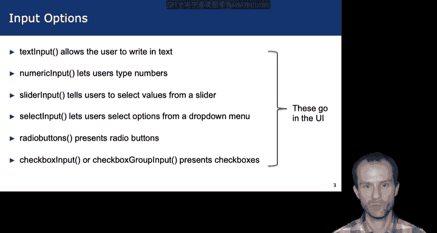

Again， these are just the basics these are some of the most commonly used ones。

 so if you want to find options for more， you can look at the documentation。Now， aside from inputs。

 you also have outputs in the user interface。And the functions for output include text output。

 which will print text。

Forbatim text output， which will print the output from the R console。Table output。

 which will display a formatted HTML table of a data frame or some kind of other object that you can provide。

Data table output， which will display a fancier HTML table with some additional navigation options。

And you should note that when you're using data table output， you need to aside from shiny。

 also use the library DT in order to make this work。Ploot output， as we've seen。

 will display plots that would otherwise display in the plot preview window。

And then plotly output will display plotly figures。

 and these are those interactive figures that we've seen in the past。And again。

 note here that in addition to the Shi library， in order to use plotly output。

 you also must load the plotly library in your Shi application。

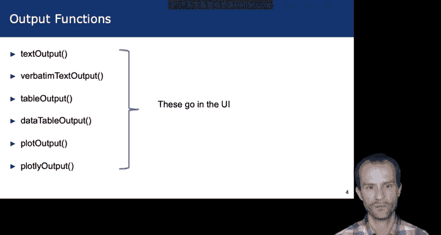

There are more output functions， but these are some of the most common and a good place to get started。

Now， these output functions are always paired with a rendering function。

 which is going to be in the server in your shiny application。

Some of the rendering functions here that are paired with the output functions we've displayed above are render text。

Render print。Render table， render data table， render plot， and render plotly。Now， as you can imagine。

 these all are all complementary， right， so render plotly is matched with。Plootly output。

 render plot is matched with plot output and so on。

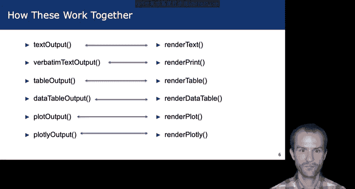

So you should always think about things as being paired。

This is all pretty abstract and difficult to follow， which is a verbal explanation。

 so it's going to be easier just to walk through some more examples。

And we're going to work through the example file that's associated with this video。

The code creates a very simple， shiny application that displays several kinds of output and a few different input options。

You should begin here by opening up the file and running the application so you see what the final product looks like。

You should also take a look at the code and familiarize yourself with it a little bit before we start walking through it line by line。

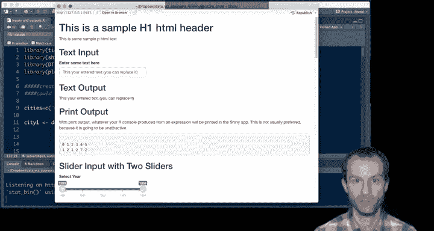

Once you're done poking around， you can open up the code again and you can follow along with us here。

To start with we load all of the required libraries and note that I'm including the DT package and the plotly package here along with the tidyverse and shiny。

You need Dt for data tables and plotly for plotly figures。For ease。

 I've just created some fake data here in the first lines of the code。

 and these are fake data for three different cities for a few different measures from 1990 to 1994。

So take a minute here， look through this code to see how that data were generated。

 and also look at the resulting object so you know what we're trying to plot here。

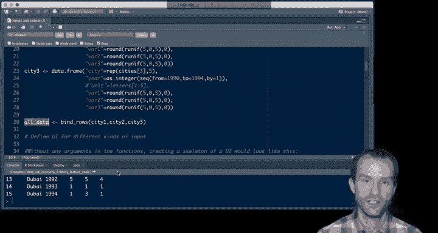

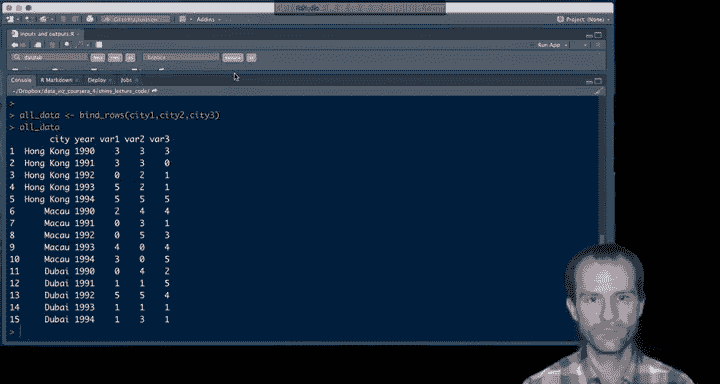

The app begins as we expect with the user interface object。

 and we're going to create this using the fluid page function。

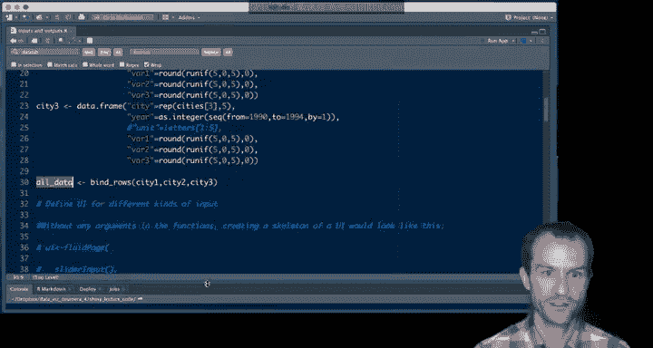

And we're going to feed different components of the user interface to the fluid page function as arguments。

This is demonstrated in the commented code here。

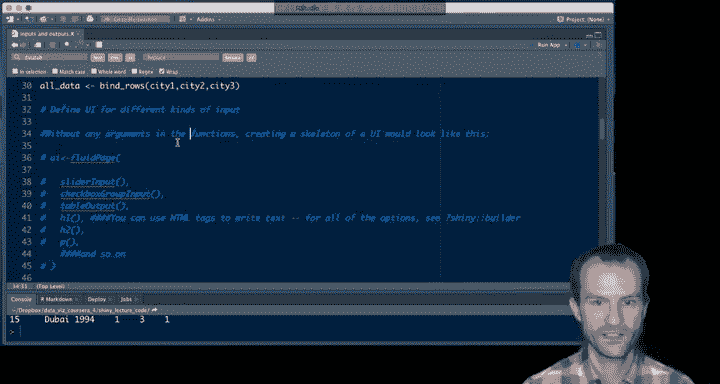

Without any arguments in the component function， the skeleton the AUI looks like this。

 It's a series of input and output functions。

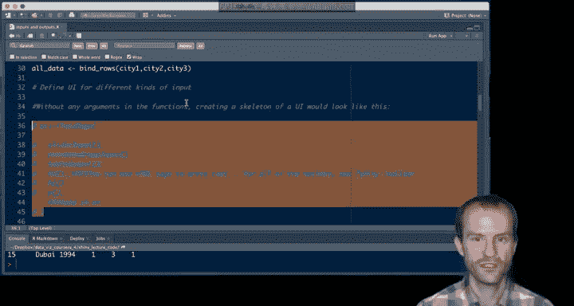

You can also see that I have these functions here for H1 and P。

 and these are functions that will print static text into your shiny app。

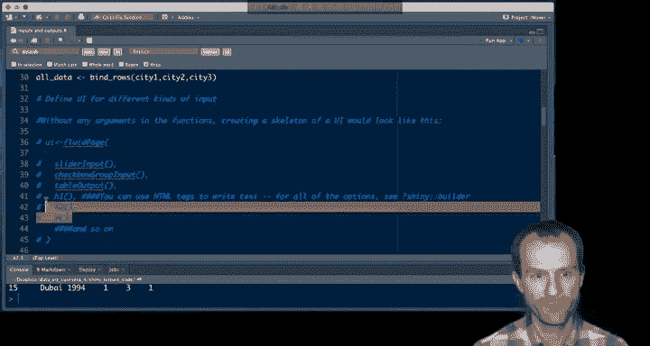

They're kind of equivalent to HTML tags if that's something you've done before。

You have multiple levels of header， so H1， H2， H3， and so on， as well as normal paragraph text。

And you can see these functions by doing a help command forBuilder in the shiny documentation。

Using these components， we'll go ahead and start building the app。

 so we're going to start adding arguments into each of these functions and build a thing up。

It's helpful to have the code and the final product up side by side here for comparisons。

 so you might want to run the app and have it open in a window that you can see while you're looking through the code。

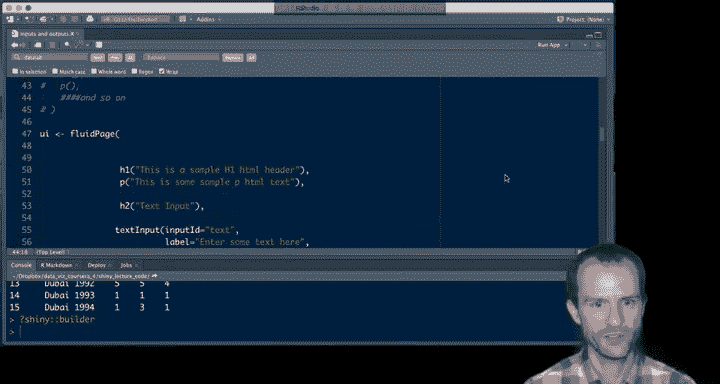

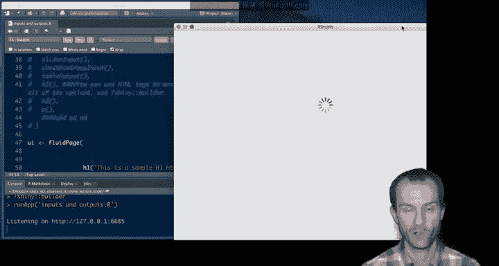

The first argument in our fluid page function is this H1 function for static text。

 followed by the P function for some paragraph style text。

And then the first interactive element of the app is the text input box。

 which we saw a few videos ago。This follows the same kind of pattern that all input functions will use。

 so we set the input ID， the label， and the starting value for the text input box。

Then we have a text output function that points to text_ output。

And if we skip down to the server function here， we can see that there's this complementary function to text output and that's render text。

And that's where we assign the input from text input to the output slot。

 which is then filled in with the render text function。Below that dynamic text。

 we have a verbatim text output function， which is going to print raw our output generated by commands in the server。

 and that's the complement to render print， which you find below。

Next we have the slider input function and a checkbox group input function we've seen these before。

And these inputs will modify the tables and figures that are in the application。

So if you look down at the rendering function for these plots and the tables in the server function。

 you'll see that these incorporate filtering commands based on the input from the slider and the checkboxes。

So for example， the render table function tells the table to display only cities that are in the vector of cities selected by checkboxes for the input city1。

And only years that are in the range of the two values selected by the slider in input year one。

This is the same filter for all these tables and figures。But they could be different。

 you could choose to have different filters here if you wanted to。

Going back up to the user interface now， and I hope you're following in me as we're going back and forth。

 back and forth to understand how all these parts work together。So back up in the user interface。

 after the table output， we have data table output。

 which is matched with the render table function in the server。

And this is going to produce the fancier interactive table。

The data table output is matched with the render data table function in the server。And finally。

 we have the plot output function and the plotly output function。

Which are matched with rendernderplot and render plotly in the server。

So there is a lot going on here， and I've kind of thrown it at you all at once。

I've tried to make it as clear as I can， but you're just going to have to kind of puzzle through this again。

You might have to watch the video several times。And one thing you might consider doing is commenting out different lines of the shiny app。

 building it up from scratch。So start by doing something like commenting out everything in the user interface except for the headers and the text input function。

And then comment out everything in the server function except for the first output line。

Then you can gradually keep uncommenting the complementary input and rendering functions。

Until you get the whole app working correctly。This is going to take some time but just try to stay positive right these are the building blocks of really powerful visualizations so once you get the sense how this works。

 I think you're going to find putting these pieces together pretty easy actually it's just that the learning curve is kind of steep and you have to spend some time with the code。

In the next video， we're going to talk about how to lay out shiny apps in more advanced ways。

 because right now all we have is this long string of inputs and outputs。

 and you might want to put these together in a little more attractive or accessible way。

And we're going to work on that next。After you've gone through all these functions and figured out how all this fits together。

