# 约翰霍普金斯大学《R语言数据可视化和仪表盘｜Data Visualization & Dashboarding with R》中英字幕 - P53：7_Shiny中的布局.zh_en - GPT中英字幕课程资源 - BV1YWPjeKEWz

In the last video， we created a shiny app with different kinds of inputs and outputs all strung together in one long page。

So in this video， I want to show you how to control the layout of different items in the user interface。

You'll quickly discover that there are lots of options for how to lay out a shiny app with so many combinations that is's just not practical to show you every single one。

And in fact， walking through all of them isn't necessary because the shiny documentation has an exceptionally well written and clear description of the different layout options。

This video will provide you an introduction to these different options that you have。

 but then you'll have the foundation you need to read the the layoutout guide to get a sense for how all the different combinations can work。

We are already familiar with really basic layout options， so for in the last video。

 we created an application that's just a series of inputs and outputs stacked on top of each other in an application vertically。

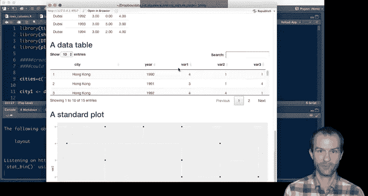

And when we covered how to publish an application onto shinyapps。Io。

 we saw how sidebar layout worked。

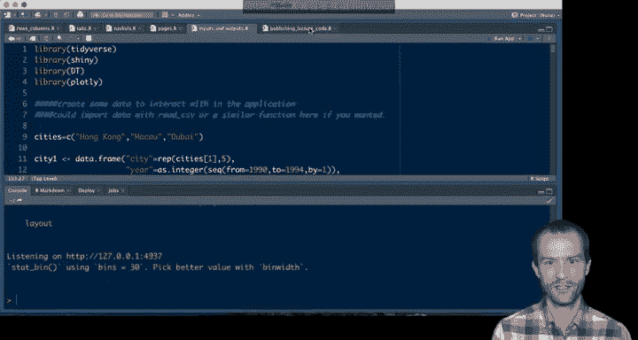

So we don't need to go over these again， you can just look at the previous videos and use those as templates for these kinds of very simple styles。

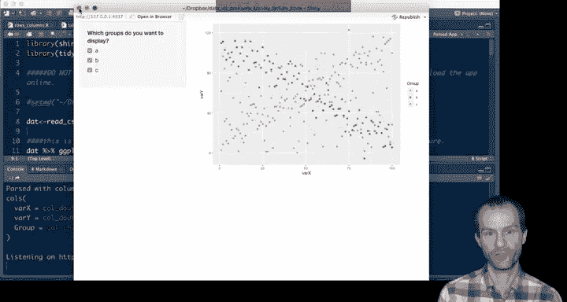

Sometimes you might want to have multiple visualizations right next to each other on the same page。

And the way to do this is by manually setting up a grid of rows and columns in your application。

So within a fluid page function， you're going to create rows by inserting fluid row functions as arguments。

 and then within the fluid rows， you can create multiple columns by adding those as arguments。

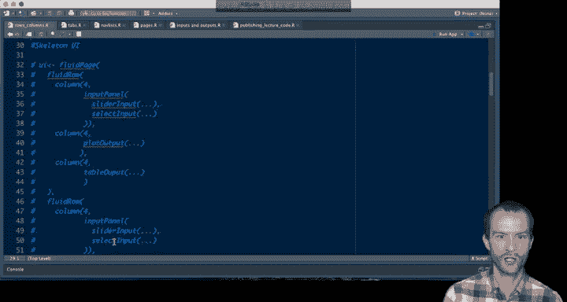

And then with each column for each row， so each cell of the matrix。

 you can include inputs and outputs。In the R file attached here called rows and columns。

 you can see a skeleton of the layout with input and output nested within column functions。

 within fluid row functions。

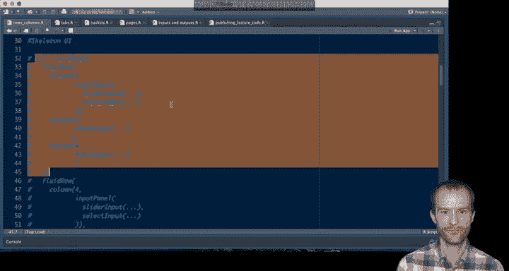

It's important to note here that the column width， which is set here by this number。

 should add up to 12 units in each row。So if we run this application。

 you'll see a grid with two rows each with three columns。

 and I've just repeated the same content here across both rows。

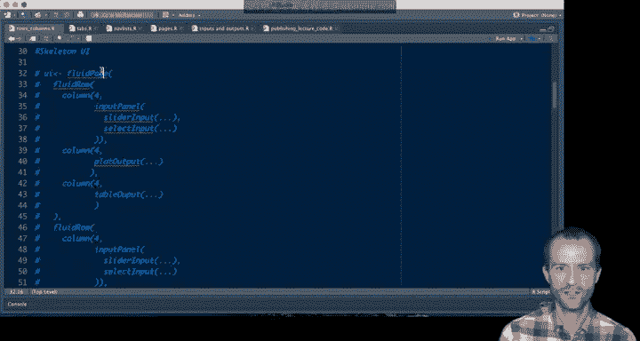

Of course， you could customize this and make it different if you wanted to。

Also note here that I've wrapped the inputs in the leftmost column into the function input panel。

 which provides this pleasing visual highlight around the input functions。

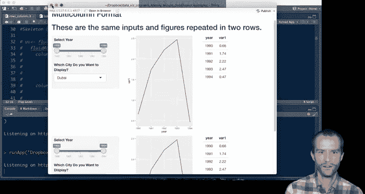

Another option for displaying multiple figures in an application is to use a tab set。

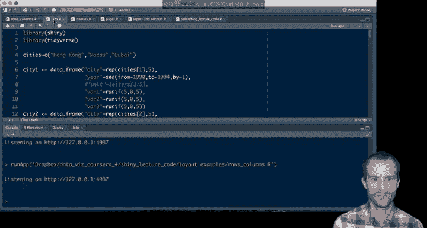

So for example， let's say that you want to use a sidebar layout with a single set of inputs and then allow a user to switch between controlling two different outputs。

This is demonstrated in the R file attached here called tabs。

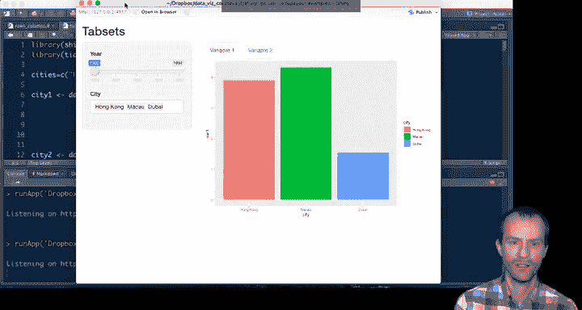

And you can see that the slider and the select boxes control the content of the figures in the main panel。

 but you can switch between two different figures in that main panel using tabs。

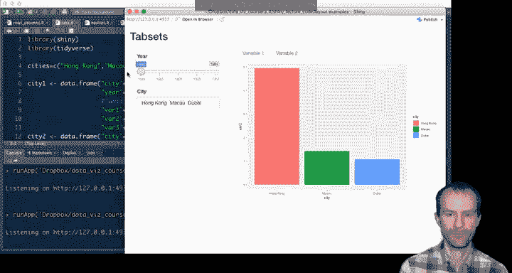

If you open up the R file for this and you look at the skeleton code。

 it looks like normal sidebar layout at first， but then we nest inside the main panel。

 this function called Tabet panel。

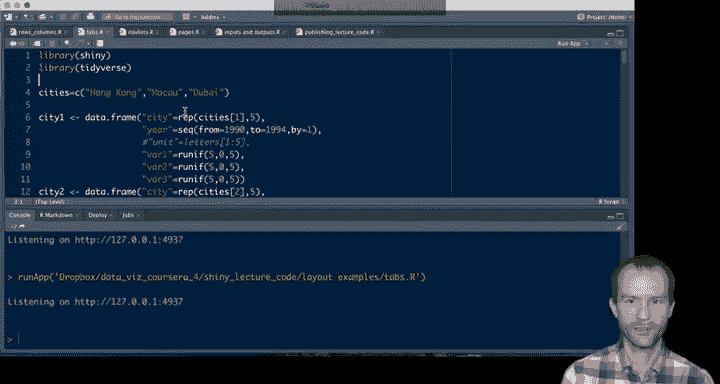

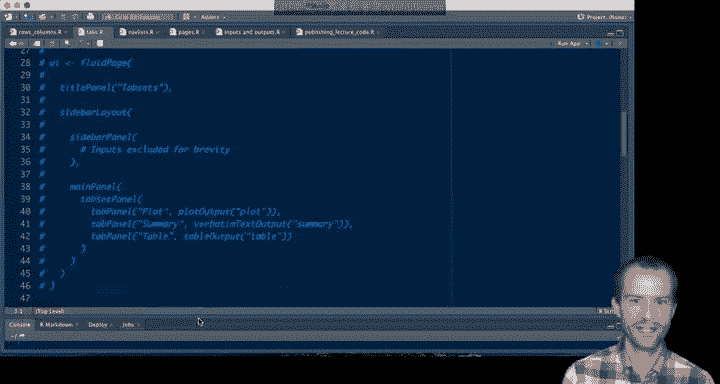

And then as arguments to that， we feed in different tab panels。

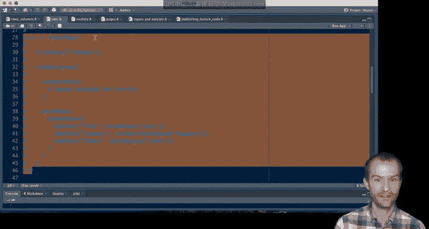

Within a tab panel， you can provide a title for the tab。

 and then you provide a output function as a second argument to the tab panel function。

This is demonstrated in the uncommented code below。

 so in the user interface we have a fluid page function， a title panel function。

 and we set up the sidebar layout。We set up the two inputs for our sidebar panel。

 and then in the main panel， we specify that we want a tab set and we set up the tabs titles and the output functions for each tab。

The server function should look pretty normal to you， it just takes care of taking in the input。

 rendering the figures accordingly based on that input。

 and then assigning the rendered figures to the output slots。

And that output is up in the different tabs。As you get more complicated applications with many figures and inputs。

 you might want to set up those applications with more complex navigation options。

You have two choices here。You can create a navigation list or you can create navigation pages。

 and they both do sort of similar things。

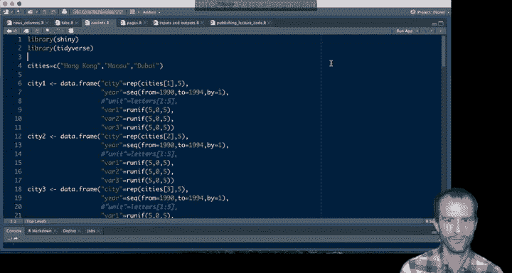

An navigation list will set up a series of different views that users can switch between。

And a skeleton of this is provided in the NAvlists。R file that's included with the video。

You create navlists by including a navlist panel function as an argument in fluid page function。

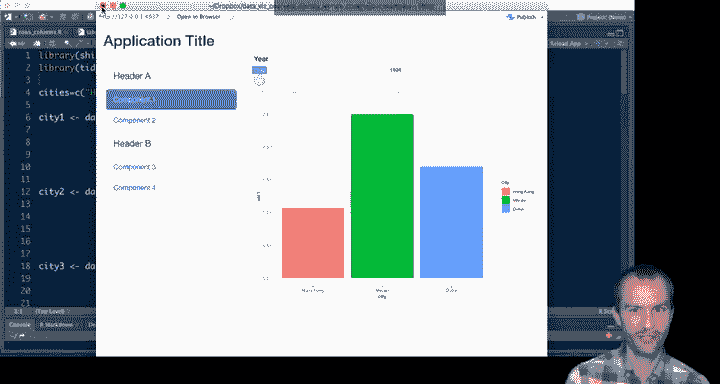

And then you can provide titles within the nav list and different items in the navlist with T panel functions as demonstrated here。

Within the T panel function， you can provide inputs and outputs。

I partially fill on this skeleton here the uncommented code below。

 so when you load up the app you'll see that you can navigate between these different views on the left hand side of the page。

Again， this is just like nesting different functions inside of each other in order to create your layout。

 so if you carefully go through the skeleton and then look through the code。

 you'll see how these things fit together。Finally， an alternative to nav lists is NAP pages。

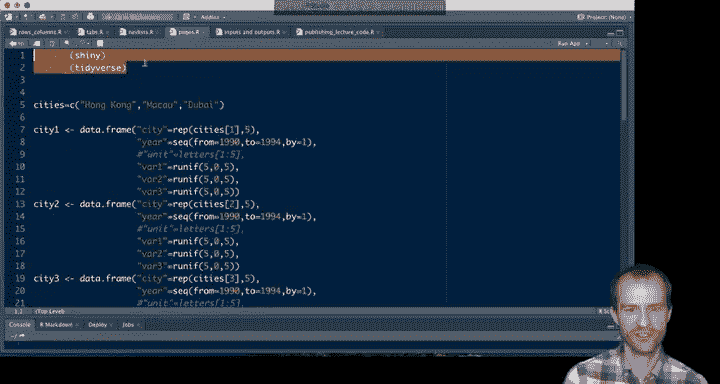

And an example of this is included in the our file called Page。R。

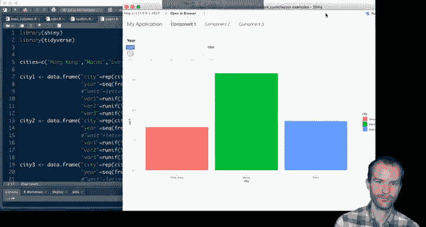

Pages are very similar to navigation lists except that the navigation is formatted like this menu on the top of the page。

So instead of a nav list panel， we have a nav bar page function and you can specify the tab panel those arguments to that navbar page function。

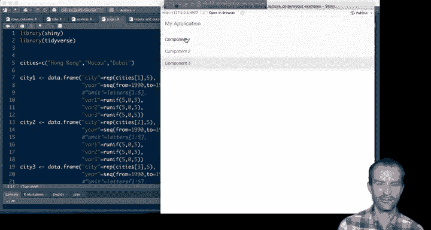

Now， of course you can mix and match two different layout options in innumerable ways。

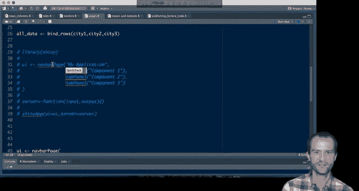

And if you look at the Shiny Ga， you're going to see many more advanced and complex applications and dashboards built with Shiinny by manipulating these different options。

However， the goal for now is to just get started， look at these different layout options and get a sense for how to build those applications with these basic different choices you can make。

Once you do that， you'll be able to interpret the code that you find for more complex shiny applications。

 and you can purpose build them based on what you're trying to display。

You've got all the basic skills now you need to build shiny applications。

 so don't be afraid to look at templates and examples。

 get some practice modifying and replicating them。And when you're ready。

 you can publish those to the world using shinyapp。Io。Good luck。😊。

And congratulations on your work so far。