# 约翰霍普金斯大学《R语言数据可视化和仪表盘｜Data Visualization & Dashboarding with R》中英字幕 - P54：8_制作仪表板.zh_en - GPT中英字幕课程资源 - BV1YWPjeKEWz

Along with Shi， another option for displaying your visualizations and sharing them with the world is to use the R package Fl dashashboard。

A flex dashboard is just a special way of formatting in our markdown report。

 something we've done a lot already。And it will allow you to arrange different plots and tables into a dashboard style document。

This is reasonably straightforward after you've learned how to use our Markdown。

 Gigi plot and shiny to make visualizations。But it's still a powerful tool and worth going over。

I want to stick pretty closely here to the material that's in the official Fl dashboard documentation。

 which is available in the materials associated with this week。

So make sure you review these materials really carefully in conjunction with watching the video。

 the documentation is very clear and after you watch this。

 you should be able to start to make sense of it a little bit easier。To make a dashboard。

 the first thing we do is open up our studio and in the console。

 you should install the Fl dashboard package。

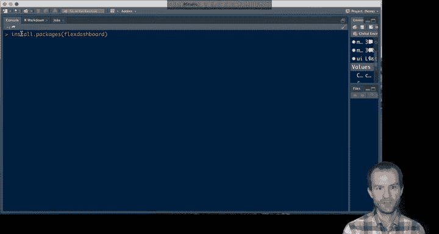

And once you do that， you can go ahead and click to create a new markdown document。And from there。

 you can select templates and click Fl dashashboards。

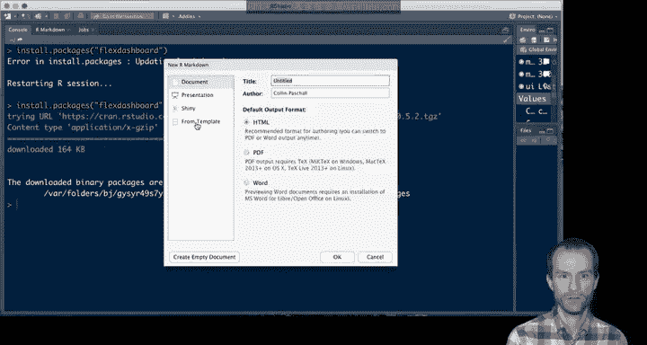

When you create a new project this way， the dot RMD file will open up with a template for dashboard already in it。

And for demonstration purposes， you can save this。arMd file somewhere on your computer。

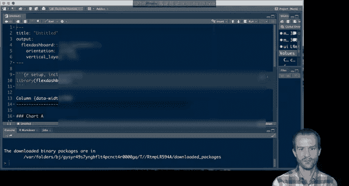

Again， like any other R Markdown file， if you're going to import any data into this。

 you would want to put this dark dotarMD file in the same folder where you have your CSV file that you're going to import。

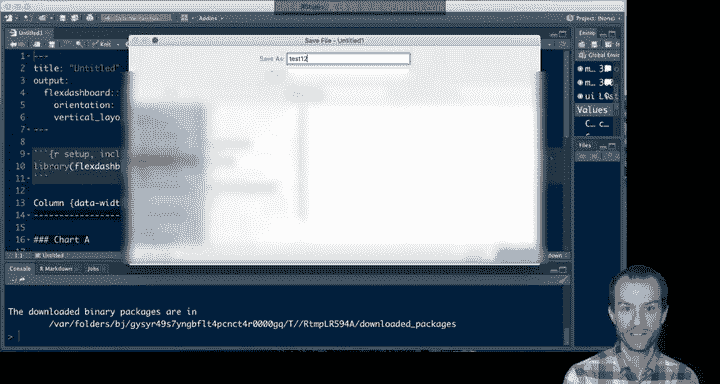

Here we're not going to do any data importing， but just keep that in mind in case you're doing that on your own。

So go ahead and click theni button once you've saved it， and as you can see。

 what this generates is a blank dashboard with three placeholders for content。

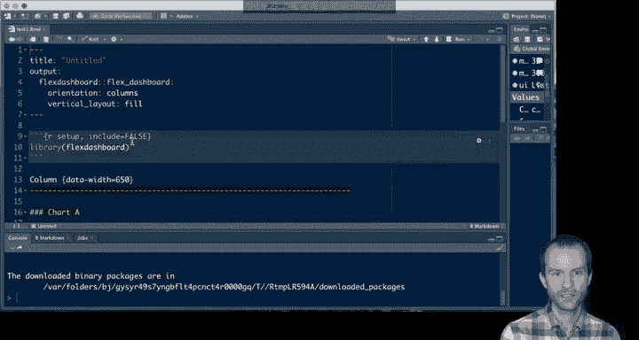

This is just an HTML file， so you could go find this on your computer where you have the dot RMD file and you could open it up in a web browser。

From your file Explorer or your finder。To continue for demonstration purposes here。

 let's load the ti verse into this template document。

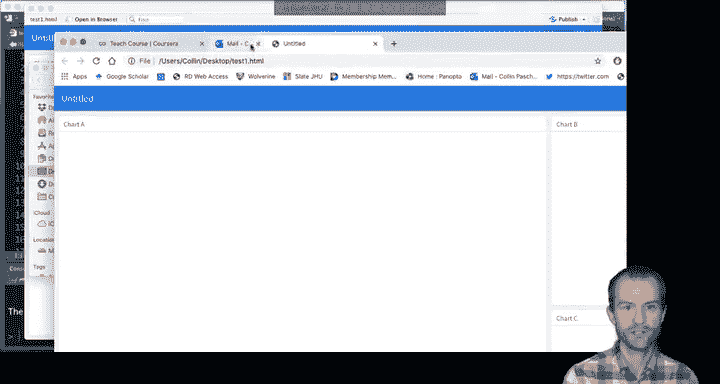

And load the data here to make a couple of quick visualizations。

We're going to use the empty Cars data， which is just built into R as we've seen before。

 and it's a table of car models with information about them。

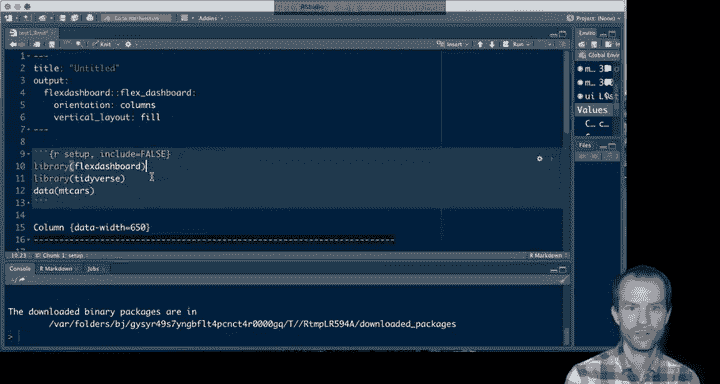

In the code chunk for chart A， you should make a scatter plot of weight against miles per gallon。

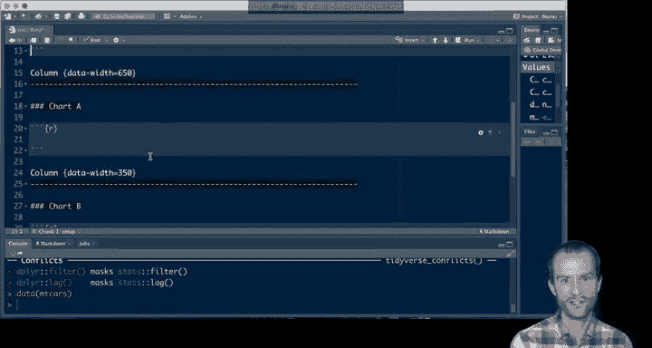

In the code chunk for chart B， you make a bar chart with counts of models with four。

 six or eight cylinders， and in chart C you make a box plot for horsepower。

We're not going to worry about making these prettier or formatting them because we're just showing how you can put this content into the different components of a dashboard。

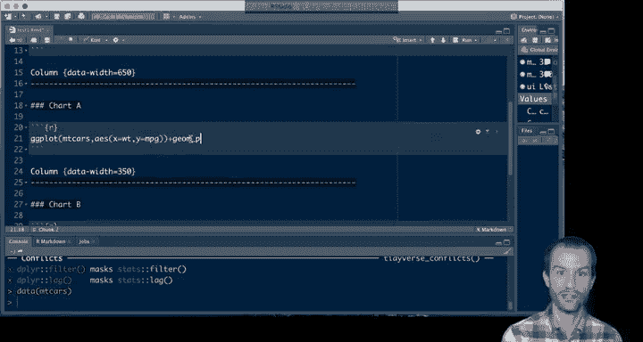

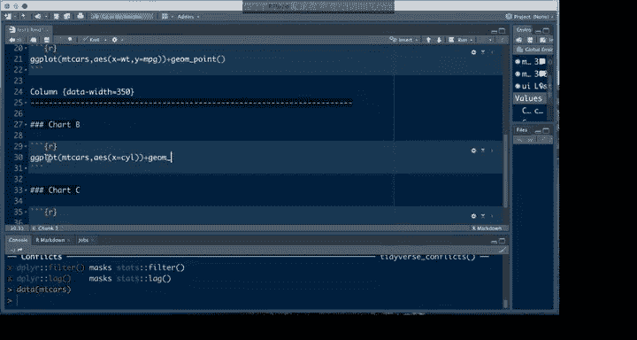

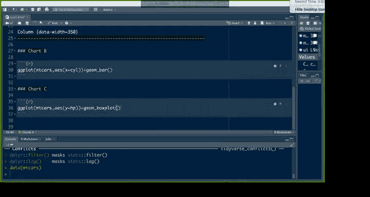

You can also go ahead and change the title of dashboard here。

As you can see this for just making basic static visualizations， this is really easy。

 so go ahead and knit the document together to see what it looks like。

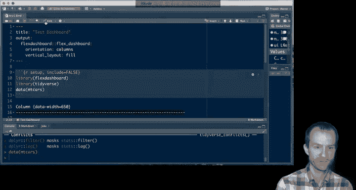

And then you can compare the output with the code as you go along here。

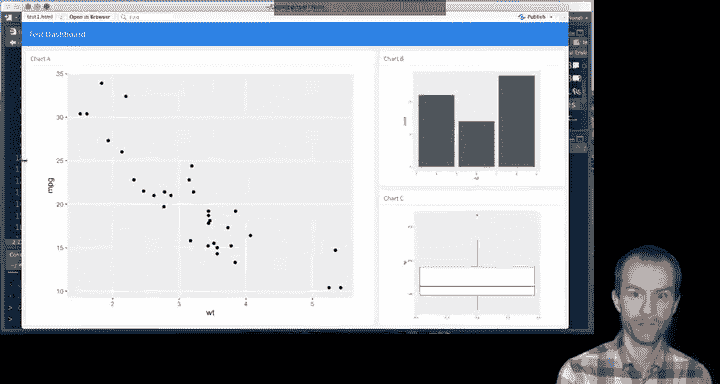

Columns are specified by writing column and setting the width of that column in this tag。

And in the next line afterwards， you should include at least one dash mark。

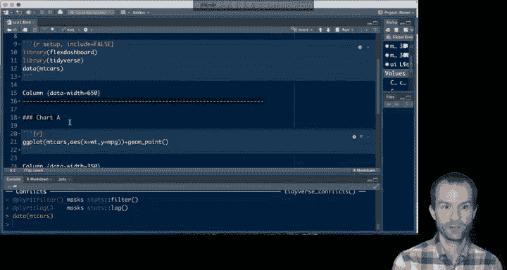

The widths are relative here so you can make the total， whatever you like。

 and the dashboard will assign different components to be relative in size。

And you can specify different boxes within the column by doing this third level header in our markdown format。

 so three pound signs followed by a chart title。And within this column。

 each of these charts is going to display vertically。

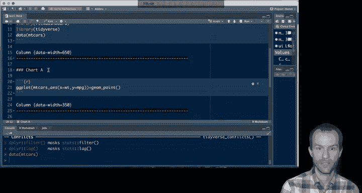

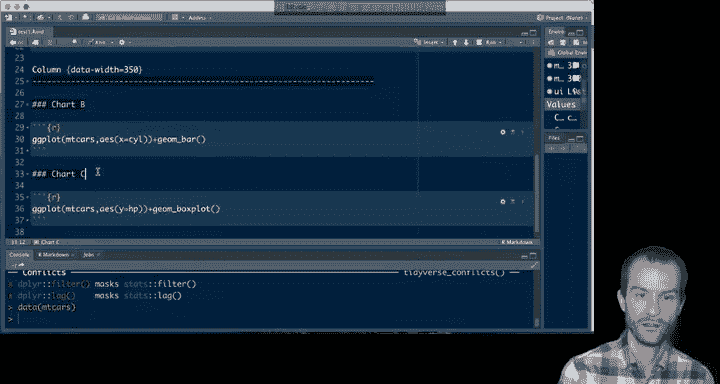

Now， if you want to switch to row orientation， this is easy to do。

All you have to do is go up to the header here and switch the orientation to rows。

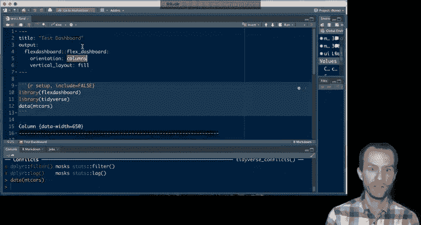

And then change the data width tag in each of these two data height。

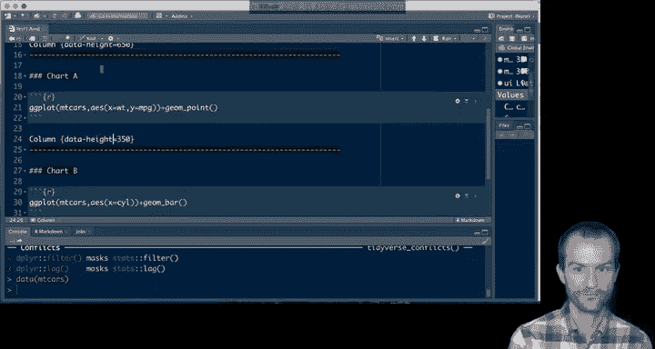

You'll want to play around with the height and width values to best fit your figures and getting these right is largely just a matter of trial and error。

 so you'll have to get comfortable on gain some experience doing that。

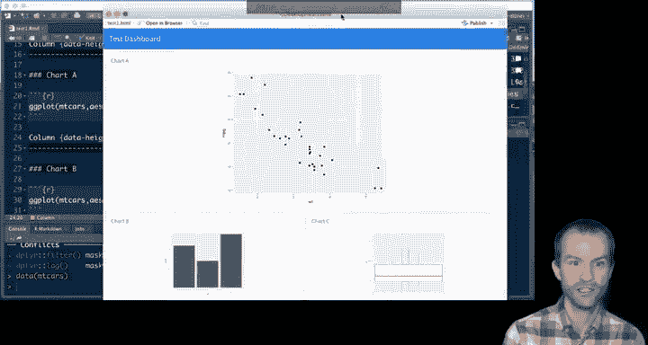

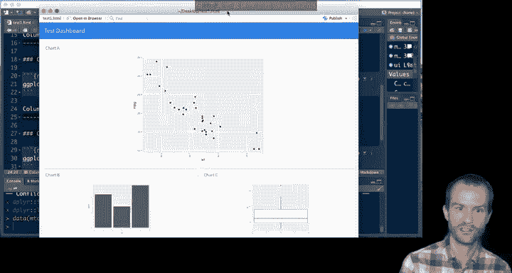

A final choice here to go over is to decide whether or not you want the layout of your dashboard to be in fill or scroll format。

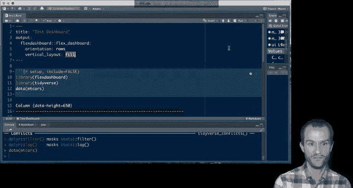

With the fill format， the fill layout， the HTML file will try to fit all the figures in your dashboard into whatever size window the user is using for the browser。

 so if they resize the window， the sizes of the different components will change in order to try to fit that。

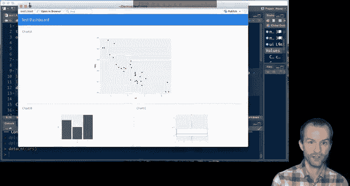

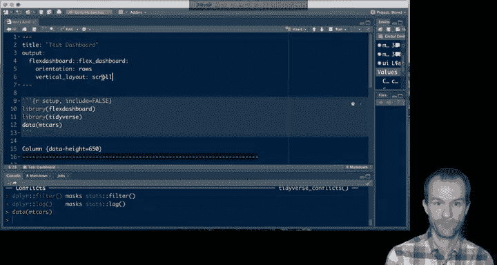

With the scroll layout， the user will instead see the scroll bar and the figures are not going to automatically do as much resizing。

This is just the simplest introduction to Fl dashashboard。

 but already you could do quite a bit with just these few basic options we've presented。

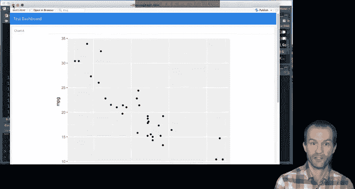

And we'll do more layout options and tweaks in the next few videos。So take a few minutes。

 play around with the different components here， change it between rows and columns。

 mess with the height and the width of the columns and the rows。

 and then when you're ready to go ahead and go on to the next video and we'll talk about some more options for making more complex dashboards。

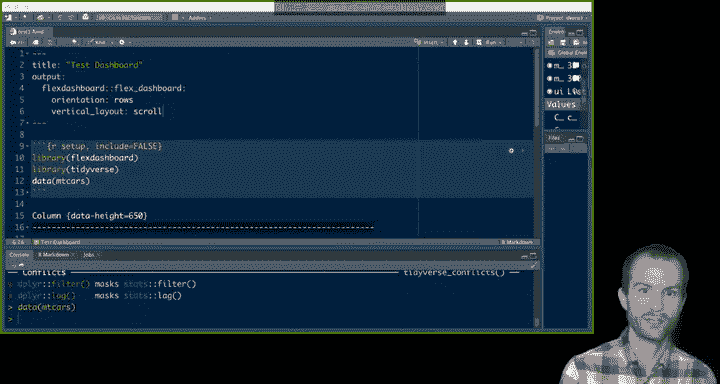