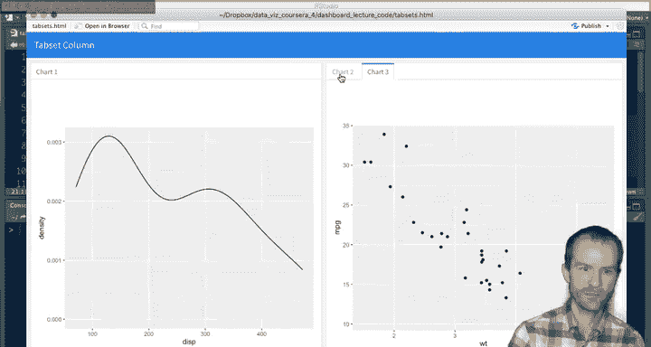
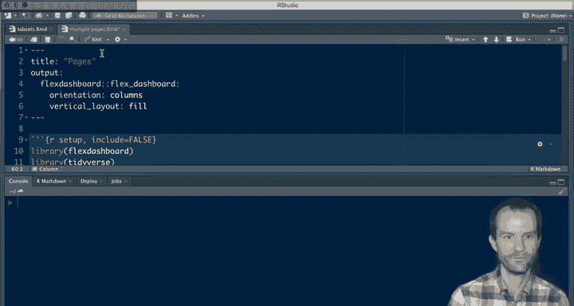
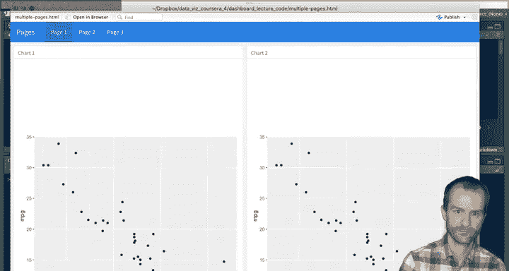
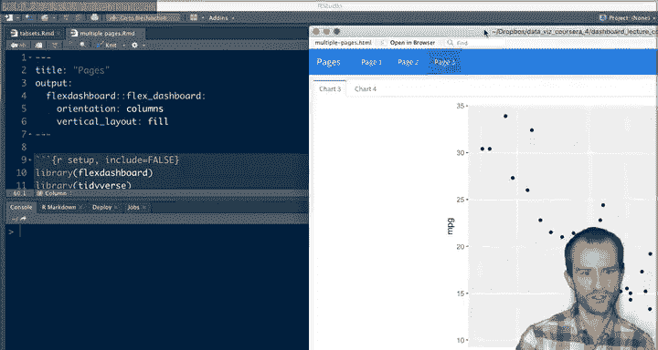
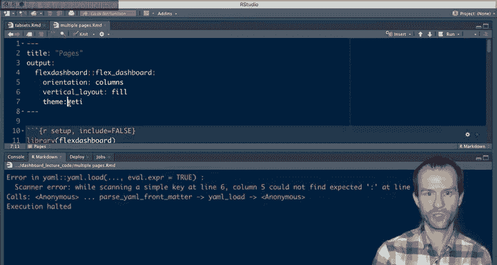
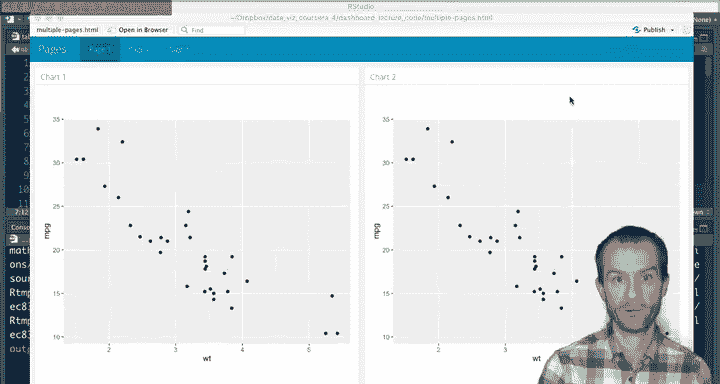
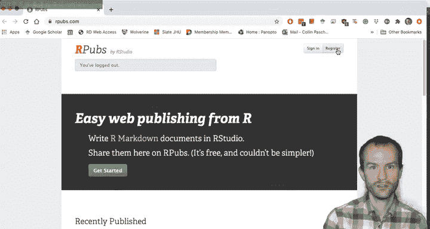
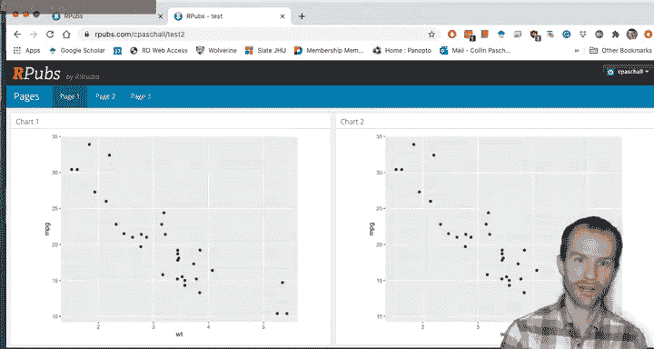

# 约翰霍普金斯大学《R语言数据可视化和仪表盘｜Data Visualization & Dashboarding with R》中英字幕 - P55：9_仪表板中的选项卡和页面.zh_en - GPT中英字幕课程资源 - BV1YWPjeKEWz

Just like we saw with shiny applications， there are some more advanced options for setting up complex dashboards。

So for example， just like with shinyny， you can set up tab sets within a flex dashboard。

 and this allows the user to swap between different visualizations in a row or column。

There's an example of this in the dot RMD file that's associated with this video。

You set up a tab set by creating a row or column and then adding the dot tab set attribute。

So then in that column row， the user will be able to switch between those charts in the column row by clicking on tabs here。

You can also create multiple page documents， so to create a page。

 you should specify a page and then follow that with at least one equal sign on the next line。

And this is demonstrated in the multiple pages。armd file associated with this video。

You can also specify when you created a new page whether or not you want your data to be in row or column orientation for that page。

 and so the different pages of the document can have different orientations。

And of course， you can also include a tab set within a page if you want to。

There are also a number of visual theme options that are built into Flex dashashboard。

 giving you some options for how the dashboard will look。

You can find a list of these themes in the documentation and you can try them out by inserting theme。

 colon， the name of the theme into setup for the dashboard up in the header。

As with shiny layouts， the options for how to set up your flex dashboard are really endless。

 but it's just the combination of these different components here。

So once you've got a basic intuition for how this works。

 you should be able to go ahead and format them in order to fit your own needs。

 it just takes a little trial and error and little patience to get used to how you're going to lay these things out。

This is a good time to go ahead and show you how to publish a flex dashboard， so with the dashboard。

 when you do not include any shiny components， you can share with others by simply forwarding them the dot HTML file that's generated when you knit the document together。

And your colleagues can open up the dot HTMLM file in a web browser and take a look at it。

You can also share flex dashboards when again， when you don't include any shiny elements through the free servicerpbs。

com。

This is like shiny App IO， except it's for our markdown documents。And you'll want to go to ourpbs。

com and register for an account and once you do that， you can click on the publish button here。

Select R pububs and then log into your own account。

The dashboard will upload and then you can share the link with whoever you want。

Keep in mind that our pubs is public to the world， so don't put any private information up there that you don't want to share with anybody。

When you have a flex dashboard that does include shiny components。

 which we're going to get to in the next video， you can publish that using shinyapp。

Io and we're going to get to that in the next video when we start making your dashboards more interactive。

