# 约翰霍普金斯大学《R语言数据可视化和仪表盘｜Data Visualization & Dashboarding with R》中英字幕 - P56：10_仪表板中的Shiny和Plotly.zh_en - GPT中英字幕课程资源 - BV1YWPjeKEWz

Along with static R graphics， you can also add shiny content to your Fl dashboard。

And this is actually very straightforward， just like it was easy to integrate Shiny into a normal R markdown report。

So we'll demonstrate this by creating another dashboard in our studio and sticking it somewhere in your computer。

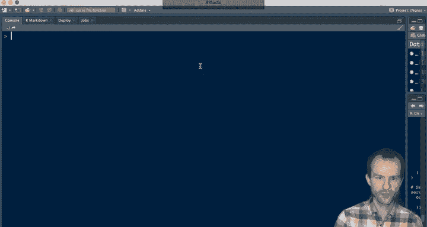

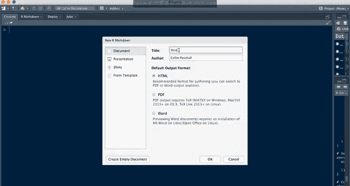

First， add into the front matter or the setup area of the Fl dashboard， the line runtime shiny。

And then in the R setup， load the tidy verse and shiny as well as the MT Cars data set。

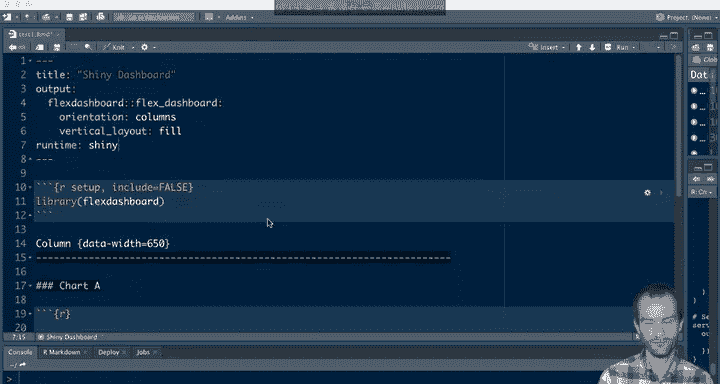

Now change the first column， rename it， input。

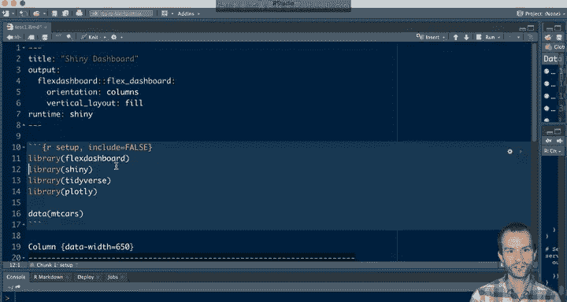

Remember you can name rows and columns whatever you want here。

 the key is that you follow the name with a line of dashes in order to create that column。

After the input column name here， add the attribute dot sidebar。

And this is going to create a sidebar where the shiny interactive controls are going to go in the document These are the things like the sliders or the select boxes or the radio buttons that we've seen before when we were working the shiny。

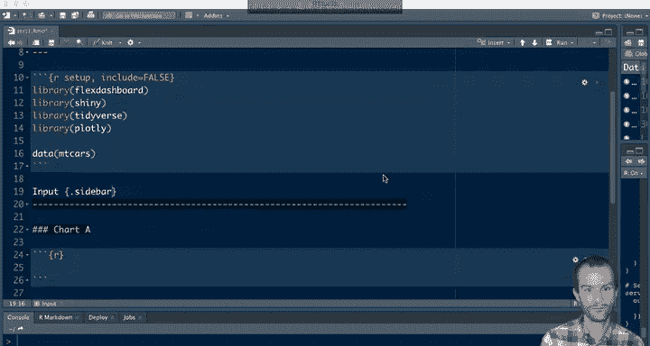

So go ahead and change the heading for this panel to user input。

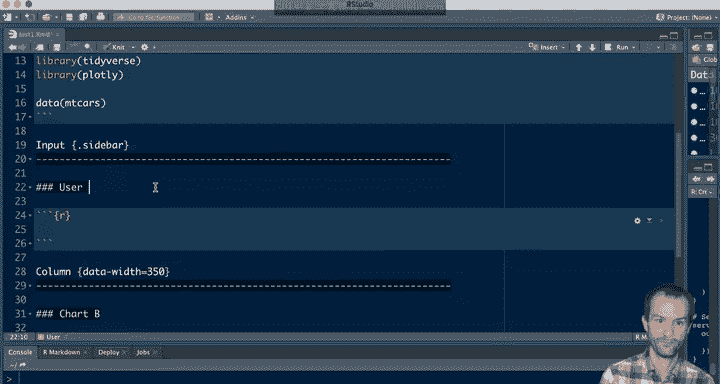

In this example， I'm just going to use empty cars and create radio buttons for the users to look at data for four。

 or six or eight cylinder cars， filtering that out。

I'm studying the radio buttons function here and setting the input ID， the label， the choices。

 just like in a standalone shiny app。

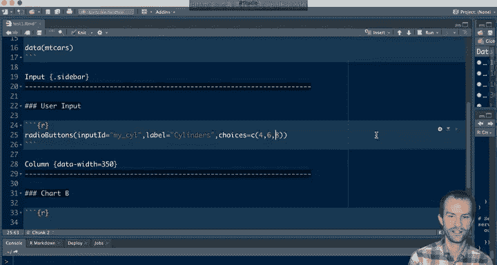

The figure we're going to create is going to be a plotly style interactive scatter plot of miles per gallon against weight for either four。

 six or eight cylinder cars， depending on what the user wants。

So I'm going to use render plotly here and tell the dashboard to render a Gigi plotly object based on the input from the radio buttons。

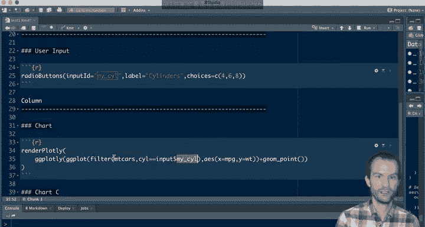

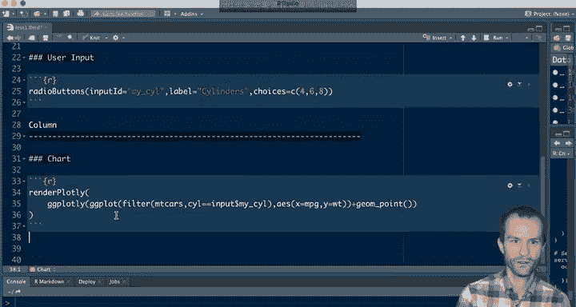

I'm just going to remove the material for chart CA right now and once you do that。

 go ahead and click Run documentcument。And as you can see now we have a dashboard with a shiny app integrated right into it。

 using a plotly interactive figure。Now， because we created this dashboard and we included shiny content into it。

 we're not going to publish this to our pubs， instead we're going to publish this to shinyapps。

Io by clicking the publish button。And this is just like we did earlier with a full flood shiny app。

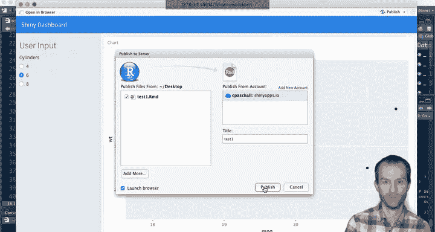

So as you can see， Fl Dashboard is not particularly difficult to use。

 but allows gives you another option for how to share your visualizations。

 and especially in the dashboard format， which is so popular in many business settings and so desirable for many decision makers。

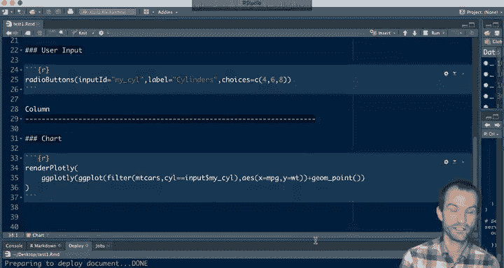

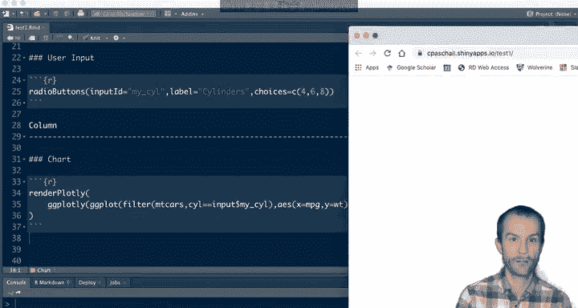

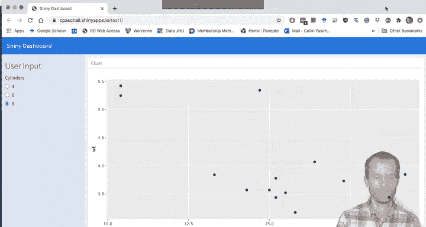