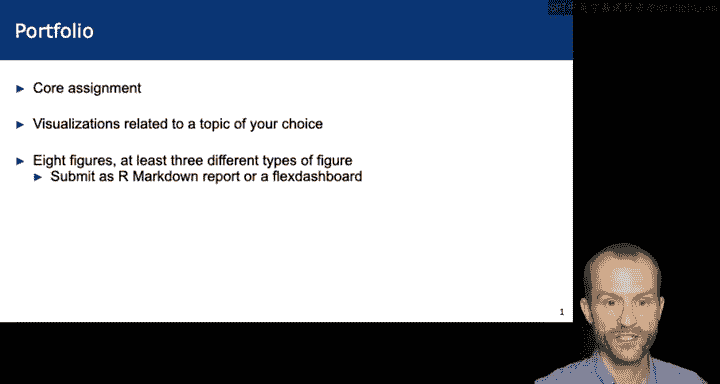
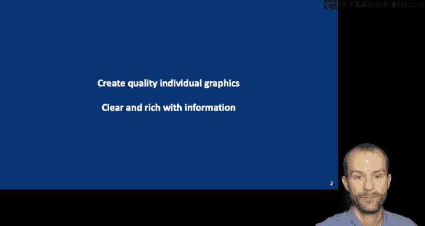
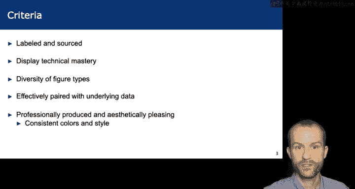
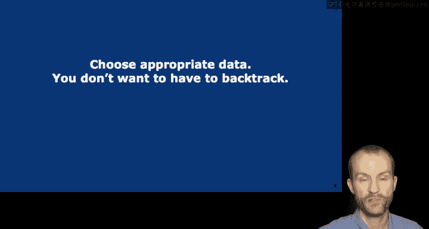
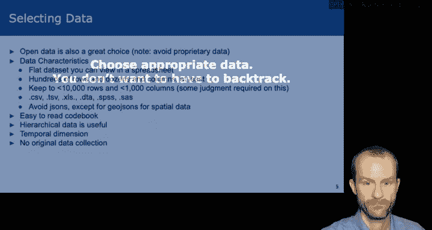
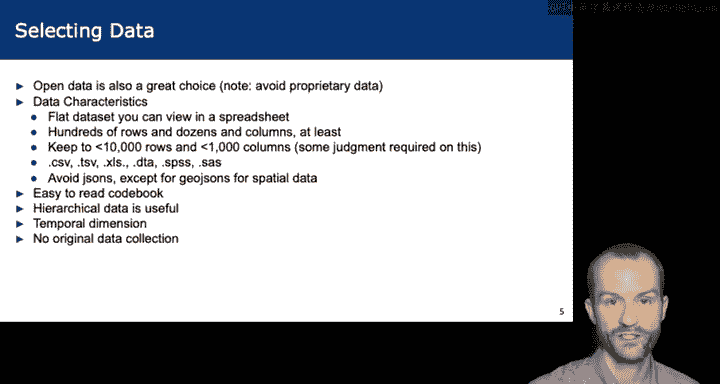
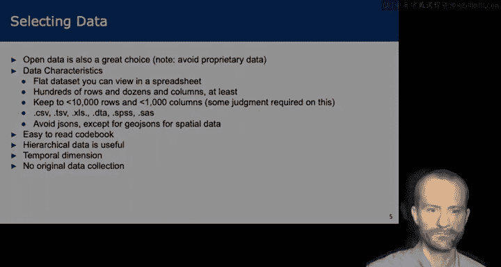

# 约翰霍普金斯大学《R语言数据可视化和仪表盘｜Data Visualization & Dashboarding with R》中英字幕 - P58：1_项目概述和查找数据的技巧.zh_en - GPT中英字幕课程资源 - BV1YWPjeKEWz

In the next few minutes， I'm going to provide you an overview of the capstone project and also provide some suggestions for data sources。

The capstone project is the core assignment of this course。

 and it is the culmination of the entire specialization。

You're going to create a data visualization portfolio related to a topic of your choice that demonstrates the skills and abilities that you've learned to visualize data with R so far。

The final project is going to be eight data driven graphics。

 and you'll be able to submit this either as an R markdown report or as a dashboard created using Fl dashashboard。

As you think about the project， remember that the primary emphasis is on the quality of the graphics。

 and the most important feature of the graphics is going to be the clarity that they have in delivering a rich amount of information。

You should think about several things when you're trying to put these together。

Make sure that your graphs are properly sourced and labeled。

Make sure that the graphs display technical mastery of the skills that you've gone through in this course。

Make sure that you have a diverse type of figures in your portfolio with at least three different types of figure。

Make sure the graph types effectively represent the data that they're presenting。

And make sure that the graphs are aesthetically pleasing and professionally produced。

 This goes along with all the other points here。Keep in mind that these are the general requirements of the project and one of the most important steps is choosing appropriate data。

It's very difficult to make a good set of data visualizations if you don't have data at your fingertips that you're able to manipulate and prepare for visualization。

So you want to make the choice about what data you're going to use early on here because you don't want to have to change course midstream。

There are many different potential data sources that you can use。

If you have interest in a substantive area， there's probably data on it somewhere out on the internet which you'll be able to download and use for this project。

If it's something that you're familiar with through your work or through your educational background。

 that's fine， and in fact I encourage you to do something that will be professional useful to you。

My only thing about that is that you want to make sure that your data are open source because you want to be able to replicate your analysis and replicate your visualizations。

 using proprietary data like from your work or business that's private might not be a good choice here。

 so I would avoid that。When thinking about the kinds of data you might want to use for the project。

 there are a few things that you want to keep in mind。First。

 you want to make sure that your data is rectangular， it should look like a spreadsheet。

 and it should have rows and columns。You want something with probably hundreds of rows and at least 10 or 12 columns if you want to have enough data to visualize for this project。

However， I would avoid really， really big data sets。

 which would be something maybe like more than 100。

000 rows and maybe more than 1000 columns because this is going to get very taxing for data management purposes and you don't have that much time。

And keeping with this advice， I would really recommend that you find something like a spreadsheet。

 so an Excel file， comma separated values file， tab separated values file。

 or some kind of easy easy to read statistical file like a data or SPPSS file。

There'll be more about this in the data import video in the next video。

I would generally suggest that you avoid using JSON files。

 which is something that you might find out there because those are a little bit more difficult to work with。

The exception to that would be if you have some kind of spatial data。

 which is a GeJSON file if you're trying to make a map。When you're looking for data。

 you want to find something that has a code book， kind of like what we've used in the previous courses of the specialization。

You want to make sure that the codebook describes what the variables mean and how they're coded。

 so you don't have to spend your time trying to puzzle out what some of these things are。

Find well documented data that's not terribly messy。

 and that will increase your chance of being successful in this course。If possible。

 it's nice also to have data that has like a hierarchical component or maybe a geographical component。

 something like voters in states， prisoners in jails， customers and cities， students in schools。

 something along those lines， because this will provide you a little more flexibility in terms of the kind of data that you visualize。

It's also useful to have data that has a temporal component。

 so observations across units across time so that you can make line charts。

Whether or not your data will be suitable for the final project is an important decision。

 but it is difficult to give one size fits all advice。

You'll need to use your best judgment when considering different data sources。My advice， however。

 generally， would be to be conservative。Don't put too much on your plate in terms of managing a lot of data。

If you have to make a choice between data that seem really interesting but are difficult to use or sort of less interesting data that's really well documented and well formatted。

 I would definitely go with a better documented and better formatted data just to make your life easier。

I'm confident that with what we've covered in the specialization so far and with the few additional details that we'll cover in this course in the next week。

 you'll have all the skills that you need to create a great set of visualizations with some interesting data。

Again， good luck and have fun along the way。

