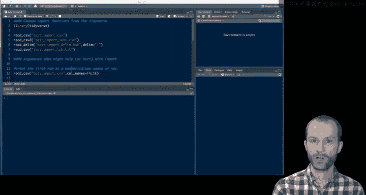
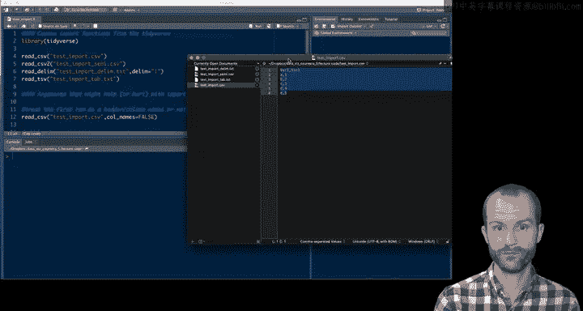
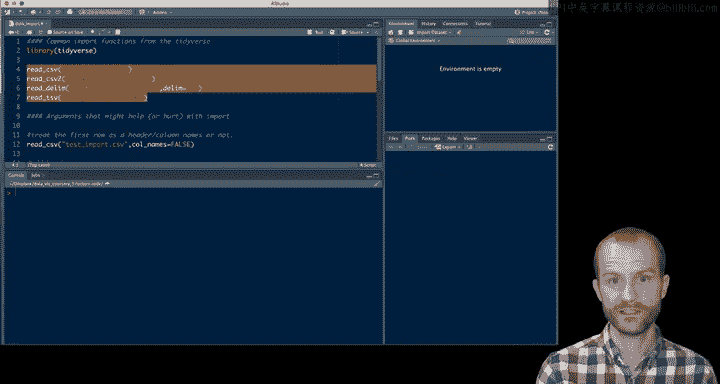
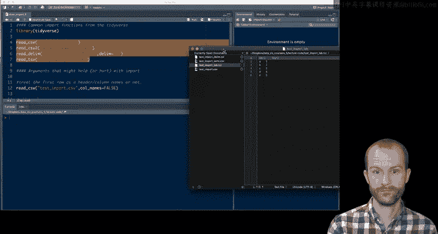
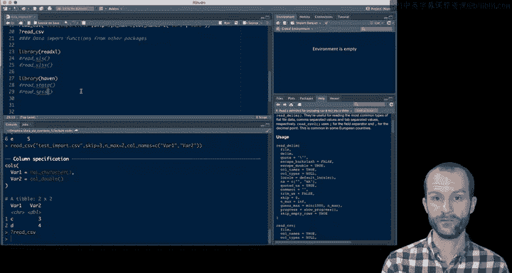

# 约翰霍普金斯大学《R语言数据可视化和仪表盘｜Data Visualization & Dashboarding with R》中英字幕 - P59：2_数据导入.zh_en - GPT中英字幕课程资源 - BV1YWPjeKEWz

As you go out and look for publicly available data。

 you will find that rectangular data comes in many different file formats。Fortunately。

 R is quite good at importing data from many different file types。

The data import cheat sheet that follows this video provides a good summary of many of these functions。

 and here I'll show you a few of the most important。

You are already familiar with comma separated values files and the Read_ CSV function。

But other common types of data have different delimiters than commas。

 with delimiters meaning the characters and the raw data that separate data across columns。

Several examples are included in the files associated with this video。

These include semi colon separated files。Filees where the separator is this little vertical line that's about the enter or return key on many keyboards or tablim files。

You can read any of these file types in with the R functions we're going to go over here。

 which correspond with the different delimiters。

Along with functions for reading these different formats of files。

 you can also tell these functions to read the data in with specific instructions。

You could choose to read in the first row in the file as a column name or not。

Or you can assign your own column names that will proceed at the first row as you read in the file。

You might also have some instances where you want to skip to a row to begin reading or provide a maximum number of rows to read in from one of these raw data files。

And this can be really helpful if you are working with very large files and you only want to read in a certain number of the rows。

If you're having a problem reading in very messy data。

 you might want to look through the different arguments of these different functions to see if one of the options might be helpful for getting your data cleaned up a little bit more from the start。

In addition to the tidyverse functions from radarar， like what we've just gone over。

There are a couple of other packages that are handy for other kinds of files。

These include the Read Excel package， which includes functions for reading or XLS X files for Microsoft Excel。

And the Have package， which includes functions for's data or SPPSS files。

Which are two kinds of files that are used for specialized Sta software。

These functions are similar in their use to the other kinds of import functions。

If you find some kind of other type of file that you're not sure whether or not you can read it into R。

 it's worth just Googling to see if theres a way to import that data type into R。

There are lots of different functions and a lot of different file types out there。

 and you may find something that we haven't covered in this video。

