# 约翰霍普金斯大学《R语言数据可视化和仪表盘｜Data Visualization & Dashboarding with R》中英字幕 - P5：4_R中的函数.zh_en - GPT中英字幕课程资源 - BV1YWPjeKEWz

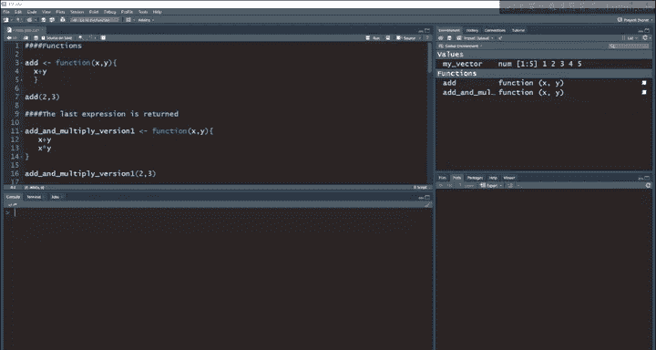

Beyond basic math and logical operators。

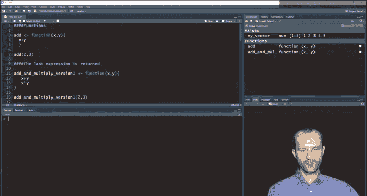

R works by using functions。And a function is a set of commands that tells R to do something with a set of input。

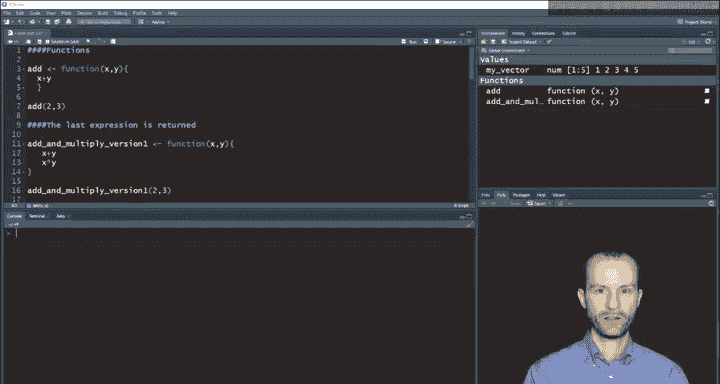

You specify a function in R by writing function and then putting in parentheses the inputs you want users to put into the function separating those inputs by commas。

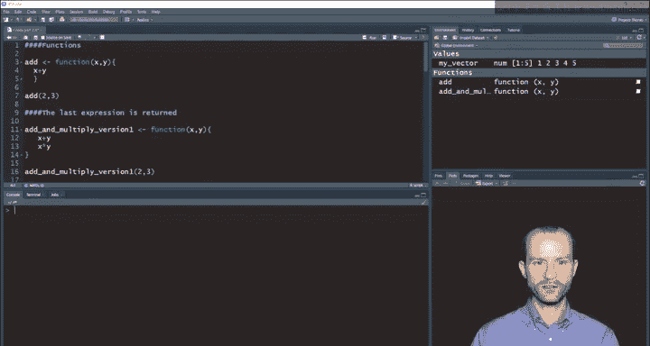

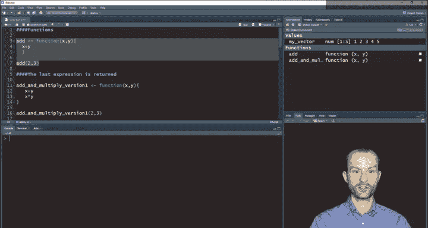

Then in brackets， you provide the set of commands that you want the function to do with the input。

Herere in this example， which Im saving to the object add。

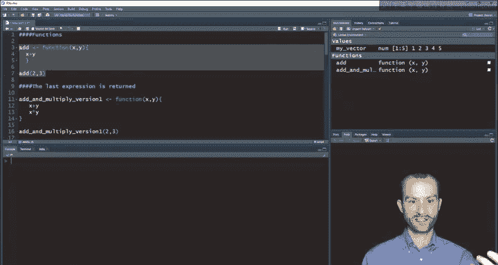

We're telling our to add up the two input values。

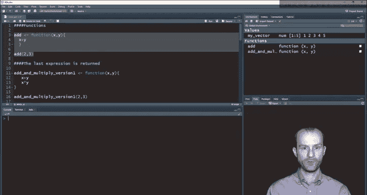

By default， after you run a function。

R will provide as output the last evaluated expression in the function as it does here。

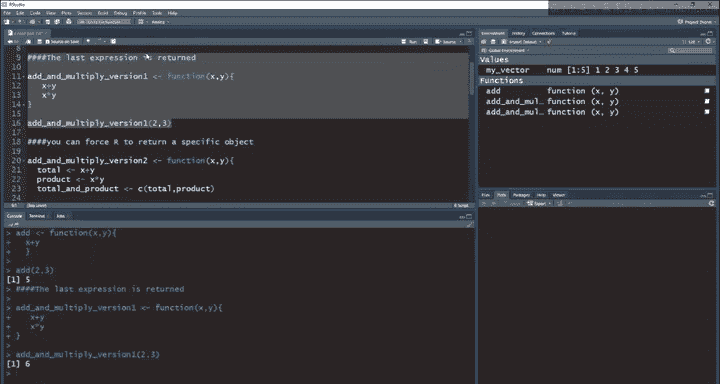

Alternatively， you can tell are what you want a function to display by wrapping the return function around an object that you save within the function。

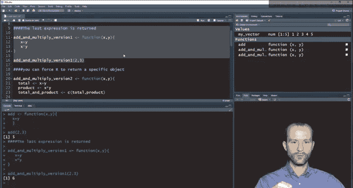

And that object can actually be a vector。

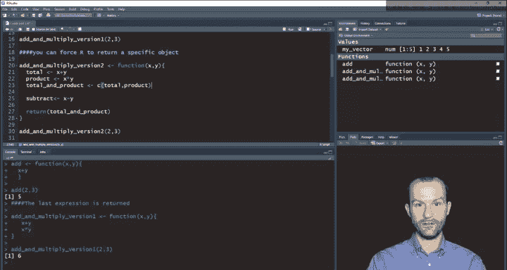

You probably won't end up writing that many functions on your own in this course。

 but I thought it was helpful to show you how these things work underneath the hood。

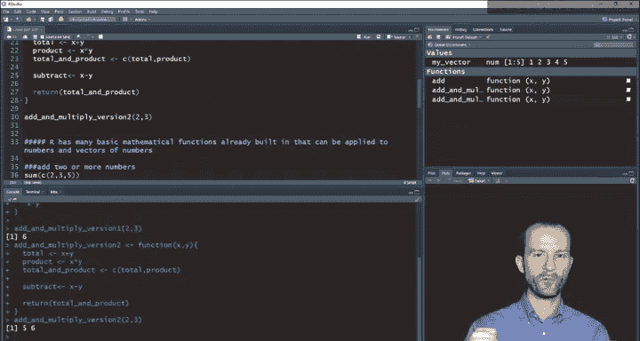

And from this very simple foundation， you could theoretically build functions that do anything you want are。

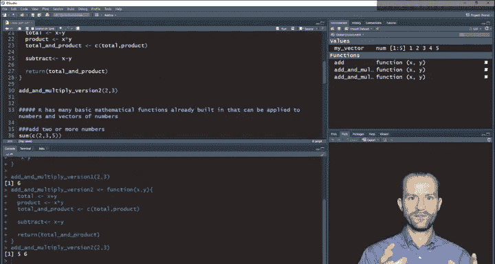

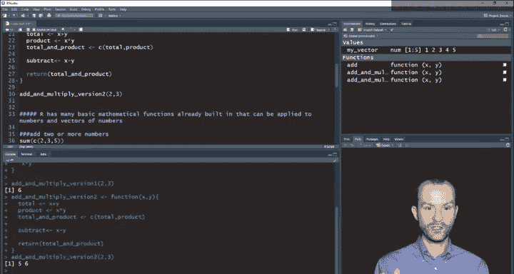

But practically speaking， our software developers around the world have already written thousands of functions that you can download and apply to your own data。

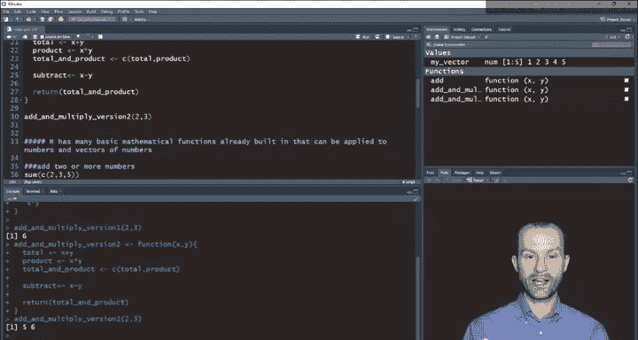

So for example， there's no reason that you need to write a function that adds numbers together in a vector because R already has a function to do that。

 and it's called the sum function。

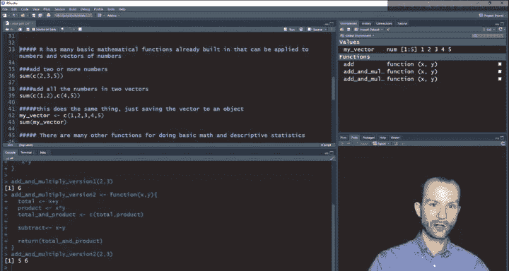

If you put a series of numbers or a vector of numbers into the sum function。

 it will return the total of all that input。

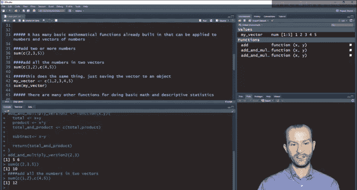

And again， this is basically how all of our works， you apply functions to numeric and character data built on numeric and logical operations。

As you'll find out as we go along， there are lots of different functions that can provide simple descriptive statistics and other useful information that are built right into R and then you can also go out and download a lot more exotic functions。

 which we'll get to later。

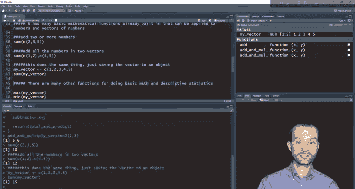

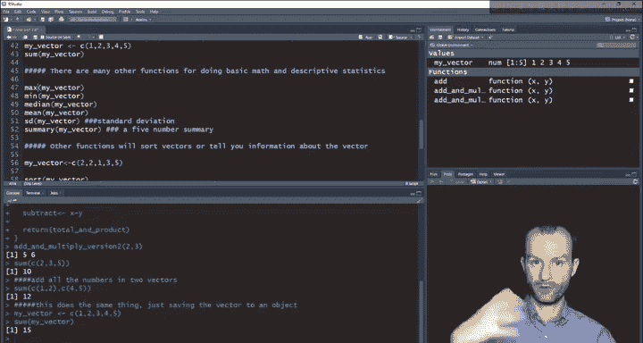

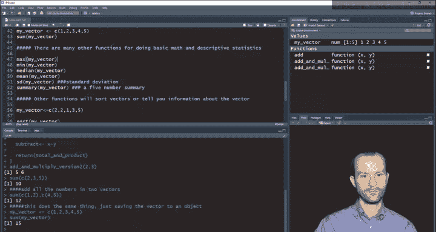

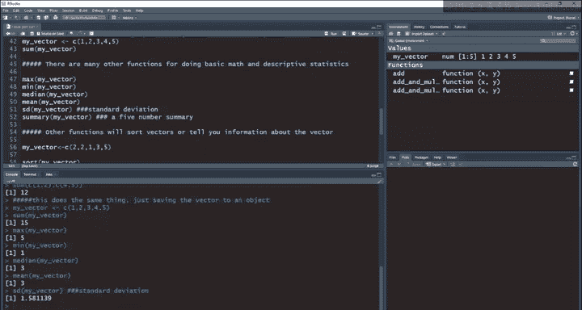

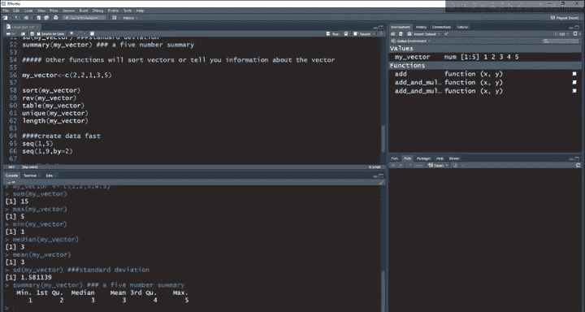

Some other common and useful functions that will return information about vectors are sort reverse table。

 unique and length。

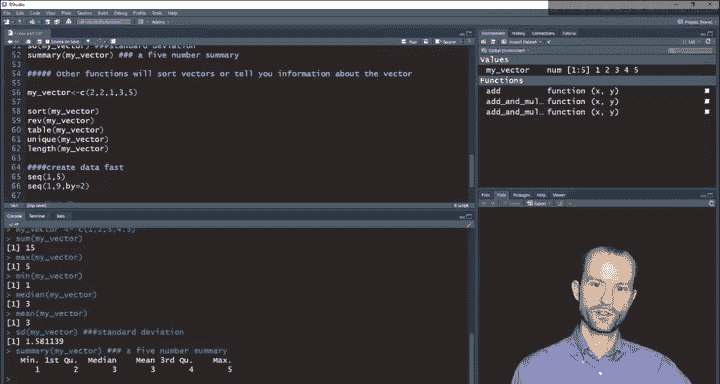

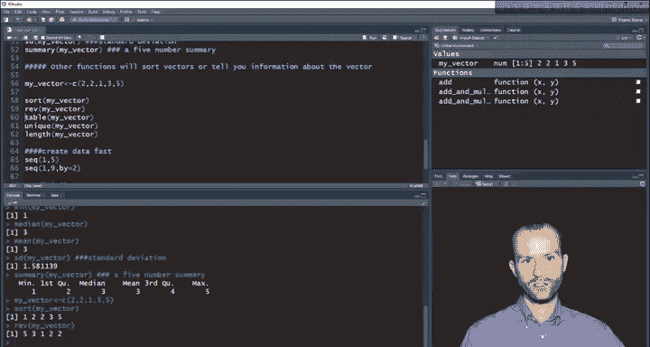

And you should run these and get a sense of what these different functions do。

You can also use functions to help you create data very quickly and some handy functions there are sequence and rep。

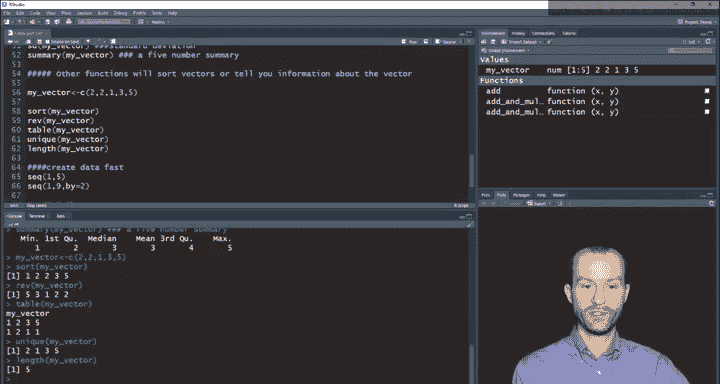

Which will create sequences of numbers and repeat elements of vectors。

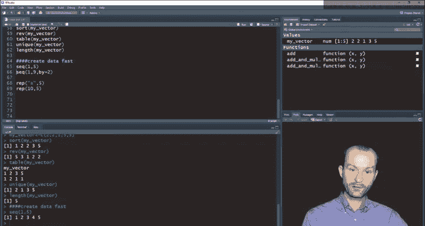

Try those out too to get a sense of how those work。

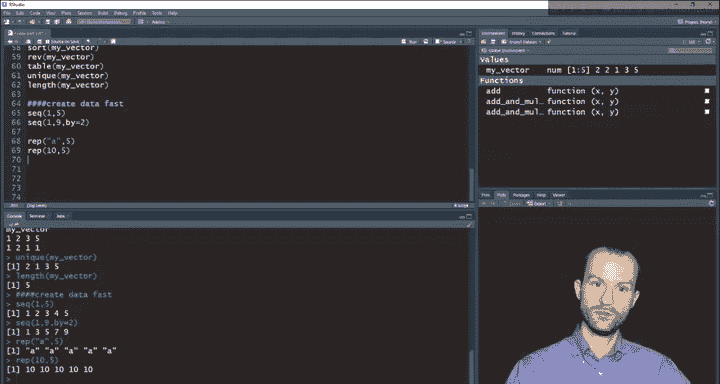

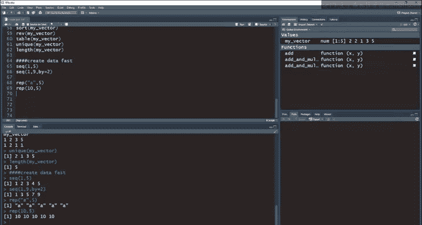