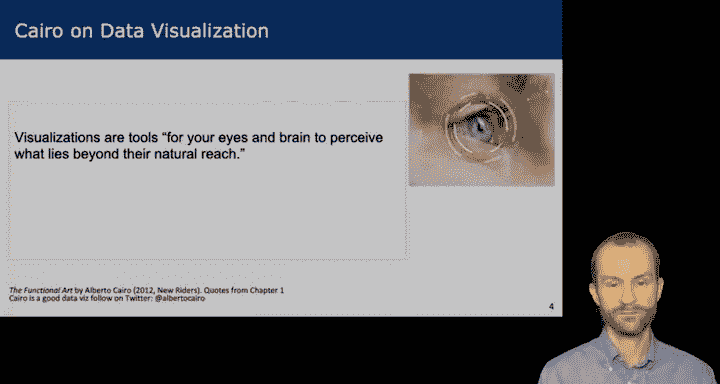
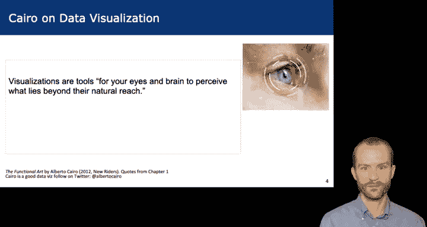
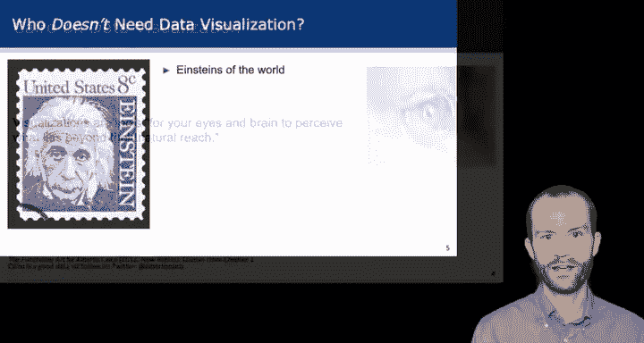
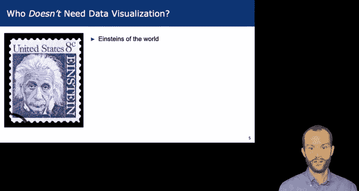
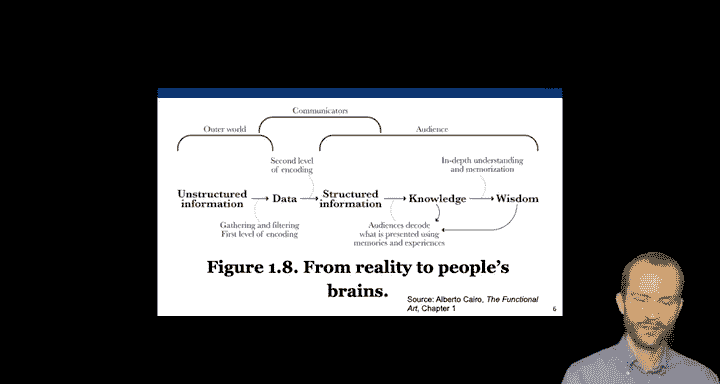
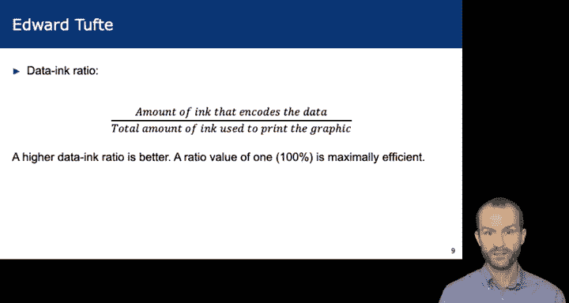
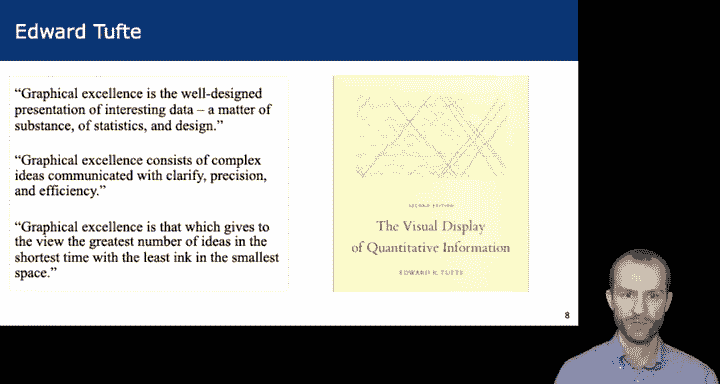
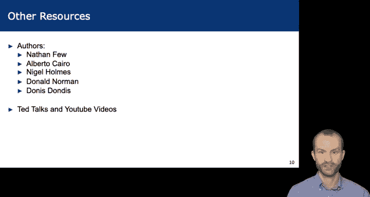

# 约翰霍普金斯大学《R语言数据可视化和仪表盘｜Data Visualization & Dashboarding with R》中英字幕 - P60：3_数据可视化要点.zh_en - GPT中英字幕课程资源 - BV1YWPjeKEWz

Our emphasis throughout these courses has been on learning the software needed to create visualizations and R。

We haven't spent very much time at all on visualization theory or best practices。

So I want to take this opportunity to spend just a few minutes talking about some of the basic concepts in this area and make you aware of a few resources that might be valuable if you are interested in learning more about this。

Now that we have all these tools for visualizing data。

It's a good time to go back and think about some basic questions。

We spent all this time learning to use art to visualize data。

 but why is visualization all that important to all？Why is it an important tool for data analysts？

Given that visualizations are so common in our media today。

 you might have an intuition about this already， but it's worthwhile to formalize it。

Essentially the reason that we visualize data is that as Alberto Cairo puts it。

 graphics and visualizations are tools for your eyes and your brain to perceive what lies beyond their natural reach。

But differently， because we are so awash and data today。

 it's very difficult for us to comprehend all that data and see patterns in it without sensory aes that help us process information。

There might be some people out there that are so gifted in their mathematical skills and spatial reasoning that they don't need visualizations to understand data。

But for the rest of us， visualizations are very helpful。

With a graphic that can be easily generated with software today。

 you can take a bunch of unstructured data and leverage it in a way that makes it easier for an audience to understand。

If you're curious to think more about this a little more formally。

 you should check out this figure from Alberto Cairo's book， The Functional Art。

And you may want to pause the video and contemplate this for a few minutes。

What does this really mean practically if visualizations are useful for organizing unstructured data。

 what makes for a good visualization？If this is something you want to think more about。

 there are a lot of resources available and there are in fact competing schools a thought about what makes for a good figure。

To a degree， my conclusion from all this is that some of it is in the eye of the beholder。

So what's important from the author's perspective is to think critically about how you visualize data。

 what information you're including， what you're excluding。

 and what kind of statistical truth you're trying to tell with visualization。That said。

 if I have to point you to a few maxims， I would start with the work of Edward Tufty。

 who is one of the most significant figures in data visualization in the past generation。Tuffy。

 who was a political scientist before he switched to gears to become a visualization evangelist。

Switch his focus mid career and dedicate himself to advocating for better ways to display statistical information。

His book， The Viual Display of Quait information is a true masterpiece on this topic and I would really encourage you to pick up a copy and breeze through it sometime。

Toughty presents three principles of graphical excellence。

 which I would offer for your consideration。First， graphicphal excellence is the well designed presentation of interesting data。

A matter of substance， of statistics and design。Second。

 graphical excellence consists of complex ideas communicated with clarity， precision and efficiency。

Third， graphical excellence is that which gives to the viewer the greatest number of ideas in the shortest time with the least ink in the smallest space。

This third point called the efficiency principle， is especially important。

 and it can be stated more concisely as the data ink ratio。

The data ink ratio is equal to the amount of ink that encodes the data in a figure。

Divided by the total amount of ink used to print the entire graphic。Generally speaking。

 the higher the ratio， the better the figure。Ideally。

 100% of the ink that prints the graphic is dedicated to encoding the data。

This might not be practical in real life， but it's the ideal that you can shoot for when you're trying to think about how to design a visualization。

Looking at Tufty's principles， you should see why I say that a good statistical graphic is an exercise in critical thinking。

What constitutes well designed， clarity and similar terms is up for debate。And in fact。

 there are some graphic design professionals who take issue with Tufty's minimal approach。

 pointing out that many audiences today are used to seeing fun or creative visuals。

 and humans have this tendency to gravitate towards novelty。

 and they might get bored by very basic figures。

In my view， the better approach is to start minimally and then build complexity as you see fit。

Considering at each step， whether your visual flourishes are helping to tell the statistical story that you as the analyst。

 have gleaned from your close work with the data。There's no replacement for knowing your data well。

 so before you make any decisions about visualizing。

 make sure that you know what the data are telling you。

As I've mentioned， there's a lot more that could be said about this topic。

And if you want to learn more about it， a few authors that I can recommend with interesting books and work in the area are Edward Tuftty。

 of course， but also Nathan Fugh， Alberto Cairo， Nigel Holmes， Donald Norman and Donis Dons。

A YouTube search for Edward Tfty can also yield a bunch of interesting results。

 including recorded talks and presentations。

Prorovs any of this at your leisure， but above all。

 remember that the emphasis is bringing your own critical eye to your work as you visualize data。

