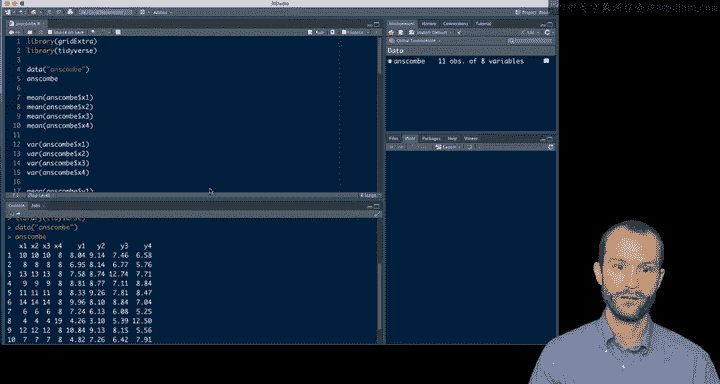
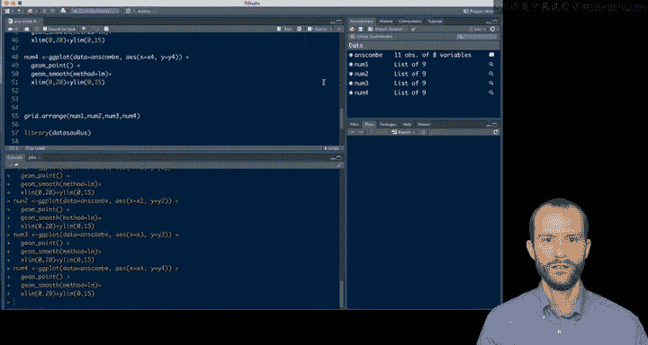

# 约翰霍普金斯大学《R语言数据可视化和仪表盘｜Data Visualization & Dashboarding with R》中英字幕 - P61：4_安斯库姆四重奏和数据恐龙.zh_en - GPT中英字幕课程资源 - BV1YWPjeKEWz

Data visualization is so ubiquitous today that you hardly ever need to justify its value for audiences trying to contend with the data driven world。

However， if you ever do need to justify the value of data visualization。

 a classic example that is worth reviewing and having at your fingertips and is often featured in data visualization textbooks is Anscombe's quartet。

NsCO's quartet is a set of four data sets， each with two columns， an X and a Y。

If you calculate these summary statistics for the data sets。The four data sets look identical。

The means and the variances of the x columns are the same。

 and so too are the means and variances of the Y columns。For each of the four data sets。

 the correlation between the x and y are essentially the same。

So if you were just looking at summary statistics， you could easily be deceived into thinking that these four sets are all substantively very similar。

However， data visualization shows that these four data sets are not equivalent。

If we make simple scatter plots for the x and Y values and run a best fit linear regression line through them。

You can see that the data are not equivalent at all。

 and they show very different patterns of curves and clustering。

This is an excellent concrete example of how important it is to create visualizations for even very simple data。

For a more fun example of this， Steph Locke and Felix Kramer created an R package called Dataaurus。

Building on examples from Alberto Cairo， Justin Mateika， and George Fitzm。

As this visualization shows， the data source package includes 13 different data sets。

With essentially the same summary statistics， but creating radically different shapes with scatter plots。

So if you ever need to justify the importance of data visualization to anybody。

 look no further than these scatter plots of dinosaurs and stars。

