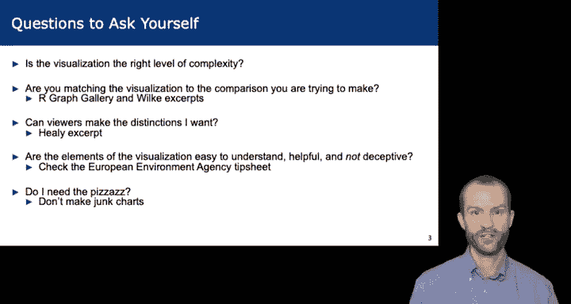

# 约翰霍普金斯大学《R语言数据可视化和仪表盘｜Data Visualization & Dashboarding with R》中英字幕 - P62：5_更多最佳实践和阅读概述.zh_en - GPT中英字幕课程资源 - BV1YWPjeKEWz

You'll see that I've provided a lot of readings for this week following this video。

And I think I've curated a nice set of resources on visualization best practice。

And you would benefit greatly from reviewing these now and keeping them handy for your future visualization work。

However， I realize that it's a lot of information to consume。

 so I'll just hit on a few highlights here。To start with， I cannot assign the book here。

 but along with Tuft's the visual display of quantitative information。

 I would also encourage you to get a copy of Alberto Cairo's dysfunctional art。

Ciro makes several excellent points about data visualization design that I would emphasize。

The first and main goal of any graphic is to be a tool for your eyes and brain to perceive what lies beyond their natural reach。

Second， in information graphics， what you show can be as important as what you hide。Third。

 visualization should be seen as technology， they are a means to reach goals。

And finding the complexity of a graphic should be adapted to the nature of your average reader。

I think these basic maxims translate into a number of questions that you need to ask yourself when you're visualizing。

First， is the visualization at the right level of complexity for your audience？Well。

 the average person who you think is going to be seeing this visual going to be able to make sense of it。

Is there enough context for them to understand what's going on？Additionally， you should ask yourself。

 is the visualization I'm using right for the job？Visualizations can show a variety of different kinds of relationships。

They can show distributions， correlations， rankings， composition， change over time。

 and other features。In the readings for this week， the RGra gallery and the textbook excerpts from Klaus Wilke's book are very useful on these points。

 showing you a gallery of different possible visualizations and the types of relationship that each visualization is good at showing。

You should also ask yourself， does the visualization that I'm creating include visual elements that allows viewers to make the distinctions I want them to？

Think about position， length， angle， area， and color as sort of the different features of a visualization that you can modify in order to allow people allow your audience to make distinctions and understand what you're trying to communicate。

Humans have varying levels of ability to make distinctions on each of these dimensions。

 so you want to think carefully about how you're using these in your visualizations。

The textbook excerpt from Kiing Healley's textbook is especially good at making these points and showing you that the different ability of individuals to make these distinctions and to interpret visualizations。

You also need to ask yourself and make sure that the elements of your visualization are sensible and not deceptive。

Your axes should be easy to understand， and typically you should use the full axis on your X and Y axes in the figure。

Use transparent intervals， be careful about scale。Many people are not going to be comfortable interpreting logarithmic scales or other kinds of transformed scales。

 so oftentimes the best thing to do is to start with a linear scale and if you're going to do something else be very explicit about what you're doing to make sure that it's easy to interpret what the axis is saying。

Use color strategically and carefully， it can really add a lot to your figures。

 but it can also make them too busy and can distract the reader from the underlying message。Also。

 you have to remember that there are a lot of people out there， especially men who are colorblind。

 and so you might not want to rely on color for drawing sharp distinctions in your data that are really important because either your audience might be colorblind or they might have to see this on the written page in black and white when colors are much more difficult to distinguish。

And then additionally， generally speaking， just avoid too much pizz in your figures。

 things that are like blown apart or rendered in 3D on a 2D surface are very difficult to interpret。

 so be very cautious about using these。The same thing goes with animations。

 animations are really cool， but sometimes it's better just to show things in small multiples。

 so using facet wrap， for instance， to show distinctions across different categories of your data。

The guidance document from the European Environment Agency has a really nice list of these guidelines and tips which echoes what I've said here。

 so make sure you read that very carefully。When you first start visualizing data。

 you're going to make mistakes and you're going to feel a little bit confused。

So it's always good to go ahead and make your visualization， take your best crack at it。

 and then go look at some of these tip sheets to see if you made any common mistakes。

And if you really want to look at some bad charts， I've included a link to a junk chart website which shows you some really bad offenders when it comes to making bad visualizations。

Avoid trying to show up on junk charts。

