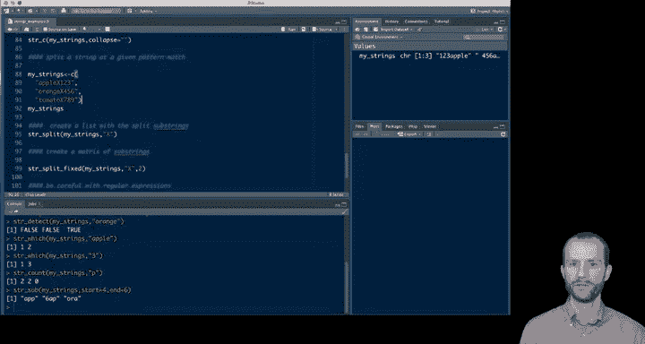

# 约翰霍普金斯大学《R语言数据可视化和仪表盘｜Data Visualization & Dashboarding with R》中英字幕 - P64：7_字符串.zh_en - GPT中英字幕课程资源 - BV1YWPjeKEWz

Most of the data that we've worked with in the past has been numeric data。However。

 sometimes the data in the cells of a table is not going to be a number。

 but instead there'll be words or either strings of characters。

These can be a little bit difficult to work with， so the tidyverse has a special package designed for dealing with this type of data called stringingR。

The most common tasks with strings is pattern recognition。

 by which I mean determining whether a given cell in a table contains a pattern or series of characters like a word。

You also sometimes may need to split up character strings and spread those data across multiple columns。

String our cheat sheet does a great job of summarizing these functions。

And the reference materials for stringR on the tidyverse pages is very clear。

But I'm just going to go ahead and show you a few examples to orient you to functions in this package。

Let's start by creating a short character vector， which we'll use for an example。

This is made up of a few strings shown here in the code。

Note very carefully the arrangement of these characters， including any blank spaces。

If we run string detect on this vector。We can do a logical test for the presence or absence of a pattern in a string。

Here we're testing for the presence of this pattern of characters and each of the elements of the character vector。

We're trying to get it true or false for whether or not this string of characters is present in each one of these cells。

Where our finds the pattern， it returns a true and otherwise false。

If instead of a vector of truths and falses， you wanted the output here to be the elements of the character vector that contain a given pattern。

 So like the first， the second or the third or the first and the third or the second and the third and so forth。

 you can use the function string， which。We identify the data again and give the function a pattern that we want to check for。

The output is the index values of the vector for the elements of the vector where the pattern is present。

String counts will count up the number of times that a given pattern of characters appears in each element of a character vector。

So here， if we use the character P。We see that there are two P's and elements one and two of the vector。

String sub will extract a substr from each element of a character vector。

And you can specify within the function the range of the characters that you want to extract。

So here we indicate the start position at four and the end position at six。

And running the function will pull out the fourth， fifth and sixth characters in the string in each element of the vector。

I could go on and on here and illustrate every function in the string our package。

 and the code file here has many more examples。But you should get the basic point by now。

The string R function allows for pattern matching it and substitution in character strings。

And you'll also find that the functions can split or combine character strings。

 which can be handy for creating new columns of data。

It's all fairly straightforward and it can be important for managing these kinds of data。

So run all the functions in this code and make sure you understand how they all work。

 so you're aware that these functions exist in case you need to use them in your work。

One thing you should be aware of， but I'm not going to cover here is regular expressions。

On the second page of the string our cheat sheet， you'll see a lot of information at regular expressions。

And in short， this is an extremely powerful set of tools for doing more complex pattern matching。

 allowing you a lot more flexibility than matching exactly or substituting exactly similar strings。

However， regular expressions can be quite complicated and this is really a better subject for a more advanced programming course than what we're doing here。

For now， just know that if you have a very complex problem with pattern matching with less structured or very irregular character data。

 you might be able to fix that and resolve it using regular expressions。When the time comes。

 you may want to start with chapterer 17 of Roger Pang's book， our Program for Data Science。

Which does a much more in depth coverage of regular expressions and how they're used。

A link to that chapter is included in the readings for this week。

