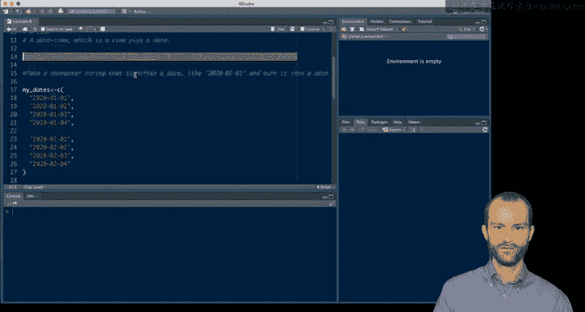
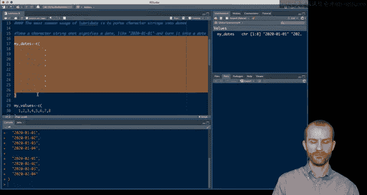
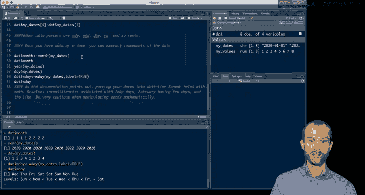
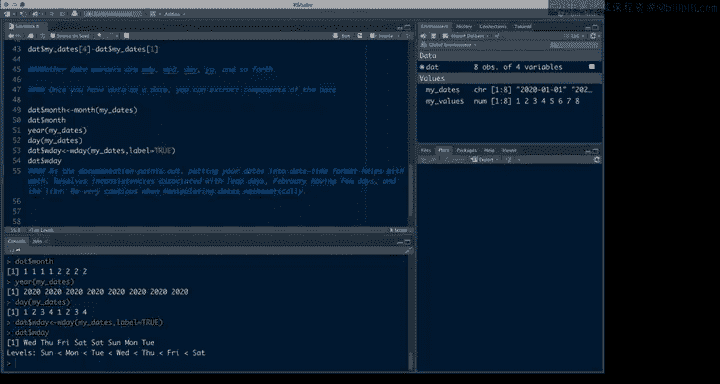

# 约翰霍普金斯大学《R语言数据可视化和仪表盘｜Data Visualization & Dashboarding with R》中英字幕 - P65：8_lubridate.zh_en - GPT中英字幕课程资源 - BV1YWPjeKEWz

Along with character strings， another type of data that can present some tricky problems is dates。

Dates are often character strings and data。They aren't really characters。

And they aren't earn numbers either because dates and times have unique properties。

 like different number of days and months， and the problem of leap years。

To help deal with some of these concerns， an additional helper package for the tidyverse is luer date。

 which does require a separate package installation。

The readings that follow this video provide a detailed walkthrough of luer date。

 but here are the essentials。In the tidy verse， there are three types of temporal data。A date。

 a time and a date time， which is a date plus a time。

The core functionality of luber date is to take character strings that might have this kind of data embedded in them。

Parsse them and turn them into data that is of the date class in R。

So let's take a character string here of dates in year month day format。

And put them together with a set of arbitrary values of a variable。

Creating a tablebble。Now let's see what happens if we try to do something like subtract the first element of the dates column from the fourth。

We might think that this should be three because it's a period of three days。However。

 you see that this doesn't work because we have the date in character format。

So what we have to do is use one of the lubri date functions， in this case， YMD for year month date。

 and turn that character string into a date in R。Once we do that。

 we can do math with the dates and R will correctly calculate differences in time。

And the date value will also behave better if we try to sort them， summarize them， or plot them。

As you'll see if you look at the documentation， there are multiple functions that will parse dates like this。

 like MDY for Mon year。MYD for month year day， DMY for day month year and so forth。

Along with working better with math， once you have your dates classified as dates。

 you can use functions and luerate to extract components of the date， like the month， the year。

 the day， or even the name of the day of the week。So in short。

 LuberDate makes date information much easier to work with。

 and you should always convert your date information from characters into the date class so that you can use these functions。

