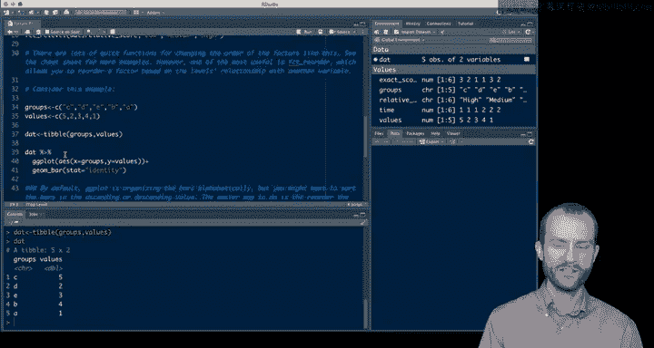
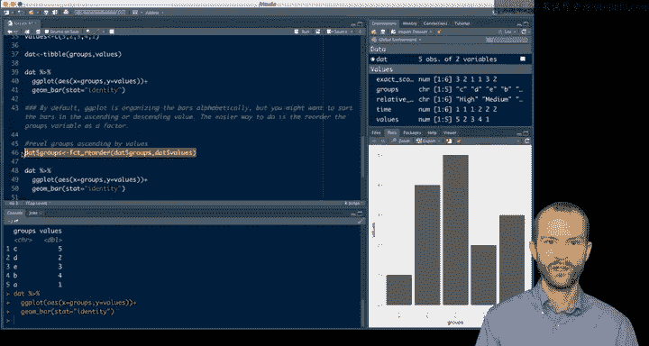
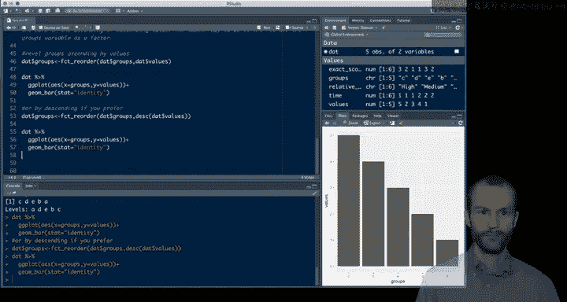

# 约翰霍普金斯大学《R语言数据可视化和仪表盘｜Data Visualization & Dashboarding with R》中英字幕 - P66：9_因子.zh_en - GPT中英字幕课程资源 - BV1YWPjeKEWz

Along with dates， another type of character data that can be tricky to work with is factors。

Factors are categorical data that usually have some kind of order associated with them。

 but that order might not be strictly numeric。Examples might be data like groups， so like group A。

 group B， and Group C。Or relative or general scores like high， medium or low。These aren't numbers。

 but they have some kind of implicit order， and this can be important in the data。

The best way to deal with character data like this is to turn it into a factor。

When you convert data into a factor， each distinct value in the vector is assigned a corresponding level。

And the levels have some kind of order to them。You see we have that here。

 but the levels are automatically assigned in R and they don't make sense。

Because they are an alphabetical order rather than an order of relative magnitude。To correct this。

 we will use a function from the four cats package from the tidyverse called Factor relevel to manually reorder the levels of the factor。

 like so。Now the levels are in the correct order and the factor data will behave much better if we're trying to plot it。

This is really helpful when you have a figure that just doesn't work right and you're trying to get the order correct on one of the axes。

For instance， let's take this little fake data set with a series of a few letters and a few values associated with each letter。

Say we want a simple bar plot here。As you can see， by default。

 R treated this column of letters as a factor and sorted the x axis of the bar plot by alphabetical order。

This might not be the way you want it on the figure， and without reordering the factor。

 this can be really frustrating to deal with。But we can quickly reorder the levels of the factor to make the figure more attractive。

By feeding factor reorder， the vector that we want reordered。

Followed by the other vector in the data that we want to use to sort the factor levels。

We can easily get the levels in the order we want on the figure by ascending value of the sorting vector。

And if we wanted to do this in decenting order， we can easily do that as well。

For cats includes a lot of convenience functions for quickly reordering factors in this way。

So you should take a few minutes and further familiarize yourself with these functions in case you need to use them in your own data。

Keep this handy and you have categororical data in your projects going forward。

