# 约翰霍普金斯大学《R语言数据可视化和仪表盘｜Data Visualization & Dashboarding with R》中英字幕 - P67：10_连接和透视.zh_en - GPT中英字幕课程资源 - BV1YWPjeKEWz

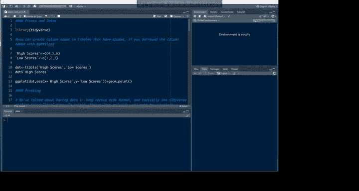

With string R， lubriate， and forecast cats。You are ready to handle more kinds of data as you process it and prepare it for your project。

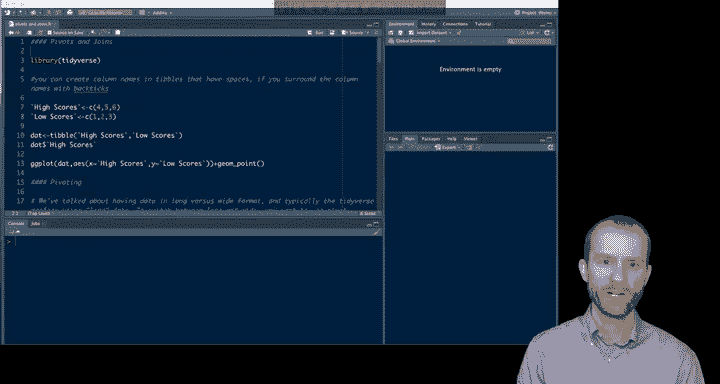

Before we go， though， I want to review just a couple more important data tidying skills that we might not have caught so far。

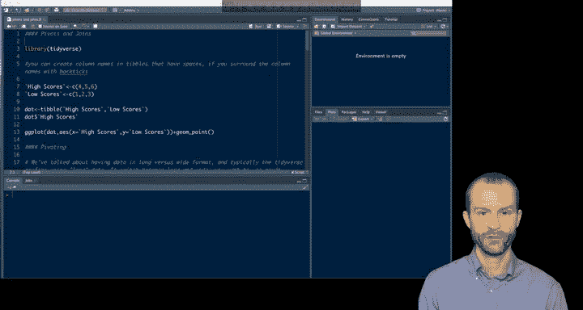

You might be working with multiple kinds of data for your project， from multiple sources。

 I want to make sure that you can get all that data in the right format and as needed。

 joined together。

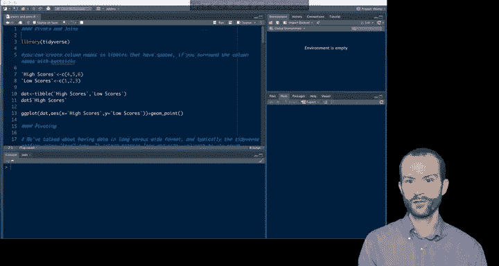

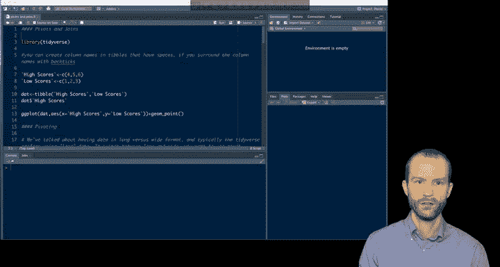

One small point dimension mention here that I don't think I've touched on before is that you can actually create column titles in R for Tbbles or data frames that have spaces in them。

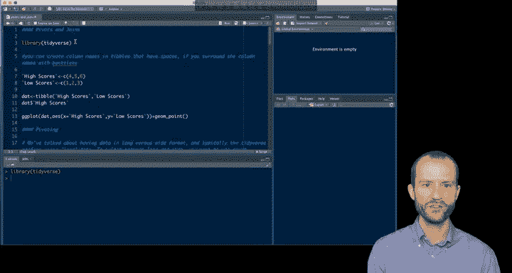

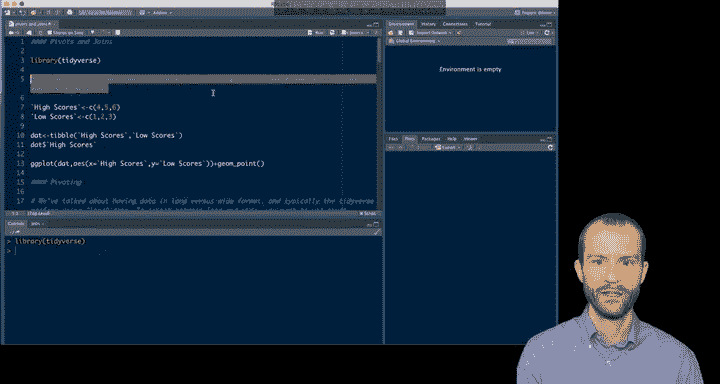

I don't usually recommend this， except at the stage when you might be making legends or Axes titles。

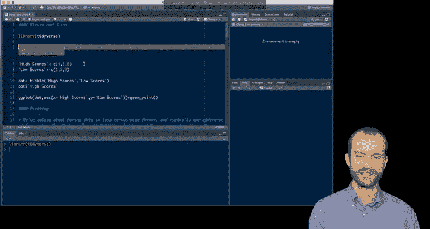

And you want to make sure that these are well formatted。

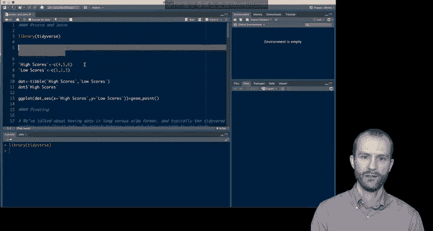

If you enclose a character string in backtics and R。

 you can create an object with that name and combine those into a tipple。

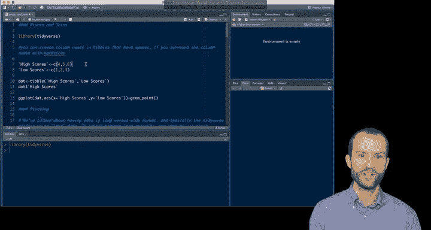

And then you can call that column or include that column in a Gii plot function if you wrap the name of the column in backtics。

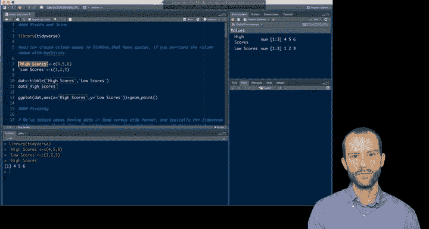

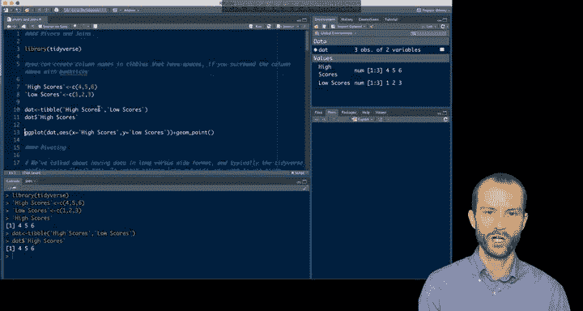

You may also find that when you import data that this is how columns are named。

 so be aware of this when you're working with your own data。

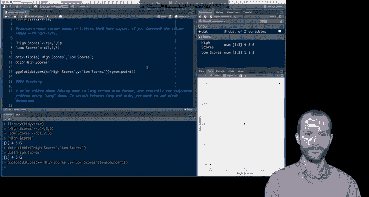

This is a good time to also review the idea of pivoting data from wide to long format。

I've said before that in the tidy verse， we prefer to work with long data where every row is a single observation。

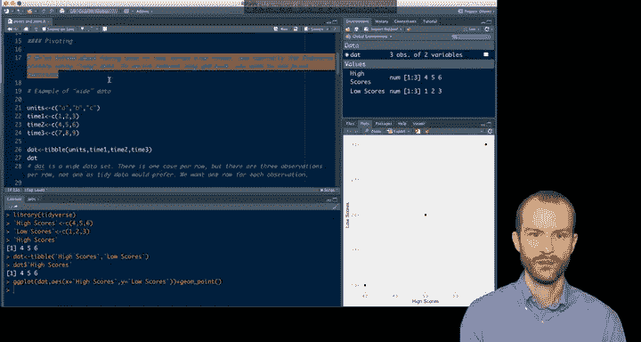

But often you'll find data out there in the world that is in wide format。

 where every row might be a case， but there are multiple observations of that case in each row。

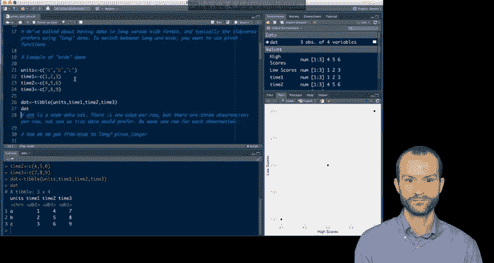

For instance， the little table I've created here is in wide format。

There are three observations for each unit or case at time1， time2， and time three。

 so the observations are wide across the table。

This is not a good way to work with the data in the tidyverse。

 so we want to be able to pivot this data into long format。We do this with pivot longer。

To make pivot longer work， first we feed the function， the data that we want to pivot。

And then we select the columns that we want to pivot。After that。

 we give a name to the column which will contain the previous column names and a name to the new column。

 which will be home to the values that we are pivoting。If this doesn't make sense， just wait。

 run the function， see what the output is， and then you'll start to put it together。

Once we run the function， you see that the previously wide data is now in long format。

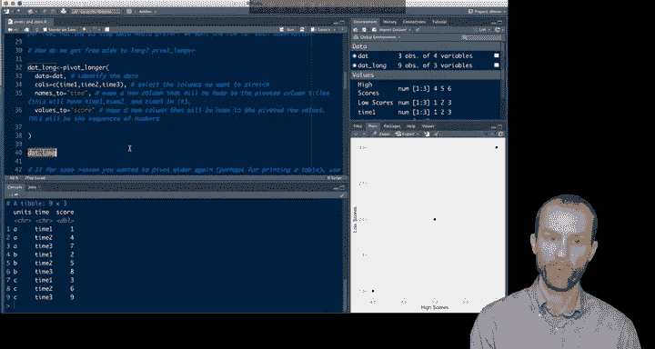

It's partially transposed。It's really important that you internalize this difference because it's not the way you might be used to thinking about data。

 and it's really important for working in the tidy verse。

If for some reason you want to pivot from long back to wide format。

 like if you are formatting a table， for instance， you can do the inverse of pivot longer with pivot wider。

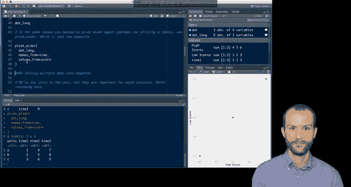

So again， go back and forth between these two formats so you understand how the cells are moving from wide to long format and back and forth so that you can get a sense of how this function works。

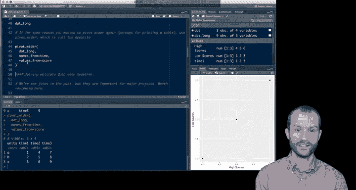

It's not very intuitive when you first start working with it。

Finally， I want to review joining or emerging data。

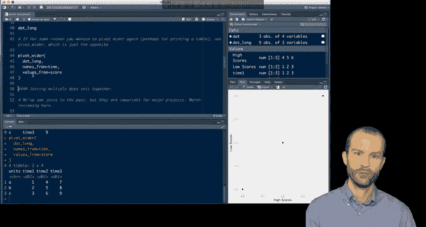

You may very well have data from multiple spreadsheets or multiple comma separated values files or some kind of other file。

 and you want to merge all these together into one really， really big table。

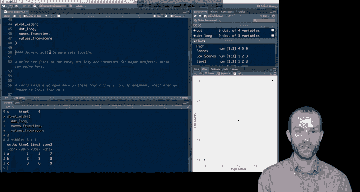

Say for instance， you had data about several cities in the world。

 but it was spread across multiple spreadsheets。

You have one spreadsheet with data about New York， London， Canberra， and Nairobi for one variable。

And another spreadsheet with data on New York， London， Canberra， and Jakarta for another variable。

It might be handy to get all the data for both variables for New York， London。

 and Canberra into a single spreadsheet。And we can do this with a join。

Joins work by finding key values in different tables and snapping the tables together on the basis of the key value。

A key value is basically just a shared column in the different tables。Here， for example。

 the shared or common column is cities。And we can merge the data together using a join based on that column of key values。

There are four kinds of joins。Left， right， inner and full。

A left join will keep all the rows in the first table that you put into the join function。

Matching the data in the second table to those rows as possible。

Every row in the first table will be in the resulting merge data。

 but if there is no data for the key value in the second table， that will be missing。So here。

 when we try to run the left join command， every row from the first table is present。

 but there is missing data for Nairobi because there is no Nairobi in the second table。

Jakarta is excluded entirely from the joint table because theres no Jakarta in the first table。

A right join is the opposite of a left join。So here， every row in the second table is there。

But with the missing data for any row where the key value was not present in the first table。

An inner join keeps only rows where the key value is in both tables in that shared column。So here。

 only the values of New York， London， and Canberra are included because those key values are in the shared column for both of the tables。

Finally， a full join will keep all the rows from both tables， creating more missing data。

Joining data can be pretty tricky， and it can also be kind of risky because there's a lot of room for error and a lot of possibility to lose data or mismerge data。

Little inconsistencies in the key value column can create errors and mismatches。

And you might need to do more complex pattern matching or other tricks to get your joints working properly。

Always， always， always check that your joints are working by doing some manual checking of your data。

For more information on joins， I really encourage you to read chapter 13 of R for Data Science。

 which is included in the readings that follow this video。If you understand that material， though。

 you'll be ready to merge together all kinds of interesting data and create great looking visualizations。

