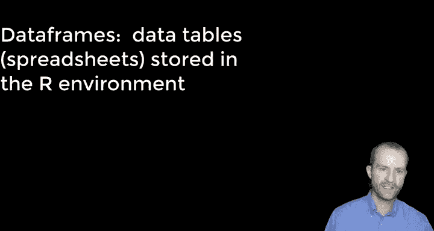
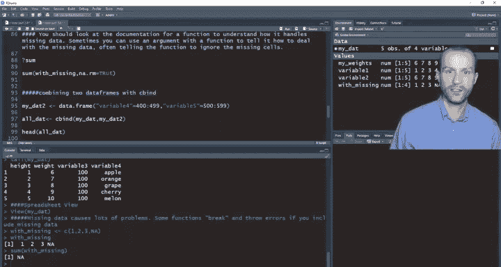

# 约翰霍普金斯大学《R语言数据可视化和仪表盘｜Data Visualization & Dashboarding with R》中英字幕 - P6：5_数据框.zh_en - GPT中英字幕课程资源 - BV1YWPjeKEWz

We're going to talk a little more now about how R manages data。

And so far you've seen that R can do operations on single numbers or character strings。

 and it can connect multiple numbers or characters together and create vectors out of those。

Beyond that， you can also create matrices in R， but more usefully from the perspective of making visualizations with data。

 you will use a data frame very often。

And a data frame is basically like a table or a spreadsheet that can be saved as an object into our's environment。

Data frames can have column headers or column titles。

And you can do different kinds of operations to add columns or rows to a data frame。

 and that's what we're going to talk mostly about in this video。

You create a data frame in R by combining vectors together， so for example。

 if we create two vectors and we save them to objects in R。

Then with the data frame function， we can combine those variables。

 those objects together into a data frame and save that to a third object that we can choose the name of that。

If you want to add the names for the columns and you want those to be something different than the names of the objects that you're putting together。

 you can specify that in the data frame function by putting the column label in quotation marks and making that equal to the vector's name。

That's a little hard to understand when you explain it。

 but you can just see how this code works and it's fairly intuitive。

Most of the time when you are working to create visualizations， you're going to use data frames。

 or as we'll see a little later， a very closely related kind of object called a Tibble。

And when you have data in these formats， you can call up a single column of those data using a dollar sign or a cash sign。

And when you do this， you're basically just calling up a vector and you can feed those columns of data into functions or you can even save those into different objects in the R environment if you want to。

If you want to select certain rows or columns or cells of a data frame。

 you can do that using syntax similar to what you would do if you were trying to select elements of a vector。

And you can select entire rows， columns， particular cells， and so on， using this kind of notation。

Once you have a data frame created， you can add columns to that data by assigning those values to a new column in the data frame using a cache sign here。

And when you do this， you have to add either a single value that's going to be repeated in every row of the new column。

 or you have to be adding a vector that is the same length as the number of rows of the data frame。

 they have to match up so you don't have some kind of like mismatch between what you're trying to add and the original data frame。

If you want to get some information about the size of a data frame， you can use the dim function。

 which will tell you the rows and columns， the structure function。

 which will give you even more data， or the number of rows or the number of columns functions。

And if you want to know the names of the data frames， the names for the columns。

 you can use the names function。If you have a really big data frame。

 you can use head to see the first few rows or tail to see the last few rows。

And if you want to see a spreadsheet view of the object that you can scroll through。

 you can use the view function。This is a good time here to talk about missing data for a second。

 and you'll find out that sometimes when you're downloading data that somebody else has collected。

 oftentimes that data set will be missing data there might be missing data for an entire row。

 an entire column or sort of across the data set in individual cells。

And it's really important to remember that these cells are not equal to zero。

 they're just blank and there's nothing in them。It R handles these blank cells by assigning the value in a to that cell or cells in your data frame。

Missing data can cause a lot of problems for you when you're analyzing data。

 it can cause functions to not work and it can also just make your data sort of inaccurate。

 so you want to be really really careful with how you do this。To give you just a simple example here。

 let's say we create a vector that has a single element missing。

 and then we try to use the sum function with that vector， you'll see that it doesn't work。

There's kind of a workaround for this and if you want to find out about this。

 what you can do is you can put a question mark in front of the name of a function， in this case。

 some， and that will bring up the documentation for that function or a help file。

And in that documentation， it will give you a description of what the function does。

 it will tell you what kinds of input or arguments will be pass to the function as well。

And these are just like more instructions that you can give to the function that will tell you how to handle the data that you're putting into it or what kind of calculations that the function is going to run。

In this case， for the sum function， you'll see that theres this additional argument that you can use。

 the NA。Rm arguments， which stands for removing missing data。

And this allows you to put a true or false logical value into the function when you're running it。

 and that will determine whether or not missing data will be removed when the sum is calculated。

And so when you add that argument， the function will return to sum of these values and it will just ignore the missing data entirely。

Again， you want to be very careful about this and ideally you want to have clean data with no missing values in it。

 but sometimes in the real world missing data comes up and you'll need to know how to deal with it。

Now， jumping back for a second to manipulating data frames。

 another very common task that you will encounter is combining different data frames together。

And you can do this using the C bind function。You just have to make sure that if you're using the column bind function or C bind and you're trying to put vectors or data frames together。

 you have to make sure that those all have the same number of rows。

 so again you don't have this like mismatch problem。The complement to sea bind or column bind is。

Abine or Robbines。And here you have to make sure that the row you're adding to the data frame has the same number of elements as the data frame has columns。

 so they have to vertically match up with each other。

And if you're combining two different data frames， you have to make sure that those columns are in the same order and have the same titles again to avoid any kind of mismatch issue。

