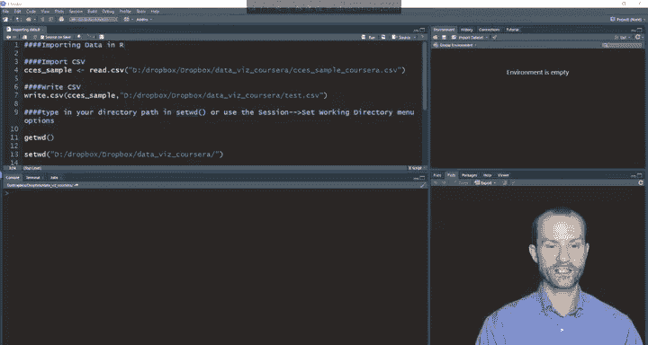
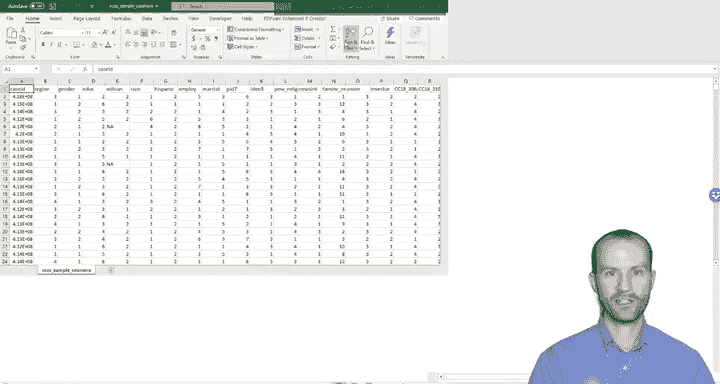
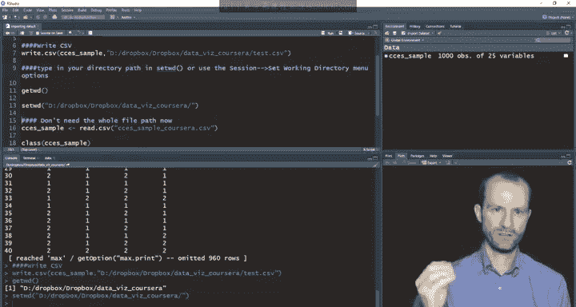
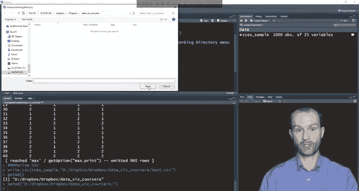
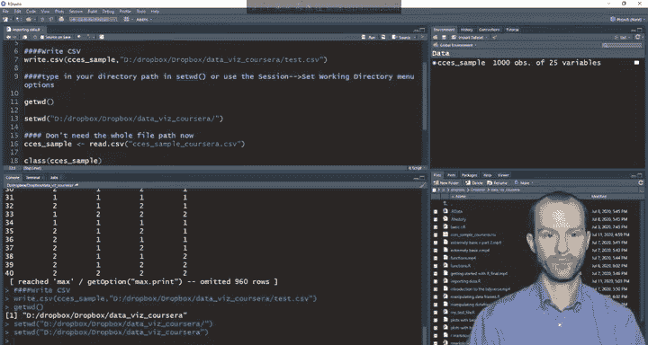

# 约翰霍普金斯大学《R语言数据可视化和仪表盘｜Data Visualization & Dashboarding with R》中英字幕 - P7：6_将数据导入R的基础知识.zh_en - GPT中英字幕课程资源 - BV1YWPjeKEWz

So far， we've been making up our own vectors and data frames in R to practice with。But in reality。

 you're probably going to be wanting to use some kind of outside data when you're doing data visualizations。

 probably something that you're downloading from the internet。

And the easiest kind of data to make visualizations with is what is called rectangular data。

 which is similar to what we've been working with， data that has rows and columns。

R can import a variety of different kinds of data， but a really common type of rectangular data set is a comma separated values file or dot CSV。

And I provided an example CSV file here in the materials that go along with this video。

You should download it and put it somewhere on your computer so you know the exact location of it in your computer's folder or directory system。

So if you haven't done that yet， pause the video， download the file。

 put it somewhere on your computer and then come back。

You might want to open up the CSV file now in a spreadsheet software like Microsoft Excel。

 just to take a look at it。

And the values for right now don't really matter because we're just going to practice importing data。

 but this is just to demonstrate to you that this is a rectangular data set。

The base function in R for importing dot CSV files is re dot CSv。And to use this function。

 you put into the readdot CSV function， the exact file path from your computer to the location of your file in your folder or directory structure。

You put the file path in quotation marks and you use forward slashes here to separate directories。

You can assign the output of a reddot CSV function to an object in your R environment。

 and this imports that data into R so you can use it just like any other kind of data frame。

The opposite of reading a dot CSV file is writing a dot CSV file。

 so you can take a data frame that you've created in R and you can write that to a CSV file。Again。

 using the exact path of the file name that you want to write the file to。

Now another way to read data into R that does not require you to set the exact file name is to import it from your working directory。

The working directory is the directory on your computer where input files for R are found and output files are written。

 so that's where you could find a write do CSv command if you didn't specify a file path。

You can find out what the working directory is by using the Git working directory command。

 and you can also set the working directory using the set working directory command。

 again specifying the exact file path on your computer。

Our studio also has the convenient option of letting you set the working directory through the top menu bar。

 so if you go to session set Work directory and choose directory。

 you can browse to the folder where your do CSV file would be or where you want to set the working directory up。

When you do that， R will automatically put in the appropriate set working directory code into your console。

Alternatively， you can also use this menu shortcut to set the working director to the location of your dot R file。

Or you can use the file tab in the lower right pane to navigate to the folder and set the working directory that way。

It doesn't matter which one of these methods you choose。

 they are all ways of accomplishing the same thing。

 but the key is to remember that you can only have one working directory at a time。

If you set the work in directory， then you only have to use the file name in your reddot CSV or write dot CSV commands and you don't have to use the full directory path。

A final option for importing data is to use the import dataset set button in the upper right of your R studio window。

And however， you choose to do this once you import data into R， again。

 this data is just like a data frame that we created manually， there are columns， values and cells。

 and sometimes missing data。And you can apply functions just like we have before。

It's good here to add one more quick detail about navigating through our studio。

When you're doing a lot of work in R， you're probably going to build up lots of variables in your R environment。

 and sometimes you want to start fresh and make sure that your code can be replicated from scratch。

And when that happens， you just need to click the little broom in the upper right of your R studio window。

 and this will clear out all the objects in your environment and you'll have to run the code again to get those loaded up。

Additionally， occasionally our will encounter some kind of strange， persistent error。

 it might even freeze up if you're trying to do something with a lot of data， and when this happens。

 you can reboot your R session by selecting restart in the session menu。

This is kind of like turning the computer on and off。

 it's the first thing to try if you're having some kind of technical issue。

