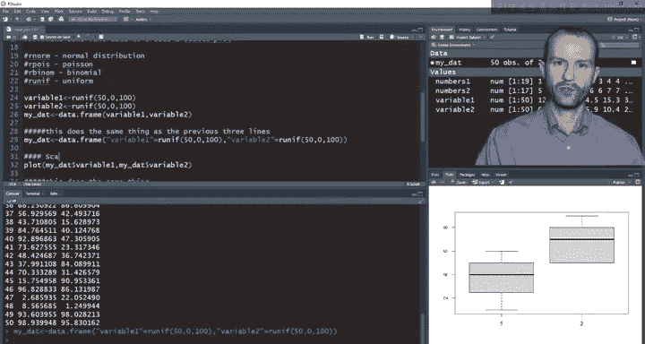

# 约翰霍普金斯大学《R语言数据可视化和仪表盘｜Data Visualization & Dashboarding with R》中英字幕 - P8：7_基础R可视化.zh_en - GPT中英字幕课程资源 - BV1YWPjeKEWz

In the standard installation for R or what we call base R。

 there are a number of functions that can be used to make basic figures。

And there are numerous good online resources and cheat sheets for how to do this。

 and I've included some of these in the materials associated with this video。

When you plot any kind of data， you can make a univariate plot。

 which plots the distribution of values of a single variable or a single vector in R。

Or you can make a multivariate plot， which plots the values of two or more values in relation to each other。

A very simple univariate plot is a histogram， which is basically just a bar chart of frequencies for different values of the vector。

And if we create a vector of numbers with some repeats。

 you can create a histogram using the hist function to see how that works。

Another way to visualize a distribution of numbers is with a box plot。

And we can create a box plot with the box plot function。

You want to give a vector of numbers to the box plot。And it will show you the minimum。

 maximum median and first and third quartiles for that vector。

If you want to display more than one box plot， so for more than one vector。

 you can just feed two or more vectors into the box plot function。

Moving into the world of byvari statistics， you can create a scatter plot。

And let's make some fake data to demonstrate how to do this。

And this gives us an opportunity to use a couple more functions from the base R cheat sheet that we haven't gotten to yet。

With our norm， our pos， our binome and our unF。You can tell R to pull random des from these different statistical distributions given a set of parameters。

If that doesn't make sense to you， don't worry about too much。

 you can just think about this as a way of generating random numbers。For example。

 with the R unit function， we can tell r to pull 50 values randomly between 0 and 100。

Let's do this twice and then we'll put those vectors together into a data frame。

And you can do this on multiple lines of code， or you can combine all those commands into a single line。

As you get more comfortable using R， you're probably going to start putting things more commands into a single line because it's a more efficient way to write code。

Once you have the data in a data frame， as we have here。

 you can plot those values against each other using a scatter plot。

And the first variable goes on the x axis， and the second variable goes on the y axis。If you want to。

 you can also make it explicit which variable goes on， which axis。But。By default。

 it will go x and Y as you enter them in。This is another thing about functions is that you can sometimes be explicit and sort of have these x equals values or y equals values。

 but as you get more experience， you can drop those and the default position of the arguments will figure out how they're used in the function。

 this is just something that you'll get more comfortable with as you go along。In this scatter plot。

 each point is a single XY coordinate pair， a row in the data frame。

There's some limited ability to customize base R plots by adding additional arguments to the functions as specified by the help file for the plot function or for the histogram function。

 that sort of thing。And you can do things like add titles or change access labels。

 and I' show you an example of how to do that here。Once you have an image created an R。

 if you're using base R or later on， we're doing fancier kinds of graphics。

 you can export that using the export button in the Plo plane， plotlo pane of R studio。

And you can save the plot as an image or as a PDF， or you can copy the image to your clipboard and then paste it into another file that you're working with。

With base R graphics， you can quickly whip up simple histograms， density plots， scatter plots。

 bar plots， line plots， and some other kinds of figures that you can experiment with。

But as you do that， you're going to find that they're really not publication quality and some of the ability to modify them is pretty limited。

 and so to make publication quality figures， we're going to have to rely on other R functions which we will learn down the line here。

The point is just to provide a glimpse here for how R can generate figures very quickly。

