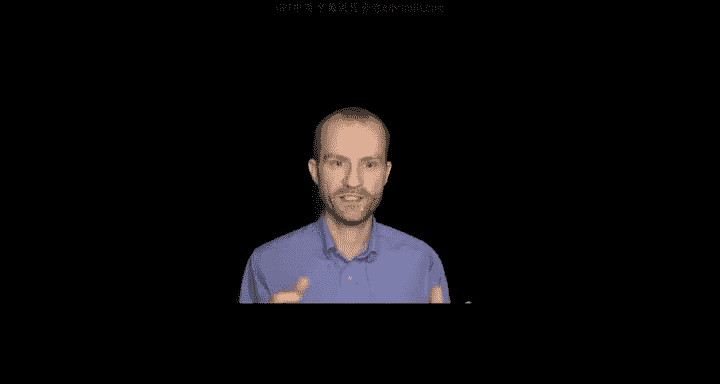
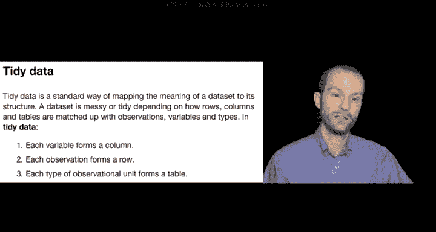
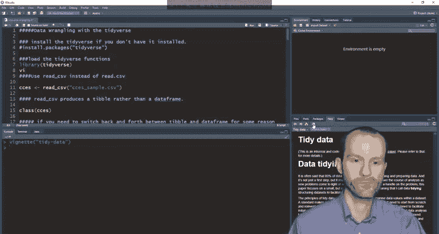
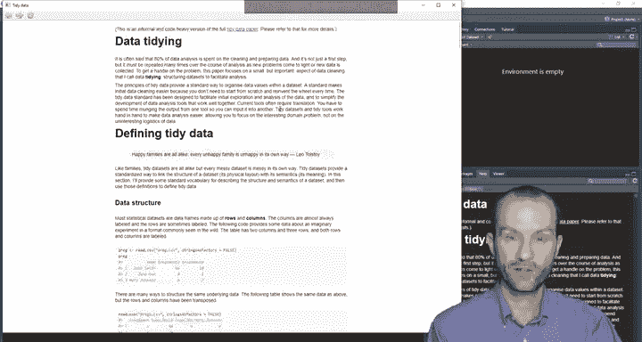
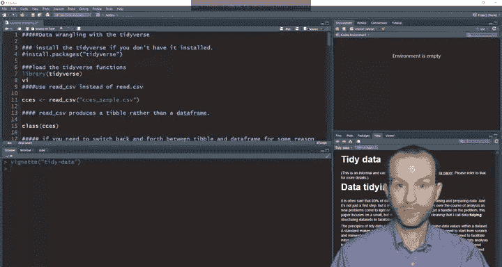
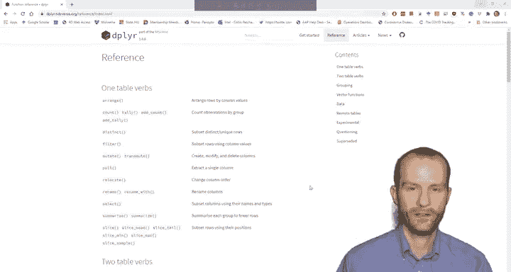
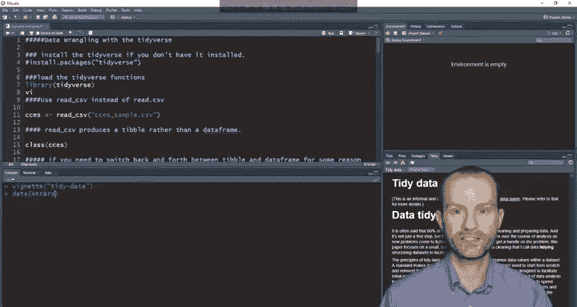

# 约翰霍普金斯大学《R语言数据可视化和仪表盘｜Data Visualization & Dashboarding with R》中英字幕 - P9：8_tidyverse介绍.zh_en - GPT中英字幕课程资源 - BV1YWPjeKEWz

So far we've covered how to load data into R， how to inspect data。

 and we've made our first visualizations using the base R visualization functions。

Now we're going to spend some more time talking about how to manipulate data。

And the application of these different data wrangling functions that I'm going to introduce in the next several videos might not seem all that obvious right at this moment。

 but you're going to come back to these over and over again as you start to make visualizations and work with more complex data sets。

It's very important to understand that when you're wrangling data with R and you're reordering it and reshaping it to meet your needs。

 that there's almost always more than one way to achieve the same outcome to get what you want。

And R has a bunch of different tools built into basear installation and then developers have come along and added even more functions。

 so if you see me do something， you might go out online and if you're googling around。

 you might find a different way of achieving the same thing and that's totally fine I'm just showing you one way to approach some of these data wrangling problems。

Associated with that point is that there are just way too many functions for me to give you like a comprehensive inventory of all the different ways to do stuff。

 so in this course we're just going to focus on commands that are part of what's called the tidyverse。

The tidyverse is a set of R packages that include many different commands for managing data。

 and as you'll see in a little bit for making visualizations from that data。

And it's the creation of a guy named Hadley Wickham who is a software developer and teacher who popularized many of the tools in the tidyverse and the approach that they take to organizing data in R。

Wickham has a very specific way of thinking about data and the tidy verse is based on these principles Wickham wants users to use what he calls tidy data when he's doing data science and he describes the principles of tidy data as follows。

Data is tidy when each column is a variable， each row is an observation and each cell is a single value。

And this is basically just another restatement of what a good looking rectangular data set would look like。

So if you ensure that your data is tidy before you start trying to work on it or make visualizations with it。

 you're going to spend a lot less time fighting with R and you're going to have a lot more time to work on your analysis itself。

Wickham does a good job of summarizing the tidy data approach in the documentation for the tidyverse package。

 and you can type into the our console thenignette and then quotation marks tidy data。

After you've installed a tidy verse， and then you'll see a short description of what he means。

I'm just going to walk through some of the most important functions here so you have a concrete sense of how these work in practice ultimately is necessarily going to be up to you to develop more comfort with the different functions and to get some practice I'm trying to point you to resources and get you oriented so that you're able to do more of that self-learning down the road。

A first great resource to look at is the Tiyverse website itself。

 Wickham and his colleagues have created a tremendous website at tidyverse。org。

And if you click packages on this website， it will direct you to an overview of the different components of the tidy verse。

Once you click on them， it will take you to online documentation for each of these packages。

 and these pages have a short introduction to the package。And also in the navigation bar。

 you'll find additional materials， including a reference page for many of the commands in the package You really want to kind of get used to looking at this because you're probably going to come back to it frequently while you're trying to learn the tidy verse。

There are also a series of really great cheat sheets。

 which I have directed you to in the materials for the course that will provide super。

 super brief overviews of how different functions work in the tidyverse。Finally。

 Wham has a freely available textbook on called R for Data Science。

 which provides a really good structure introduction to the tidyverse commands and some data visualization functions。

 and this is available at the website that I've also included information for。Again。

 going through every command of the tidy versus is going to be tiresome and hard to pay attention to。

 and it's not really all that important for you to learn every single function。

 you need to learn the functions that you need to use in your data tasks。At a very minimum。

 I would go through the data transformation cheat sheet and the data import cheat sheet and test out all those functions using example data。

And if you're looking for example data， a good place to start is the MT CarRS data set。

 MT carsRS is built into R as an example， and all you have to do to load it into your R environment is type into the console data。

 MT cars。

And it just has some technical specifications for a number of car models and it's a good data to work with if you want some practice。

 you'll also probably find a lot of examples online that are using the MT Cars data。

 so it's worth getting yourself used to working with it。

