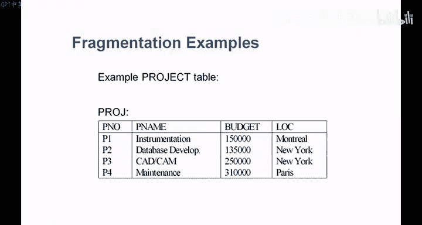
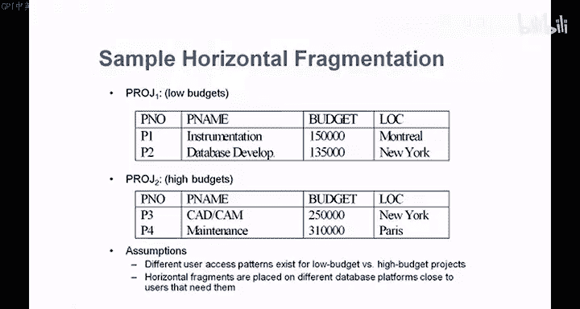
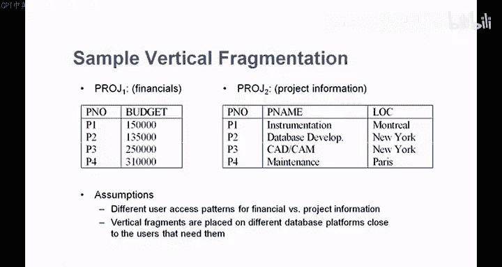

# 约翰霍普金斯大学《大规模数据库系统｜Large-Scale Database Systems》中英字幕 - P10：9_分片案例.zh_en - GPT中英字幕课程资源 - BV1N2urzvEjK

Welcome to Uni 2 of moduleule 3， entitled Horizonal Partitioning。

And this unit will discuss fragmentation。

Given a table， very simple table on the project table below， how to set it has four columns。

 project number， project name， budget and location。And in this very simple table。

 we actually have just four entries， Project 1，2，3， and 4。Each of the projects have a different name。

 a different budget and a different location。There are two ways to fragment this table。

 well at a minimum of two ways to fragment the table， but two major ways to fragment the table。

The first way to fragment the table。Is to break it into different sets of rows and those sets of rows would be accessed differently by different applications So for example。

 Project1 would represent the low budget items and project 2 represent the high budget items。

 So in a sense what we did was they took the same database with all the columns and we just broke it into two different sets of rows。

 those that would be accessible by people interested in low budgets and those sets of rows that would be interested that people interested in accessing high budgets would access。

So this is a logical。Fragmentation of this table and the assumption is is that different users will have different need for different types of data。

 so for example， perhaps low budgets are actually accessed by people in Chicago， for example。

 nothing against Chicago of course， and high budgets would be accessed by people in in Seattle for example。

For whatever reason， or alternatively， maybe more people need to access low budgets and less people need to access high budgets。

 or there's some differentiation differentiation in how people access the groupings of data such that it makes sense in a distributed database system to fragment this table into two horizontal fragments。

And we can move one to one location， one to another location to make it easier for people to access people who need low budget information would have their fragment closer to them。

 people who need high budget information would have their fragment closer to them。

 ultimately when people have different needs for different type of data。

 horizontal fragmentation often makes sense in a distributed database system。

Another type of fragmentation and we'll talk about both of these fragmentations much more detail。

 but would be vertical fragmentation， so taking the same table。

 we assume that there are people interested in financial information。

 and there are people interested in project information and maybe those people or applications are located in geographically different places。

 or maybe theres a different access pattern to them。

 perhaps financials are accessed more often than project information。

Or for other reasons where there's a difference in access pattern to each of these vertical fragments。

 it makes sense to break up thes to fragment the tables into horizontal vertical fragments。

Notice that when we do vertical fragmentation， there's always a column that is used to reconstruct the table。

The P number column， the project number column， is just that column。

Because ultimately we want to reconstruct the tables and we would do that by reconstruct the fragments into the original table。

 and we would do that by joining on the P number column。

In the previous example of horizontal fragmentation。

 we can always reconstruct the table by unioning the fragments。But in vertical fragmentation。

 we need a special column to pull along with each of the fragments so that we can ultimately reconstruct。

