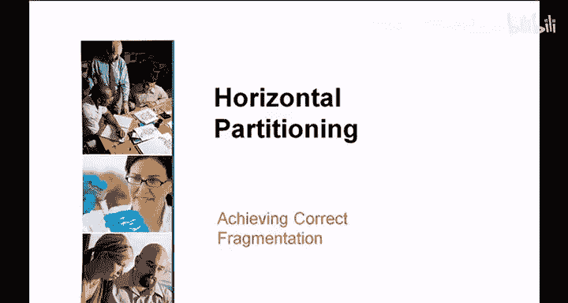
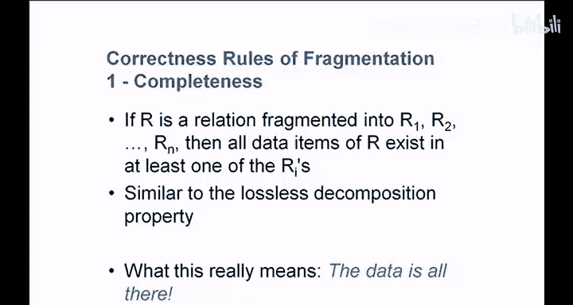
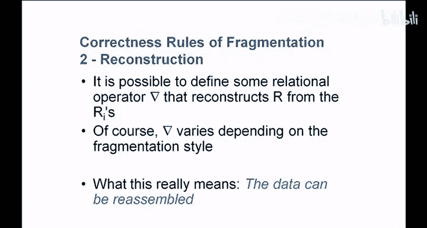
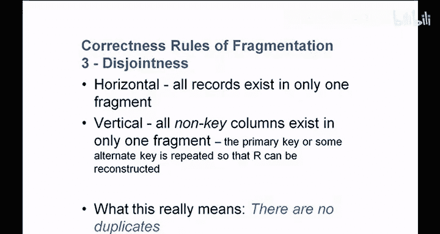

# 约翰霍普金斯大学《大规模数据库系统｜Large-Scale Database Systems》中英字幕 - P11：10_实现正确分片.zh_en - GPT中英字幕课程资源 - BV1N2urzvEjK

Wecome to unit 3 of moduleule 3 entitled Horizonal Partitioning。

In this here， we'll talk about achieving correct fragmentation。When we fragment a table。

 we have to ensure that we've done it correctly。There are three rules that will help us ensure improve to ourselves that we have achieved partitioning correctly。

I will address these rules in general， and these especially apply to horizontal partitioning。

 and will shall they apply to vertical partitioning in the future。

The first rule of the correctness rules is called completeless。Quite specifically。

 if our is a relation fragmented into end relations and fragments。

 then we have to ensure that the way those fragments are defined that all the data items of R will exist in one of those fragments had not only the current data items that currently exist in R。

 but any data item that will ever exist in art will will be placed in one of those fragments in the future。

So what this really means is that we want to ensure that the data is all there。

 and it will always be there when we enter new data into that relation。

 which ultimately will be entered into one of the fragments。That's the first rule， completeness。

The second rule is called Reconstruction。Once we have a number of relations and fragmented relations。

 we have to ensure that there is some kind of relational operator， the sub delta。

 that reconstructs the original relation from the fragments。

 so of course the upside end Dlta this operator varies depending on the fragmentation style。

For example， for horizontal fragmentation， that operator will be a union operator。

 for a vertical fragmentation， that operator will be a joint operator。

 but there will be some operator that will be able to reconstruct the table that relation from the fragments to restore the original relation。

So ultimately， you can think of reconstruction as being the rule that says that data can be reassembled into a single relation。

Finally， the third correctness rule is disjointness。

 We want to ensure that all the records exist in one fragment， so for example。

 in horizontal fragmentation， all the records exist in one and only one of those fragments。

 not in multiple fragments， so we ensured that each fragment contains different data。

And the same is true for vertical fragmentation， we want to make sure that all the columns exist in one and only one vertical fragment。

 that is except all the columns except for the non key columns。

 those key columns are those columns that are used to reconstruct the relation back to a single relation instead of bunches of fragments。

 so what this really means is that there are no duplicates throughout the entire set of fragments。

For horizontal fragments， that means there is no duplicate rows， and for vertical fragmentation。

 there are no duplicate columns， except for key columns。That concludes unit 3 of moduleule 3。

