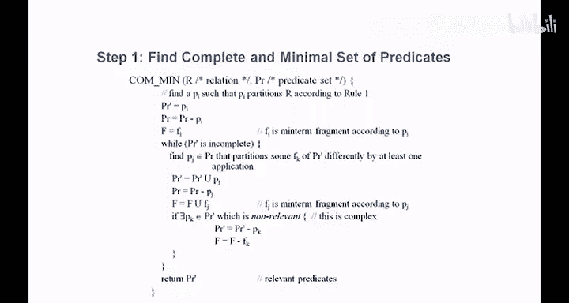
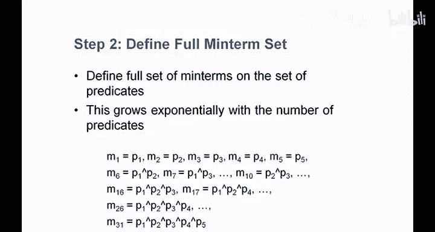
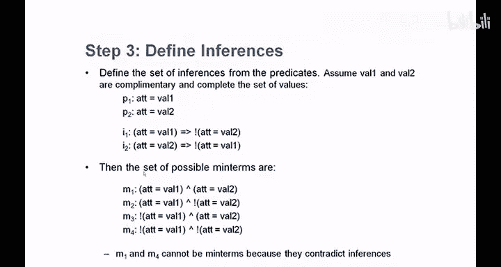
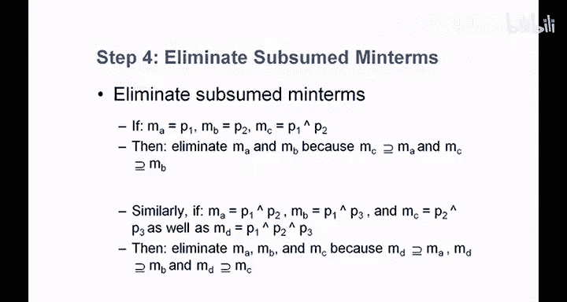
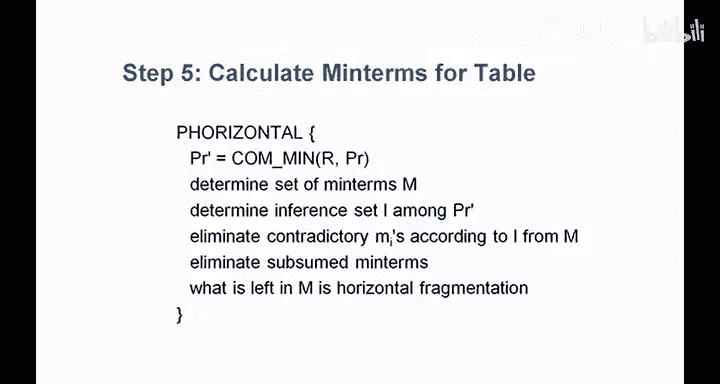

# 约翰霍普金斯大学《大规模数据库系统｜Large-Scale Database Systems》中英字幕 - P12：11_水平分片实践.zh_en - GPT中英字幕课程资源 - BV1N2urzvEjK

unit 4 of moduledule 3 entitled horizontalorizonal Partitioning。

In this unit we'll talk about working through horizontal fragmentation。

This unit will be a little bit theoretical， but in the rest of the webage and in some more of discussion on this topic。

 you'll see this actually play out in a practical example。

But from a high level perspective， how do you actually work through horizontal partitioning and ultimately what you want to achieve through horizontal partitioning。

The ultimate thing that you want to achieve is that you want to create different fragments where each fragment contains records。

 rows in those fragments that have equal probability of access of every tuple in that fragment by every application or at least one application。

So when each application will look at that fragment。

 there might be 20 different rows in that fragment。

But you know through that application that it will likely access any one of those 20 rows with the same probability if one of those rows or one or more of those rows were accessed at a higher probability。

And。😔，Other rows were accessed to a different probability。

 that gives us a good tip off that we should further fragment that table。

Or that that fragmentation is incorrect and we should go back and ref fragmentment the original table。

 but ultimately though what we're looking for is creating a bunch of fragments where each fragment。

 the rows and those fragments have an equal probability of access by the applications that are going to access that fragment。

And on the flip side， we want to make sure that if two different fragments are defined。

 the probability of access of those rows in each fragment have a different probability of access。

 so that means that if row A is in one fragment and row B is in another fragment。

 the probability of access by different applications or even the same application for row A versus row B is very different。

el。We could take this to an extreme and we can say let's fragment everything so that each row has its own fragment。

 while that might be correct， it's not going to gain us any kind of efficiencies in distributed database systems。

 We want to put as many rows together as possible。 on the other hand。

 we don't want to violate the different probability rules。

 So the trick is finding the right set of rows and the right set of rules for fragmenting different fragments of our table。

 and ultimately we want a completeness as well。 we want to make sure that all the rows have a home in at least and at most one of those fragments。

 one and only one of those fragments。 So if for look at the definition。

 we want to define fragments are subi in our subja。Ass fragment。F subi F sub J。Where some Minterm， I。

Induces fragment Fs sub I and some minter M sum J。Induces fragment F subj。

Such that if you take the ratio of the access of certain sets of minterms。

 So the access of minterm I divided by the cardinality of the fragment it induces。

 So what that means is。That you take the frequency of access of rows in that fragment divided by the number of rows。

And then you take the fragment J and you take the frequency of axis of those rows divided by the number of rows。

They should be different。 And if they're different， they will induce two different fragments。

 So you're trying to find all the fragments。 All the fragments of relation are such at the probability of access divided by the number of rows in one fragment is different than the probability of access than divided by the number of rows in the other fragment。

 So we'll see how we do this in the future and subsequent slides。

 But ultimately what we want to do is create each fragment to have different probability of access for rows in those fragments。

 So a major issue is how different must the probabilitybabilities be to indicate creating a new fragment。

 So certainly if the probability that ratio ratiot is off by 0。

001 that a reason to create a new fragment。 Probably not。

 what will happen is that you won't have minimality any more。

 and every single fragment every single row will be resonant in a different fragment that you don't want。

 So it's unlikely。The ratios are going to be identical。But if they're close enough。

 it's a good reason to combine them into one fragment。 And as they become different。

 that's a good reason to move it to a different fragment。 So what do you mean by this。

 Let's look at the algorithm。 There are five steps in this algorithm。

 The first one is finding the complete and minimum set of prediicates， so。

There are a lot of prediiccateates you can choose for any table。For example。

 imagine that you're looking at a table that has a column called budget。

 So the budget them range anywhere from 0 to  a million dollars。 Now。

 you can have predicates that say。you know， equals  zero， equal1， equal 2， equal 3。

 you can have a million different predicates， not all those predicates are going to make a big difference。

 so you want to pick the predicates that are going to make induce a large difference in your database to meet the rule that there's different probability of access for the relation for the fragmented relation that you're defining。

So what are we going to do， we're going to take this complete and minimal set of predicates。

 pass in the relation and pass in a predicate set。And you're going to find all the predicates that are actually meaningful in the entire set of predcateates where there could be lots and lots。

 millions and millions of prediccateates， but of that predicate set。

 you're going to find the ones that are most meaningful for this relation。

You can look at this algorithm step by step， but I'll just give you a general overview of what this algorithm does。

 the first few lines， pick a predicate and remove it from the initial set of prediicates and move it into the predicates we want to test。

And this loop， while the set of predicates that we want to return。

 what we're going to call the relevant prediicates is incomplete， we're going to find。

 see if that predicate among that set of prediicates。

 is the one that partitions this fragment differently。

 so it has a different probability of access than some other fragment。So， for example。

 if we choose the predicate greater than a million or less than or equal to a million。

 it's unlikely that many of the rows are going to have different probabilities of access。

 On the other hand， if we pick a predicate and that says less than or equal to 200000 and greater than 200000。

 that might be a good cutoff point to say， you know the frequency might that might be a good cutoff point for high budgetdge projects versus low budget projects and we'll find that that's a useful that's a useful predicate to put in our bag of prediicates that will help us determine what are the minimal set and the complete set of predicates that are relevant to this data。

 this particular relation。 And we iterate to that loop finding new prediicates each time that are going to make a difference。

 those that don't make a difference， we're going to chuck and those that do make a difference we're going to include in our set of prediicates that are going to be important prediiccateates to us。

 at some point。We'll find some predicates that we initially thought were relevant。 And then later on。

 we might find that they're not relevant。 I'll discuss that in a moment。 but ultimately。

 we're going to be looking at this vast set of predicates that initially can be applied to a relation。

 We're going to prune that down into a set of predicates that really do matter that adhere to the rule that says that different fragments we have will host different rows that will be accessed with a different probability of access。

 That's ultimately what this algorithm attempts to to to do is identify those relevant predicates。

 I mention that we could find relevant predicates。 and then ultimately we'll say， you know。

 it's not relevant any more after searching more predicates。

 How can we find something that we initially think is relevant。

 And then later on decide that it's not relevant。 So， for example。

 you might initially think that the location is an important defating factor because locations are accessed differently by。

by different applications or access with different probabilities。

 different frequencies by different applications might sound reasonable to pick location as a predicate。

 however， as you start examining your set of prediiccateates you might realize that while I initially thought location was important really what I'll find is that budget is important and it just so happens that the higher budget items happen to be in one location and the lower budget items happens to be in a different location So what we might identify is the fact that really budgets as the predicate we're looking for and we might eliminate location even though we initially thought location was good。

It's harder than you might think there are lots of predicates that can be used to create fragments。

 takes a lot of experience and judgment to discern what are the reasonable set of starting predicates。

It's often useful to look at the initial set of queries to identify what those predicates are。Okay。

 once we've kept those predicates， the second step is to define a full Minterm set。

 so we take those predicates and now put them together in many different combinations it grows exponentially with the number of predicates。

 so our initial set of prediicates M1 is predicate 1 M2 is predicate 2 M3 is predicate 3。We。

 in this case found five initial predicates。Now we'll start creating new min terms that are combinations of those predicates。

 so min term 6 is P1 and P2， predicate 1 and predicate 2， Min term 7 is predicate 1 and predicate 3。

 Min term 10 is predicate 2 and predicate 3， all the way to the end of all two combinations of prediicates。

 and 16 starts all the combinations of three prediates， predicate 12 and 3， predicate 1，2 and 4。

 all the way up to predicate 3，4 and 5。M26 starts all the combinations of four predicates and M31 is the combination of five predicates。

If you originally have five predicates， there will be two to the fifth different combinations of predicates。

 -1 because one one of those combinations is no predicateates。 all our midterms have one predicate。

 So if there are five preddiicates， the number of midterm combinations is2 to the fifth。

 if there are n predicates， then the number of meanterm combinations are2 to the n。-1。 Okay。

 now we've defined all those prediicates。 So some of those predicates， then the third step。

 we're going to define the inferences from those predicates。

 Some of those predates are contradictory。 So， for example。

 if predicate 1 says that location is Montreal， for example。

 and predicate2 says location is New York City。 Well。

 we know that that you can't have predicate 1 and predicate who apply to any row， because。

All rows will be in either Montreal or New York City。 So our next step is to define the inferences。

 And， in fact， those things that are going to be contradictions。

 So we'll know that if attribute 1 equals value 1， then we can say that's not true。 the attribute。

That same attribute is equal to value 2 or vice versa。 we'll see that the possible minterms。

 for example， using these two predates， predicate one in predicate 2 is to say。

Min term 1 is predicate 1 and predicate 2。Minterm2 is predicate 1 and not predicate 2。

 Minterm 3 is not predicate 1 and predicate 2， and Minterm 4 is not predicate 2 and not predicate 1 and not predicate 2。

 But because we've identified predicate 1 and predicate 2 is being contradictory。

 So at least in Minterm 1 is contradictory。 And if all we have are those preddiicates。

 then Minterm 4 is also contradictory。 The next step is we need to eliminate subsumed Minterms。

 we'll end up with a set of midterms， Certainly the initial set of midterms。

Mterm A would be predicate 1， mid termm B would be predicate2。

 and we might end up with Min termm 3 as being or mid term C as being predicate 1 and predicate 2。

 and if Minterm C contains preddiicates that are not contradictory，Then that's a validd midterm。

 but moreover， since it contains predicate 1 and predicate2。

 what they will do is also subsume Minterm A and midterm B， so since Minterm C subsumes Minterm A。

 and also subsumes Minterm B， we can eliminate Minterm A and Minterm B from those midterms that will help define fragments。

 because Minterm C is more specific， Similarlyly if Minterm A is P1mp2， Minterm B is P1 and3。

 Minterm C is P2 and P3， and we also haveterm D which is P1 P2 and P3。

 then Minterm D subsumes all the other midterms， Minterm A， B and C。

 and therefore we're left with just Minterm D， and we can eliminate Minterm A， B and C。

From our list of minterms that we consider for fragmenting relations， finally。

 the algorithm we're going to use is to figure out horizontal fragmentation will come up with a set of minters that are applicable to this relation will determine the set of minterms M based on those predicates that are applicable to this horizontal fragmentation。

Those those predicates that do make a difference some way in the probabilities of access of those of tuples and those relations。

 We're going to determine those set of inters。 We're going to define inferences。

For those meant for all the predicates among the predicates set。

 and there are going to be contradictions in some of those predicates。

 some pred you can't put all combinations of predicates together because some will contradict others。

 so we eliminate those contradictory min termss。Then we eliminate the subsume minterms。

 and what's left is a set of mintterms that will define the horizontal fragmentation。

For there were initial relation， look at the website now to look to see an example of how this is done with practical。

 simple relation。Theends unit 4 of module 3。

