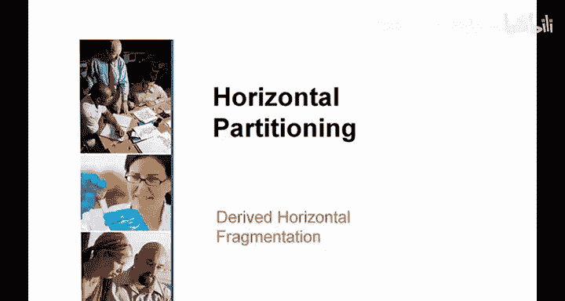
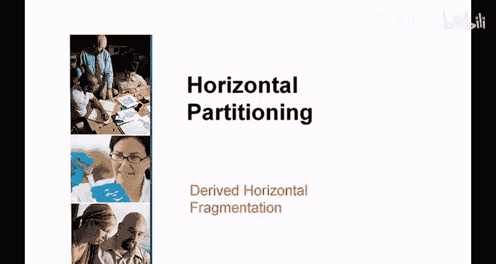
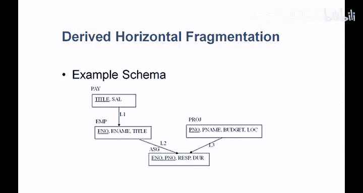
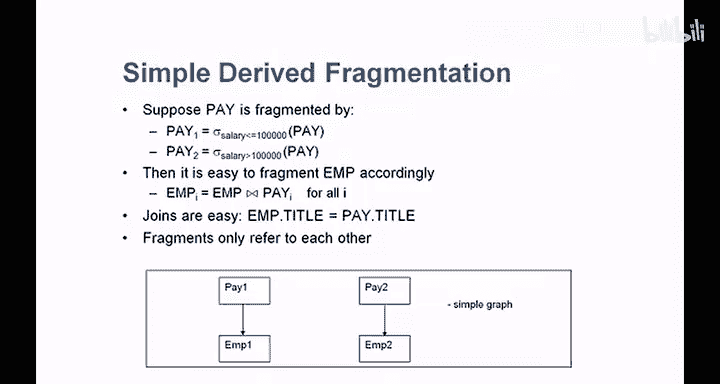
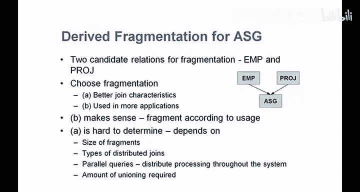
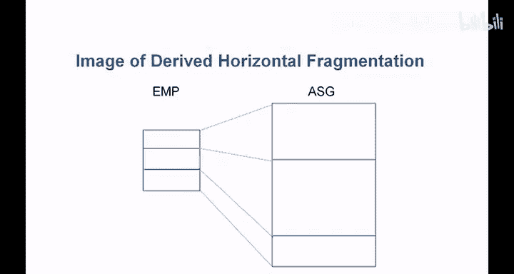
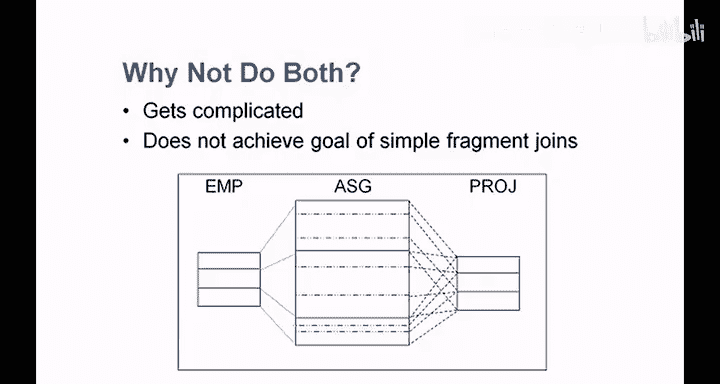
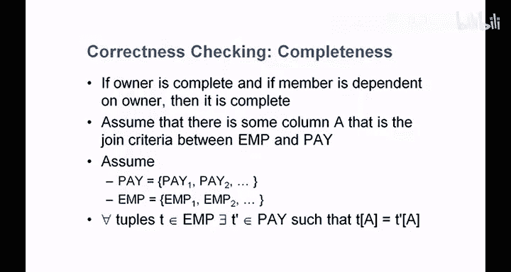
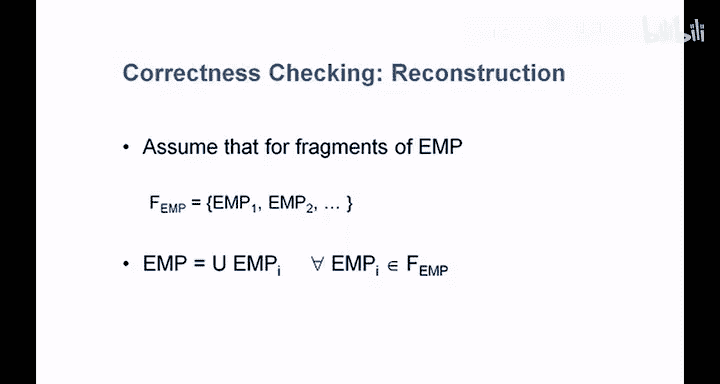

# 约翰霍普金斯大学《大规模数据库系统｜Large-Scale Database Systems》中英字幕 - P13：12_派生水平分片.zh_en - GPT中英字幕课程资源 - BV1N2urzvEjK

To unit 5 of module 3 entitled horizontaloral Partitioning。

And this unit will discuss derived horizontal fragmentation。

So this is our Tri and true schema that we're using through the course and we plan to use all the way through the course。

 we have a relation called pay with rows with columns title and salary。

We have a one to many relationship between that and employee employee is employee number。

 employee name and title， presumably many employees are paid at the same level， different pay grades。

 they're different employees。There's a one too many relationship between employee and assignment to say that one employee can potentially belong to many different assignments。

And similarly between project and assignment， there can be many different assignments for a given project。

In fact， the combination of employee and project makes the assignment。

 so a specific employee is assigned to a specific project。Makes a unique row in the assignment table。

So we notice here that there are two different rows。

 two different relationships between employee and assignment and project and assignment。

 we'll discuss that shortly。But for now， let's assume that the employee table。 I'm sorry。

 Let's assume the pay table is fragmented。 And let's say the pay enable is fragmented into two different fragments。

The first dragrant being pay one will be this selection。

For criteria is salary less than 100 or equal $100，000。

And the second fragment is defined in terms of salary greater than $100，000。

So we have two fragments now if we're distributing that across a distributed database system and we know that the employee table is part of a oneto many relationship of pay to employee table。

 then it's easy to fragment the employee table accordingly so that each row or I'm sorry each relation or each fragmented relation of employee can be derived by joining the initial employee table with each of the pay fragments。

 so the resulting rows of M that are chosen for when joining with each pay fragment yields the fragment of the employee table that we're looking for。

 an employee fragment that we're looking for， so if we put pay one on one database and we put pay two on a different database so that we have a distributed fragments。

 it makes sense to carry along that fragmentation that distributed fragments of employee one fragment to the same。

Datase that pay1 exists on and move the employee2 fragment to the same database that the pay2 fragment exists on。

 what this lets us do is for joins， which is the most natural operation between pay and employee joinins will be very。

 very easily done all rows that will select from pay1。

We'll be joined to those rows of Mmp1 that we're going to be selecting and we'll note that they'll all exist on one machine。

 There's need and there's no reason for a query processor when joining pay and fragments to go to any other machine to get information to support the pay one table。

 for example， So if were if employee was fragmented differently it was fragmented by location。

 for example， you would have many different employees that would be under not pay one set of pay grades and you would have many different employees being under the pay two set of pay grades and they would be distributed throughout the distributed database system if you needed to join the pay and employee table there'd have to be a lot of cross database joins and that's an inefficient process or it's an expensive process。

 So we want to reduce the expenses and we want to move all the employee names。Ne line up with pay。

To the same table， to the same database， So we want to fragment employee according to the fragmentation of the pay table。

 So this is called derived fragmentation if we calculate that the fragmentation of pay should be along the lines of salary less than equal to 100。

000 versus salary greater than 100000， we should also fragment the employee table accordingly。

 so we now have no need to do fancy calculations we' just create a derived fragmentation that matches the initial fragmentation we calculated for the pay table。

Let's move a little bit further。 This is a little bit more complicated note that if we look at the diagram on the right we have。

We have the assignment table， which is actually participates in on the many side of two different relations。

 So there's a one to many relationship between employee and assignment。

 and there's a one too many relationship between project and assignment。

 And we'll assume that both project and employee， are fragment it， And the question is。

 how do we fragment the derived fragment， The derived table。

 How do we perform dry fragmentation on the assignment table。So we have two candidate fragments。

 we have the employee fragmentation， and we have the project and fragmentation。

 so how do you choose the right fragmentation？Well， it makes sense to choose one or the other。

 and how do you choose one or the other， There's two options。

 You can choose the better join characteristics。Or you can choose the a fragmentation that will be used in more applications。

 so for example， looking at option B that makes sense。

 if many applications choose to join employee and assignment and fewer applications join project and assignment。

 then it makes sense to derive the assignment fragmentation according to the employee fragmentation。

It's just going to be used more often。 It will since itll be used more often。

 it will incur less expense on the system will be less。

 plus costly to join the fragments of those fragments that are frequently and going to be queried together。

If we go back to the choice of better join characteristics。

 it's hard to say what a better join characteristic is because it depends on so many factors。

 It depends on the size of the fragments。 It decides depends on the types of distributed joins。

 It depends on whether you can execute parallel queries or not。

 And it also depends on the amount of unioning required。 I haven't covered any of these topics。

 They'll be covered in subsequent modules， but trust me they're very complex and it's hard to calculate a priori。

 and that changes as new rows are added to the fragments。 So number one makes sense。

Use the fragmentation that's going to go with the derived fragmentation that's going to be used in more applications。

So you might ask， so seriesett as an example， you have the employee table。

 let's say it's fragmented into three fragments。You define the fragmentation， the assignment table。

According to the way the employee table is derived， it is fragmented。

 so the top third of the employee table will yield some third of the assignment table。

 the middle third of the employee table will yield another horizontal fragmentation。

 the second fragmentation of the assignment table and finally the third horizontal fragment of the employee table will map to rows of the third fragment of the assignment table。

As you distribute each of the fragments from the employee table to various databases throughout your enterprise。

 so too， the derived fragments from the assignment table will follow those fragments derived from the employee table。

You might ask， why not to both。While it gets complicated really quickly。So for example。

 note that we have on the left side the same fragmentation between employee and assignment as we had in the previous slide。

 so leftft the three employee fragments map to three fragments of the assigned table。

But now if we try to map also and do fragmentation according to the project table。

 note that there are free three fragments of the project table。Now。

 for each fragment of the project table， a top fragment of the fraud project table。

 that will map to various elements of each of the fragments of the assignment table。

 so if we look at the top fragment of the assignment table。

 some of those elements will map to the first fragment of project。

Some of the elements of the middle assignment fragment will map to the first project fragment。

 and some of the elements of the third fragment of the assignment table will also map to some of the elements of the first fragment of project。

ultimately， if we have three fragments of employee and three fragments of project。

 that will yield nine fragments in the assignment table and those will have to be distributed across the across the distributed database。

But it's not clear where to put those fragments because anything we want to join between employee and assignment。

 since we're， we're distributing the fragments across the entire database。

 there will necessarily be some cross database joints。 And ultimately。

 this doesn't achieve the goal of the simple fragmentation that we're looking for。

 So this doesn't make a lot of sense。

Finally， we want to do correctness checking on derived fragments。 so if the owner。

 if the de and the one we're drivingriving from is complete。

And if the member is dependent on the owner， then certainly， we know that is complete。

 So we assume there's some column in a。 That's the joint criteria between the employee and pay table。

And we assume that pay is divided into fragments and employees divided into fragments。

then for all tuples， that means rows in the employee table。Which is the drive table。

 There exists a corresponding tuple corresponding row in the pay table， such that that identifier a。

Can be found in the derived table and can be found in the owner table at same time。 So you can。

 that just means that you can join the rows。Each row of the dry fragment is some row of the。

 the original fragment。

That's correctness checking。For completeness， this is now reconstruction。

 just means that if you can assume that fragments of employee are 1，2 and 3， et cetera。

 And if you union them altogether together， you'll get the initial fragment。

 you'll get the initial employee table。 Finally， there's disjoness。

 It's normally for primary fragments。 It's easy to show mutual exclusiveness in terms of midterms。

 and in terms don't overlap。 So naturally， their rows will not overlap for derived fragments。

 it's very difficult to show because of the joint requirements。 If it's simple graph。 We've derived。

 We've done derived fragmentation。 Disness is guaranteed。

 But if you haven't done derived fragmentation in your fragmenting very differently。

 It's very difficult to show disjotness。

The graph is not a simple 110 graph and each tule must be examined to make sure that somehow that they exist in only one of the fragments and one in only one of the fragments that finishes the discussion for this unit。

