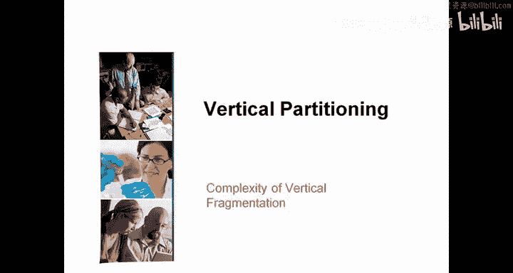
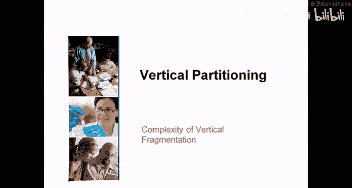
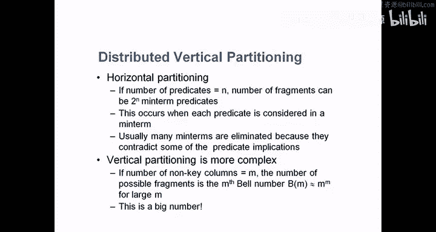
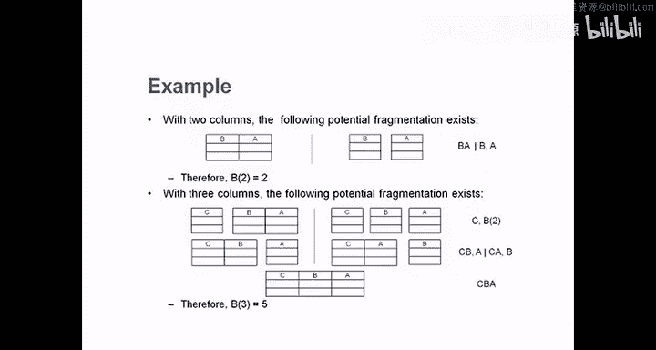
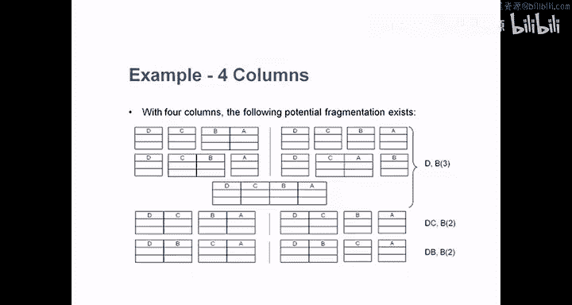
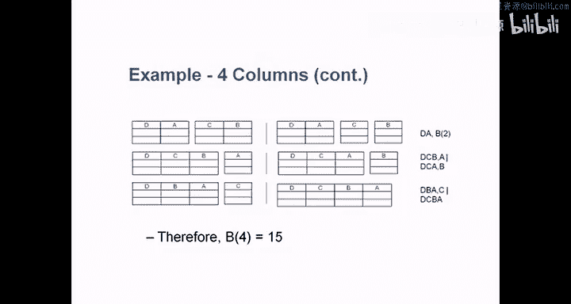
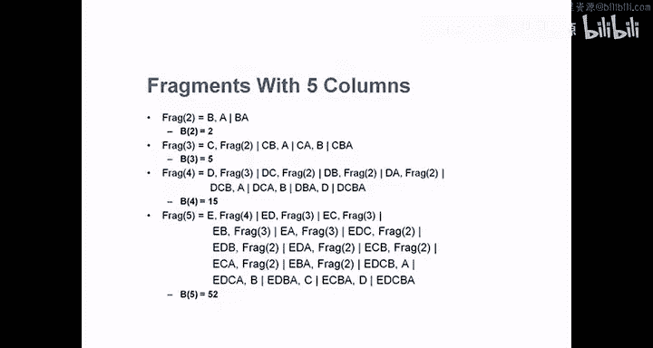
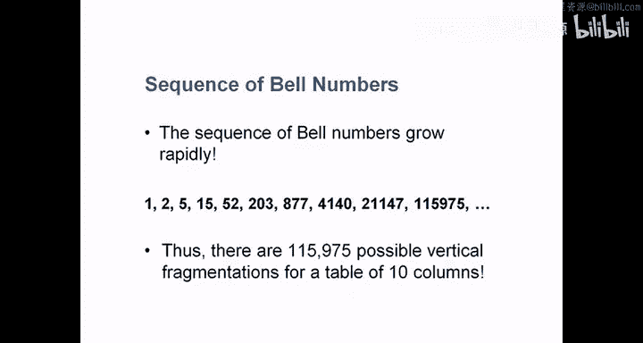

# 约翰霍普金斯大学《大规模数据库系统｜Large-Scale Database Systems》中英字幕 - P14：13_垂直分片的复杂性.zh_en - GPT中英字幕课程资源 - BV1N2urzvEjK

Wele to unit 1 of module 4 of vertical Partitioning。

In this unit， we'll talk about the complexity of vertical fragmentation。

So we have two options， horizontal partitioning and vertical partitioning。

 horizontal partitioning is complex， but vertical partitioning is more complex。

 Let me discuss horizontal partitioning briefly if the number of predcateates equals in。

Then we saw that the number of fragments could be2 to the end。Based on the midter predicates。

It occurs when each predicate is considered in a mid term。

But usually many men terms are eliminated because they contradict some of the predicate implications。

But still2 to the n is a large number， and that's why we required heuristics to pare down the possible partitions into something manageable that we can calculate an ir reasonable amount of time。

But if the number of options for horizontal partitioning is 2 to the n。

 the number of options for vertical partitioning is M to the M。

 So if the number of9 key columns is M， the number of possible fragments is the em bell number。

 we call it。Which is approximately equal M to the n power for large M。 This is a really big number。

 M to the M is greater than 2 to the n。

Let me show you an example of why that is such a large number。

Let's examine the bell number of two columns。We have two options of fragmentation。For bell of2。

 the number is  two， we can either put column B with A together and have one fragment。

Or we can define two fragments， fragment， which fragment contains column B and the fragment which contains column A。

That's very simple， very easy to examine， very easy to determine which is more optimal。

It's a little bit more complicated with three columns， so if you look at the notation。

 if you look at the boxes here， you can have C with B or A， B& A together or C with B& A separate。

That's the first line of boxes。 So if you notice the notation on the right。

 what I'm saying is that you take column C。And you multiply it by that that will there just having see by itself。

There will be the bell number of two。Possible combinations of C on its own。

 So we basically put C with B and A or C with B and A separately。But that's just the first option。

There are also options where we combined we can combine C with other columns。

 so if we combine C and B together， we leave A separate， or we can combine C and A together。

And leave B separate， or we can put CB&A together。So that is five different options。 Not so bad。

For columns it gets a little bit more complicated， so we want to add a column D。

And if we look at the first we have five options with D being separate。

So we have the bell number of three diagrams a little bit off， so if we look at we keep D separate。

 we can combine them with each of the three combinations of A B and C。

We can have D and C together with column B and A， D and C together with column。

It B And A separate or D And B together with C A together or D And B together with C A separate。

Or in DNA together when C and B separate， T and A together and those C B together， C B separate。

 you notice all the different combinations。 Therefore， the bell number of number 4 is 15。

 there are 15 different combinations here。

Well， it gets more complicated with five columns。 So if the bell number of fragment having two elements in a fragment is 2。

 bell number of having three elements，3 fragments is 5， the bell number of。Four fragments is 15。

 then 5 is going to be 52。And you can look at how I've paired each of the columns together。

 So let's look at fragment of5。 We say that E with all the combinations of different fragments of4 or E and D together with all different three combinations of C B and A or E and C together all the different combinations of D P and A or E and B together with all the combinations of D。

 C and A， et cetera， until we start mapping all the three columns together。

 E D E together with all the combinations of A and C or E D A together， all the combinations of。

C And B， et ceter。 And then we get down to all the combinations of。

Carings where E participates as one of four columns or putting all the columns together。

 that adds up to 52 if you count them。

The sequence of bell numbers grows rapidly。 So bell of1 is1。 bell of 2 is 2。 bell of3 is 5。

F all the way up to bell of 10， that's 115975。 And beyond that， it gets even much larger。

 So given a simple table of 10 columns， there are 115975 different combinations of vertical fragmentation that you can select。

 That is a lot of different combinations to examine。Clearly。

 when the number of columns grows beyond 10， he wants some heuristic that can actually help you work through all the options to determine what is going to be the ideal vertical fragmentation for that。

 We need heuristics。 And that'll be the discussion of the rest of this module。

