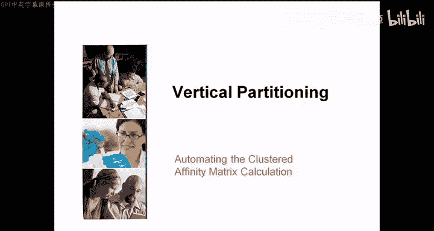
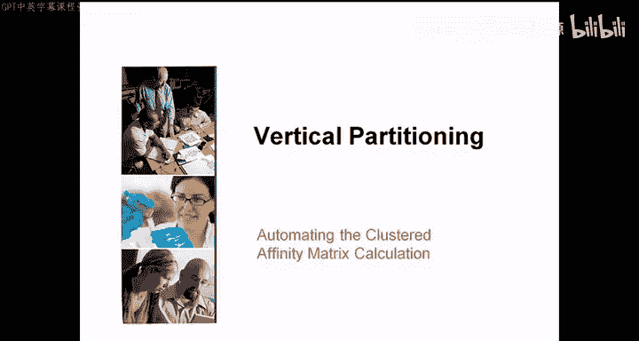
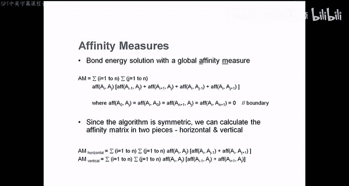
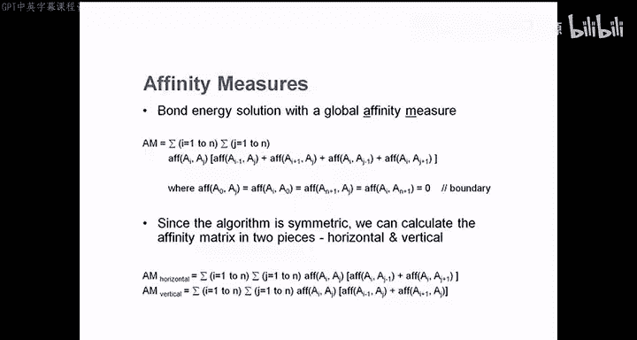
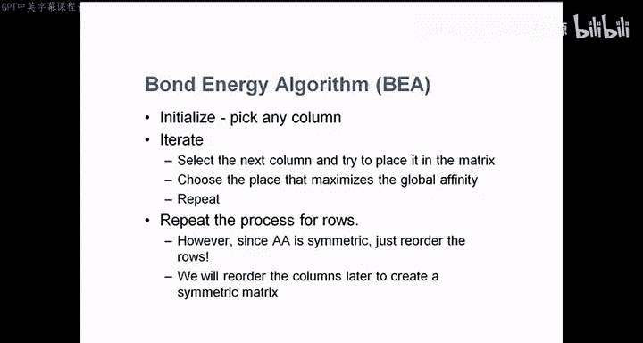
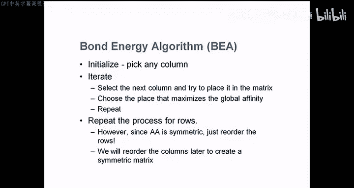
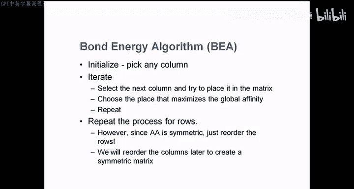
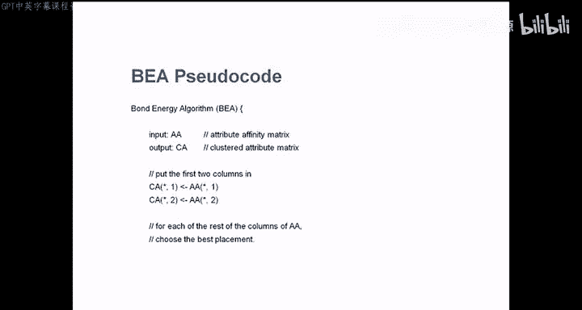
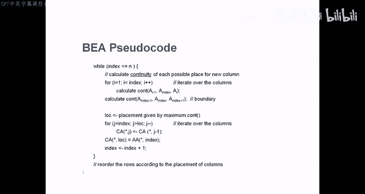

# 约翰霍普金斯大学《大规模数据库系统｜Large-Scale Database Systems》中英字幕 - P15：14_自动化聚类亲缘矩阵.zh_en - GPT中英字幕课程资源 - BV1N2urzvEjK

I'll continue the tune。Module 4。Entitle vertical Partitioning。

And this unit will discuss the automating the cluster Definity matrix calculation。

So in general， if we look for bond and energy in out matrix。

We ultimately want to find the bond energy that' is going to be the greatest for an entire matrix。

Calculating the bond energy of an entire matrix is a measure of the global affinity measure。

 we'll call that the AM just for short。So the example。

 the equation for the affinity measure is the following， we want to sum up for every row。

 for every column that means for every cell in this entire matrix。

 we want to calculate the affinity of a sub I compared to a sub J。So that's a position in the matrix。

 as we saw previously。 So that's a certain value。 And we' want to multiply it by its north， south。

 east and western neighbors。 So a sub I -1 will comma J will be its western neighbor。 A subi plus1。

 comma J will be its eastern neighbor。 A sub I。How E sub J minus1 will be its。

Northern neighbor and a subbi Kai A sub J plus 1 will be its southern neighbor。

 So what we want to do is we want to sum up for every cell in this entire matrix。

 We want to take the affinity measure of that element of the matrix and multiply it by its neighbors。

 Now， there are boundary conditions as well。 And we want to sum that up for the entire matrix。

 That's called the global affinity made measure of the entire matrix。

We have some boundary conditions that we have to know that the columns and rows that are the top of the matrix to the east of the matrix west of the matrix and south of the matrix are all going to be0。

 So those are the boundary conditions。 so that when we calculate row you calculate the affinity to the row to the left。

 if there's no row to the left who want to say that those values are 0 and the row above and above the matrix row below the matrix。

 all the boundary conditions of the matrix are 0 the affinity measures of those those are 0。

Okay， we'll notice something that since this matrix is horizontal。

 we don't need to calculate the affinity measure of the northern southern eastern and western neighbors。

 we can decide we can calculate the affinity measure of either the eastern and western neighbors or the northern southern neighbors since we we can just flip the matrix along the diagonal。

We can calculate AM horizontal and Ram vertical， and it turns out that it's the exact same measure of the affinity measure for the entire matrix。

 so we can simplify it a little bit so we can just sum up for every row in every column that means every cell find the affinity measure of that cell and multiply it by its northern。

What it add up the northern and southern affinity measures in multiplying the the sallu picks affinity measure with times that sum。

So it's really the sum of the all cells for all cellsve， the sum of the affinity measure of it。

 it times its northern their neighbor Po it times its southern neighbor。

 Or you can choose the eastern and western neighbors。 Even one will yield the same value。

Okay， so what is the algorithm？The bond energy algorithm is going to be picking any column。

 you pick any column first and you hiterate， you select new columns to place into the matrix。

 and you try the placement for each， each column in the matrix so you pick column 1。

 and then you pick column 2。You pick any random two columns and place them in the matrix。

 The next thing you want to do is try columns 3 in any one of those locations。

 You either want to take column 3 and。Place it in the first column of the matrix and move columns2 to original columns 1 and 2 over to become columns 2 and 3。

 You want to break apart columns 1 and 2 and place column 3 in the middle。

 or place column 3 at the end。

And youre going to see which which yields a greater affinity matrix。

 ainity measure for the entire matrix。

So here's the algorithm ver we're going to put。We could have the attribute affinity matrix。

 and the output is the clustered of attribute matrix。

 We want to place the first two columns in the matrix， to column a。Column B first column。

 second column we're going to be the first two columns of the cluster deffinity matrix。

 Now we're going to for each subsequent column， we're going to try to find the best placement of that column。

So while we're looking at the index for all the columns， we want to find the best continuity。

Placement of the new column， meaning which placement will yield the greatest on energy for this。

 for this， for this new column。 So we're going to try the column in， as I said before。

We're going to shift all the columns that are currently in the matrix over and place a new column as the first column。

 calculate as bond energy。Then we'll take the initial placement of columns and break and make a space after the first column。

 shift all the other columns to the right and place that new column in that slot。

 We're going to try placing that column in each slot。

 including at the very end of all the chosen columns in the， which has the greatest bond energy。

 and we're going to hiterate through that。 and kindly come up with a you know what they with the highest bond energy。

 Al at the end of the calculation， We'll have all the columns placed in the places that will give it the highest bond energy。

 And then we're going to reor the rows to match the column ordering so that we at the end。

 have our cluster divffinity matrix。😊。

