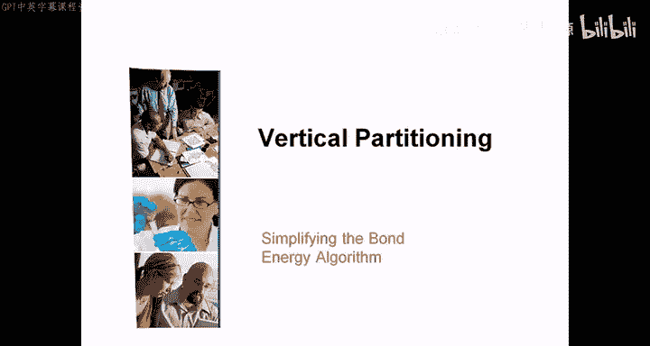
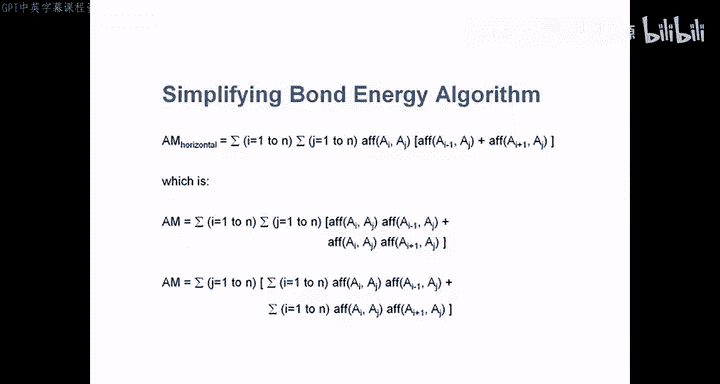
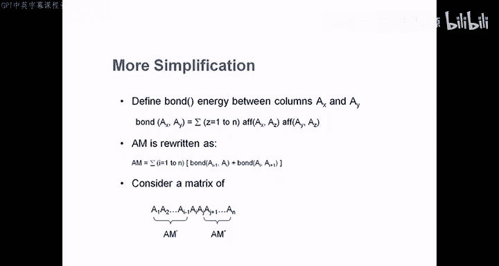
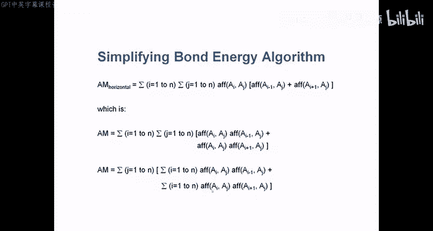
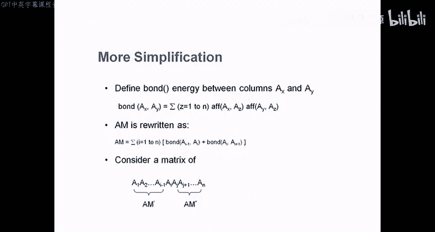
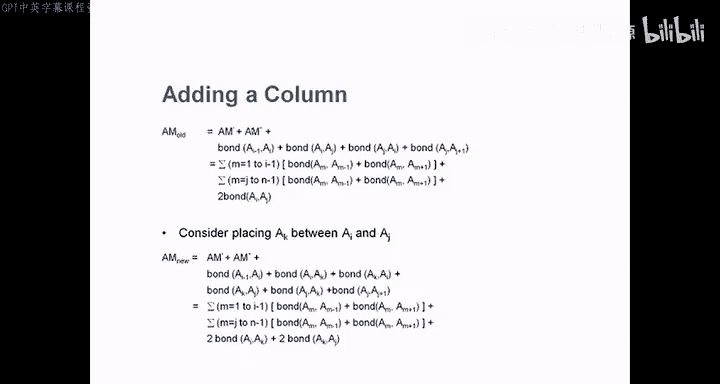
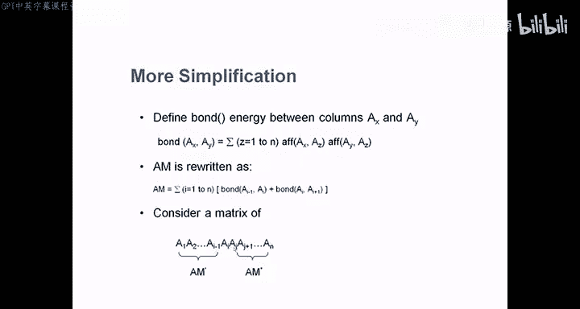
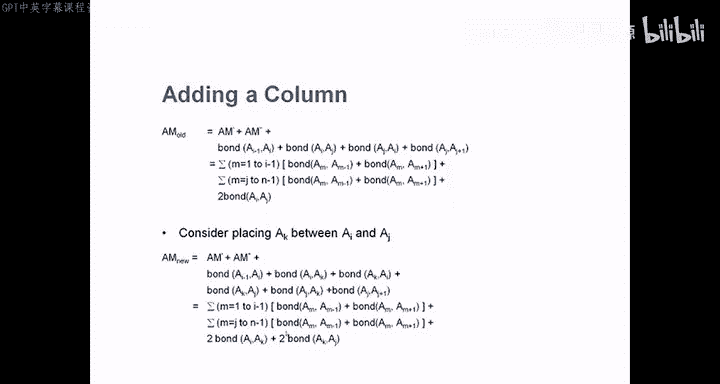
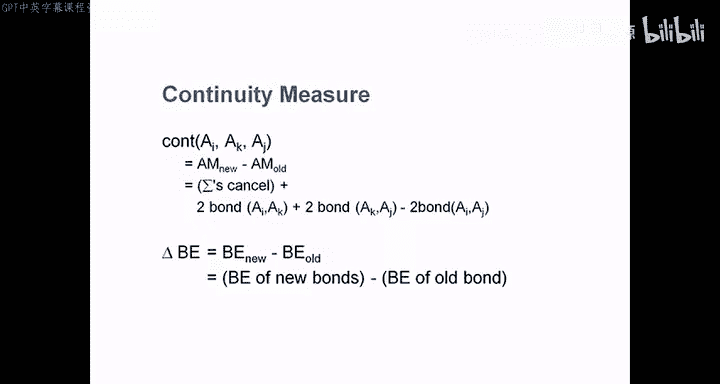

# 约翰霍普金斯大学《大规模数据库系统｜Large-Scale Database Systems》中英字幕 - P16：15_简化势能绑定算法.zh_en - GPT中英字幕课程资源 - BV1N2urzvEjK

Welcome to Vert Partitioning and this unit will speak about simplifying the bond energy algorithm。

As you recall， a previous presentation。We spoke about the affinity measure。

 the horizontal affinity measure of the bond energy of the entire matrix。

 So if you look at the term affinity of a sub I and a sub J。

That is the affinity of some attribute sub I and some attribute sub J。

 and we're going to sum up for the entire matrix taking every one of those affinity measures and the entire matrix summing up for all the columns and for all the rows。

 we're taking that and multiplying it by its Western neighbor。

 as you notice affinity of a subi and minus1 and J。

And the affinity of its eastern neighbor is see affinity of a I plus1 and A sub J。

And we're going to calculate that for the entire matrix。

 That's the double sumump we're summing over columns and we're summing over rows。

 So manipulating that that equation， we're going to move the affinity of each cell inside the brackets。

 So we're going to in this， as you see in the middle equation。

 we're going to move the affinity of a sub I。And A sub J。

Inside the brackets and we're going to multiply it by the affinity of its Western neighbor and the affinity of its eastern neighbor。

That third equation here shows that we can manipulate these sums even one step further。

 we can actually take the sum of IN。And we can sum up。

 You can imagine I being moving through all the columns。 I'm sorry， all the rows of a table。

 You can sum up for all the rows of a table。 You can say the affinity of a sub I and a sub J。

And the affinity of a sub by 1 and a sub J。Looking at it and its， A sub J and its Western neighbor。

And summing up the affinities for an entire two columns， you have the A sub I minus1 column。

And the A A sub I column here' summing that up for all the A sub Js that occur in those columns。

So what we're doing is we're calculating inside this bracket。

 we're calculating the affinity measures of all the cells。

Of a particular column that would be all the a subs for a column。And A sub J。

A subi would represent the row， a subja would represent a fixed column。

And this would be the next affinity measure would be affinity of a sub by minus1。

 which would be the next。The next row and column of the the western neighbors。

 So you're summing that you're summing up on the entire set of affinity measures for a sub I J P and the affinity measures of a western neighbors。

 a sub I -1 J。 And you're doing the same thing for the eastern neighbors。

 You're summing from1 to n through all the rows of I。

 You're summing up the affinity of a sub I J and its eastern neighbor， a subi plus 1 and a sub J。

Okay， so now we've manipulated that equation。 What we're going to do is notice that this。

Sumation inside the bracket has a special meaning。

We're going to define a bond energy between columns a sub x and a sub y in the following way。

 We're going to imagine that we have a column a sub x that's next to the column of a sub y。

 and and we're going to calculate the bond energy of those two columns next to each other and how much energy they create when they're placed next to each other。

 So if you look at the sum of z of1 to n and z represents each row。

 we're going to take the set of rows and all the affinity measures a row for those two columns。

X and Y， and we're going to measure there we're going to take the product of each affinity measure。

 one next to the other in each row and sum it up for all the rows。So， if you notice。

In the previous equation， you can replace the first expression in the bracket as a bond energy and the second expression in the bracket as a bond energy。

Okay， so now let's rewrite that equation， the bond energy between x and y is really the sum of from I equals 110 of the bond energy of a sub I and its Western neighbor。

 and the biased bond energy of a sub I in its eastern neighbor。

So now let's consider a matrix of lots of different columns and we've created n columns in this database in our bond energy。

 in our clustered affinity matrix， and actually in our affinity matrix before get to a clustered affinity matrix。

We're going to represent the bond energy of the left portion of this entire matrix as A M prime。

 so the bond energy of all the columns entered up from a sub 1 all the way to a minus1 is all represented in this term a subm prime。

And the bond energy of all the rightmost columns， a sub J plus1 all the way to a sub n is going to be represented as AM double prime。

And our assertion is， is that when we insert a new column between I and J。

That the bond energy of AMM prime andM double prime remain the same。

 so all we need to do is consider the bond energy that where is created by placing a new column between I and J。

So。Let's add that column。 But first， let's calculate the old bond energy。

 If we look at the old bond energy。 it's really just the bond energy of AM prime the leftmost side of the matrix。

And A double prime the right side of the matrix。

And we left out terms if you flipped previously， the bond energy between AI and a AI -1 and the bond energy of AJ and A J plus 1 and the bond energy between AI and AJ。

 So now coming back to this equation。

Let's calculate the bond energy of the AM prime， which is really just the AM。A prime。Plus。

 the bond energy of a minus A I-1 and A J。 If you put these two expressions together。

 A M prime and the bond energy of a。I minus1 at A I。You can create this summation。

 which is the summation of M from idda1 to I minus1 of the bond energies of all all the Json columns。

 and you can do the same thing for the bond energy of matrix A M double prime。

 you add it to the last bond energy AJ and Aj plus 1。 you put that in the sum。

 and that's a of M equal J to n -1 of the bond energy of all the columns on the rightmost side of the matrix all that were left leftover is two times the bond energy of AI and AJ。

You have the bond energy of AI and the bond energy of AJ AI， which are identical。

 so the result is two times sum of is the bond energy of the sum， the bond energy of the second sum。

 and finally the bond energy of the attraction between AI and AJ。

Now consider placing column AK between AI and AJ， Let's calculate the new bond energy。

 so you still have A prime， which is the leftmost side of the matrix， AM double prime。

 which is the rightmost side of the matrix， you have AI minus1 AJ that's the bond energy between column AI and column A I -1。

 the bond energy between AI and AK the new column the bond energy between AK and AI looking at its westmost neighbor and bond energy in AK and AJ and the bond energy of AJ and AK and the bond energy of Aj and AJ plus1 if you sum up A prime and the bond energy of I 1 and A and I。

That yields the first summation in the final equation。

If you sum up A and double prime in the last term， the bond energy of Aj and A J plus 1 has the second sum in this equation。

 And finally， you take that middle terms， the bond energy of AI K is doubled because you have two terms that measure the bond energy of AI and A K。

Plus， you doubled the bond energy of AK and AJ to have A K and AJ and AJ and AK they're equal。

 so ultimately have these two sum as sums， plus two times the bond energy of AI and AK and two times the bond energy of AK and AJ。

Now what we're going to do is find the differential in the bond energies between AM new and AM old。

 So if you look at these summations in AM old。You have two summations。

 plus2 times the bond energy of AI and AJ。In I M due， you have the same sumations。

Plus2 times the bond energy of AIK plus 2 times the bond energy of AKj。

So finding out its continuity measure， meaning the new bond bond energy measure。

 you have AM new minus A old， all the sigmas cancel out and what's left over is the new bond energy produced by placing A K between AI and AJ。

And。You subtract out the bond energy of pulling apart AI and A J from each other。

So when we calculate， when we calculate the change in bond energy。

 it's really the bond energy of the new bonds created by placing a new column between two existing columns。

 subtracting the bond energy of the columns we pulled apart to place the new column within。

So calculating Delta bond energy is a lot simpler than going through an entire matrix to calculate the affinity measure of the entire matrix。

 So what we're going to do is and there's a much easier calculation。

 what we're going to use is use the deelta bond energy equation that deelta bond energy equation is going to be an easier calculation to figure out exactly what we're doing to this affinity matrix as we place a new column inside other columns as we as we take each new column and try to place it inside the new matrix。

 we just need to calculate the deelta bond energy for each placement。

 which is a much simpler calculation than calculating the entire affinity measure of the entire matrix。

