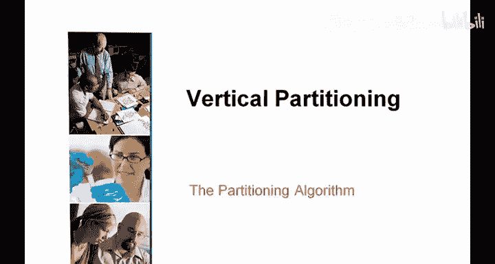
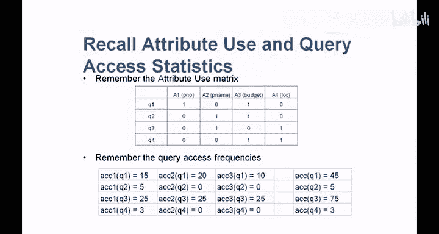
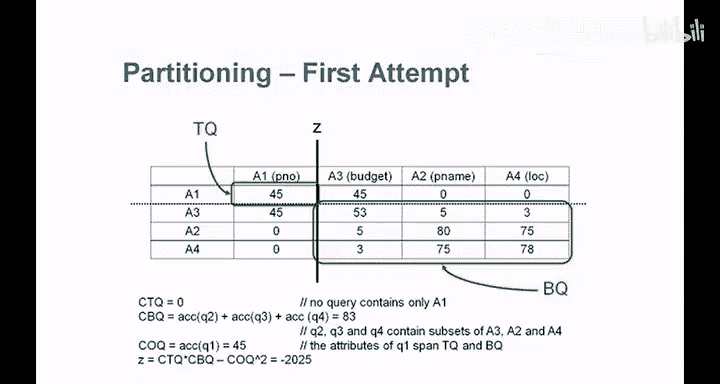
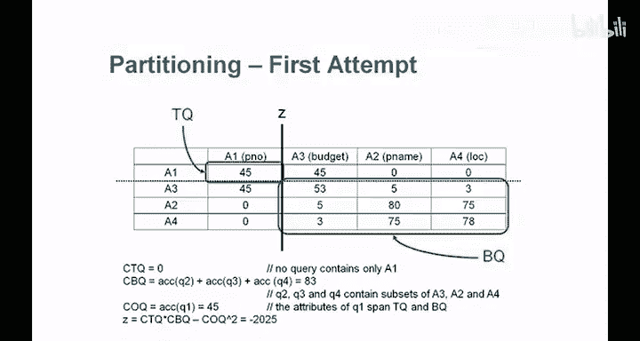
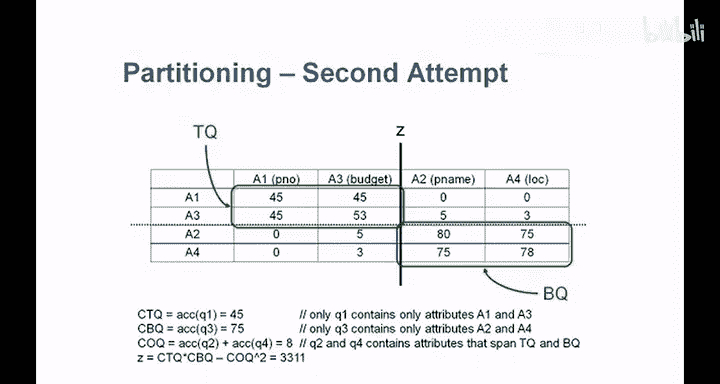
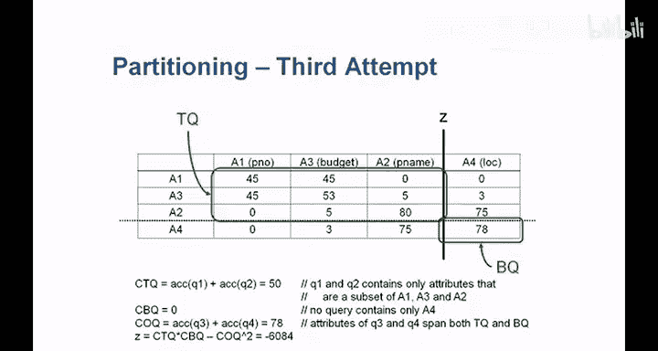
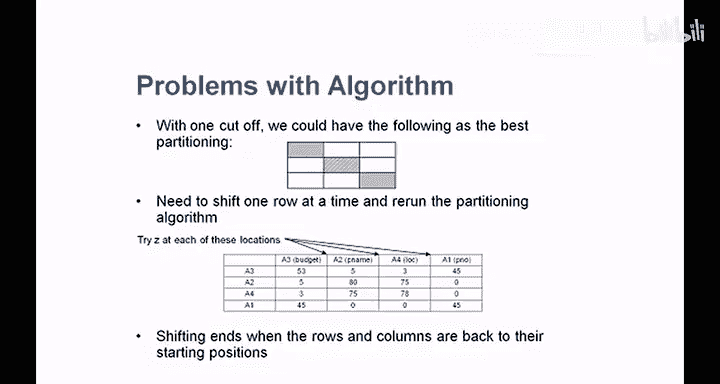

# 约翰霍普金斯大学《大规模数据库系统｜Large-Scale Database Systems》中英字幕 - P17：16_分区算法.zh_en - GPT中英字幕课程资源 - BV1N2urzvEjK

Welcome to Vertical Partitioning， the Partitioning algorithm。

This is the final step in determining the partitioning of a cluster affinity matrix。

When we looked at a previous example， we could basically eye it and determine that how the columns went together based on the affinities of different attributes。

 however， that's not always possible when you have lots of columns it's very difficult for the numbers to work out such that you can easily see blocks of attributes that are cluster together in a strong way。

 so we're going to introduce an algorithm that shows you how to do this in an automated way。

 so in order to do this， remember the attribute you may usage matrix What that does is it gives you a list of for each query which attributes are used in that query。

Query 1 uses attributes A1 and A3， Que 2 uses attributes A2 and A3， Que 3 uses At 4 and At 2。

 and query 4 uses At 3 and attribute 4。What we're ideally trying to do is find some kind of partitioning that puts clusters together the attributes that are used most often in queries。

What we don't want to do is often when a query asks for two attributes。

 go to two separate tables and pull the results together。Now we can do that。

 but it's not the it' not going to the V is the most efficient query。 In fact。

 many times we're forced to do that。 but what we're trying to do is for the most part。

 for most queries， we'd like to be able to cluster the attributes that are used together most often。

So remember in the query access frequencies， we have access measures for each query for each site that's going to access those queries。

If we look at the bottom matrix on the right hand side， we have a sum。

 We have the sum of all the aes for each query。 So query1 is accessed 45 times per hour by all the sites。

 Que2 is accessed five times per hour by all the sites。

 queryry 3 is accessed 75 times per hour by all the sites。

 query 4 is accessed three times per hour by all the sites。

We have all the information we need to now start with the vertical partitioning algorithm that actually finds the partitions。

So given our cluster deffinity matrix， A1， A3， A2， and A4。So without this algorithm。

 we can just eye it and notice that A 3 and A1 or A1 and A3。

 they tend to cluster well together because they have high affinities right all in this box。

 in a2 and a4 cluster very high If you look at the bottom bottom 2， box， bottom 2 by two boxes。

 you'll notice they have lots of affinity together。 And if you notice a2 a 1 and。A 2， and A4， and A3。

 They don't cluster so well together。So it's easy to eye but we don't always have the luxury of eyeing the right partition the right cutoff point。

 so what we're going to do is try Z the cutoff point at each one of the inter breaking up each one of the columns and we'll try at each point in this table to find the best partitioning so to find the best partitioning what we want to do is look at the top queries。

Induced by putting Z in。 So notice when we put z between a column A1 and A3。

 that also means putting a line between row A1 and A3。And we' look at。The the。

The cluster that's created by column A1 and A1， which is just 45。

 And then that's called the top set of queries， T Q。 Then we look at the bottom set of queries B Q。

 It's also induced by Z， and that's a3， A2 and A4。So we're going to examine what the advantage of。

Partitioning this cluster affinity matrix at the point Z。So if we notice the top quarter queries。

 there is no  query in our set of queries。 If we go back to the previous page。

 there is no set of que that that queries only attribute a1 and nothing else。

So， in reality。The count of the top quarter queries is equal to0。

 is no single query that contains only a1。IfWe want to count the bottom quarter queries。

 all those queries that actually you query just a3， A2 and or a4。

 but no other column doesn't have to query all the columns。

 but just some subset of those columns and nothing else。

 we count that up and we found the access we add up the accesses of Q2。

 Q3 and Q4 off all query subsets of A3 A2 and a4， so if we add up the access frequencies。

 we get the number 83。And if we count the other queries that have to span both both a1 and。

the top quarter columns， which is a1 and all the other columns A3A2 and84。

 that's query 1 in its access frequency is 45。 so if you recall what we want to do is maximize the z value。

 which is the count of the top queries times the count of the bottom queries。

 minus count of the other queries squared。While the count of the top  queryries is 0。

 so the first term is going to be0。 so all we're doing is subtracting the count of the other query squared。

 which is-2025。 This actually gives us a negative value。

 not a very good not a good option to partition， this cluster affinity matrix between column a1 and a3。

Let's try a second attempt。Let's try to cluster。The columns A1 and A3。And as well。

 we'll cluster columns a2 and a4。And we'll try to determine the affinity or the Z measure here between columns A1 and A3 and A2 and A4。

 So if we look at that we assume that the A1 A3 columns consists the top quarter of columns。

And if we look at all the queries that access just the columns in the top corner。

 but nothing else could be just individual columns or a subset of columns。

 but ultimately can't access anything else。We see that the frequency it only is really addresses query 1。

 but the access frequency is pretty high， It's 45。And if we look do the same for the bottom quarter queries。

 we notice that only Q3 will actually access A2 and A4 and nothing else。

But its access frequency is pretty high。Now， if we look at the other queries。

 then have to span both the top quarter and bottom quarter columns as Q2 and Q4。 They span A1， A2。

 A3 and A4。So theres with this Z cutoff point， there is no table or is no fragment that's going to contain all of those columns。

So if we add up their access frequencies， it's8。Now， looking at the Z value。

We multiply CTQ times CBQ。And subtract C O Q squared， and that yields 3311。 That's a high number。

 That looks like it's a good option。

Just for complete list。We're going to move Z。To the next column。

To move to be a division between columns a 2 and A4。So if we look at the top quarter， queries。

Those are the queries that are going to。To access some subset of a1， A3 and a2。

 and the bottom quarter queries will be those that access some subset of a4 or just a4。

 If we count the top quarter queries， only queries 1 and queries 2。Actually。Qury some subset of a 1。

 A3 and A2。So Q1 and Q2 access those columns， and if you look if you sum up their access frequencies。

 it's 50 times an hour。If you look at all the queries that access only columns A4 we'll find that there is no query that contains only a4。

Now， looking at the， the account of the other queries， the other queries that he'll have to span。

The bottom quarter columns and the top quarter columns are query 3 and query 4。

 and that yields a frequency of 78。So calculating the Z value at C T Q times C B Q and C B Q is 0 at yields a0 value minus C O Q squared。

 which is -6084。 So of the3 Z of partitioning attempts by calculating the value of Z。

 we find that the best Z cutoff is between A3 and a2。

Now there are problems with this algorithm that we have to adjust for， so with one cutoff。

We could possibly have a a partitioning that looks like the following。

Notice that theres a three by three matrix here。And imagine that there are multiple columns。

 this represents a multiple clustered affinity matrix with multiple columns in it。

 single cluster affinity matrix with multiple columns in it。And what we might get is by just perch。

 by choosing certain columns。In in choosing some order of columns， we might have a。

 if you look at the top part of that matrix，'ll notice that there's a good clustering of those columns and the bottom part of the matrix。

 there's a good clustering of the columns。And also the middle part of the matrix。

 there's a good clustering of the columns。Now， by chance。

 had we chosen different sets of columns that really might have yielded a different matrix where you have two single cluster ranks。

 So what we have to do is we have to shift run one row in one column at a time to try new cutoffs。

 So if you look at the matrix below the clustered affinity matrix。

What I've done here is I've shifted column a 1。From the leftmost side to the rightmost side in column a 1 and row A1 to the from the top to the bottom。

 And we have to try Z at all of the locations all over again， between a 3 and A2。

 A 2 and a 4 and a 4 and a1。 And we keep on having to shift this matrix untilward back to the original position。

 because it could be by luck of the draw and our cluster affinity matrix algorithm。

 kind of set up a skewed kind of clustering， as shown in the top matrix the 3 by3 matrix。

So we have to do the shift one at a time。Ultimately。

 this will yield the best in Z if we calculate Z in each of those locations。

 What will show up actually， in this case， if we carry it to the next level。

 there's not going to be too high at the Z partitioning here， Z value for these partitions here。

 But if we are again to now shift a3 to the bottom on the A3 row to the bottom the A3 column to the right we'll notice that there will be a good strong clustering between columns A2 and A4。

 And then again， A1 and A3。 And both of those will be valid Z cutoffs。

O， there's still another problem with the algorithm。 That assumes there's only one cut off。

 There can really be and-1 cutoffs as well， right， Ultimately。

 it could be each individual column has its own fragment。

 That's not always very optimal in calculation， but it is a possibility。

So the number of options of all these different cutoffs is o the big o of2 to the n。

 meaning it's an operation on the order of2 to the n， it's an exponential operation。

 which is really combined by n minus-1， choose1 partitioning and -1。Places between the rows。

 between the columns。Choose two partitionings， and-1。

Different places to cut off between columns choose all the way up to n minus1 partitions。

So there are a lot of other options to try。 so you need to modify the optimization equation in order to find the best cut off。

Alternatively， you can recursively run this algorithm in each block。

 But you have to know when to stop。 All of these are very difficult questions。

 We're not going to deal with them in this course， except to mention that there are problems with this algorithm。

 and it can be refined and improved。 And that's the subject of research。

 Maybe one of you will actually decide to research this in the future。

 and you'll find great optimization algorithms for creating vertical fragments for your tables。

