# 约翰霍普金斯大学《大规模数据库系统｜Large-Scale Database Systems》中英字幕 - P18：0_实施语义完整性.zh_en - GPT中英字幕课程资源 - BV1N2urzvEjK

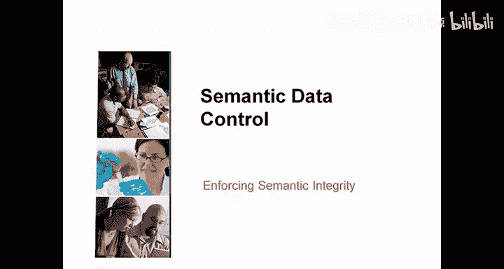

Welcome to Semantic Data Control。And this unit will be discussing enforcing semantic integrity。

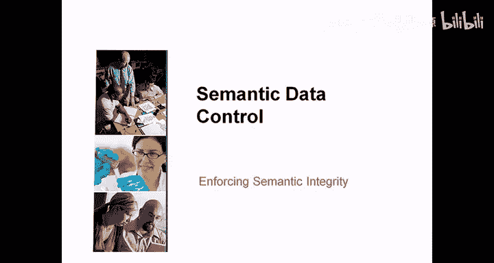

Enforcing semantic integrity can be very difficult， so given an operation。

 something that updates a database like function U。

Funy basically takes the database from its original state and moves it into the state D subu。

Which means some updated state of the database。So that can mean an addition additional row。

 it could be a changed record， changed value， a deleted row。 It can be anything。

 but the database is no longer in the same state it was after the update operation than it was in the beginning operation in the beginning before the operation started。

 So one way to approach this is called post tests。 So you do the operation。

 it changes the database state from D to D sub U。 And when a constraint becomes false。

 after testing the constraints after the transaction is completed， then we reject the transaction。

So either we modify the update operation， we change what it updates。

 or we undo its operation undo its effects， so this requires a lot of work。

Once you've changed the database。From the state D to the state D subbu。

 you have to check D Sbu to ensure that the state of the database is consistent with all the assertions。

Also。It requires undoing you。Let's， that often could be a lot of work。

 We'd like to try a different option。

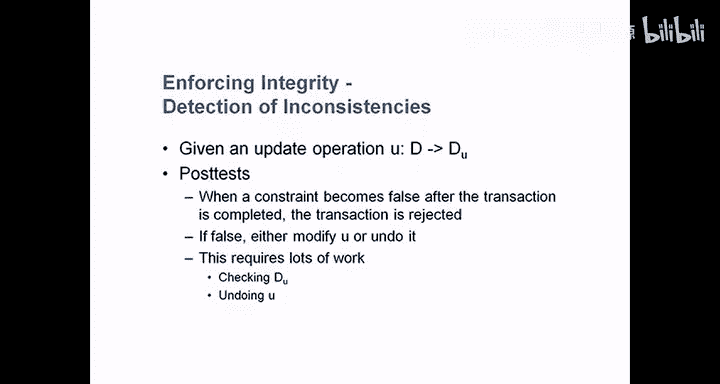

In fact， the option will choose is prets， so we'll ensure that the outs are going to be executed only if the database will database will be in a consistent state after the operation as is run。

 So this is more efficient because there is no need to undo anything。 You basically check the state。

Then it will be in if you perform this update operation， and if that update operation。

 the effects of it will will contradict some assertion。

Then we won't actually we won't actually execute that update operation。 So here's an example。

 here's a simple query where we want to update the project project's budget number and we want to update the budget by 10%。

 so if the constraint on the database is that the budget has to be between 500 k and a million so we want to ensure that we're not going to be updating the budget to have too large of a budget。

 so one way to address this is before the query is executed we can now append the constraint to the query to the update statement and we could say we maintain the update project we set the budget equals budget times 1。

1 where the project name is CAdcam。And we now add on the constraints of the assertion that we made that the budget has to be between half a million and a million dollars。

 and we add that into the query and we use a new operator here called New dot budget。

 which is the new value of the budget after the budget operation。

 the set operation will take effect so the database can actually check this ahead of time。And if。

 indeed， the budget will and will be over a million dollars， it will reject the operation。

 and we will not have changed the database， Any values in the database。before we did this check。

 so the check will not let the database be modified and the database will remain in the state it was。

 which it was a consistent state and still will be a consistent state。

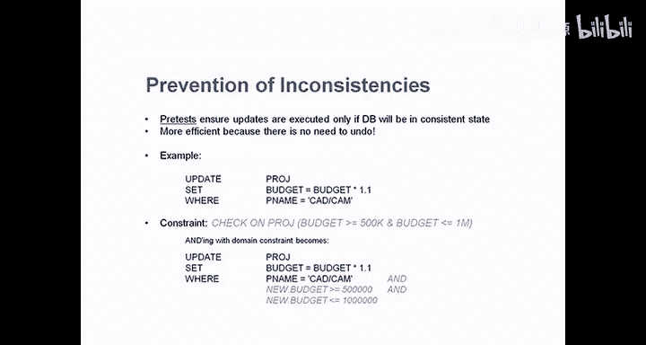

So inconsistency prevention only works for universally quantified Tuple calculus formulas。

 so the formula will be， for example， we'll have some kind of update operation called F and we'll say for all x。

 f of x will take effect。So what that means is that when F of x takes effect on all the data or some of the data in the database。

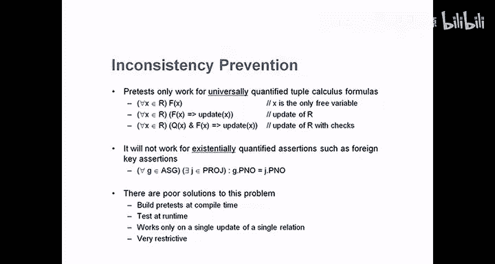

that it actually matches， we'll update certain parts of the database。

 but for all the values in the relation， we will apply this update and the update will apply to only those rows that the update is designed to apply to。

 we will now formulate that update。

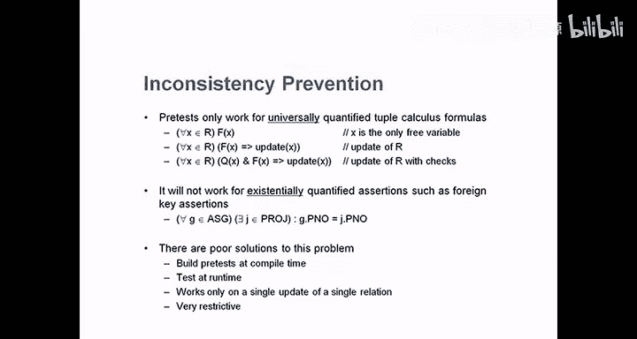

So what we did in the previous example in the previous slide was we handed the constraints to that update operation。

 so instead of beating the function being set the budget to be 10% higher than it was。

 we have this function Q of x， which was the constraint which ensured that it actually fell between 500 K and a million。

 so for universally quantify Tuple calculus formulas。

 we can easily take those constraints and append them on to the where clause of the query。

 check out the values long before it ever enters the database if it checks out will allow those values to now be updated in the database。

 if not we'll reject the operation and the database will not have changed。

But it does not work existentially quant assertions， such as for a key constraints。

 So read the middle formula or the formula in the middle of the page。

 As for all rows in the assignment， there exists some project such that the project number in assignment is going to be equal to the project number in the project table。

 What this ensures is that you don't add an assignment for which there is no project。

 So any time you want to add an assignment row， you better make sure that the project number you've as saying that you've assigned in that row is equal to some project somewhere in the project table If not。

 there is no corresponding project and you don't want to add that assignment row as well。

 But notice there exists clause in there， there exists to J。That belongs to project。

 it doesn't apply to all rowsnt project， and therefore you can't easily take this assertion and end it to the update operation as we did previously。

It's not easily done。 So there are poor solutions to this problem。

 you can build a pretest at compile time， not always easily done， you can test it at runtime。

 but still that requires making you building some complications into the update operations。

 and only works on a single update of a single relation anyway and is pretty restrictive。

 So there's another approach the other approach is differential relations。

 So this is actually quite compelling because every update of some relation R yields a triple。

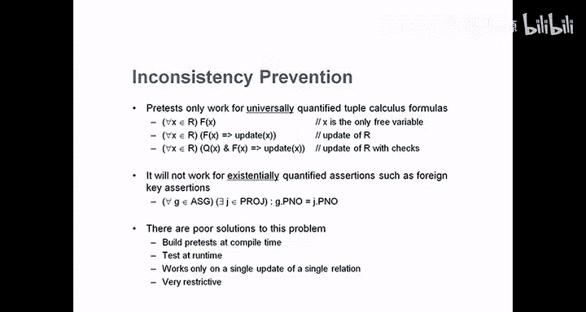

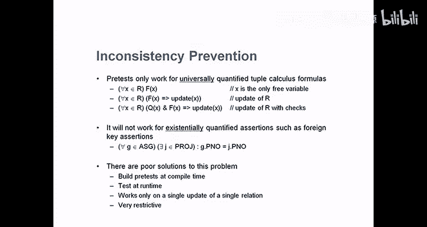

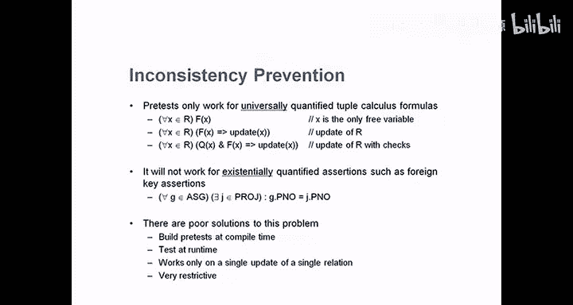

The state of our。Which was the relation that we had R plus。

 what are the things we're going to add to R and R minus。

 what are the things we're going to remove from R R plus and R minus are called differential relations So R plus is the set of new tuples added by an update operation。

 for example， if you're just the leading data there will be nothing in R plus because we're just strictly removing information if we're inserting information R minus is going to be empty because insert subtract anything from the relation and R will equal R plus union with R minus R minus if it's an update。

 So what does this mean we take the if we have an update operation。

 certain things will be added to the relation， certain things will be removed from the relation So the first thing we do is remove those things that we were planning to remove that the update will remove from the operation。

And now once we remove those elements， then we'll add the new rows。

 the R plus rows into the relation。 So the new version of the relation will be as as described in the last line of the slide。

 So heres are some examples of compiled assertions。

 Those compiled assertions are expressed in triples。

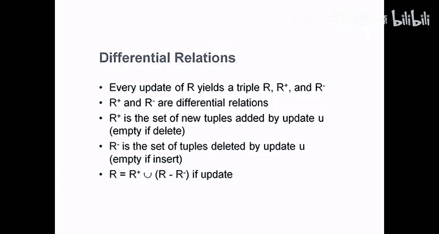

Where the first element of the triple is relation for some relation。

 we are now going to do something T is the type of update。

 We're going to perform some kind of update on this relation。

 And only under the circumstances where C the assertion is true and only a sudden set of the assertions are tested only those that are matching R and T so you can imagine there are lots of relations in a database and there are lots of types of updates So only when the update expressed by T is done to table R do we test that particular assertion and it only applies to R plus and R minus So that means that we start the operation。

 we decide what will be added to the database and what will be subtracted from the database if the assertion goes through I mean if if the operation goes through R will remain unchanged and we'll test the values in R plus and R minus And if those pass the test if they pass our assertions then we are going to update the database if the assertions do not pass with R plus and R minus we'll just simply drop our。

plus an R minus and R has never changed and the database remains in the state it always existed and so here's some examples of assertions for the assignment table we have an insert assertion and that assertion is C1。

 so we look at the definition of C1 and that says for all new rows of assignment。

 we have to make sure that there exists in the project table a row such that the following is true that the new assignment rows project number。

Matches some project number in the project table。What that ensures is that all new assignment rows have some corresponding project number row in the project table。

If this assertion were not to be true， what would happen would be that we would add assignments for which are no projects。

 We don't want our database to lose that height of integrity。

 So we assigned we decide to define this assertion and before anything is done before an actual row is added to the database。

And very specifically before an assignment row is inserted into the database。

 this check is performed。 The second assertion operates on the project table only when a deletion exists when a deletion is is performed and that constraint is defined as C2 and what does that mean for all rows and if you look at C2 for all rows in the assignment table。

And when we remove a row from the project table， we have to make sure that there is no assignment that's still attached to that project that we are removing。

 If there were some assignment that was still attached to that project and we remove that project。

 we'd have orphan assignments。 This constraint ensures that we don't have those orphan assignments。

 The third and final constraint is a modification to the project table。

 and we define that this constraint exists， applies to any time that a modification is attempted on the project table and here by modify。

 we mean update。 So what we want to say is that we're assuming that through a modification。

 we're going to be。Changing information in a row。 And there's going to be an old row version of the row and a new version of the row。

 And we want to check the constraints based on the old version and the new version of the row。

 So if we're changing somebody's age， for example， there is an old age and there's a new age in this case。

 what we're going to say is theres for all rows in the assignment table when we modify the row in the project table。

 there's going to be an old row and a new row。 So for all old rows。

 there exists a new row such that either the following is true。 that either the old project number。

 if we're changing the project number has no corresponding project in the assignment table to ensure that there are no orphan assignments。

Or， if there really does exist that project number in the assignment table。

 we have to ensure the new row that we've modified。

 meaning that we've changed change our row in some way， but that row。

 the project number of that row has not changed， the new project number is the same as the old project number and therefore that project number。

 even though the rest of the row might be modified only that that project number is not and therefore the corresponding rows in the assignment table are still connected to that project row。

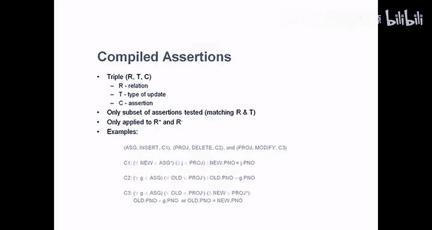