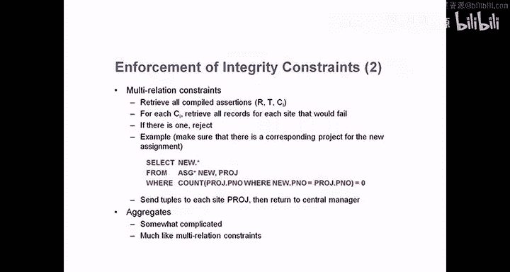

# 约翰霍普金斯大学《大规模数据库系统｜Large-Scale Database Systems》中英字幕 - P19：1_实施分布式语义完整性.zh_en - GPT中英字幕课程资源 - BV1N2urzvEjK

Welcome to Semantic Data Control。And this unit， we'll be discussing andforcing semantic distributed integrity constraints。

As you recall， there are three different types of integrity constraints。

The first type is ended individual assertion， and that assertion is identified along with a table or or the fragments associated with the table。

 and that assertion is sent to each site with the fragments。

The checks are made against the predicates。 and also the data。

 That means how were these fragments created And is the data consistent with with these assertions assumption here as we have an existing database and now we're defining constraints assertions against those databases and in particularly assertions on this table。

 So if the predicate is false。 at one site， we globally reject the predicate If the data doesn't even match at one site。

 we also globally reject the predicate and we say this constraint doesn't exist anymore。

 even though we try to define the assertion， we say we have to reject this assertion。

 So more concretely， suppose we have three fragments on the employee tables defined by following P 1 are those employees between we have employee numbers between 0 and 300 P 2 are those employees having employee numbers between 300 and 600 and employee 3 contains all the employee numbers of employees that are greater than 600。

 If there's an attempt to define a constraints such that the following。

Employee number is less than 400 saying that we're never going to have an employee that has a number of 400 or more。

 and if there's already existing data。What we're going to check each of the fragments。

So certainly this is consistent with the data in fragment1 and it's also consistent with the definition of fragment one。

 there is not a problem of defining this assertion。

Given the check that we made for the pregnant want of employee。It might be okay。For fragment 2。

 certainly it's consistent with the definition of the fragment employee numbers between 300 and 600。

 We will accept predicate if there is no employee number 400 are greater in that fragment。

 But if the data already says that there are employee numbers 400 and greater。

 we are going to reject this predicate and reject this assertion and say this will not be defined on this database。

 And certainly when it looks at the third fragment and sees the whole reason that this fragment has been identified has been defined for those employee numbers greater than 600。

 we're going to say that contradicts this constraint。

 and therefore we're going to globally reject this assertion。

 set her going to assertions are a little bit more difficult。 Theyre multirelational。

 they involve lots of joint prediicates， at least one join predicate。

 and these assertions are stored with single relations。

 So those assertions are stored are stored at all sites。 It store the relation fragments。

 They're impossible to test， and they can only be tests on the data。

 And you actually have to perform the。In many cases， in order to test the whether it is true or not。

So， give in an assertion。In this case， we have an assignment assertion。

 We're going to say that you that you can only insert a new assignment row if there's an existing project row。

 So the way we in this case， we're going to check it against a semi join fragmentation。

I'm going to discuss the semijo algorithm in much more detail later on， but just at this point。

 assume that we've defined assignment in the following way。

 define the fragments of assignment according to the fragments of this project。

 So if the project number is the project table is fragmented into several horizontal fragments。

 then we're going to fragment the assignment table are in a corresponding matter。

 so that each of the assignment fragments are on the same site as their project fragments。

 So therefore， when we want to when want to add this insertion into the database。

 we are just going to check one site and make sure that all any new predicates。

 any new assignment rows， have some corresponding。Project in the project fragment。

 no communication is required during this check， because we're assuming that the the fragment of assignment is this is covers the same range as a fragment of project。

 So this is derived fragmentation。Another example is if the project is horizontally fragmented based on two predicates。

 So the first fragment is are defined only those projects that have project numbers less than 300 and the second fragment。

Defins a fragment that where a project numbers of 300 or greater for each new tuple of assignment is compared to either the first project fragment or the second project fragment。

 So at most only one communication step will be will be incurred per new tuple。

 If project is horizontally fragmented based on two predicates that is nothing to do at the join criteria is's fragmented according to the project name。

 which is not how the assignment table is fragmented。

 Each new assignment is compared to each row of each project because we don't know ultimately where those projects exist。

 So it's actually quite and involved check how do we enforce integrity constraints。

 So through individual assertions， those assertions are stored at the sites along with the relations。

 and when we make an update so that induces a differential update are in if R plus and our minus its to the assertion at those sites or all these assertions for that site。

 the site will accept the。ate if it is rejected by one of the assertions。

 then it will be rejected sett oriented assertions are a little bit more complex。

 so those are single relation constraints on the same table。

 but they're set oriented they use tuple variables in this case we saying that any new two new employee have to adhere to the constraints such that if their employee numbers are the same their employee names better be the same or or that if theres an employee number that corresponds to some employee number already in the table。

 so its name has to correspond to the same employee name in that table。

What it'll will do is it' will create differential relations。

 R plus and R minus and send each to the site， and each site verifies whether this is true or not。

 Once site rejects， all or some are rejected。 We also have multi relation constraints。

And that says that there's a complex constraint that involves multiple relations and usually it involves some aggregate as well。

 Each constraint will retrieve all the records for each site that would fail。

 And if there is one that fails， we're going to reject it。 So here's an example。

 Let's say that we've defined this complex constraint consisting of select new star new assignments and projects what we're doing is we want to ensure that there is a corresponding project for a new project。

 So we want to make sure that somewhere along the way， there is a new project。

 but count is an aggregate operation and we want to make sure that。That， you know。

 we adhere to this constraint。 Unfortunately， all these new tuples that might end up in the database have to be sent to each sitepro that contains a project fragment and return to the central manager。

 So if there' is one that rejects or if they all reject altogether。 So the constraint is rejected。

 the insert is rejected。 Otherwise， it'll be accepted。 aggregations are somewhat more complicated。

 It's much like multirelation constraints， in a sense， the count to operation here is an aggregation。

 which is very complex。 So checking integrity constraints can vary from simple to complex based on the complexity of the aggregation constraints and also the complexity of how many relationships among different fragments here testing at one time。

