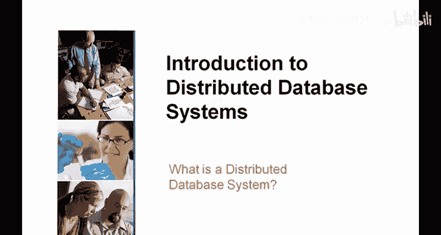
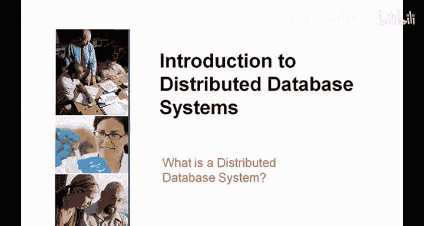
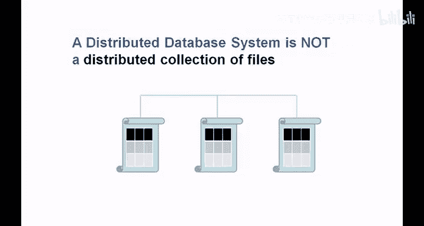
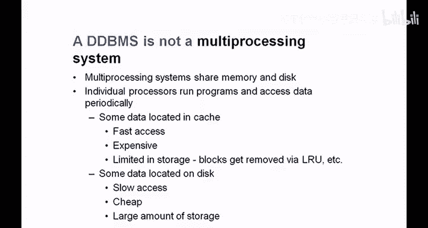
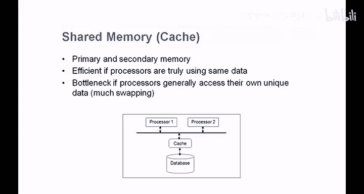
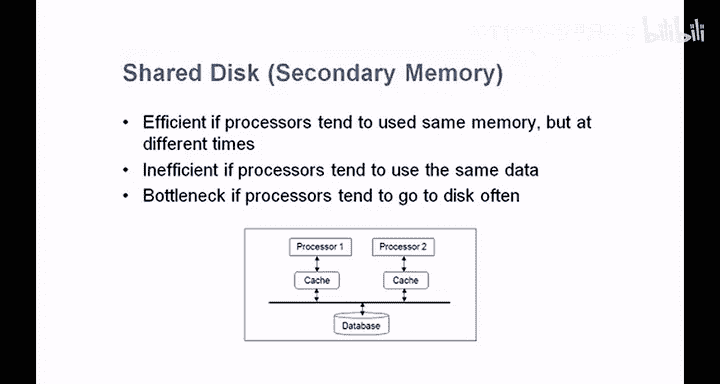
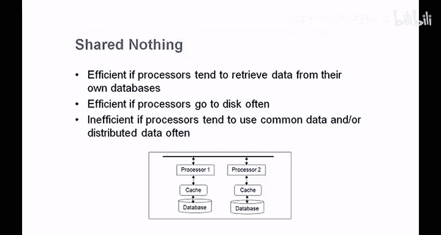
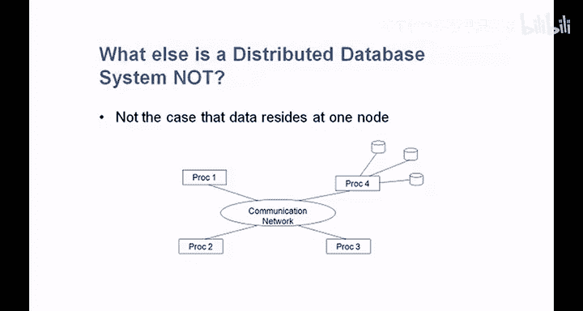
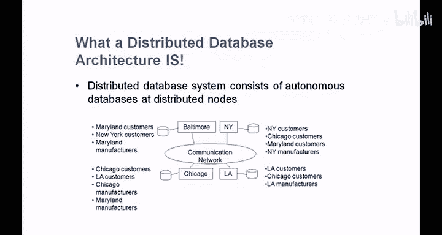

# 约翰霍普金斯大学《大规模数据库系统｜Large-Scale Database Systems》中英字幕 - P1：0_什么是分布式数据库系统.zh_en - GPT中英字幕课程资源 - BV1N2urzvEjK

Welcome to Uni1 of module of distributed database systems In this module what we'll talk about is what is a distributed database system best define what a distributed database system is we would first start by describing what it's not distributed database system is not a distributed collection of files although there are systems that integrate files and usually their word search systems or usually concepts as search systems like Google for the purposes of our distributed database system class we're not going to consider distribution of regular files as being part of a distributed database system first files would have to be related to each other in some meaningful way in order to be partially considered a distributed database system Furthermore。

 those files would need to be well- structured the structure enables a fast integration and the structure enables us to relate data and integrate data very smoothly so in order to be a distributed distributed database system it has to be physically distributed across many different database systems and the reason we want physical distribution。

There are a lot of important issues that come up in transaction management and other aspects of the course that the distribution is very critical to understanding how to execute and how to implement in actual distributed database system execute queries on distributed database systems and also understand the mechanic of and also some of the major issues of integrating data from many different distributed data sources distributed database system is also not a multiprocessing system multiprocessing systems are systems where we have multiple processors that access very similar data while that sounds akin to distributed database systems it's different in some meaningful ways just as an introduction a multiprocessing system is characterized by system that share systems that share memory and disk we have individual processors that run and the type of memory they share are both cache memory disk memory cacheme is characterized by having fast access so that's very good because data can come to your application。

Very quickly however， the limitations are that it's expensive and also it's limited in storage The second aspect is multiprocessing systems is that they share disk disk is characterized by slower access。

 however it is cheaper and it can store a lot more information than cache memory system the first style multiproces system is called a shared memory system where they share both multiple processor share both cache and a database system so it shares both primary memory。

 which is the cache memory and secondary memory which is a database it's efficient if both processor are typically going to the database to retrieve the same type of information example。

 for example processor one will access certain data in the database to make the access to that data faster the system will move that data because cache access is much faster than the slower disk access of the database So when processor one ask for let's say variables A B and the system will move AB and C up to the cache and when processor has one a request。

Access to AB and C again it will need to go all the way down to the database to get AB and C instead it'll go to the cache and access that information much quick benefit here is if processor2 is also accessing AB and C will not have to go to the database to get in AB and that information will already be in the cache so when processor one and processor2 are accessing the same types of data often the data often one of those processor will pull the data into cache and then then the same processor and the other processor will access that same data from cache says very if will become inefficient if processor one and processor2 are not accessing the same data in which case processor one will pull a whole bunch of information into the cache Pro2 will then access different information and when the cache is full it'll write back the old information for processor one into the database when processor2 will then elevate the data it's accessing to the cache and if this happens too frequently there'll be lots of swapping between information or data into the cache。

Between processor one and processor2 case could be quite an inefficient operation if there's a lot of data swapping in and out of cache so depending on the application。

 shared memory can be very efficient or very inefficient and that based on the characterization of both of the processors second aspect of multiprocessing systems are shared disk systems where each processor needs its own cache shares a common database so this is efficient if processor one and processor2 generally the same type of data all stored in one single database access different aspects of that data Pro1 might need might need data A B and C and processor2 might need data X Y and Z 1 will pull its A B and C up into cache and operate on that for a while until it needs other information processor 2 will pull X Y and Z up into the cache and and work on that data until it needs other information in which both cases when they're done with their information that they need write it back to database to the database the data is changed and needs to be written back。

The database and they'll pull new data back up to the cache to access that data this is very efficient if they really do need the same data in general from the database。

 but they operate on different parts of the database if they need to go to disk very often could be a bottleneck and if they access the same data X A B and C all the time so they've wasted a cache because would have gotten by with one cache but depending on the type that are running on each of the processors this can be efficient or it can be if the third type of this type of system is a shared nothing system and this is very popular these days especially for large data warehousing systems shared nothing architectures and and some of the produceuce shared memory system a shared nothing system I'm not going to speak about those until later on in the semester。

 These are where the processors have their own cache and their own databases occasionally share information So processor one will access its data in its database move promote information that reads often to the cache processor2 will do the。

Aing the data in its database， promoting its information that it uses often to the cache and they'll operate quite independently。

 So once in a while they might need information from each other's databases so messages will be passed across the network to retrieve information from others databases is very efficient when data they need is very different inefficient if they share common databases and even more so if they share common caches that in all of these multiprocessing systems that's not what we mean by a distributed database system and just one more slide to talk about what a distributed database system is not and I touched touched on this in the first few slides is that imagine a communication network where you have many processors that are communicating across the network processors are geographically distributed however all the real data systems hanging off of one processor so the multiple databases will hang off of processor this while it might be considered a distributed database system is not going to be considered a distributed database system for the purposes of our course too much of。

Distributed database theory relies on the fact that the databases are actually geographically distributed or are a lot of issues in accessing data from multiple sites and aggregating them。

 joining the results together that have to do with network and bandwidth issues also have to deal with distributed transactions there are a lot of complications that are introduced when information is joined from geographically distributed sites so what is a distributed database system distributed database system is you have a large communication network where the processors are a geographically distributed and each of those processors actually has a database hanging off of those processors in this case we represent for geographically distributed processors。

 one in Baltimore， one in New York， one in Chicago and one in in Baltimore they store Maryland customers New York customers in Maryland manufacturers in New York they store in New York customers Chicago customers Maryland customers for redundancy reasons and redundancy is very important to distributed database systems because if one node goes down you want to make sure other node can。

Process the information and conserve up the information even though the primary node might be down。

 New York also contains New York manufacturers one more word about the distribution。

 Maryland customers being located at New York sometimes people from New York might need Maryland customers on a frequent basis so they'll be able to access the Maryland customers very much faster than having send a request out in the Internet all the way to Baltimore's database to get Maryland customers locality of reference is very important and distribution and the distribution of database tables。

 so knowing that Baltimore Baltimore the processors at Baltimore and the programs at Baltimore will need Maryland customers off。

 also knowing the fact that New York programmers at New York programs will need Maryland customers often helps understand helps us design the distributed database to replicate information both for replication purposes to make sure that information is always available。

 but it's always available in places where people will likely need it the most so that those people can get quick access to that data。

So that concludes the first unit of the first module is the distributed database systems class。

