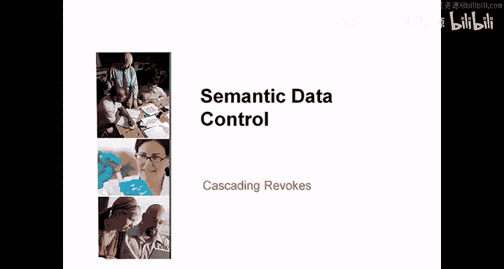
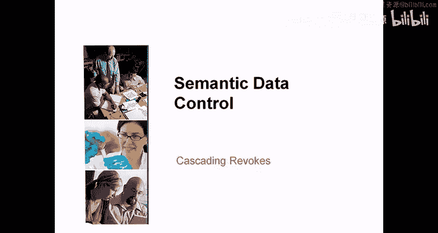
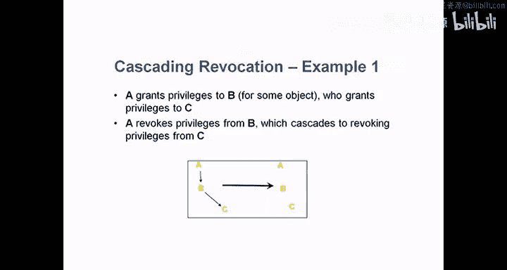
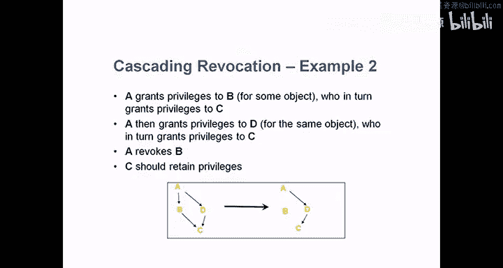
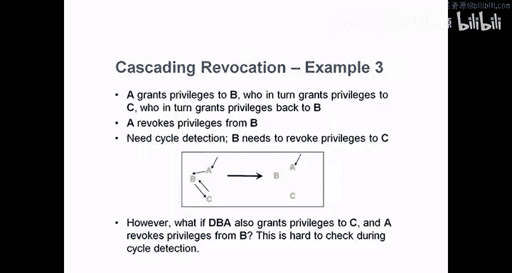
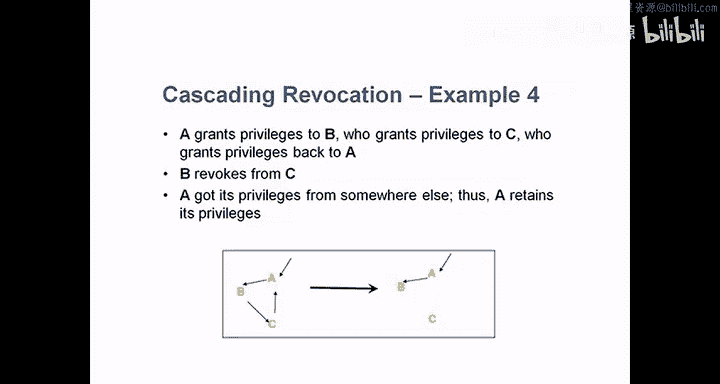

# 约翰霍普金斯大学《大规模数据库系统｜Large-Scale Database Systems》中英字幕 - P20：2_级联撤销.zh_en - GPT中英字幕课程资源 - BV1N2urzvEjK

Welcome to Semantic Data Control。And this unit will discuss cascading reokes。

The first example of cascading revokes is the following， very simple。 you have three users， A。

 B and C。And A grants privileges to be for some object in the system that object can be a table。

 can be a view。For even B columns or rows， but for simplicity， we'll talk about tables or views。

 which is common in most database systems。 B turns around and grants privileges to see。

So if you notice the directed access graph on the left-hand side of the diagram。

 it demonstrates that A has granted privileges to B for some object。

 and B who also not only has privileges for that object but also A has granted it grant privileges so that a can turn around and grant privileges to others。

 So B turns round and grants privileges to C for that same object。

 So when A revokekes privileges from B for some reason A doesn't want B to have those privileges any。

 the whole reason B has privileges in the first place came from A and A doesn't trust B any more to have those privileges。

 B has to turn around and revoke the privileges from C。

 So essentially when A revokes privileges from B， A is saying I don't want B to have privileges any more。

 nor anybody else who has privileges that were granted by B。 the second example more complicated。

 but not fair。

In this case， we have four users， A Gr's privileges to be for some object。

B turns around and Grs privileges to see for that same object。

And then A now grants privileges to D for that same object。

 and D turns around and grants privileges to C。 So C receiveseth privileges from two different users。

 B and D。When A revokekes privileges to be。So the graph on the right hand side reflects that A and B are no longer connected by an arrow。

But that means B has to turn around and it revoke its privileges from C。 So it does that as well。

 But notice C received its privileges from D as well。 A never revoked the privileges from D。

 So to C still can maintain the privileges， even though it was privileges were also granted to it by B。

 which was revoked by a。So the ultimate out。Access graph。

ultimate directed access graph is the following A， D and C， and B is left out。

 Third example is a little bit harder than the second example。

 So suppose we only have three users A grants privileges to B in turn Grs privileges to C fine so far。

 but C decides to grant privileges back to B kind of interesting。

So when A revokekes privileges from B。What's going to happen。Well， you might think， well。

 B was granted privileges from somebody else， that person being C。

 So maybe if B was granted privileges from somebody else， it should retain its access。

So one thought would be to just remove the arrow between A and B。

 but keep the the cycle going between B and C。 It's a little bit tricky。

 but that's not really the intent A。 A really wanted B to have those accesses revoked and B didn't receive its access privileges from anybody else。

So what we need is cycle detection to realize that be and sea it or。Collaborating with each other。

 whether intentionally or not， and we have to detect that there is a cycle between B and C。

 and we have to remove that cycle。 Okay， so the ultimate representation of the graph is A receives his privileges from somebody and the and C no longer have privileges to that object。

 What if the database administrator also granted of privileges to see。

And A revokes privileges from B。 So that means C would have privileges from another person。

 So this is a little bit tricky。 The question is， so since C received his privileges from somebody else。

 in this case， we would retain the privileges of C to B。

 The final example is even a little bit more tricky and not so much， A Gr's privileges to B。

 the Grant's privileges to C， who can turn Grant's privileges back to A。 So in B revokes。

Privileges from C， you might think you'd need to through cycle detection。

 You' get rid of the entire cycle。 A to B， B to C， and then C back to A。

 But A did get his privileges from somewhere else。 So thus， A retains its privileges。

 A can't inadvertently cause itself to lose privileges because it was the initial granter。

