# 约翰霍普金斯大学《大规模数据库系统｜Large-Scale Database Systems》中英字幕 - P21：3_查询处理示例.zh_en - GPT中英字幕课程资源 - BV1N2urzvEjK

Welcome to query processing this you will cover a query processing example。

 so for our example query we are going to examine very simple query。

 it's a simple join between an employee and an assignment table。

 and we're going to select those employees that have a responsibility of manager。

 and from that we're going to select the employee name， very simple query。

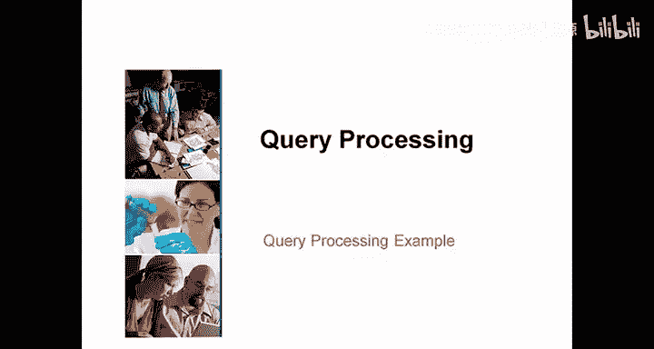

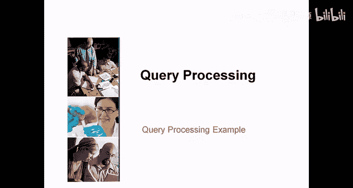

But we'll see that examining the strategies for solving this query are actually very complex。

 so when we convert this query into a relational algebra expression。

 we have different options for the relational algebra expression。

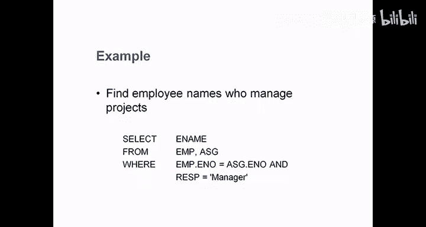

So notice the first one is the query taken at the very simplest level。

 working from the inside of the parentheses outward。

 we first create a cross product between the employee and assignment table。

And then from that cross product we select those such that the employee employee number and the assignment employee number are equal。

 which filters out a certain number of rows， and then we select the responsibilities equals manager rows。

 and from that we have a much smaller table and then finally the projection requires that we select only the employee name column。

 so at the end we see we just get a set of employee names where the employee responsibilities our manager on a particular assignment。

Now using the laws of query algebra， moving operators in and out， we can create identical。

Query plans or through a relational algebra expression and we can actually pull apart we can actually push in as a matter of fact。

 the selection of responsibility equals manager to the assignment table because the responsibility column is only associated with the assignment table and the thought being when we push in the selection we actually filter out a number of rows from the assignment table making that assignment table much smaller and hence when the assignment table is smaller than its crossproduct with the employee table it turns out to be much smaller and then when we apply the selection of employee numbers having to be equal in the employee and assignment table that will create another filter of rows and at the end of that we'll project only the employee name column。

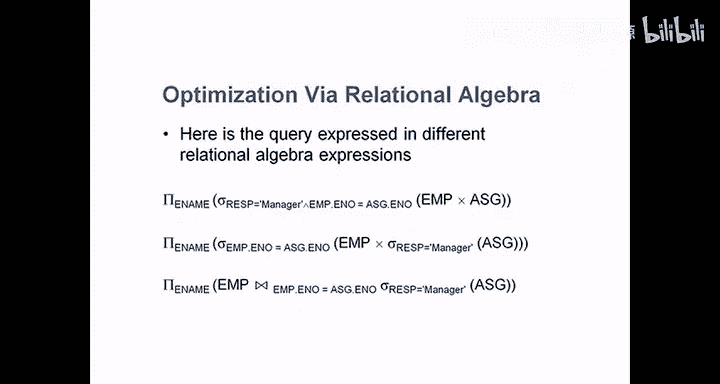

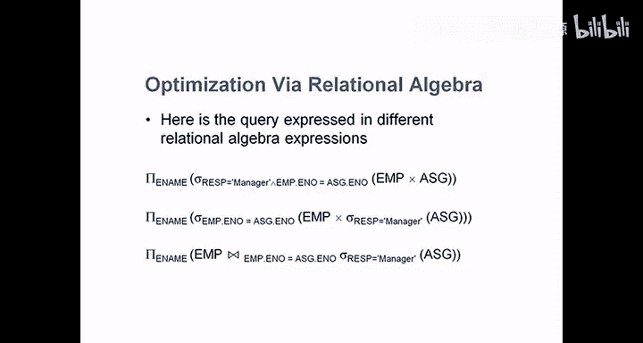

The results are identical。But there's a sense that because we're making the assignment the result of the assignment table smaller before we create a cross product between it and the employee table。

 they will be better performance on this expression of the query。 Finally。

 third query is another expression of the query。 but is actually even more efficient。

 at least we have the sense that it's more efficient。

 We'll push the selection operator into the assignment table to make the assignment table much smaller and we'll select only those rows that have a responsibility equal to manager。

 and then we'll create a natural join between the employee table and the product and the result of that assignment table after filtering out only those assignments that have a manager responsibility。

 And the notion is， is that a natural join is much more efficient than creating an entire cross product and then filtering out the rows。

 and then finally we'll apply the projection of employee name。 Now。

 I've described a sense of why one is more efficient than the other。

 but I haven't quantified it at all。In the rest of this presentation。

 I will talk about quantifying these so we don't have to play guessing games。

 but we can actually get really good estimates on which are the proper relational expressions that will likely lead to better query plan。

 Now， notice that the laws of algebra query algebra。

 All these expressions are actually quite equal to each other that will produce the same results。

 But if we use these expressions as query plans。 So notion is。

 is that the last expression is more efficient than the previous expression is more efficient than the first expression。

 So just a word about centralized versus distributed database systems。 and central database systems。

 the problems finding the best relational algebra expression。 So in general。

 this is an intractable problem。 I presented a simple query。

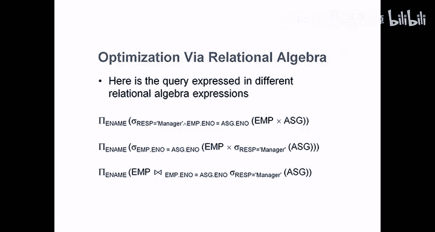

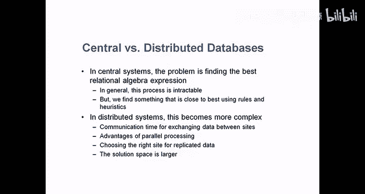

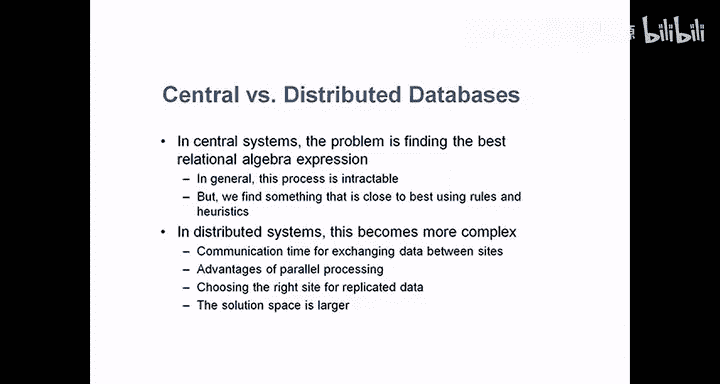

But as queries get more complex， more， there are a lot more。

Representations of the query and query algebra， and there are a lot of options to choose from when you're selecting the query plan that is most likely to give you best query results so。

In fact， with the addition of more tables and lots of different options in setting up the relational tree relational algebra expression。

 we will actually get very complex number actually an exponential number of different possible relational expressions we have to choose among an exponential amount that's a lot so we employ heuristics to weed out those that are unlikely to provide good results and then focus on those that will likely to better performance results I'll describe those throughout this module and the next module in distributed systems it becomes more complex because we have to consider communication time for exchange of data between sites。

 whether the tables are stored at different sites， whether there are fragments of the same tables stored to different sites so the complication actually gets more complex there is an advantage of parallel processing when you're distributing data across multiple sites you can get some kind of efficient。

From performing parts of the query in parallel。Lt examined that shortly。And。

The other complications are choosing the right site for replicated data。

 the solution space is also exponential， but it's still strictly larger because you have a lot more opportunities for moving data and a lot of different combinations across the distributed database system。

 But ultimately， this is a very difficult problem。 Okay， so let's look at a notional example of。

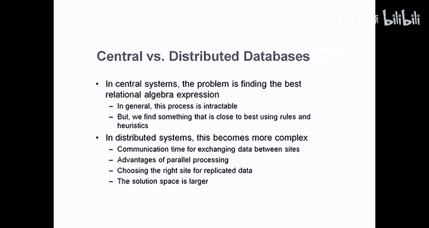

How you would determine what are better query plans and what are not so good query plans。

 So here's an example， let's consider the same query that we consider before。

 let's choose an optimal query plan or what we felt was optimal optimal where we actually select the responsibility equals manager from assignment filter that that table down to a smaller size and then perform a actual join with it in the employee table and then finally project the employee name。

 Furthermore， our constraint here is that we have a fragmented database where the employee 1 fragment is stored at site 3 and the employee 2 fragment is stored at site 4。

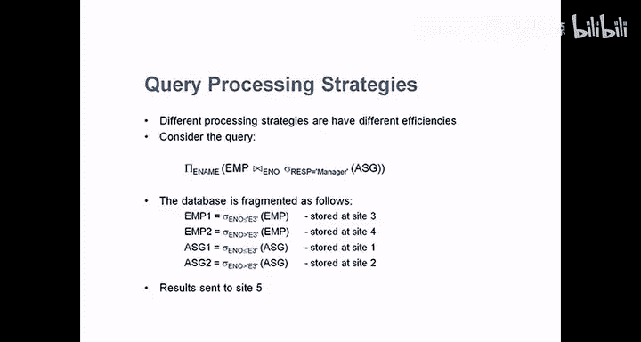

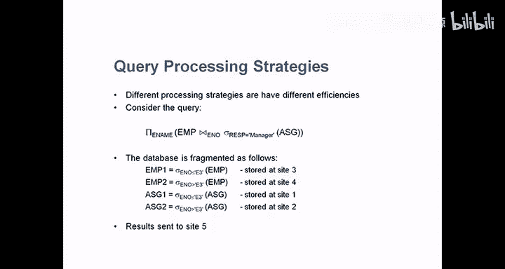

The assignment 1 fragment stored at site 1， the assignment 2 fragment is at site 2。

 and the results need to be sent to site 5。

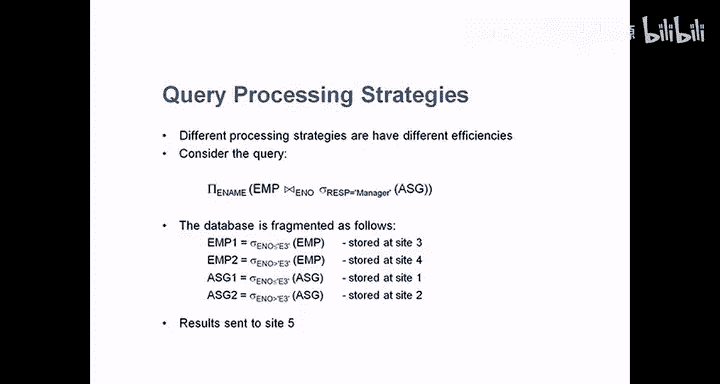

Heres a representation of this plan， so notice sites1 and 2 actually perform the first step of the query where we look at the assignment assignment table fragments。

 and we filter out those rows that are only manager rows。We read the entire assignment fragments。

 but pull out only those rows that our manager rows and send those results to sites 3 and 4 respectively。

It's there what will perform natural joins between the employee 1 fragment and the assignment 1 fragment。

 as well as between the employee 2 fragment and the assignment2 fragment。

Given that they're fragmented along the same employee numbers where the fragment for assignment1 is actually a lower number than the assignment two are higher numbers hired in employee 3。

 the fragmentation is identical for employee 1 and  employee 2。

As it is for the assignment 1 in assignment2 tables。Fments。

 and then when we take those results from from the natural joins at site 3 and site 4。

 we bring them together at site 5 when we perform in union of the results。

That looks like a reasonable query， but we don't know exactly how to evaluate right now how efficient that is。

 compare that to a second strategy where we just send all the information from each of the sites to site 5 and then perform all the operations at site 5 so we send all the assignment fragments to site5。

 weun the results and we apply a selection criteria。

 the responsibility equals manager to that at the same time we send the employee1 and employee2 fragments to site 5。

 we union those results and then we take the natural join of the union of the employees with the selected selection from the union of assignment tables and that creates the results。

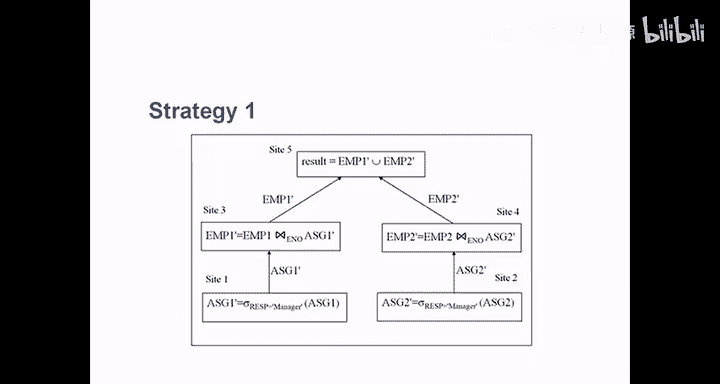

The senseenss werere sending a lot of data over the network here that in the previous strategy。

 we filtered out， so the sense is this is more expensive。But we need to prove it。

 So before we actually compare both strategies， we need some metrics。

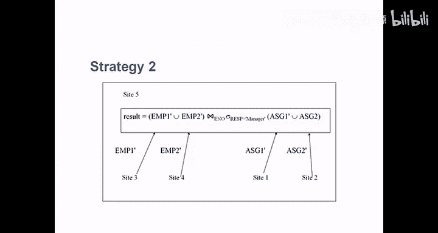

Let's say that the units of measurement are the following that a tople access to a database。

Is one unit of time transferferring data is 10 units of time。

 Let's assume that the employee table has 400 tuples。Therefore。

 each fragment is likely to have 200 tuples at each table。 We don't know that for sure。

 but that's a good guess right now。 And then also we look at the assignment table。

 which has1 thousand tuples， which also tells us approximately 500 tuples are assigned for each assignment fragment。

 and among the assignment table， there are only 20 managers。

 which tells me approximately the managers are probably distributed across each of the assignment fragments。

 there'd be 10 managers in the first fragment and approximately 10 managers in the second fragment。

 again， we don't know this for sure。 but we've collected statistics about the tables。

 and therefore we have some rough idea of what these tables contain。

 and these statistics are crucial for predicting the performance of each of the strategies。

In general， you need statistics to do any kind of evaluation and estimation properly。

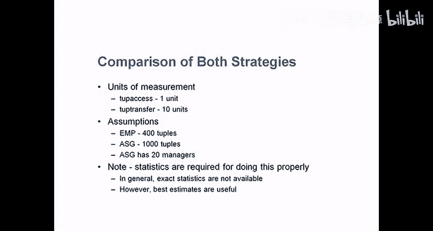

Exact statistics are never going to be available。 And if you do collect exact statistics。

 there is a lot of overhead in that。 We don't want to do that necessarily。

 and is's not even necessary。 Good estimates are very useful as well。

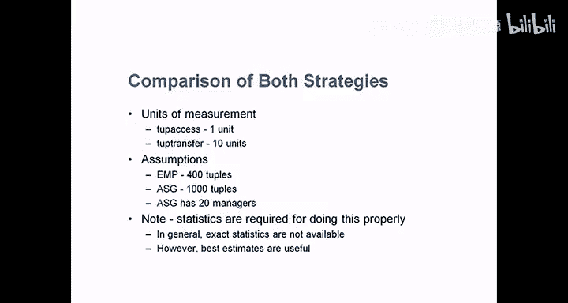

So let's look at the first strategy cost。So by producing the assignment tables。

 like looking at the result of reading each of the rows of the assignment table from the first site we read 500 rows。

 a second site we read 500 rows， and we multiply that by the tuple access time that's going to be 1000 units of time。

 we're going to transfer each of those that are managers to the employee fragment sites。

 and given that there are really only 10 managers approximately we know there are 20 managers altogether。

 10 managers from each site together， So we'll say that the tu we're only sending 10 rows from each fragments。

 10 plus 10。Times a couple transfer times， 200 that gives us 200 units of cost。

We're going to write each of the assignment prime tables that's the result of sending to the sites where the employee fragments are housed and we'll write each of those coupleples to each of those sites。

 it's going to require 10 rightss from the first assignment fragment and10 rights from the second assignment fragment which will yield 20 units of cost。

 we're going to produce the employee prime fragments by joining it to the assignment prime fragments and we'll assume right now that we have an index and we'll be able to find these rows very quickly。

 and then we'll read one row from employee， we'll be able to find the corresponding row in the assignment table very quickly or just the opposite well read one row from the assignment fragment and we'll find the corresponding row in the employee fragment。

 but in any case that's two reads per tuple and therefore from each side。

 each of the two sites where the employee fragments are living。

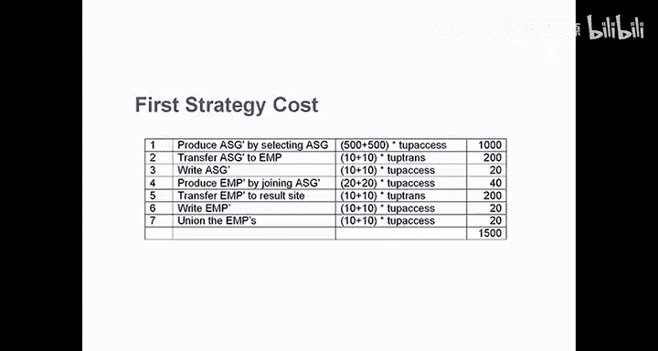

There'll be 20 reads pending out now that heals a net cost of 40 units。

 we're going to transfer each of these。

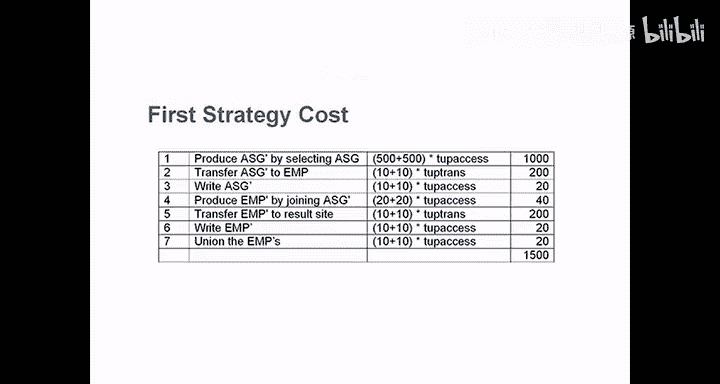

10 rows，10 rows from each of these fragment site up to the site5 we're going to transfer them。

 Tuple transfer time is is worth 10 per unit so we have 20 times 10 is 200 we're going to write the employee rows。

 there's 10 rows coming from each of the results of each of the fragments employee fragment sites so we're going to be writing 10 rows and 10 rows to site 5 that's 20 units of time and then we're going to unit as the results at's 10 rows of reading 10 rows a reading times of tuple axis time which is 20 units of time altogether in the unit cost is 1500。

 Let's look at the first strategies response time。 let's assume that we can perform these operations in parallel so look at the first read of both of assignment fragments we're reading 500 from each of the fragments and since it's done in parallel the cost is only 500 reads times the tuple axis time which is 500 we're going to transfer in parallel。

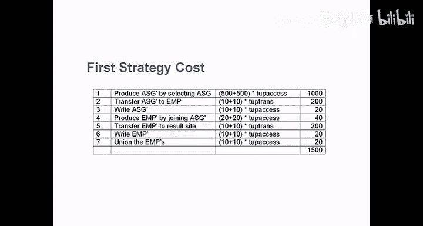

10 rows from each of the fragments。Approximately 10 rows and we'll multiply 10 times a tuple transfer time because these happen in parallel remember we're not looking for resource costs now we're looking for time costs and since we can execute in these operations and parallel we can actually just count that as one cost because they're timewise they're executing in parallel just a side note it's very difficult to get distributed systems to execute in parallel so this is really a best case analysis it's not practical in most cases。

 but just to continue with the example， we're writing 10 rows of the results in parallel to each of these sites that house the employee fragments that's 10 times a tuple access time。

We're going to produce the employee prime by。Results by joining it to the assignment fragments and from the calculations before it's 20 reads on each site。

 but since they're happening in parallel， we're only going to consider the cost of one site we're going to transfer them in parallel is 10 transfer 10 rows and 10 rows that are being transferred again that's in parallel we're going to be writing 10 rows in parallel to site 5 and then finally the union is going to require us to read all the rows and so we're going to read 10 rows from the first results。

 10 rows from the second results multiply that the times a tuple access time that yields the unit cost cost for the operation to be 760。

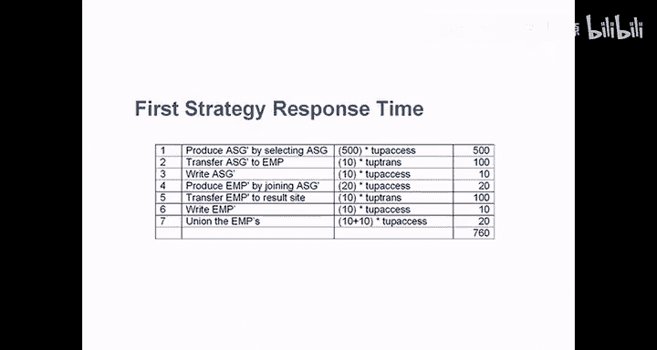

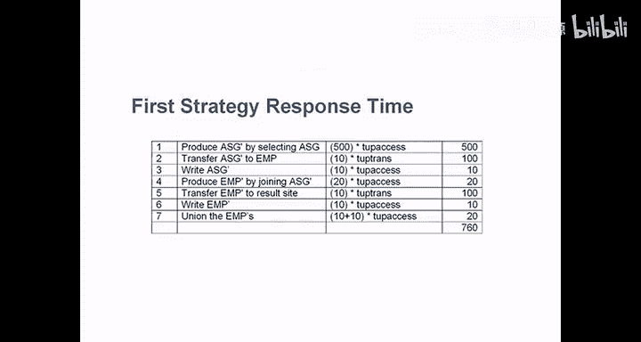

Now let's contrast that with the second strategy， remember we needed to send all the employee rows and all the assignment rows off to site5。

 so there's going to be 400 reads of employees， there's going to be a1 thousand reads of assignments and we're going to read those from each of their respective sites。

And that it heals a cost of 1400。 we're going to transfer all of them to site 5。

 Now there's a major cost in communication cost between those sites and site 5 and that's sending all 400 rows plus all thousand0 rows of the employee tables and assignment tables times the tuple transfer time which is going to be 14000 units we're going to write off those rows。

 so that's 1400 times the tuple access units which is one so it's 1400 units of cost we're going to select from assignment we're going to read 1000 rows of assignment we're going to join them to the employee table so for each row that we select only select in 20 managers So for that we're going to read 400 rows of employees。

Times 20 managers to get the tuple access time of 8000。 So we see that the cost is going to be 25800。

 very expensive。 We see that just measuring resource cost between the first， the second strategy。

 which is 25800。 I remind you to go back to the first strategy cost is only 1500 units of cost。

 Finally， let's look at the second strategy from a response type perspective。

 Notice that the parallel transfer。 So we have a maximum transfer of 200 from each employee fragment。

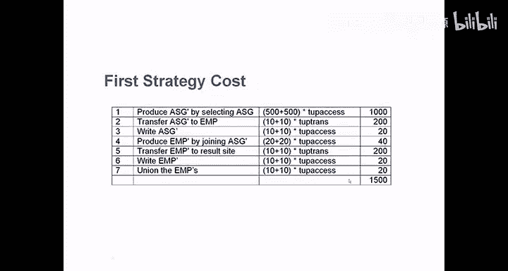

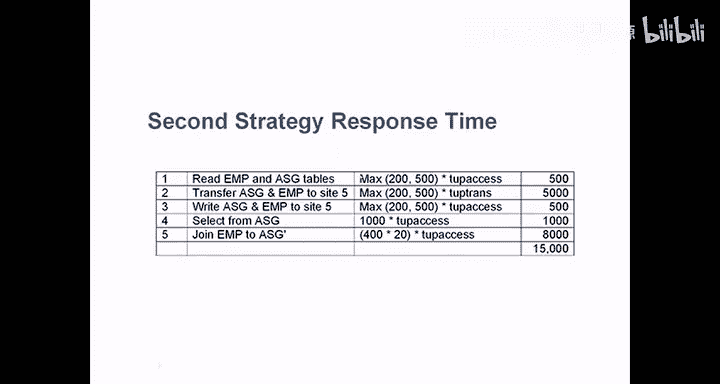

Because there are 200， approximately 200 rows in one employee fragment。

200 and the other employee fragment， but there are 500 approximately rows in the assignment fragments。

 So we're going to just take the maximum value of that multiplied by the tuple access time。

 which is 500， we're going to transfer them to site 5 and we're going to take the maximum of the number of rows we have to transfer。

 which is 500 times the tuple transfer time， which is 10 which yields the cost of 5000 and we're going to write the assignment and employee。

Rose to site 5 again， that's a maximum value of 20500。

 which is 500 times the tuple access time a tu right time is 500 units of cost and we're going to select from the assignment table。

 which still requires a thousand accesses to the assignment table。

 we're going to join it to the employee table。 So for each row that we've accessed we're going to read through all of the employee rows。

 it's not indexed when we when we sent it to the site 5 and since it's not indexed。

 we're going to have to do a essentially for every row read from the assignment。Fragments。

 we're going to have to read every row of the employee table each time we loopfully get a new assignment value。

 which yields 8000 a cost of 8000 the total。Cost from the response time perspective is 15000 for the second strategy。

 We go back to the first strategies。 responsepon time is only 760 units of resources。

760 units of type。

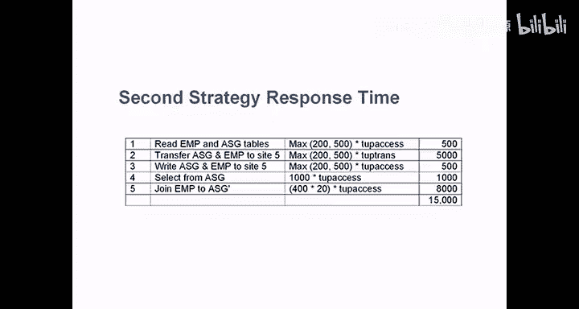

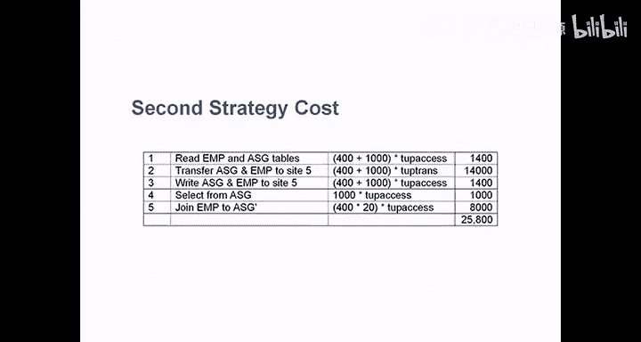

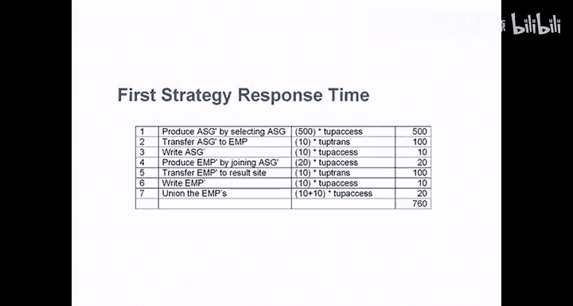

So whether we're looking at response time or whether we're looking at resource usage。

 the first strategy is much better than the second strategy。

 All this is to show that we can apply some， some real analysis。

 knowing some statistics about the structure and the nature of the database system find。

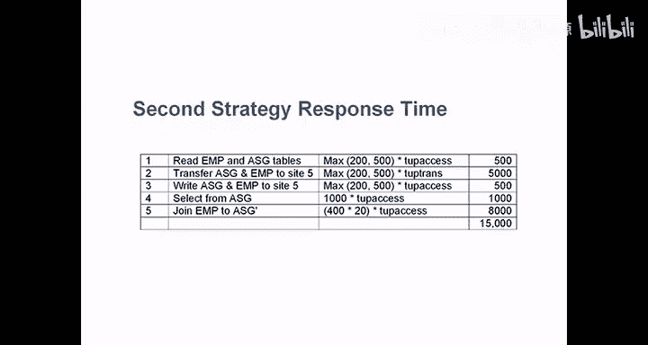

Better query plans or to predict better query plans and eliminate those that are not going to be as good as well performing queries。

So this was just exemplary， we're going to go into a lot more detail in how to evaluate this and this module and the next。

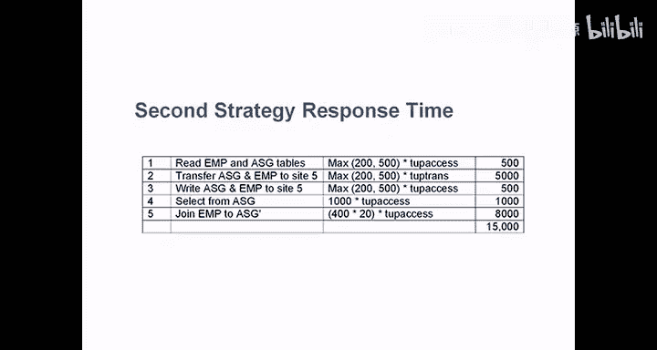