# 约翰霍普金斯大学《大规模数据库系统｜Large-Scale Database Systems》中英字幕 - P22：4_查询转换规则.zh_en - GPT中英字幕课程资源 - BV1N2urzvEjK

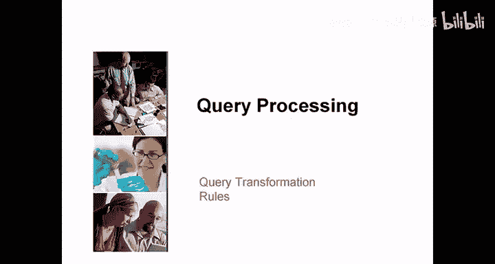

Welcome to query processing and this unit will' talk about query transformation rules。

 Let's look at a query was is an average query we might encounter， and this is our example query。

 We're going to select the employee name。

And we're going to create a join between our among three tables， employee。

 the assignment and project table， and we're only going to be looking for titles that are programmer。

 so this our employee titles that are programmer， where projects are greater than 100，000。

 and the duration of a project is less than 12 months。Very， very reasonable query。

 the first thing we do is create a tree。

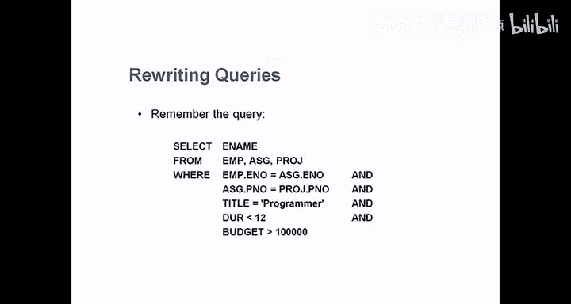

In the order of projections selections and joints so we take that relational algebra expression and now pre a query tree as a result so we move the projections to the top and we say that we're going to be projecting e name from the result of it all and the next things we're going to be doing actually from the top of the tree is selecting the titled programmer duration less than 12 and budget creator that 100000 and that's going to be operating on a join between the project table and the result of a join between the assignment and the employee table so looking at this as a query plan that we would pass to a query execution module you would look at this tree from the bottom up and determine what it needs to do based on the structure of the tree in the essence these are instructions sent to a query processor so not only is this representation of the query of the relational algebra a query but it'sre of the instructions sent to a query execution module so the first thing the query execution module。

Is going to do this is going to join the assignment table with the employee table and since it because it's at the bottom of the tree and is's going to be joined on the employee number。

The results of that are now going to be sent to another execution module。

Pece where it's going to join its that result with the project result， the project table。

 and then it's going to take that result and apply a selection of budget creator than 100。

000 and iss going to take its result in select only those that have a duration of less than 12 and take that result and apply other filter title equals programmer and finally it's going to project only the employee name column so we have a sense that this query plan in essence。

Well take a certain amount of time to execute。 So we'd like to apply some heuristics to weary tree in order to drive a semantically equivalent weary tree。

 but something that would be fed to a query execution planner that would be word that would actually operate much quicker and evaluate much quicker。

So there are a number of rules that we can apply to do the manipulation of this tree。

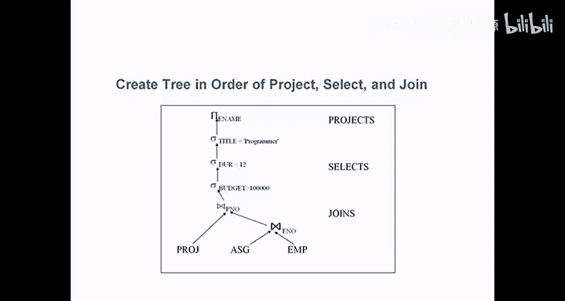

These are some of the tree transformation rules。 And in my discussion here。

 we'll assume that R and here 2 tables， and they both consist of attributes 1，2，3。

 all the way through N。 These are columns of the table。 and we have a separate table called S。

 and it has also attributes B1， B2， B3， all the way to B N。 So for tree transformation。

 we are going to look at number one， the commutative law。

We'll see that an arc process cross product between R and S is the same as a cross product between S and R and a join between R and S is the same as a join between S and R。

 Were thinking， of course， that's true。 But these two expressions mean very different things to a query processor。

 as we'll see had through this module and the next module。

 that the way the query processor will evaluate these is very different based on the order of the operation R cross R join S。

 for example， makes R the outer table and S the inner table。

S join R makes S the outer table in R the inner table。 And why is this important。

 Suppose that table S has an index on it， and table R does not。

 So we saw from the last video in this module that if R is considered the external table。

 we read run one row of R at a time And for each row we read of R。

 we find the corresponding row of S。 how this is done since S is index by looking at a B plus tree that represents the index of S。

 which is a log n operation， which allows us a log n read to find the corresponding rows in table S。

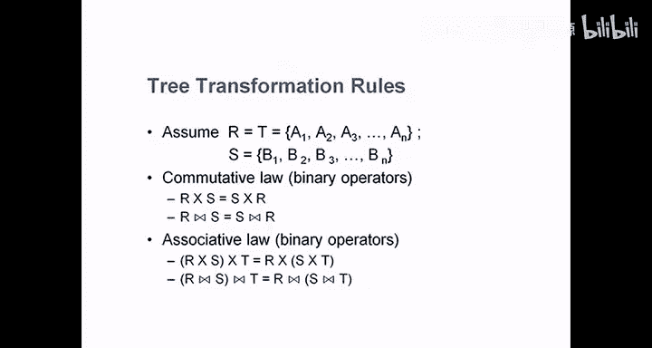

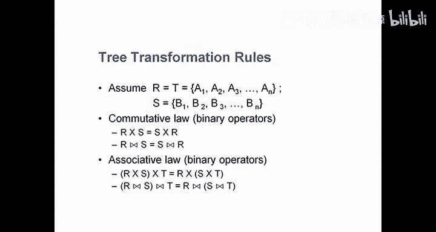

Contrast that with the other expression S join R， where S has an index on it。

 but R does not if S is going to be considered the outer table。And it will。

 because the query processor doesn't know any better。 It'll start reading of row of S 1 at a time。

 It'll look for the corresponding row in R。 except R is not indexed。Essential。

 that's going to be we're going for each row in S。 we're going to have to read a corresponding。

All the rows of R。 And for each subsequent row S， we're going to have to read all the rows of R again。

 So iss the left hand expression。 the left hand side of the equal sign。

 It's an n log n operation on the right hand side of the equal sign。 It's an n squared operation。 So。

 but we know that these are semantically equivalent to each other。

 and a good query optr will look at the various options。

 Under which of the tables our index in which are not。

 and potentially reverse the order of the join will change the meaning of the join。

 but it will certainly change the way the query processor approaches joining S and R or R and S together。

 provide a better choice for a more optimal query， Similarlyly， we have the associative law。

 So R cross taking its product cross T is the same as R cross a product of S cross T。

 and the same thing is true for natural joins， And again。

 depending on the index structure one may more optimal。

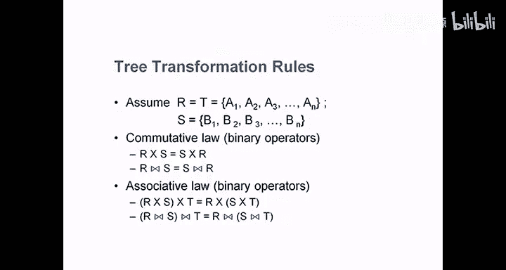

than the other to execute there are transformation rules for unary operators。

 so if you're doing projects and you have a set of attributes。

 A and a prime is some sudden set of the attributes and a double prime is some subset of the attributes。

 and a prime is even a subset of a double prime。

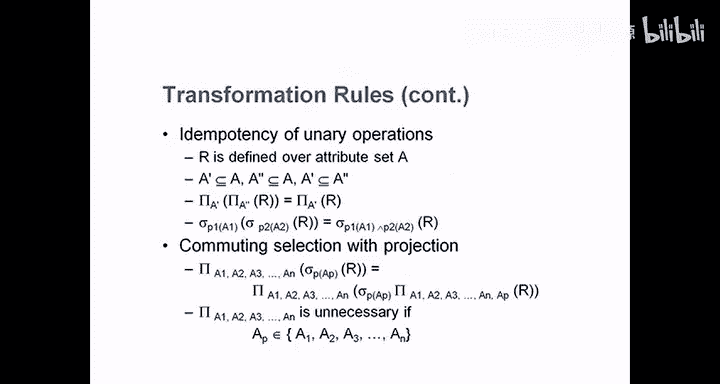

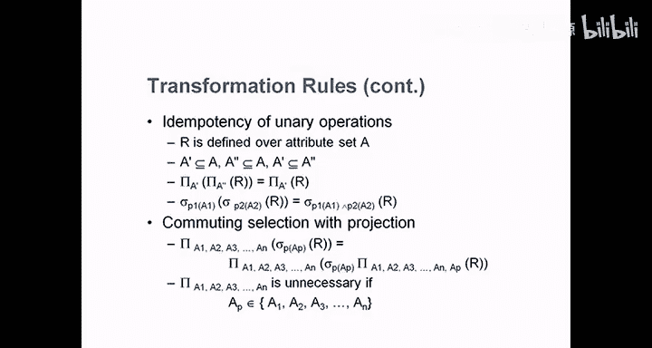

So if we have a projective a prime and a double prime。On R。

 it's equivalent to saying projective a prime， we can get rid of the whole layer of projections by applying this transformation rule。

 Similarlyly， if we have two sets of selections on one table instead of representing them as two selections。

 we can transform them to be an and of the two selection criteria on that table。

 much faster operation， we have commuting selection with projection so if we're projecting columns A1 through AN after selecting based on some predicate of table R。

 we can actually pull out this we can actually push them， sorry push the projections in to table R。

 so were actually dealing with a much smaller set of data and only the columns we're interested in a table R plus the column A sub P and provide all the selections on A sub P and a much smaller table and then ultimately project out As sub P if we don't need AapP。

 If A subp is one of the A1 through ANs， then。It's not a separate attribute and then we don't even need the outer projection and with the transformation from the projections on a selection relation just become a selection of projections on a relation it could be much faster another transformation is if a selection applies only to one table。

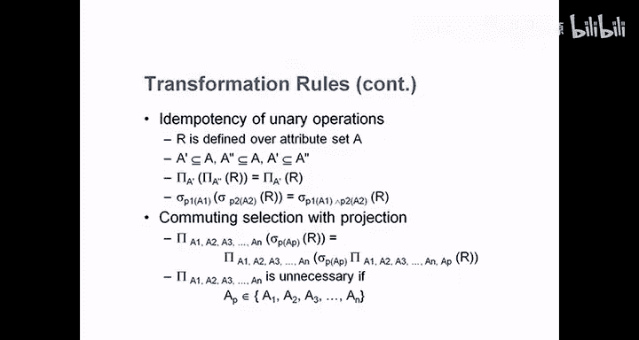

So if we say selection of our cross as versus selection of。

Maybe that selection criteria only applies to R。 it can move that selection in to only deal with table R。

 and then we apply that the result of that is a much smaller result。

 and then that means that the cross product of the smaller result and S is much more efficient to calculate than the cross product and then applying the projection Similarlyly it's true for natural joins。

 we can apply the selection criteria much earlier， but we could push it down to the table it's appropriate and then take its product。

 take its result which is going to be much smaller than the entire table and join it with table S。

 we look at our union T when have a selection criteria。

 apply to the union operator if that selection criteria only applies it'll apply to both because we're doing unioning。

 we can take that projection criteria， move it down to both tables。

 minimizing the set of rows that we have to deal with before we do the union and it can make the union a much more efficient operation。

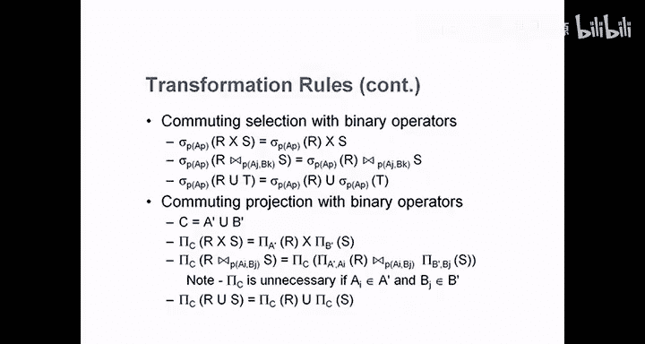

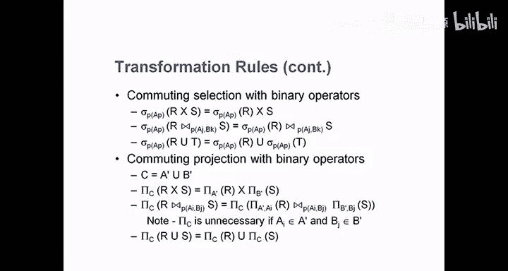

formation rule is commuting projection with binary operators。

 so if C is a set of attributes have attribute a prime and B prime a applies to to table R and B's。

 the B's apply to table S So if we project C from R across S that's really taking。

And C is the union of a prime and B prime。 we can take the a primes that are associated with R and just project those columns from R from a prime and then cross product them with just the columns that we need from S。

 columns B prime from S。 Similarlyly， we can apply this to a natural join or if we have projections of certain columns instead of creating the whole natural join first and then applying the projection we can push the projections down to the bottom level。

 and then now form the projections of join on the products of the projected rows of each table。

 Now applying this to a query tree。 So what we want to do to our original query tree is take all the selection and projection operators that we saw on the rules。

 especially rules 4，6 and 5 and push all projections down as far as we can and push the select down as far as we can So pushing the selects down as far as we can。

 we notice project greater than thousand applies to project duration less than 12 applies to。

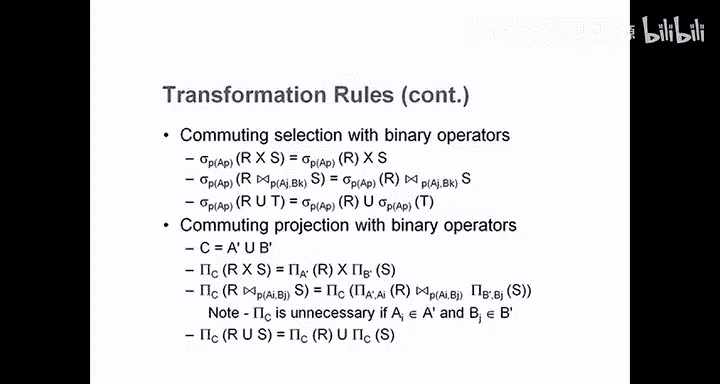

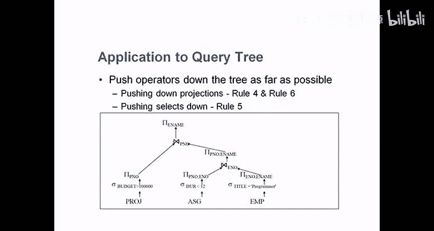

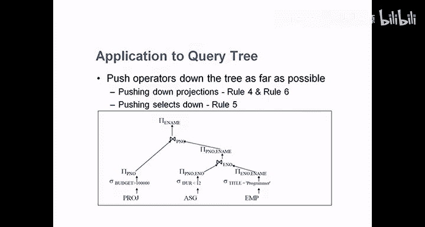

Signon table and title equals programmer applies to the employee table。

 we take the result of that and apply it to the projection we notice that the projection on the project table is we just project how P number and the product of P number and E number。

Is we apply the projective P number and E number to the result of applying the selection of the assignment table and then finally we project only the columns that we need from on the employee table。

 we join the results of the assignment table and the employee table but just only the columns and the rows that we need。

 and we now produce the resulting table and we project out of that just the project number in the E name。

 and then we take the results of that。And join that said the product of the the results of the project table。

 We perform a natural join on that and now perform a project on he name。 Now。

 let's do this with horizontal fragmentation。 I assume that the employee table is fragmented into three different fragments。

 We have employee 1 employee2 employee 3。 If the query predicate is choosing employee number less than E4。

 Then employee 3 is excluded from the join。 So any table that's defined based on a predicate we see the predicateates defined fragment 12。

 are not contradictory to the query predicate a number as greater as less than E4。

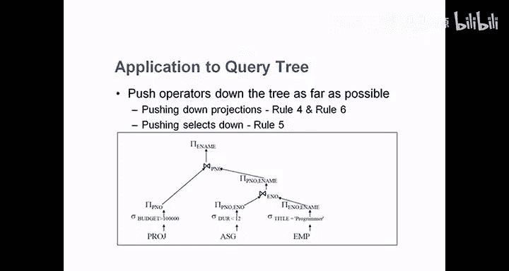

But the predicate。Defining M fragment 3 is contradictory to that query predicate。

 we can eliminate it from our query plan。 so if we look at the select reduction。

 we normally would be unioning three fragments to produce a result。

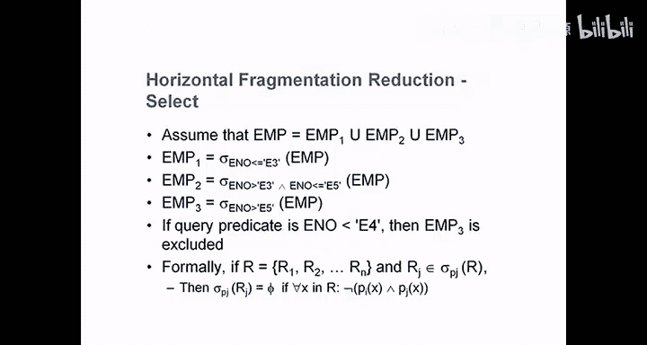

And then we'd apply a selection criteria of E is less than he4。

 but if we notice that that selection criteria is only applicable to employee fragment 1 and employee fragment2。

 we can eliminate employee fragment 3 from the table from the joint expression soably we can apply this to a joint reduction if we're joining different fragments of R and different fragments of S we can just the fragments that have the same or reasonable connection between their fragment definitions。

 so moving on to the next slide， if the union of three fragments of employee。

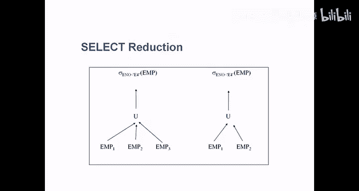

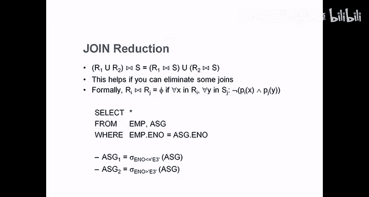

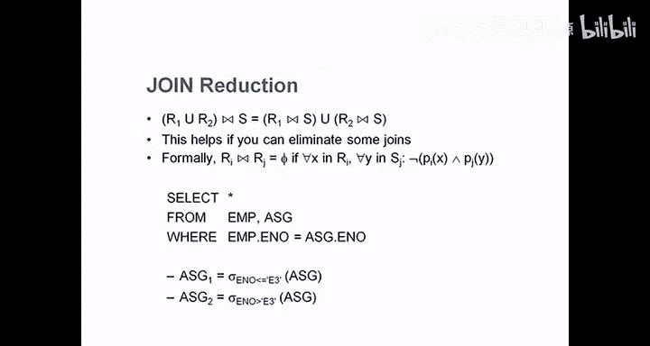

Hes joined with the union of two fragments of the assignment table and the assignment one fragment。

The predicates that define the rows， assignment1 fragment or overlap with the predicates that define the rows in the employee 1 and  employee2 fragments overlap。

 and then predicates that apply the assignment 2 table and the employee 3 table overlap。

 we can rewrite this whole join plan and just join fragments employee 1 and employee and assignment 1。

 employee 2 and assignment 2 and finally employee 3 in the assignment two fragments。

 We join those results and union them together。 Vert fragmentation reduction is the same way。

 If our query is only asking for certain columns and some fragments do not contain that column。

 we can eliminate it from the definition of the query from the query tree itself。 So。

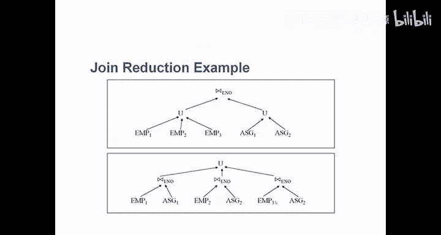

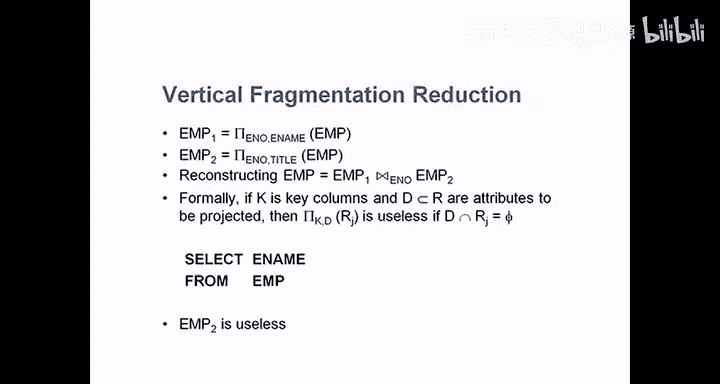

If we're joining at fragments， only want an employee too。

And then we only want to project the employee name。

 so reality we can ignore the join because the employee1 fragment is the only fragment that has the projective E name。

 so therefore our new query tree becomes a projective E name on the employee1 fragment。

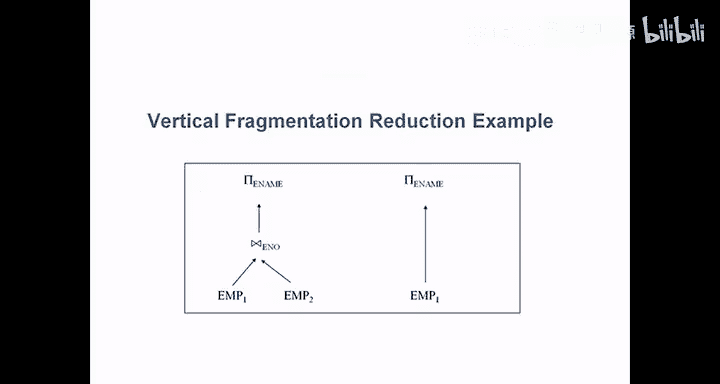