# 约翰霍普金斯大学《大规模数据库系统｜Large-Scale Database Systems》中英字幕 - P23：5_查询操作成本.zh_en - GPT中英字幕课程资源 - BV1N2urzvEjK

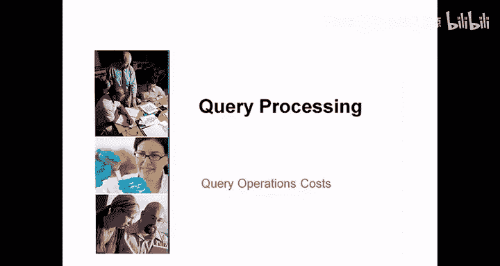

Welcome to Queery Processing。this unit will discuss query operations costs。

 so there are multiple operations that are accessible in a relational database。

 and there are multiple ways to actually implement them。

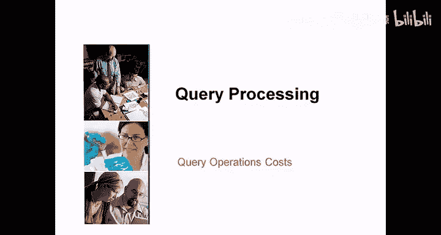

So we're going to look at a number of the options。 The first option is selecting rows from a single table where there's no index on that table。

 So if you look at the diagram on the right that represents a table of N rows and ultimately。

 we have to look through each row to see if we find a match。 tu their end rows in that table。

 the best we can do is look through all n rows and to find the match。So we can look first row。

 Second row， third row。Ultimately， we're going to have to read N rows to find the match。

 If there are multiple matches in this table， So we'll have to read all the rows。

 If there we know there's only going to be one match in the table。

 So we're going to have to read all the rows until we find the match。

 Sometimes it'll be the first row。 Sometimes it'll be the second row。

 Sometimes it'll be the middle row。 Sometimes it'll be the last row。 But on average。

 it'll be really we'll have to read the the row or the table。Halfway through on average。

 So there's a notation in computational complexity theory。

 and that's big O of a big O of tells us the order of magnitude of the cost of an operation。

 given some variable。 in this case， the size of the table is going to be N rows。 So given that。

 and given that we have to do a search through this entire table reading the entire table is an O of n operation。

 big O of n operation， which says on average， we'll have to read about N rows。

We don't know exactly what the cost of a read is yet。 If the cost of a read is 500 units。

 it's 500 times n。 if the cost of a read of something is maybe thousand times n。

 But what it does tell us is that the cost varies linearly with the number of rows in the table。

 So the big O of n， a reading rows from a table is going to be just O of n。 It's a linear。

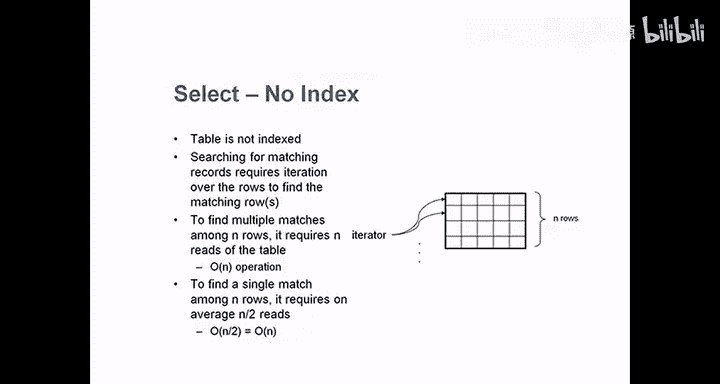

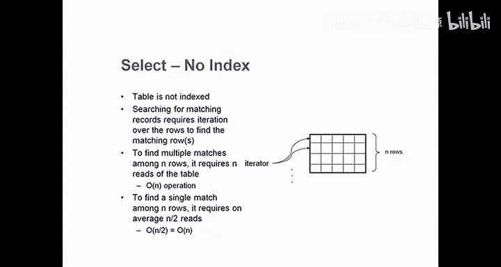

With linear time operation， even though that we said that on average， it'll require n over2 reads。

 But still， we get rid of the constants in in big O notation。

 and we say that order of n over 2 is really the same as order of N。

 It just means that the cost or the time it requires to read N rows varies with n in some way。 Now。

 let's look at selection with an index。

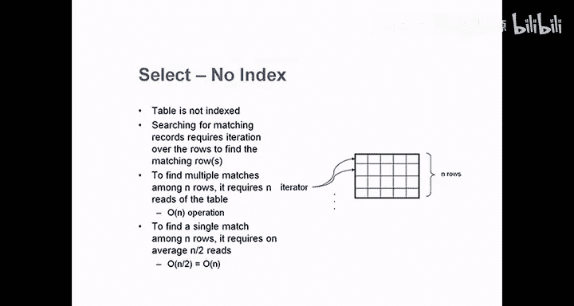

Most relational databases are indexed by a B plush tree。

 A B plus tree as a balanced tree of all the rows in a table， given some key constraints。

 Maybe we're indexing by the identifier， maybe we're indexing by some other value in the table。

 but ultimately what we do is when we enter a row in the table。

 We find that key value that we're indexing by， and we place it inside of a tree。

 Now I'm showing a tree over here。 that is really a binary tree。

 that there are always these two branch each node。 So we start from the top。

 and there's a branch to the left and a branch to the right。 We follow the branch to the left。

 there's another split branch to the left branch to the right。In each case。

 there are two splits at each decision point。 you might imagine that if you're storing or you're indexing by last names。

 So if you insert a row of somebody that a name that starts with A We'll see that that split point at the very top tells you that the A's are restored on the left side。

 and maybe it's a through K on the left side and L through Z on the right side。

 and then you notice that the first branch down。 there's another split point and maybe that's a through G and then an H through K。

 and ultimately you find its location in that tree， and you store at the very leaf point。

 that new row of that new element， that new element contains the value that you're indexing and a pointer to its location location of the original row in the table B plush trees are could representations of indices good implementations of indices。

 because they' guarantee to be balanced。 So， for example。

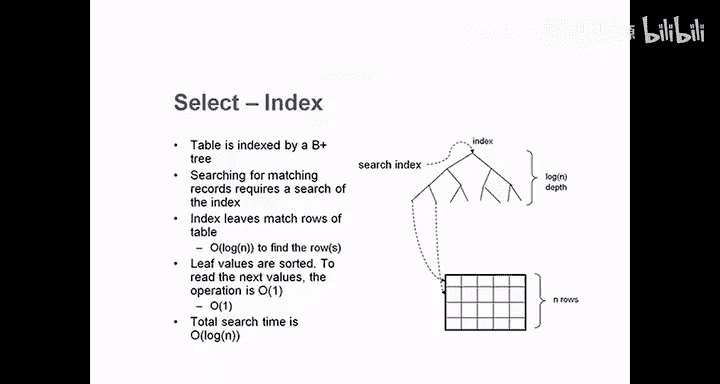

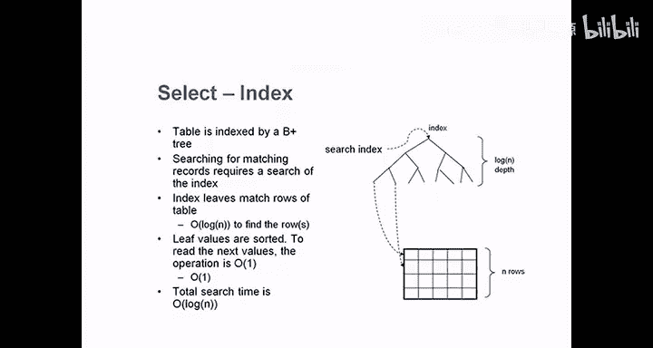

If you add lots of A's to your database， let names that start with A。

 the concern is is that the left branch might become very。

 very deep and the right branch might not be very deep。

 so the B plus tree handles this by noticing that if things get too deep on one branch it'll split that branch and automatically causes a split through the entire index and restructure the index to ensure ultimately in restructure the index to ensure that that tree is balanced Now the advantage of a balanced tree is that at any point that the lowest point at the bottom of the tree is always a log n depth。

 so if I have n elements， the bottom of the tree is always going to be log n deep。

 which means that if I'm looking for a row， all I really have to do are some value some last name。

 all I have to do is read through log n reads as opposed to nreads going straight to the database row。

 I would have to read through all the rows in order to find that name。

A Bre index I would only have to do log n reads， which is a much faster operation that an now enables us to find very quickly the row we're looking for。

 Now I've represented a B plus tree as being binary branches in reality B plus trees to not have to be binary。

 there can be many， many branches at each node， but it's a very quick operation。

 you can represent thousands and tens of thousands or even more rows What a very。

 very short Bree index。 So if I want to search for a row my search through the index will be an o log sorry o of log n operation I'm looking for and then name Harry I'll look through that index to find Harry。

 itll be a log n read and then the results will be。

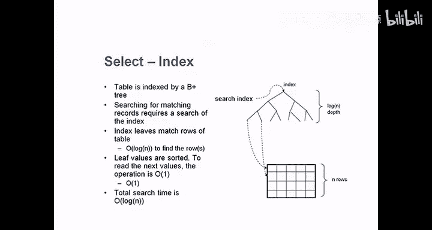

It'll be a login read， and it'll quickly have a pointer to the row in the table。

 So it takes an order of login reads to go and find the row I'm looking for。

 This is a much better algorithm for finding rows at a database than the previous table when I had to select with no index the select with no indexes in order of operation of O of N。

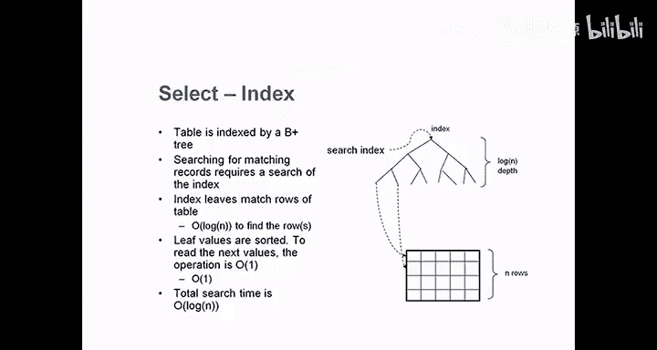

Here we have O of login， which is inherently much faster。Now。

Sometimes we'll have multiple haries that we're looking for。 So each row。

 each row that's placed into this table。We'll have a corresponding index in in the B plush tree index。

 And ultimately， we can ever row one with Harry in row 83 with Harry and row 78 with Harry。

 The nice thing about this is that in the index itself， not only is it a balanced bee tree。

 but the leaves themselves are sorted， so that when we find the first Harry。

The leaves at the bottom are also connected to each other through through a forward pointer。

 and sometimes a backward pointer， such that we can find the first Harry and the second Harry and the third Harry very quickly。

 Once we find that first Harry， we can start iterating through all the leaves that are adjacent neighbors to find all the Harry。

 So each subsequent reed would be in order of one operation very quick。

So the total search time for an index index table is all of login。

Haash index indexes are actually very quick because you， you take the search criteria。

 the key that you're looking for， you apply a hash index to it and you come up with a quick number。

 a number that represents what you're looking for， so you send the word。

A name Harry through an indexer， it'll come up with some binary number that is that can be searchable。

 So if I'm looking for Harry， first of all， if I enter Harry and my table at the lower right。

 provide a hash value for Harry， I'll send it through my hash routine。

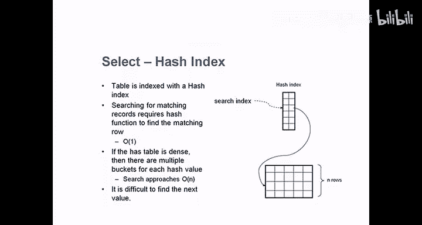

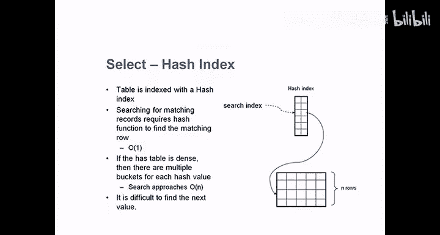

And I'll include an entry in my hash index that says this number， whatever the hash number is。

 is Harry。And that points to some row in the table at the bottom Its very fast。

 Now when I look up Harry。 All I have to do is apply a hash function to it。

 look for the entry in the hash index and then follow the pointer down to the table。 very fast。

 It's an order of one operation。So why don't we use hash indexes all the time。 Well。

 they are very common。 But the problem is， is that when the hashing values are really just get to be the size of。

The number of rows get to be very large。 The hash index actually gets to be a more complicated structure。

 There are some different algorithms for reading a hash hash tree， or I mean， hash index。

 or even entering rows into a hash index one algorithm， for example， says whenever I index Harry。

 or let's say two different things， we'll hash to the same number。 So Harry will and Fred will。

 for some reason， hash to the same number。 because our hash index is very small in it' limited size。

 So the result will actually， instead of pointing directly to a row in the bottom table。

 actually point to a chain bucket of rows off of that a hash index。

 and I'll look at each one of those elements to see， does this match Harry or not。 might match Harry。

 it might at Fred， But along the way， I'll find Harry。

 and then I'll find the corresponding row in the table。Now。

 when the hash index is small compared to the number of rows in the table。

 there's going to be a lot of repetition。 a lot of different values will hash to the same hash index value。

 which will cause long bucket chains that each representing different rows with the same hash value ultimately the order of operations when that hash table gets very large when large number of and rows。

 our hash to a small index， the search can approximate O of N。

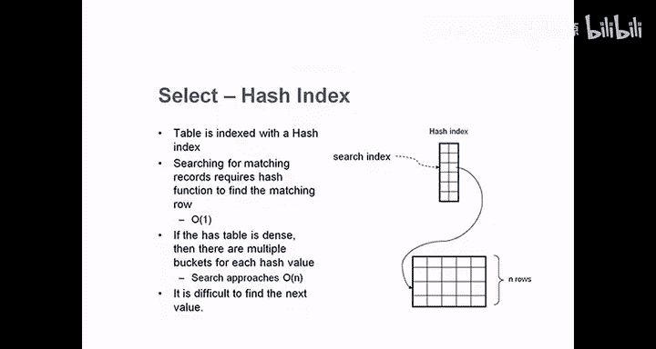

For the purposes of this class， I'm going to describe sparse Hash indexdices。

 whenever we talk about hash indexing。 Have we' going to assume there's plenty of room in the hash index。

 the order of operations or the order of magnitude of a read from hash indexes order of magnitude 1。

 Theres project with duplicate elimination。 So a project says get me certain number of columns from some result。

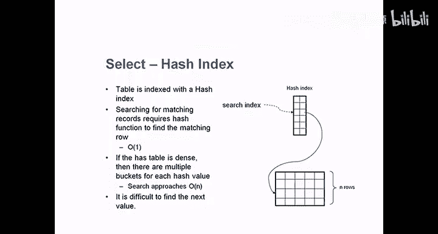

But I want to now that I've got these results。 Those columns could have duplicates in them。

 So the cost of retrieving and sorting these records is as follows。

 the search for these records might be O of O of and。Sorting， however。

 is inherently an n log n process，5 n elements， the best sorting algorithm。

 the best I can do and is provably shown the best sorting algorithm is n times log n。

So search is O of n， sorting is O of n log n。 So the total time is order of magnitude n log n plus n。

 but N log n is just a Mar as a larger function than n。 It grows much quicker。

 So by the rules of expressing big O of notation， we pick the largest expression。

 And we say that's the order of magnitude of this operation。

 So projecting with duplicate elimination is O of n log n。If I want to group records together。

 I have to sort them essentially， and since sorting is out of log n and log n。

 grouping is also going to be order of and log n。If the initial table is already sorted。

 so the sorting doesn't have to be done， search will be just O then because the sorting has already been done。

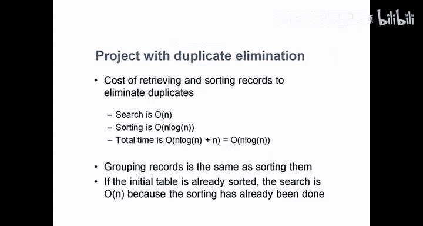

Cartesian products are really computationally complex。

 it's an O of n squared operation because we're assuming we have no indices。

 we have a table A and we have a table B， and just for argument's sake we say there are N rows and table A。

 and there are also N rows and table B。

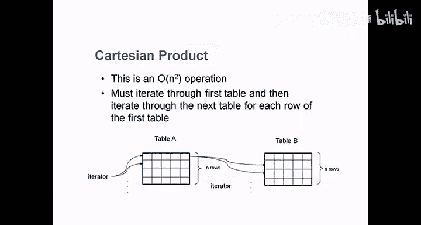

The algorithm for performing the join is iterating through the entire set of rows of table A。

But as we iterate three row， we pick the first row。

 and then we iterate through all the rows in table B to find potential matches。

 and then we pick the second row of table A， and we again iterate through all the rows of table B。

 and we pick the third row， et cetera， et cetera of table A。 And then for each row。

 we pick in table A， we have to iterate through table B。

 So it's really in order of operation of n times N or n squared very expensive operation。

 We stay away from Cartesian products whenever possible。 Joining with an index is actually very。

 very fast。 you have two tables， you have table A， and you have table B。 T A has N rows。

 Table B has N rows。 Table B is indexed so that when we iterate through each row of table A。😊。

We look through the corresponding index in table B that's only a log n depth search。

And then we find immediately the corresponding row of table B。

 So we have to iterate through each row of table A。 but for each row of table A。

 we have a log n search for that row to find the corresponding joined row in table B。

 So the ultimate cost of the search is n times log n。

 which is much faster than the cartesian product， which is n squared。 If we join on sorted tables。

 This is actually the best join possible because we're assuming that both tables are sorted。

 So we maintain two current pointers to each table， current point table A current point out table B。

 and we manipulate the pointers。 we start from the top and we look for the key。

 maybe the key value is one and table A and we correspond find the sorted value。

 which is at the top of table B。 and we find the corresponding values that in table B that are equal to1。

 and then we'll move down a row and table A and maybe it'll be value of two。

 and we'll find correspondingly， all the rows in table B that are equal to2。

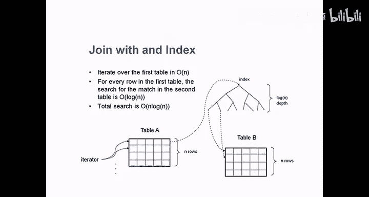

It will work through the tables 1 by one。 We never have to iterate over the table。

 never have to repeat any searches， because they're sorted。

 Those current pointers are constantly moving down At the end of the day。

 the current pointer to table A is only moving down once for each row of table A。

 table B is also moving down once。 We never have to move the current pointer of either those tables back up a row。

 So this is really an order of magnitude of two times n。 We're reading two end tables。

 But remember from a big for biggo。Notations， we get rid of the constants and multiplier。

 so it's really an order of an operation。

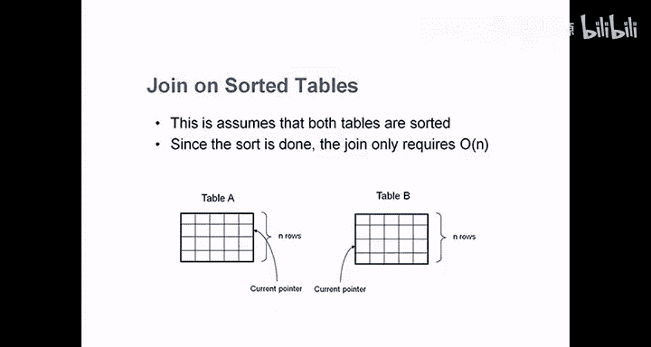