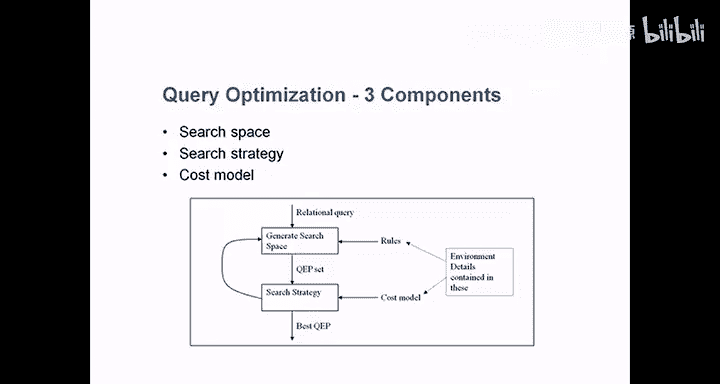
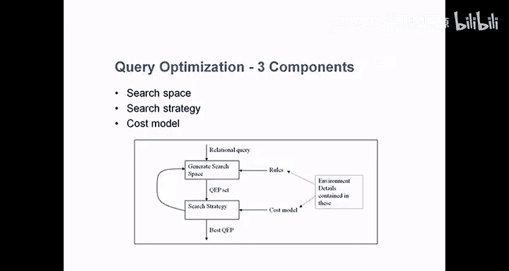
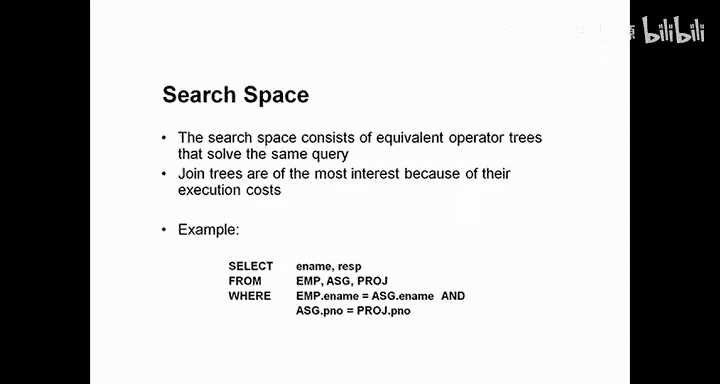
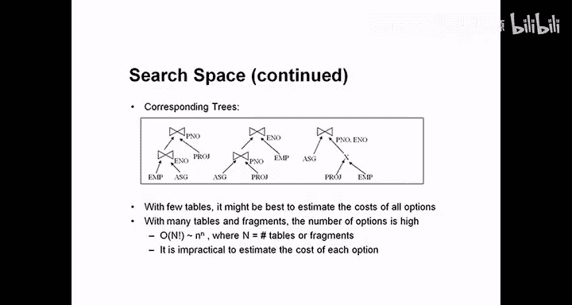
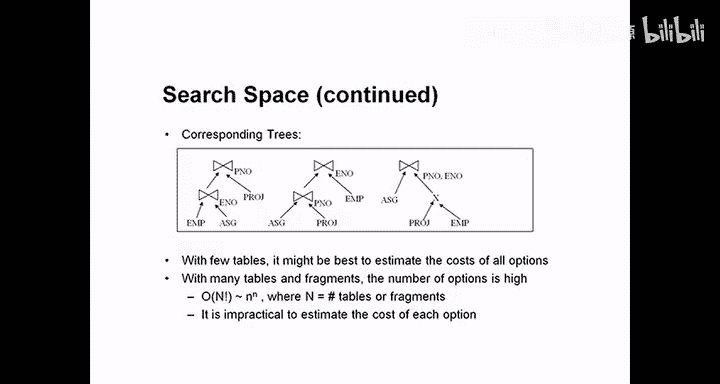
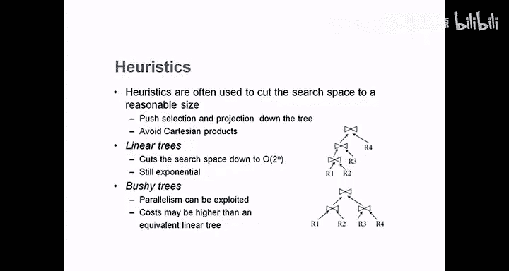

# 约翰霍普金斯大学《大规模数据库系统｜Large-Scale Database Systems》中英字幕 - P24：6_查询优化步骤.zh_en - GPT中英字幕课程资源 - BV1N2urzvEjK

Welcome to Pury Optimization。And this unit will cover query optimization steps。

In query optimization there are three processes that we apply to a query to find the best query execution plan。

 QEP stands for a query execution plan。The first process is generating the search space so given a relational query。

 we find all the different potential query plans that we can apply to solving that query we saw in the previous module how we can create relational trees to come up with different types of plans they're all semantically equivalent but to a query execution a query execution process each one of those becomes a different plan with different costs。

 so in generating the search space we generate all the potential plans。

 or in our case it really becomes very difficult to generate all the plans。

 so we start generating a few plans。We apply rules to the relational query to generate those plans。

 and out of that first step comes a query execution plan set。

We apply a cost model to that queer execution plan set。

And applying the cost model to each of those query execution plans will give us results that I'll find certain query execution plans will be costly。

 and others will be of reasonable cost。 Those that are costly are pruned。

And those that are reasonable cost are now sent back to the generate search space process。

 which takes those plans that promise to be good performing plans， and we apply。

 we flush it out even further， flush out the plans even further by applying more rules and we generate a new query execution plan set we apply our cost model to that query set in the search strategy process and again。

 we prune those that aren't going to be that don't promise to be a good query execution plan and we keep those that look like they will be good query execution plans at the end of the cycle will come out with the best query execution plan based on our cost model estimates of query execution plans。

So we're going to look at generating our search space， so remember in the last module we spoke about。

Converting a relational query to a relational algebra expression and then creating then generating relational。

A relational tree， an operator tree from that relational algebra expression， and in fact。

 there are many different operator trees we can generate， but as they all solve the same query。

In this module， we're going to concentrate mostly on the join aspects of those operator trees because they are most interesting they are the most expensive。

 joins in a central database are very expensive and attributed database they even more expensive because there are communication costs among different database processors。

We have to send parts of tables to other databases from one database to another database。

Here's our example query if again we're going to select employee name and responsibility from three different tables。

 we're joining the employee to the assignment table and then we'll join the assignment table to the project table。

So let you got three corresponding join plans。We have them laid out in front of us。

 We can join the employee and assignment table on the employee number。

And then we can set its results to be joined with the project table on the project number。

 That's the first tree。 The second tree represents first joining the assignment table to the project number on the project number and then joining its results to the employee table based on the employee number。

 and then the third plan is providing cross product or calculating across product of the project on the employee table and then joining its results with the assignment table both on the project number and the employee number。

 So with a few tables might be best to lay out all the plans and estimate the costs of all the options。

 But we see that with many tables， especially many fragments。

 which each fragment is treated like a table， a number of options becomes very high。

 So the number of op given end tables or end fragments。

The number of options become on the order of O to the N factorial。

 which is approximately order of n to the N。

It's impractical to estimate the cost of each option。 We need to apply heuristics。

So when we do apply heuristics， they cut the search space to a reasonable size we saw in the last module some heuristics are pushing the selection and projection operators down the tree。

And we also avoid cartesian products。But still。We still need to evaluate joins。

 And in evaluating joins， we have two different heuristics。

 There is evaluating joins via linear trees and evaluating joins via bushy trees。

 If you look to the right。The diagram shows at the top a linear tree where each join has the product of each join is joined to one single table。

 and you end up with a linear tree starting with a join of R1 and R2。

 and you pick this product to join one more table in Take his product join another table in。

 It's still an exponential process， but we've cut the search base down to O of two to the end because they' are only two to the n possible linear trees。

 Bushy trees are still order of n to the end or in factorial。

 If you look at the diagram on the right hand， lower right hand side。

 You'll notice that we can have joins at any level。 We're not necessarily joining a new。

Table at every level。 Sometimes we can join two tables at the same level and take their products enjoying at the higher level。

 In this case， parallelism can be exploited， but the cost can still be higher than an equivalent lunar tree。

So we're going to explore the heuristics for linear trees and bushy trees and linear trees we're going to examine the ingress system。

 which employed in linear trees to calculate joins。And for bushy trees。

 we're going to be exploring this system， our system。Which。

 which employed heuristics to deal with bushy trees。We'll see them in subsequent units。

