# 约翰霍普金斯大学《大规模数据库系统｜Large-Scale Database Systems》中英字幕 - P25：7_查询优化统计信息.zh_en - GPT中英字幕课程资源 - BV1N2urzvEjK

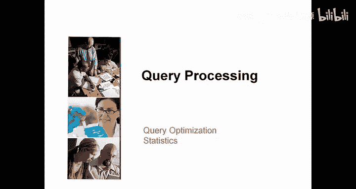

Welcome to query processing。In this unit， we'll discuss query optimization statistics。

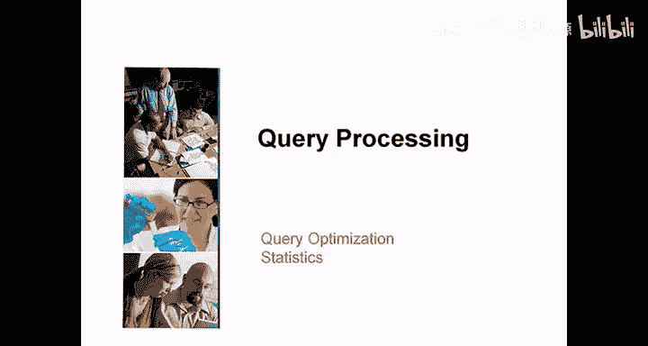

Sad we discussed before， statistics are very important to query processing and calculating the best estimated query execution plan。

We can't make these judgments without statistics about the database。

 and we'll see how we really do that in coming up shortly。But in this video。

 I want to discuss what statistics we have available to us。

 So let's assume we've got attributes a1 through A N for relation R fragmented into multiple fragments。

So the length of a。Is the lengthnken bytes of a particular column or an attribute in each fragment R sub J。

All that tells you is looking at each column how many bytes are in that column。

 What is the length of that column for each row， the cardinality of the projected values of the a sub I or some fragment is the actual distinct values of a sub I in that fragment。

 So， for example， imagine we have a table or a fragment where we represent states of the union。

 and we might have lots of rows in that table or in that fragment。

 but there are only going to be 50 distinct values。

So knowing the number of distinct values that will retrieve is actually very important in helping us estimate the size of products of joins or the size of products of transfers from one database to another。

 We'll see how this applies shortly。But that is another important statistic。

 understanding how many distinct values you have for a certain column or certain attribute。

It's also useful to know the minimum values and the maximum values for these values for it for certain columns。

 So you might have many rows and a table， and you might have an age column。

And you know that in your database， the minimum age is 20， for example。

 and the maximum age will be 60。 That will be very crucial in us determining or predicting how many rows will be retrieving from a table。

 given some constraint， like is age less if a query as for age greater greater than 50。

 And we know a range ranges from 20 to 60。 We know we'll be pulling about one quarter of the rows out of that table。

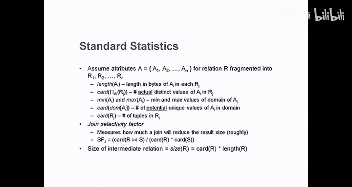

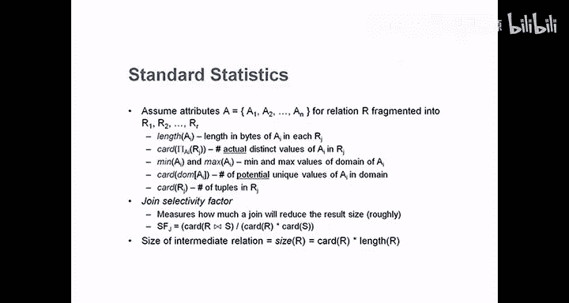

So knowing the minimum value and the maximum value is very important。

Would like to know the cardinality of the domain v subi。

 What are the potential unique values of a subi in the domain。

 not necessarily what's in the database， but what could be in the database。 It's also useful。

 And finally， the cardinality of some fragment， just the number of tuples in that fragment。

Is the table or the fragment have 20 rows， Does it have 2000 rows。 It's all very important。

 because we'll see how。These statistics help you in evaluating different join strategies to ultimately point you to the best query execution plan。

There's also a matter of join selectivity factor。 You want to know how much a join will reduce the result size。

 You can't always predict this in general， but there are good indications of how you understand how youll be able to identify the selectivity factor。

 So in general， the selectivity factor of a join is just the cardinality of our join S。

Which is really how many rows you produce from a join。

Divided by the number of potential rows from a cross product， which is the cardality of R。

 the number of rows in R times the cardinality of S， which is the number of rows in S。

 that gives you the selectivity factor。You can calculate the size of it intermediate relations。

 The size of that relation is really how many rows you have。

 the cardinality of that relation tons of length comes how many bys in one row。So besides。

 think of it as an area， you'll have number of rows times suddenly length to vitrotro。

As the number of bites you'll have in an intermediate relation。

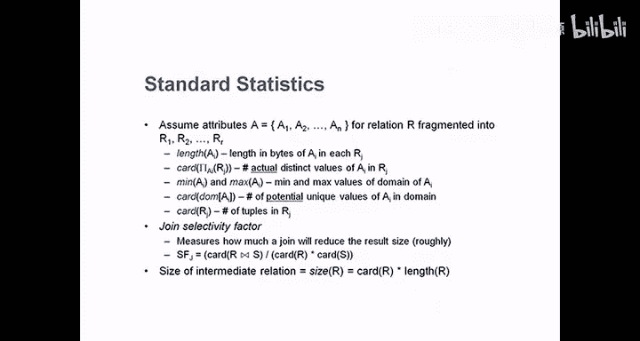

There are estimations of cardinalities of intermediate results。

 so we're going to make some simplification assumptions。 These are not always true。

 but they usually turn out to be very good rules of thumb in helping us evaluate or estimate what are the best costs for a join。

 We're going to make two rules of the。 we're going to lay two assumptions。

 One is that the attribute values are uniformly distributed。

What is uniformly distributed mean， It means that if you've got a range of ages from 20 to 60。

 We'll have as many 20 to 30 year olds as we will have from 30 to 40 year olds。

40 to 50 year olds and 50 to 60 year olds， or even 25 to 35 year olds will assume that ages are you evenly distributed across your table。

It's never going to be true。 no databases is statistically correct。But， you know。

 it's a good rule of thumb that we could use for estimating intermediate sizes after applying sizes intermediate tables after applying constraints to a table。

 So if we're selecting from a table and we're saying。

 give me all values or the ages greater than a certain value。

 we can estimate the number of rows that will that will be returned。

The second simplification assumption is that the attributes are independent。

Will say that age has nothing to do with zip code。Not always true。

Could be that certain zip codes tend to have younger people or certain zip codes tend to have older people。

 but in general， we'll assume that these are independent。

 and these will simplify our calculations for estimating the size of results。So in general。

 if we looked at our selection。Of selection formulas， the cardinality have of the number of rows。

That we're going to result in after applying a selection based on some formula to some relation R is really the selectivity factor of that selection times the cardinality of R。

 If that selectivity factor is going to be returning 65% of the rows。

 So we multiply 65% times the actual number of rows。So to be more concrete， if we look at。

The next entry in this list will say， given a certain value， if we have a constraint。

 a equals some value， a equals 35 as an age， for example。

 And we know the number of possible values for age can range from 1 to 1 to 60 or 20 to 60。

 and we know we're looking for one particular age， So the selectivity factor is one over the number of possible values。

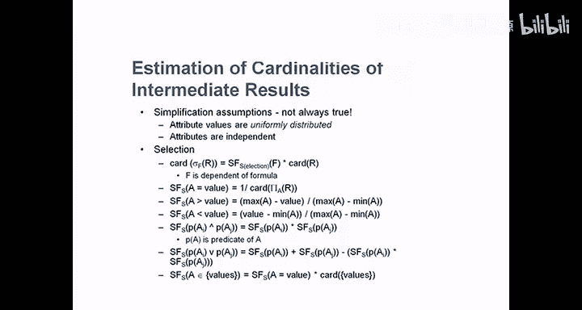

Similarly， the selectivity factor of a being greater than some value is the maximum value minus the value that we've asked for。

Divide it by the entire range and the maximum minus the minimum。

 the selectivity factor of a being less than some value is the value minus the minimum value over the entire range。

 So if we're looking for all people younger than 30 in this 20 to 60 range。So 30 minus 20 is 10。

And 60-20 is 40。 So 10 over 10 over 40 is one4th or 25 per cent。 If we have two predicates。

 and we're ending those predicates together， the selectivity of ending those predicates together is just the selectivity of each predicate。

 And that's based on the fact that we're assuming the attributes are independent。

 Not always a good assumption， but it's very simplifying when we're trying to predict the number of rows that will result from applying two predicates。

Oring two prediccateates a little bit more complicated because we'll be taking the selectivity factor of the first constraint。

 adding it to the second selectivity factor of the second constraint。

But there will be some overlap between both of those constraints。

 So it'll have to subtract the overlap， because in that overlap， we've counted it twice。

 both in the first term and the second term， we have to subtract that overlap， which is really the。

The selectivity factor of both predicates multiply by each other。 And then finally。

 if we got a set of values， we just count up the number of values。

 and we multiply it by the selectivity factor for a single。

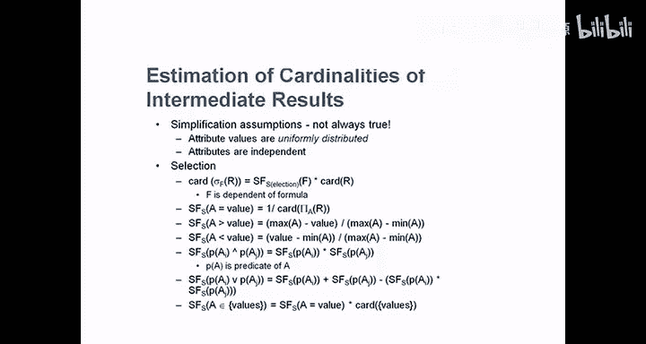

S a single value。 If we want to estimate the cardinality of a projection。

 this could be done with or without duplicate of elimination。

 So if we're just projecting some column and we don't have any duplicates。

 the size of the project the number of rows of the projection is going to be equal to the number of rows of the original of the original table that we're projecting from。

 But if we're dealing with duplicate of elimination。 we don't necessarily know the size。

 And generally， you can't know the size。 it's hard to know how many duplicates will be eliminated for a primary key value。

 we'll note that the primary keys are all independent。

 So it's really the cardinality of of that projected column。

 it's really the cardinality of the table itself。For a Cartesian product， which we don't do often。

 we hope to avoid。 But the Cartesian product， the cardinality of that is really just the cardinality of the first row times the cardinality of the second row。

 Carinality estimates of joins， not generally known。

 Certainly the upper bound of the cardinality of join of of an estimated joins where you we're not talking about necessarily a natural join right now。

 but any join， upper bound could be R cross as as an actual Cartesian product。

 It's incredibly high estimate。 It has to be if it were dealing with an equijo。

 The value is each column would have to be the same value。 not likely to happen。 So the very。

 very upper bound is cardinality of R cross as that's typically not the value。 and an equijo。

 It's really， if you're dealing with you joining。

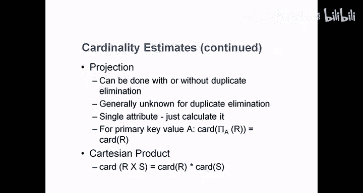

R with S really equals the cardinality of S。If is F is the large table。

 if it's a one to mini relationship between R and S。

 or what will'll be able to generate the number of rows that will really comes out to number of rows of R。

 each row of R corresponds to multiple rows in S。 so will for each row in R。

 it will be joined with each row and S。 and ultimately this size will be carinality of s。

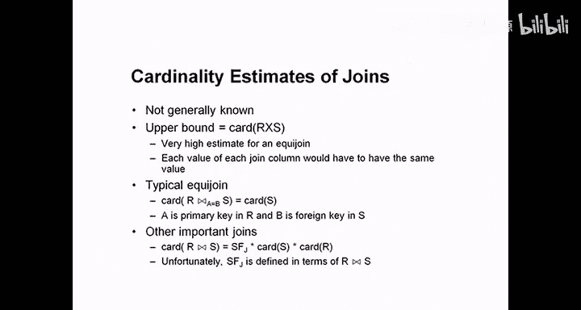

Other important joins are just a general， not equijo between R as is really the selectivity factor of that join times the cardinality of S times the cardinality of R。

 It really what percentage of rows are we going to be getting from that join。

F and applied that percentage to the cross product， which is cardd as typed Car R。But unfortunately。

 this selectivity factor is defined in terms of our join S， as we saw a few slides ago。

 looking back three slides。 look under join selectivity factor。

 we notice that this selectivity factor is defined in terms of our join S。

 So now moving up moving up these slides。 We're we're basically just moving terms around an equation。

 So it's difficult to predict。 semi joinins are an interesting phenomena。

 we'll talk about them more as the semester progresses。

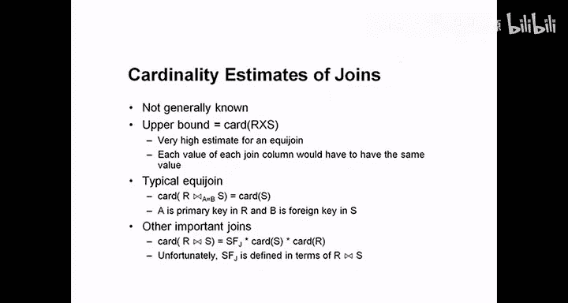

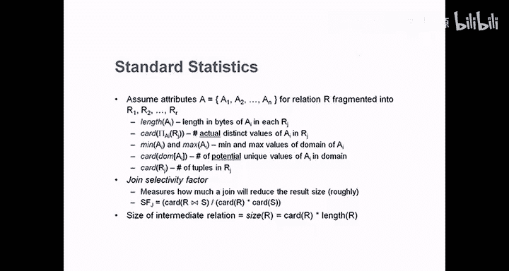

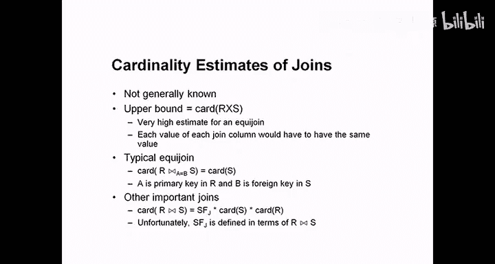

But before I get to the points I wanted to bring out。

 here's the notion of what the semi join is about。 If you look at the diagram on the bottom。

 diagram has the table S。which might be the one side of a one to many relationship between S and R。

 So as is the one side R is the many side。And of which normally to formulate a join。

 we either move the entire table of S to R and perform the join in there or move the entire table of R to site where S is located and perform the join in there。

 But it's very expensive moving those rows around。 So what we do is we select just the keys of S。

And just the distinct keys of us。And create a very small one column table and send that small one column table to the site where our is located。

Then we take that small one column table。 We'll call it S prime and join it with the table at R and only。

We might just be pulling out only some of the rows of R。

 We won't necessarily be pulling out all of the rows of R because we've just got to join whatever and S prime to the rows to R。

 and we'll pull out a certain number of rows。

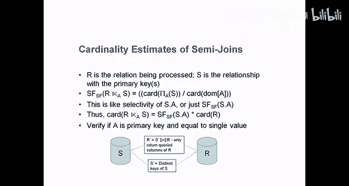

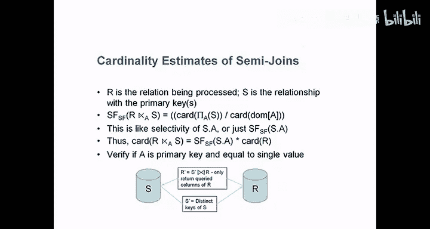

And then we're only going to project the columns of that query so that the ultimate result there is just S prime。

 just the number of rows that are created by that product by that join between S prime and R and just the columns that we need。

 we're going to send R prime and that will become R prime， we're going to send it back to S。

 and now join it again with table S and just pull out the columns that we need from table S。

So given the right circumstances， the semi join minimizes the amount of communication between SNR。

So now estimating the size of the semijo， we're going to estimate the size of the first process。

 basically we're pulling in this case。If you look at the sum， I join。Operator。

 it's almost like a bow tide， but it's missing a side。 I view that as as sucking the rows out of S。

 creating an S prime moving it to R。 So we're going to calculate how many of those rows are going to actually be moved to R。

 It's really the cardinality of the possible values of S Checking just just column A。

 over the entire domain of a。 So how many are we actually retrieving versus how many are possible。

 and that becomes a selectivity factor。 So only retrieving the eastern states over the United States。

 So the selectivity factor will be the number of eastern eastern states divided by the number of total states。

 And that's ultimately a description of selectivity factor of a semi join。

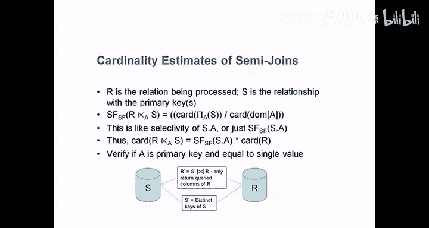

Other cardinality estimates become the union， which is the upper value is card R and Cars。

 were adding rows together from two different tables that have the same columns。

Some columns might be actually identical， so we don't need to actually join all the row。

 we don't need to union all the rows， but in the worst case they are all distinct rows。

 and the upper size will be the carar。Plus， the cardez。In the best case。

 where card one of these tables is actually subsumed by the other table。

 a lower bound will be the maximum of both cardinalities。

For taking a difference we taking all the rows， difference of R minus S is find all the rows in R that exist in S and remove them。

 So card R minus S。Could peve that we're not removing any rows。

 So the upper bound is card R and lower bound is 0。 We might be removing all the rows。

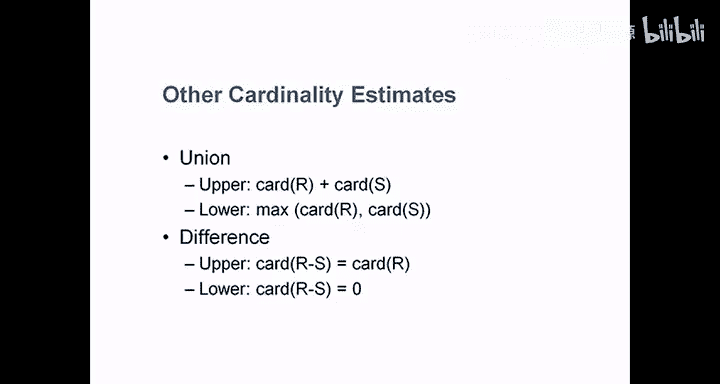