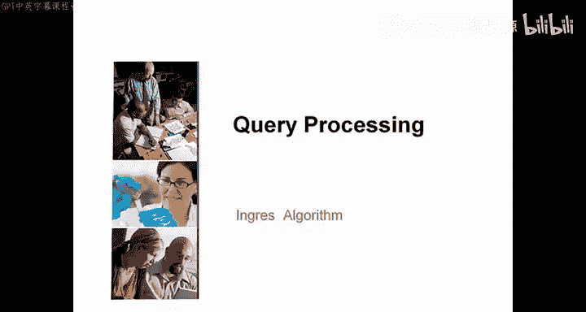
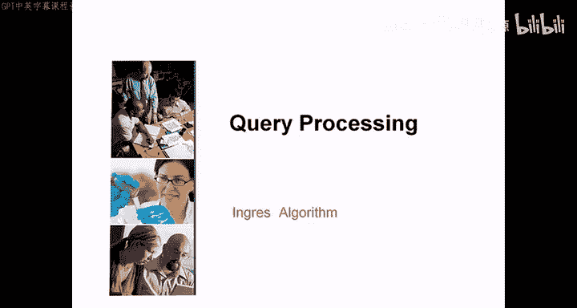
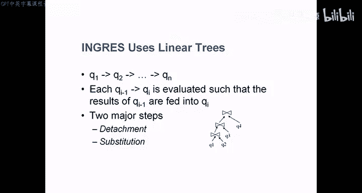
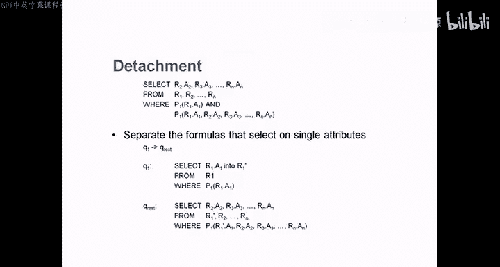
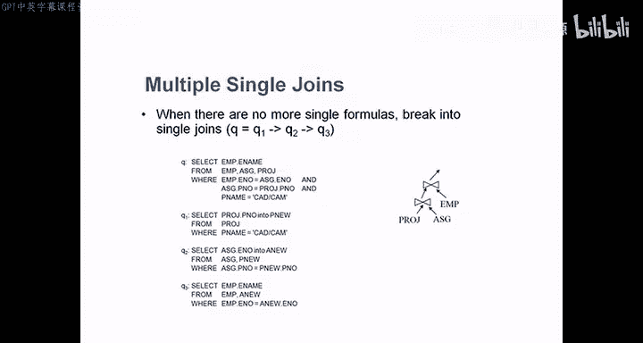
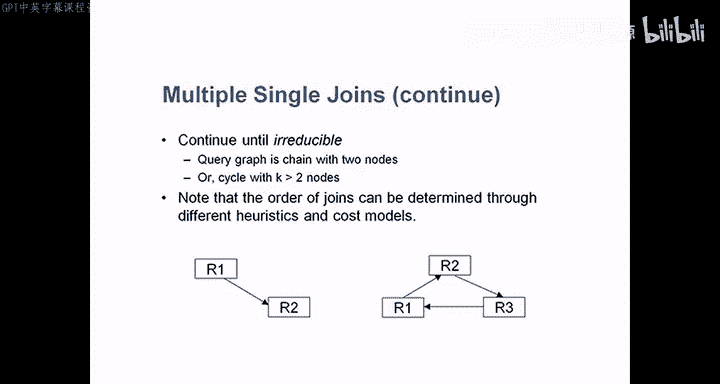
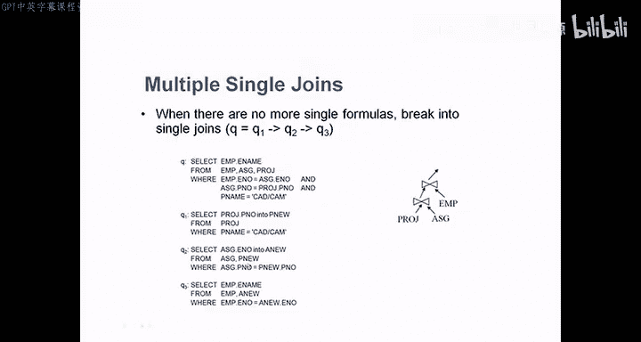
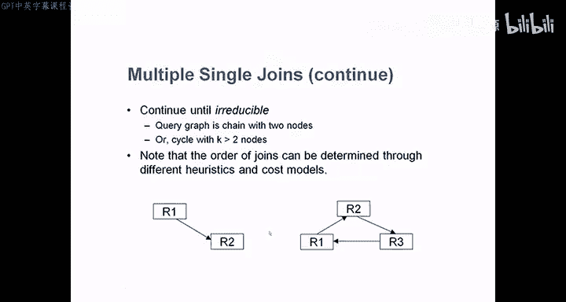
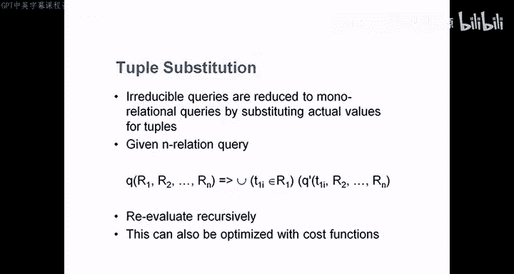
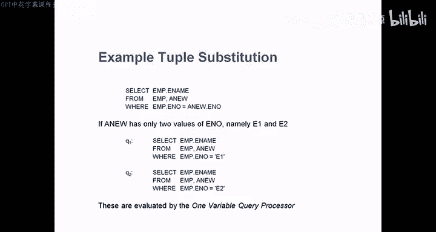

# 约翰霍普金斯大学《大规模数据库系统｜Large-Scale Database Systems》中英字幕 - P26：8_INGRES算法.zh_en - GPT中英字幕课程资源 - BV1N2urzvEjK

Welcome to query processing， and this unit will discuss the English algorithm。

Hinggresss uses linear trees。If you notice the diagram on the right hand side。

 you notice that we're joining two tables together， produced by some query 1 and query 2。

 and we'll see what that means shortly and we'll take its product and join it to a new table produced by query 3 and take its product and join it to a new table query 。

 so if you pull apart a query， you're basically sending the results of query 1 to query 2。

Its results to query 3 all the way up to the last query。

Each query step is evaluated such that the results of the previous query are fed to the new query。

 so two major steps involved in the Innggress algorithm。

 one is detachment and the other's substitution。

So here's how we evaluate detachment if we look at a table and let's say our query is going to be select a whole bunch relations and their attributes from a whole relation list and we have predicates and predicates so predicate applies to table R1 and the rest of the prediiccateates applied to the rest of the tables。

 so the first part is we're going to detach one of the queries from the rest of the queries。

 So if you notice that we're going to detach Q1， which is basically select some attribute and create a temporary table from R1 and create the temporary table by applying the predicate 1 to some attribute in R1。

And that creates a join result from query 1 Now we're going to take that result and now feed it into the rest of the queries。

 so the rest of the queries are the joins of all the other relations with the associated predicates。

 making that more concrete What we're going to do is take an initial query our favorite query we're going to be selecting the employee name from three different tables。

 and there's going to be a join among those tables from employee to assignments and assignment to project and we're going to create a constraint on project name。

So the English algorithm will detach the first query based on project。

 it'll say it'll apply the contraint。Select select the project number into this new table P new from the project table。

 where the contrain is that a project name is equal to CADCm。That's our first query。

 Now we're taking the result and feeding it into Pnu and we're taking Pnu and feeding it into the second query and the second query。

Selects the employee number from the assignment table。

And it does a join between penue and assignment。And then the join is on the project number。

 and that creates a temporary result anew， and that anew now gets fed into the third query。

 which is a join between anew and employee， and willll eventually find all the employee names that are produced by that query。

So a model of this query is viewed on the right hand side， where're taking the project table。

 we're producing a temporary table， Pu， we're feeding that into a join between that and the assignment table。

 we're creating a new as a result of that and feeding that into a join with the employee table。

So we continue detachment until the query is irreducible。 and then we apply substitution。

 So what does it mean that the query sub is irreducible means that we now have a join between two or more。

Two or more tables。 So moving back a slide over here。 first the first query represents a detachment。

 we can now create a query from a single table project。

 We feed it into an intermediate result pay new and every subsequent query beyond that is now a query of two tables that need to be joined So we'll see how we deal with those what those tables need to be joined through substitution。

 So under certain circumstances。 R1 will be joined to R2。

 That's a case where we where a  query is irreducible and we have to apply substitution to。

 There are other more complex queries where we have a very complex join pattern going on between R1 and R2 and R3 and back to R1 those are not usual but that's still a situation that we have to consider when we're reducing queries through substitution。

 So how to double substitution work when we have irreducible queries and now we're joining two or more tables together。

 So we notice that we。

of n rows so each row is can be abstracttracted from that table。

 so give it a query and and relations， we can actually take the first row。

 take first relation and for each tuple in it， it's tuple。

 substitute it into the rest of the query so in this case we're taking T1i。From each row。

 and we're putting it were， we're modifying the query a little bit。 And instead of。

Quering on ajoin between R 1 and the rest of the relations。

 we're joining between a specific tuple in R 1 and the rest of the relations。

 and we'll reevalu this recursively。 So how does this work very specifically。

 So we'll give an example where we're joining the employee table to the a new table。

There's a join going on over here。 What we'll do is we'll look at the E the M table and we'll take the E numbers from the M table。

 And in our very， very simplistic case， we really only have two tuples in there。

 one employee is equal to E1 and the other employee is equal to E2。

And so we take a look examine the employee table， pull out all the tuples and create individual queries for each tuple。

 and instead of now joining employee E number to a new。E number Anew has only those values。

 E1 and A2， we're going to take the values of E1 from the Anu table and now plug it into the query so we have a query where we're selecting the employee names where the employee number is a1。

 and then we take the next tuple from Anew and now plug it into that query。Again。

 and select the employee where the employee names where the employee number is E2。

 and we take each individual tuple and plug it into the query to evaluate the result。

So this is tuple substitution， and these are evaluated by a one variable query processor。So。

 Ingrigress basically does。A two step process， it does detachment so we can evaluate queries on a single table and then then we feed its results into other queries and now those other query segments will have joins between two tables usually one table and a result of a previous join and for there for that case we will apply tuple substitution where we could take an individual row out and feed its value in thequeries so that no longer just joining between two row two different tables were actually substituting one tuple in so it becomes a very simple query onto the second table。

